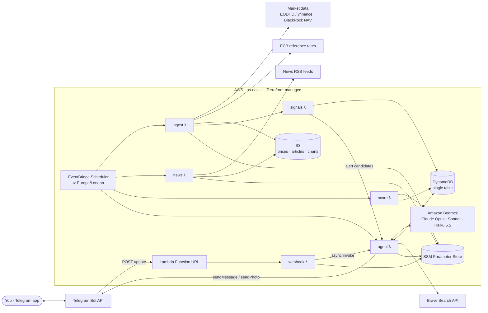
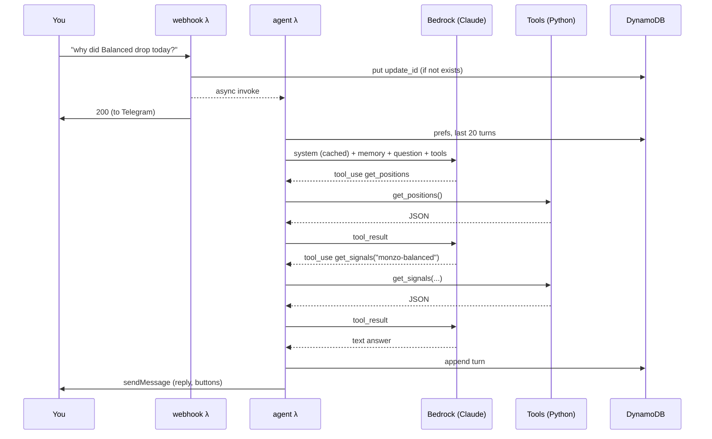

# MyPaisa Agent — Architecture

A private Telegram bot that watches one household's investments, explains what
moved and why, and makes small, scored calls from prices, news and scheduled
events. It runs on AWS in account `545595341442`, `us-east-1`, and uses Claude
through Amazon Bedrock.

Animated version of this document:
<https://claude.ai/artifact/DHWD7WFjsy7r3VmMvu9eDx>

Status: design only. Nothing here is built yet. `PLAN.md` says in what order it
will be.

---

## 1. What it does

| Job | When | Who does the work |
| --- | --- | --- |
| Fetch prices, fund NAVs, FX, calendars | 07:00 and 21:00 UK, weekdays | Python |
| Compute signals: trend, volatility, drawdown, drift, FX split, ranges | After each fetch | Python (pandas) |
| Morning brief | 07:15 UK, weekdays, silent push | Python facts, Claude words |
| Evening wrap | 21:15 UK, only when something moved | Python facts, Claude words |
| Alerts | After each close, tiered, with cooldowns | Python rules, Claude filter and words |
| Answer questions | When you message the bot | Claude, calling Python tools |
| Score news sentiment | Nightly, 23:30 UK | Claude Haiku |
| Make a call (stance, horizon, confidence) | Before the UK open | Python rules + Claude |
| Grade forecasts and calls | When each horizon ends | Python |
| Saturday review with scorecard | 08:00 UK, Saturday | Claude Opus |

Two rules hold everywhere:

1. **Claude never produces a number.** Every figure in a message comes from a
   tool result. Claude chooses what to say and how to say it.
2. **The bot cannot trade.** It holds no broker credentials. The only actions it
   suggests are ones that are safe inside an ISA: hold, pause or move a
   contribution, rebalance.

---

## 2. System context



---

## 3. Components

All functions ship as **one container image** with several handlers, so the
pandas/numpy/matplotlib stack is built once.

| Component | Trigger | Memory / timeout | Responsibility |
| --- | --- | --- | --- |
| `webhook` | Function URL (auth `NONE`) | 256 MB / 10 s | Check `X-Telegram-Bot-Api-Secret-Token`, check `chat_id` allowlist, conditional-put `update_id` for dedupe, async-invoke `agent`, return 200 |
| `agent` | Async from `webhook`; Scheduler; `signals` | 1024 MB / 120 s | Claude tool loop, model routing, message rendering, charts |
| `ingest` | Scheduler 07:00 / 21:00 UK | 1024 MB / 300 s | Fetch closes, NAVs, FX; write parquet to S3; invoke `signals` |
| `signals` | Invoked by `ingest` | 1024 MB / 300 s | Indicators, forecast ranges, drift, alert candidates; write DynamoDB; invoke `agent` with candidates |
| `news` | Scheduler every 3 h | 512 MB / 300 s | Pull RSS, extract text, dedupe, tag instruments, store in S3 |
| `score` | Scheduler 23:30 UK | 512 MB / 900 s | Score the day's articles with Haiku (bounded concurrency), roll up the sentiment index |

### 3.1 Telegram integration

- **Webhook mode**, set once with `setWebhook(url, secret_token, allowed_updates=["message","callback_query"])`.
- **Single user.** Any `chat_id` other than the configured one gets a 200 and
  no reply.
- **Idempotent.** Telegram re-sends an update when the webhook is slow. The
  `update_id` is written with a conditional put and a 48-hour TTL; a repeat is
  dropped.
- **Fast ack.** The webhook never calls Claude. It hands off and returns in
  about 100 ms; `agent` sends `sendChatAction(typing)` while it works.
- **Messages:** HTML parse mode, inline keyboards (`Explain`, `Snooze 7d`,
  `Mute`, `I acted`, `Why?`), charts as PNG via `sendPhoto`.
- **Silent by default.** `disable_notification=true` on everything except a red
  alert.
- **Commands:** `/brief`, `/holdings`, `/why <id>`, `/whatif`, `/calls`,
  `/scorecard`, `/prefs`, `/mute <id>`, `/privacy`.
- **Privacy mode.** Bot chats are not end-to-end encrypted. With `/privacy on`,
  messages show weights and percentages, never pounds.

### 3.2 The agent loop



- **Client:** Anthropic Python SDK, `AnthropicBedrockMantle(aws_region="us-east-1")`.
  Auth is the Lambda's IAM role; there is no API key anywhere.
- **Tool definitions** use `strict: true`. `tool_choice` stays `auto`; forced
  tool choice is rejected by the 5.5 models.
- **Thinking:** adaptive (the default); depth set with `output_config.effort`
  per route.
- **Prompt caching** on the system prompt, tool list and rubric.
- **Validation:** before sending, every number in Claude's text is checked
  against the tool results of that turn. A number with no source fails the
  message and it is regenerated once, then sent as the plain facts.
- **Refusals:** `stop_reason == "refusal"` falls back to the plain-facts
  rendering, never to silence.

### 3.3 Tools

| Tool | Returns | Side effects |
| --- | --- | --- |
| `get_positions` | Instruments, units, value in GBP, target weights | None |
| `get_signals(id)` | Trend, momentum, vol percentile, drawdown, drift, local vs FX split, 1-month range | None |
| `get_history(id, days)` | Daily closes for charts and context | None |
| `run_scenario(shocks)` | Portfolio impact of index and FX shocks | None |
| `get_events(days)` | Upcoming MPC, FOMC, ECB, CPI, earnings for top holdings | None |
| `get_sentiment(id, days)` | Sentiment index and the articles behind it | None |
| `get_calls(status)` | Open and graded calls | None |
| `get_scorecard()` | Hit rate, calibration, return vs baseline | None |
| `search_news(query)` | Brave Search results, treated as untrusted text | Paid query |
| `fetch_article(url)` | Extracted text of one page | None |
| `update_pref(change)` | Proposed change; saved only after you tap Confirm | Writes after confirmation |
| `log_decision(text)` | Records what you did | Writes |

Web search and web fetch are client-side tools here because Bedrock does not
offer Anthropic's server-side web tools.

### 3.4 Model routing

| Route | Model (Bedrock ID) | Effort |
| --- | --- | --- |
| Alert filter (is this worth a ping?) | `anthropic.claude-haiku-5-5` | low |
| Article sentiment scoring | `anthropic.claude-haiku-5-5` | low |
| Morning brief, evening wrap, alert text | `anthropic.claude-sonnet-5-5` | low |
| Chat | `anthropic.claude-sonnet-5-5` | medium |
| Call writing | `anthropic.claude-sonnet-5-5` | medium |
| Saturday review | `anthropic.claude-opus-5-5` | high |

Global inference profiles keep base pricing. A geographic profile adds about
10%; not needed for this data.

---

## 4. Instruments, prices and currencies

### 4.1 Instrument model

Every holding is an `Instrument`, whatever it is:

| Field | Example |
| --- | --- |
| `id` | `monzo-balanced` |
| `kind` | `fund` · `etf` · `stock` · `bond_etf` · `commodity_etc` |
| `name` | BlackRock MyMap 5 (Monzo Balanced) |
| `isin` | from the factsheet |
| `listing` | exchange MIC + trading currency, e.g. `XLON/GBP`, `XETR/EUR`, `XNYS/USD`; funds have none |
| `exposure_ccy` | dominant underlying currency, e.g. `USD` |
| `units`, `cost_gbp`, `target_weight` | position data |
| `account` | `ISA` · `GIA` · `SIPP` |
| `price_source` | plugin name: `fund_nav`, `etf_eod`, `yfinance` |
| `proxy` | for funds: weighted basket of ETFs from the published holdings |

Adding a new kind means adding a price-source plugin. Nothing else changes.

### 4.2 Monzo's BlackRock funds

Monzo's investments are BlackRock MyMap multi-asset funds: OEICs priced once a
day in GBP, published after the fact. So each fund carries a **proxy basket**
of its top iShares ETF holdings, priced from exchange closes. The proxy gives a
same-day read; the NAV corrects it the next morning. The gap between them is
tracked as a signal of its own.

### 4.3 Currency

- Base currency is **GBP**. Everything is reported in GBP.
- Trading currencies supported: **GBP, USD, EUR**.
- FX from the **ECB daily reference rates** (free, about 16:00 CET).
- Every daily move is split into **local return + FX effect**, using
  `exposure_ccy`. A GBP-quoted line holding US shares still carries USD risk.

### 4.4 Calendars and time

- Exchange calendars via `exchange_calendars`: `XLON`, `XETR`, `XNYS`.
- All schedules run in `Europe/London`. UK and US clocks change on different
  Sundays; for those weeks the US opens at 13:30 UK, and the calendars handle it.

---

## 5. Signals, forecasts and calls

### 5.1 Signals (deterministic, unit-tested)

- Trend: price vs 50- and 200-day averages.
- Momentum: 12-1 month return.
- Volatility: 20-day realised, EWMA, and its percentile over 3 years.
- Drawdown from the 1-year high.
- Allocation drift vs target weights.
- Local vs FX split of each move.
- Proxy-vs-NAV gap for funds.

### 5.2 Forecast ranges

1-month return distribution from a volatility-scaled block bootstrap of the
instrument's own history. Output: 10th/50th/90th percentiles and
`P(fall > 5%)`. Volatility is forecast; direction is not.

### 5.3 News, events and sentiment

```mermaid
flowchart LR
  rss[RSS feeds] --> news[news λ<br/>fetch · extract · dedupe · tag]
  cal[Event calendar] --> news
  news --> s3[(S3 articles)]
  s3 --> score[score λ · 23:30]
  score -->|Haiku 5.5, strict JSON| ddb[(Sentiment index)]
  ddb --> call[Call engine]
  sig[Price signals] --> call
  cal --> call
  call --> log[(Paper-trade log)]
  log --> card[Scorecard] --> you([Telegram])
```

- **Sources:** RSS from BoE, Fed, ECB, FT markets, Reuters, BlackRock notices.
  About 200 articles a day.
- **Tagging:** an article is linked to an instrument when it mentions the fund,
  its index, its top holdings, or its currency.
- **Scoring:** each article is scored once by Haiku with structured output:
  `instruments`, `direction` (−1, 0, +1), `magnitude` (0–1), `horizon_days`,
  `novelty` (0–1, against the last 7 days), `event`, `confidence`, `quote`.
- **Index:** novelty-weighted sum per instrument per day, decayed over the
  horizon.
- **No Bedrock batch:** Anthropic's Message Batches API is not on Bedrock, and
  Bedrock's own batch inference does not support the 5.5 models. Real-time
  Haiku 5.5 costs less than batched Haiku 4.5, so scoring runs in real time
  with 5–10 concurrent requests.

### 5.4 Calls

A call is a stored object:

```json
{
  "id": "call_2026-10-29_monzo-balanced",
  "instrument": "monzo-balanced",
  "stance": "cautious",
  "horizon_days": 14,
  "confidence": 0.58,
  "reasons": ["hawkish BoE minutes, 3 sources", "CPI Thu", "vol rising"],
  "invalidated_if": ["CPI < 3.0%", "GBPUSD < 1.25"],
  "action": "hold; move this month's top-up to Friday",
  "entry_px": 1.2345,
  "graded": null
}
```

- Price signals set the base stance. Sentiment may tilt it only when price
  signals do not contradict it. News alone never triggers a red alert.
- Every call is logged as a paper trade with its entry price and graded at the
  horizon: right or wrong, return vs doing nothing, calibration.
- Calls stay in **shadow mode** (logged, not sent) until the paper record beats
  the baseline for 8 consecutive weeks. The Saturday review reports the
  shadow record either way.

---

## 6. Notifications

About ten messages a week. Quiet hours 22:00–07:00.

| Tier | Triggers (defaults, all configurable) | Delivery | Cooldown |
| --- | --- | --- | --- |
| Red | Drawdown > 8% from high; trend break on a holding > 20% of portfolio; fund NAV move > 3% in a day | Sound, max 2 a week | 3 days per instrument |
| Amber | Vol doubles in 2 weeks; drift > 5% from target; GBP moves > 1.5% vs USD or EUR in a day | Silent | 7 days |
| Digest | Everything else | In the next brief | n/a |

Haiku reads the candidates against what was sent this week and demotes
repeats.

---

## 7. Data

### 7.1 DynamoDB (single table, on-demand)

| PK | SK | Item | TTL |
| --- | --- | --- | --- |
| `INSTR#<id>` | `META` | Instrument and position | |
| `USER` | `PREFS` | Preferences, thresholds, quiet hours, privacy mode | |
| `SIG#<id>` | `D#<date>` | Daily signals | 2 years |
| `FCST#<id>` | `<made_at>` | Forecast + outcome when graded | |
| `CALL#<id>` | `<made_at>` | Call + grade | |
| `ALERT#<rule>#<id>` | `STATE` | Last fired, cooldown, weekly red budget | |
| `SENT#<id>` | `D#<date>` | Sentiment index | 1 year |
| `ART#<date>` | `<hash>` | Article score | 90 days |
| `CHAT` | `T#<ts>` | Chat turn incl. tool results | 30 days |
| `UPD#<update_id>` | `SEEN` | Webhook dedupe | 48 hours |
| `DECISION` | `<ts>` | "I acted" records | |

### 7.2 S3

```
s3://mypaisa-agent-<env>/
  prices/instrument=<id>/year=<yyyy>/part.parquet
  fx/year=<yyyy>/part.parquet
  news/date=<yyyy-mm-dd>/<hash>.json      # 90-day lifecycle rule
  charts/<yyyy-mm-dd>/<name>.png          # 30-day lifecycle rule
```

### 7.3 SSM Parameter Store (SecureString, standard tier)

`/mypaisa-agent/<env>/telegram/bot_token`, `.../telegram/webhook_secret`,
`.../telegram/chat_id`, `.../brave/api_key`, `.../eodhd/api_key`. Read once per
cold start.

---

## 8. Tech stack

| Layer | Choice | Why |
| --- | --- | --- |
| Language | Python 3.14 | pandas ecosystem; the tracker's backend is Python too |
| Packaging | uv, `pyproject.toml` | Fast, reproducible lockfile |
| Lint / format / types | ruff, pyright (strict) | One fast linter; strict types on tool schemas |
| Tests | pytest, hypothesis, moto, respx | Unit, property, AWS and HTTP fakes |
| Data | pandas, numpy, pyarrow | Signals and parquet |
| Calendars | exchange_calendars | XLON, XETR, XNYS sessions and holidays |
| Models / validation | pydantic v2 | Tool inputs, Telegram updates, stored items |
| HTTP | httpx | Telegram, ECB, EODHD, Brave, RSS |
| News | feedparser, trafilatura | RSS parsing, article text extraction |
| Charts | matplotlib (Agg) | PNG for `sendPhoto` |
| Claude | `anthropic[bedrock]`, `AnthropicBedrockMantle` | Messages API on Bedrock with IAM auth |
| Lambda helpers | aws-lambda-powertools | Logging, tracing, parameters, idempotency |
| Telegram | Thin client on httpx, no framework | Webhook-only, single user; frameworks assume polling |
| Runtime | Lambda container image, arm64, AWS Python 3.14 base | One image, cheaper Graviton |
| Scheduling | EventBridge Scheduler, `Europe/London` | Timezone-aware cron, free at this volume |
| Storage | DynamoDB on-demand, S3 | Free tier covers it |
| Secrets | SSM Parameter Store | Free; Secrets Manager is $0.40 per secret |
| Infra as code | Terraform, state in `s3://wealth-tracker-tfstate/mypaisa-agent/<env>/infra.tfstate` | Same tooling as the tracker, separate state |
| CI/CD | GitHub Actions, OIDC to an IAM role | No stored AWS keys |
| Observability | CloudWatch Logs (14 days), alarms, AWS Budgets | Failures reach Telegram |

---

## 9. Security

- **No long-lived keys.** CI assumes a role through GitHub OIDC; Lambdas use
  execution roles; Bedrock uses IAM. Third-party API keys live in SSM only.
- **OIDC trust pinned to this repository's own ids.** The subject claim embeds
  the owner and repository numeric ids, for example
  `repo:gilipersonal@325700199/mypaisa-agent@<repo_id>:environment:dev`. Do not
  copy the wealth tracker's trust policy; its repository id is different.
- **IAM only through Terraform.** Each function gets a role scoped to the one
  table, one bucket, its SSM path, and the Bedrock model ARNs it uses.
- **Webhook:** secret-token header, chat_id allowlist, dedupe, payload size cap.
- **Untrusted text:** RSS, fetched pages and search results go to Claude inside
  clearly marked tool results and are never followed as instructions. The
  agent has no tool that can spend money beyond a search query, delete data,
  or message anyone but you.
- **Privacy mode** for message contents, as above.

---

## 10. Reliability and observability

- Structured JSON logs with a correlation id per update or schedule run.
- **Dead man's switch:** if the morning brief has not been sent by 07:45 on a
  trading day, an alarm Lambda sends a short "brief failed: <reason>" message.
- CloudWatch alarm on any function error rate > 0 over 15 minutes, same route.
- Price-source fallbacks: EODHD → yfinance → last known close, labelled stale.
- Every job is idempotent for its date, so a re-run overwrites, never
  duplicates.

---

## 11. Cost (Bedrock, monthly, at $1.30 to £1)

| Line | Lean | Standard | Full |
| --- | ---: | ---: | ---: |
| AWS compute, storage, logs, ECR | £0.10 | £0.10 | £0.20 |
| Bedrock: briefs, alerts, chat, Saturday review | £7 | £12 | £21 |
| Bedrock: sentiment scoring (Haiku, real-time) | £3 | £5 | £5 |
| Brave Search | £0 | £1 | £2 |
| Market data (EODHD All World EOD) | £0 | £16 | £16 |
| **Total** | **£10** | **£34** | **£44** |

Guard rails: AWS Budgets alert at £40 and a hard stop at £50 that disables the
Scheduler rules; a per-day Bedrock token ceiling enforced in the agent.

---

## 12. Decisions

| Decision | Choice | Reason |
| --- | --- | --- |
| Claude access | Amazon Bedrock | One AWS bill, IAM auth, no API key |
| Web search | Brave Search API as a client tool | Bedrock has no server-side web search |
| Batch scoring | Real-time Haiku 5.5 | No Bedrock batch for 5.5 models; still cheaper |
| Telegram mode | Webhook via Lambda Function URL | No always-on process; Function URL is free |
| Compute | Lambda container image, arm64 | pandas + matplotlib exceed zip limits |
| Repository | Separate (`gilipersonal/mypaisa-agent`) | Independent deploys and IAM |
| Calls | Shadow mode until 8 weeks above baseline | Prove value before it reaches you |

## 13. Open questions

- Exact Monzo fund and ISIN (from the factsheet in the app).
- EODHD from day one, or start on free sources.
- Whether the wealth tracker should read positions from this table (phase 8).
