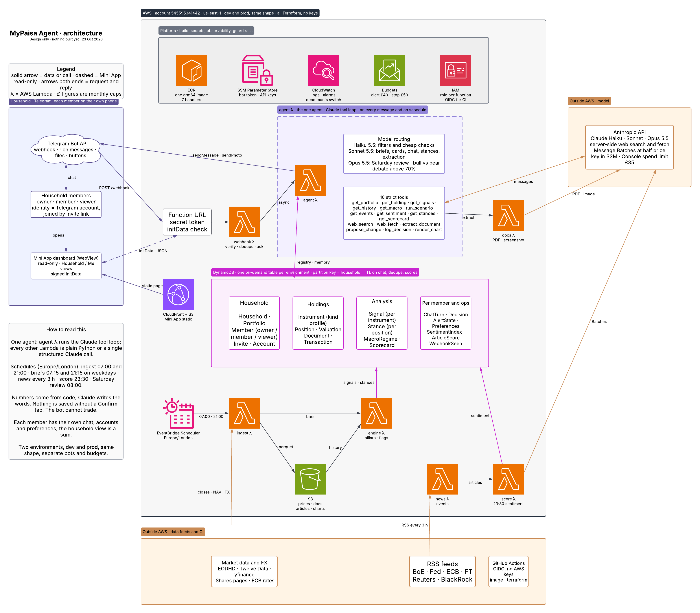
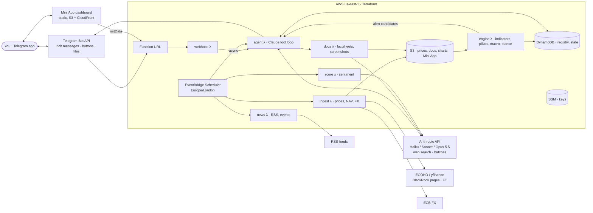

# MyPaisa Agent — Architecture (v2, the hybrid)

A private analyst for one household's investments, run entirely from a
Telegram chat by someone who is not a finance person. It keeps the record of
what is held and what it is worth, computes what moved and why, takes a stance
with a confidence score, explains it plainly, goes technical on request, and
grades itself. It runs on AWS in account `545595341442`, `us-east-1`, with
Claude through the Anthropic API. It never trades.

v2 folds in what `docs/RESEARCH.md` found in the Agentic Trading Desk and
Agent Toolbelt: the desk's deterministic indicator and pillar engine and its
discipline, the toolbelt's card shapes and portfolio review, and the layman's
Telegram front end both of them lack. v1 (prices, briefs, alerts, chat, news,
calls on Lambda) stands underneath; sections that have not changed are kept
short.

Animated version (v3 of the page, matching this document):
<https://claude.ai/artifact/DHWD7WFjsy7r3VmMvu9eDx>. The user journeys:
<https://claude.ai/artifact/LQAFk1kz4sddEMkKnwpbam>. The dashboard screens:
<https://claude.ai/artifact/A9mF3PJ91NJ9gRshFes5qp>. Sources for all three are
in `docs/design/`.

The component diagram, every service, the one agent and the DynamoDB entities
in detail, is a Lucidchart document: <https://lucid.app/lucidchart/abff9766-f522-4134-b559-0028eecb78fc/edit>
(private to the account; share from the document's menu). Its rendered image
and the import JSON it was built from are in `docs/design/lucid/`.



Status: design only.

---

## 1. The two rules, and a third

1. **Claude never produces a number.** Every figure comes from code with
   tests. Claude chooses what to say and how to say it.
2. **The bot cannot trade.** No broker login, no orders. It suggests only
   ISA-safe actions.
3. **The layman sees the summary; the detail is one tap away.** Every message
   has a plain top and a technical underside. Nothing technical is shown
   unasked.

---

## 2. What it does, as the user sees it

| You | The bot |
| --- | --- |
| Open the chat for the first time | A three-step setup: base currency, what you hold (send a factsheet or a screenshot, or type it), how often to be told things. You become the household's owner. |
| Send `/invite` | A one-time link. Your wife taps it on her phone; she is a member of the same household, with her own chat, her own accounts and her own preferences |
| Tap **Household** or **Me** on the Portfolio card | The household overview across every member and account, or your own accounts in detail. As owner you can open any member's detail; a member sees their own and the household totals |
| Send a factsheet PDF | Reads it, shows a card: name, ISIN, cost, what it holds, where it invests; you tap Confirm |
| Send a screenshot of your Monzo valuations | Reads the values, matches them to holdings, updates the records, shows a before/after card; you tap Confirm |
| Type "I put £200 into Balanced today" | Logs a contribution, adjusts units, confirms |
| Tap **Portfolio** | One table: each holding, value, day and month change, a stance chip (Add · Hold · Pause · Trim), confidence; a total line in GBP |
| Tap **Today** | The morning brief: what moved, why, anything to do |
| Tap a holding | Its card: value and history chart, stance with confidence and horizon, "Why?", "Technical", "What if?" |
| Tap **Technical** | A collapsed section opens: pillars, indicators, flags, macro regime, data quality, as numbers |
| Ask "should I add to Balanced this month?" | A stance card: ADD / HOLD / PAUSE with confidence, two reasons, what would change it, and the track record of that kind of call |
| Ask "what if the pound falls 10%?" | A scenario card from the look-through currency exposure |
| Tap **I acted** on a card | A decision record; the Saturday review compares it with what the signals said |
| Say "stop pinging me under 2%" | A preference card to confirm; saved |
| `/pause` | Everything stops until `/resume`; the kill switch |

Silence is a feature: about ten messages a week, two with sound at most.

---

## 3. System context

The compact view. The full component diagram, with the platform services, the
agent's tools and routing, and the DynamoDB entities, is the Lucidchart
document linked above.



One container image, seven handlers. The agent Lambda is the only one that
talks to you; every other Lambda produces data it reads.

---

## 4. State: the holdings registry

The user said holdings will change and the system must save all state. The
registry is designed so that adding a new kind of thing adds data, not code.

### 4.1 Entities (DynamoDB, single table)

| Entity | Key fields | Notes |
| --- | --- | --- |
| **Portfolio** (household) | `id`, `name`, `base_ccy`, `created_by`, `budget_tokens_per_day` | The tenant. Every other item's partition key starts with the portfolio id. |
| **Member** | `portfolio_id`, `tg_user_id`, `display_name`, `role` (`owner` · `member` · `viewer`), `share_detail` (let other members see my accounts), `prefs` (thresholds, quiet hours, ping budget, privacy mode, simple/technical), `joined_at`, `invited_by` | A person, identified by their Telegram account. One chat with the bot per member. |
| **Invite** | `portfolio_id`, `token`, `role`, `created_by`, `expires_at`, `used_by?` | Single use, 24-hour expiry, bound to one portfolio and role. |
| **Account** | `portfolio_id`, `id`, `name`, `type` (`ISA` · `GIA` · `SIPP` · `cash`), `platform` (`Monzo`, …), `owners[]` (member ids; two for a joint account) | A tax wrapper belonging to one or two members. Finances are managed here, per member. |
| **Instrument** | `id`, `kind` (`oeic` · `etf` · `stock` · `bond_etf` · `commodity_etc` · `cash`), `name`, `isin`, `sedol?`, `listing?` {MIC, ticker, ccy}, `yahoo_symbol?`, `base_ccy`, `exposure` {regions %, currencies %, asset classes %}, `benchmark?`, `ocf`, `price_sources[]` (ordered chain), `proxy?` (weighted basket), `schema_version` | The thing. Identifiers are optional because an OEIC has an ISIN and no ticker, a stock has both, cash has neither. |
| **Position** | `account_id`, `instrument_id`, `units`, `avg_cost_gbp`, `target_weight?`, `protected` (never suggested for trim), `opened_at` | What is held, inside one member's account. The same instrument may sit in two members' accounts; the household view adds them up. |
| **Valuation** | `instrument_id`, `date`, `price`, `price_ccy`, `fx_to_gbp`, `units`, `value_gbp`, `source` (`nav` · `close` · `proxy` · `user_screenshot` · `user_typed`), `provisional` | The time series the wealth tracker reads. User-supplied values are kept alongside computed ones; a gap between them is a signal (wrong units, a fee, a late NAV). |
| **Document** | `instrument_id`, `type` (`factsheet` · `kiid` · `annual_report` · `screenshot`), `s3_key`, `as_of`, `extracted` (JSON, with the source line for each figure), `confirmed_by_user` | The factsheet is the source of look-through until a better feed exists. |
| **Transaction** | `position_id`, `date`, `type` (`buy` · `sell` · `dividend` · `fee`), `units`, `amount_gbp` | From "I put £200 in", or extracted from a screenshot. |
| **Signal** | `instrument_id`, `date`, indicators, pillars, flags, forecast range, data quality | From the engine. |
| **Stance** (call) | `instrument_id`, `made_at`, `action`, `horizon_days`, `confidence`, `reasons[]`, `invalidated_if[]`, `entry_px`, `state_bucket`, `graded` | Paper-traded and graded. |
| **MacroRegime** | `date`, per-basket composites and regimes | Shared by all instruments. |
| **AlertState**, **Decision**, **ChatTurn** | per member | A member's chat memory, decisions and alert cooldowns are their own. |
| **SentimentIndex**, **ArticleScore**, **WebhookSeen** | per portfolio or global | |

Signals and macro regimes are per instrument and shared by everyone who holds
it; stances are per position, because the horizon, the drift from target and
the "holding" flag belong to one member's account.

Every item carries `schema_version`; a migration is a Lambda that rewrites
items of an older version, run once from a script, never by hand.

### 4.2 Adding a holding, from Telegram

```mermaid
sequenceDiagram
  participant U as You
  participant A as agent λ
  participant D as docs λ
  participant B as Claude (Anthropic API)
  participant R as Registry
  U->>A: /add (or just sends a PDF)
  A->>U: "Send the factsheet, a screenshot, or tell me what it is"
  U->>A: factsheet.pdf
  A->>D: extract(factsheet)
  D->>B: PDF + schema (name, ISIN, OCF, allocation, top holdings, benchmark, currency)
  B-->>D: structured JSON with citations
  D-->>A: extracted + confidence per field
  A->>U: Card: what I read, with the low-confidence fields marked · [Confirm] [Edit] [Cancel]
  U->>A: Confirm
  A->>R: Instrument + Document; resolve price sources (ISIN → yahoo id, BlackRock page)
  A->>U: "Added. How much do you hold? Send a screenshot or type it."
  U->>A: screenshot
  A->>D: extract(screenshot)
  D->>B: image + schema (holding name, value, units?, date)
  A->>U: Card: Balanced £22,925 on 23 Oct · units 1,234.5 at NAV 18.57 · [Confirm]
  U->>A: Confirm
  A->>R: Position + Valuation(source=user_screenshot) + Transaction
```

Any field Claude is unsure of is shown in amber and asked about. A holding is
never saved without the Confirm tap. The same path handles an ETF (ISIN and
ticker from the factsheet), a share (ticker and exchange), or cash.

### 4.3 Kind profiles

A `kind` is a bundle of defaults, so a new holding of a known kind needs no
code. The profiles live in configuration, versioned with the registry.

| Kind | Price chain | Look-through | Engine | Cascade temperament |
| --- | --- | --- | --- | --- |
| `oeic` (a UK fund such as the Monzo BlackRock ones) | fund NAV chain (§5.1), proxy basket intraday | factsheet, then the product page | all pillars; macro from exposure weights | patient: ADD on steady trend, PAUSE on exhaustion |
| `etf` (UCITS or US-listed) | exchange close (EODHD, Twelve Data, yfinance), issuer NAV as check | issuer's holdings download (daily for iShares) | all pillars; macro from exposure weights | patient |
| `stock` | exchange close | the company itself; sector, country, currency | adds the Valuation pillar and the stock cards | cautious: single-name risk raises the bar for ADD; earnings dates block changes for two sessions |
| `bond_etf` | exchange close | duration, credit quality, currency from the holdings file | trend and momentum downweighted; risk pillar reads duration × rate moves | slow |
| `commodity_etc` (a metal, oil, or a basket) | exchange close; spot price as check | the metal and its pricing currency (usually USD) | no valuation; risk pillar weighted ×2; macro from dollar strength and real yields, not the equity basket | slowest to ADD, quickest to PAUSE; drawdown alerts at a wider band (12%) because 8% is a normal week for silver |
| `cash` | FX only | the currency | none | n/a; it is the thing contributions come from |

Adding a kind that is not here (a bond, a gilt held directly, crypto) means
writing a profile and, if needed, a price plugin. Nothing else changes.

### 4.4 Worked example: today's holdings

Everything held through Monzo, in GBP, as it would sit in the registry. Rows
are what the bot would record after the factsheet and screenshot path; figures
marked ~ are examples.

| Instrument | Kind | ISIN | Listing recorded | Price chain | Exposure | Notes |
| --- | --- | --- | --- | --- | --- | --- |
| BlackRock MyMap (Monzo "Balanced") | `oeic` | from the factsheet | none (daily NAV) | yfinance `0P…L` → BlackRock page → FT → proxy → screenshot | ~66% shares, ~34% bonds; mostly USD under the hood | the proxy basket comes from its top holdings |
| iShares NASDAQ 100 UCITS ETF (Acc) | `etf` | IE00B53SZB19 | XLON `CNX1` GBP (the USD line is `CNDX`) | EODHD → Twelve Data (US line `QQQ` as a check) → yfinance `CNX1.L` | 100% USD, US large-cap tech, ~50% in the top ten | charge 0.30% |
| iShares Automation & Robotics UCITS ETF (Acc) | `etf` | IE00BYZK4552 | XLON `RBTX` GBP (USD line `RBOT`) | EODHD → yfinance `RBTX.L` | global, roughly equal-weighted small and mid caps; USD, JPY, EUR, TWD | charge 0.40%; overlaps the NASDAQ ETF in a few names (computed, not assumed) |
| iShares Physical Silver ETC | `commodity_etc` | IE00B4NCWG09 | XLON `ISLN` GBP (USD line `SSLN`) | EODHD → yfinance `ISLN.L`; silver spot × GBP/USD as the check | silver, USD-priced | not a fund: a debt security backed by bars in a vault; charge ~0.20% |
| Monzo pot | `cash` | — | — | — | GBP | where contributions come from |

Three things this example teaches the design:

- **The ISIN is shared by the USD and GBP lines**; only the ticker differs.
  The registry stores the listing separately, and the bot asks which line
  when the factsheet does not say (Monzo most likely holds the GBP line).
- **London GBP lines are often quoted in pence (GBX)** by Yahoo and some
  feeds. The price plugin normalises to pounds or every valuation is off by
  100×; a test asserts it.
- **Every holding here is a dollar asset in a sterling wrapper.** One move
  in GBP/USD moves all of them, so the FX line in the brief is a
  portfolio-level item, and the US macro basket matters far more than the
  UK one for this portfolio.

The platform fee Monzo charges on top of each product's own charge is part
of the cost drag in `fund-vs-benchmark`; it is a preference (percentage per
year), set once per account.

### 4.5 Identity, members and views

**There are no passwords.** Telegram authenticates every person who talks to
the bot, and it signs the identity it hands to the Mini App. "Login" is: which
Telegram account is this, and which household is it a member of.

| Where | How the member is identified |
| --- | --- |
| The chat | Every update carries `from.id`, a stable numeric Telegram user id. The webhook already accepts only updates signed by Telegram (secret token); the old single-chat allowlist becomes a `Member` lookup. A known id acts as that member; an unknown id gets silence. |
| The Mini App | Telegram signs `initData` (an HMAC over the user and a timestamp, keyed by the bot token). The Function URL checks the signature and the age, looks up the member, and serves only what that member may see. |
| The wealth tracker, later | Amazon Cognito (email, passkey, Google, MFA; free at this scale). A one-time code shown on the web and sent to the bot ties the Cognito user to the member. Not a priority now; nothing in the bot depends on it. |

**Joining.** The owner sends `/invite` (optionally `/invite viewer`). The bot
replies with a one-time deep link, `t.me/<bot>?start=<token>`, single use,
24-hour expiry, bound to this household and that role. The invitee opens it
on their own phone, becomes a member, and gets the three setup questions. The
owner removes a member with `/members`; a member who changes Telegram account
is simply re-invited. Private chats only: the bot ignores groups.

**Roles.**

| Role | Can |
| --- | --- |
| owner | Invite and remove members, change any account or holding, set the household budget and settings, see every member's detail |
| member | Add, change and remove holdings in their own accounts; see the household overview; see their own detail; opt in to sharing their detail with the household |
| viewer | Read the household overview and whatever members share; nothing else |

**Views.** The Portfolio card and the dashboard have a switch: **Household**
(every account, every member, one total) and **Me** (my accounts). The owner,
and any member whose detail is shared, appear as further tabs. A member's
brief covers their own accounts plus one household line; the owner's brief
covers the household with a line per member. Alerts go to whoever owns the
account, and to the owner as well if the owner asks.

**Isolation.** Every item is keyed by the household, every tool call carries
the calling member as a principal, and the registry layer refuses a read or
write outside that member's rights. One DynamoDB table cannot enforce that
with IAM alone, so it is enforced in code and covered by tests ("member A can
never read household B; a member cannot read another member's detail unless
shared"). Each member's chat memory, decisions, preferences and cooldowns are
their own. A per-household Claude token ceiling sits under the account-level
budget, so one chatty member cannot spend the household's allowance.

**Scope.** Two members in one household is personal software. Several
unrelated households using a bot that says "ADD, 64% confidence" starts to
look like investment advice to the public, which is regulated in the UK. The
model supports more households; using it that way is a separate decision
about wording and scope, not a technical one.

---

## 5. Data layer

### 5.1 Price source chain per instrument

Each instrument carries an ordered list; the first source that answers with
fresh data wins, and the brief says which one did.

| Kind | Chain | Freshness |
| --- | --- | --- |
| OEIC (Monzo's BlackRock funds) | 1. yfinance on the fund's `0P…L` id · 2. BlackRock UK product page · 3. FT tearsheet · 4. proxy basket · 5. last user screenshot | NAV once a day, published next morning; proxy intraday, labelled provisional |
| ETF or ETC on LSE / Xetra | 1. EODHD · 2. yfinance · 3. issuer NAV (iShares publishes daily) · 4. last close, labelled stale | Each exchange close; GBX normalised to GBP |
| ETF or stock on NYSE / Nasdaq | 1. Twelve Data (free tier) · 2. EODHD · 3. yfinance · 4. last close, labelled stale | 21:00 UK close |
| Stock on LSE / Xetra | as ETF on LSE / Xetra | same |
| Commodity ETC | as its listing, plus the metal's spot price × FX as a sanity check | same |
| Cash | FX only (ECB, Twelve Data as fallback) | |

Twelve Data's free tier (800 calls a day, US listings) also serves the US
macro basket and the earnings calendar; whether its free tier includes LSE
and Xetra is a phase 2 check that could make EODHD unnecessary.

Input hygiene, from the desk: drop interpolated bars, append today's close only
when the session has traded, mark a series STALE when its last bar is older
than the previous session and exclude it from scoring (the circuit breaker).
Every job is idempotent per date.

### 5.2 Look-through

From the factsheet (and later the product page): asset allocation, top
holdings, regional and currency split. It drives three things: the **proxy
basket** for a fund's intraday read, the **currency split** of each move, and
the **overlap review** across holdings. Refreshed when a new factsheet is
uploaded or monthly from the page.

### 5.3 FX, calendars, time

GBP base. ECB reference rates. Exchange calendars XLON, XETR, XNYS. All
schedules in `Europe/London`.

---

## 6. The analysis engine (deterministic, ported from the desk)

### 6.1 Indicators

EMA 20/50/200 (SMA seed), Wilder RSI-14, MACD 12/26/9 with histogram slope,
TRIX-15 with EMA-9 signal, Bollinger 20/2 with %B, slopes vs 5 bars,
`bars_since_below_ema20`; plus ATR-14, realised volatility (20-day and EWMA)
and its 3-year percentile, drawdown from the 1-year high, 12-1 momentum,
proxy-vs-NAV gap. The desk's known-answer self-tests become golden-file tests
and also run at the start of every engine run; a failing self-test blocks
scoring that day and tells you.

### 6.2 Pillars (−2..+2 each)

| Pillar | Inputs | Source |
| --- | --- | --- |
| Trend | price vs EMA20, EMA20>EMA50, EMA50>EMA200, EMA200 slope; partial components labelled | desk |
| Momentum | RSI zones (45/55), MACD histogram sign, TRIX vs signal | desk |
| Macro | the cross-asset regime of the basket(s) the instrument is exposed to, weighted by look-through; US basket as the desk (RSP/SPY, HYG/LQD, IWM/SPY, SPY/TLT, XLY/XLP, SPY-TLT correlation, 10Y−2Y when available); UK and EU baskets from UCITS equivalents; for a commodity ETC, dollar strength and real yields instead of the equity basket | desk + ours |
| Risk | volatility percentile, drawdown depth, proxy gap, bars present, NAV age | ours |
| Valuation (stocks only, later) | P/E, P/S, FCF yield, EV/EBITDA vs sector; cheap…expensive | toolbelt |

Flags, from the desk: exhaustion, relentless-bearish, rebound, death-cross.

### 6.3 The holder's cascade

The desk's cascade rotates capital; ours accumulates with care. `holding` is
always true for a position and false for a watchlist item.

| Action | When | Framing |
| --- | --- | --- |
| **ADD** | Holding; trend ≥ 0 and momentum ≥ 0, or a rebound with healthy structure after a drawdown; risk not elevated | Make this month's contribution here, or bring it forward |
| **HOLD** | Default for a holding with no triggers | Nothing to do |
| **PAUSE** | Holding; exhaustion ≥ 2 or risk elevated or adverse macro | Keep what you have; delay new money until the next review |
| **TRIM** | Holding; drift above target by more than the band, or relentless-bearish ≥ 3 with a death-cross, and the position is not protected | Rebalance toward target; never "sell everything" |
| **REBALANCE** | Portfolio-level drift beyond the band | Move the next contributions, not the holdings, unless drift is large |
| **WAIT / WATCH** | Not holding; a candidate | No entry trigger yet; the trigger that would change it |

Adverse macro and elevated risk tighten the framing and lower confidence; they
never change the pillar numbers. Sentiment may tilt the action one notch only
when the price pillars do not contradict it. News alone never triggers a red
alert.

### 6.4 Confidence score

`confidence = clamp(0.5 + agreement + persistence + quality + history, 0, 0.95)`

- **agreement**: pillars pointing the same way (+0.05 each, −0.05 each
  against)
- **persistence**: bars the state has held (0 for 1 bar, up to +0.10 for 10+)
- **quality**: −0.10 if partial components, stale or provisional data, or a
  proxy gap over 1%
- **history**: the empirical hit-rate of past stances in the same state
  bucket, once 20 or more exist, pulling the score toward it

Shown as a percentage; below 55% the card says "no clear view". Calibrated
weekly (Brier score, reliability table by bucket); the mapping changes only
after 8 weeks of evidence and the change is logged.

### 6.5 Forecast ranges

1-month return distribution by volatility-scaled block bootstrap on the
instrument's own history: 10/50/90th percentiles and `P(fall > 5%)`.

---

## 7. Research cards (from the toolbelt, rebuilt for funds)

Every card: a verdict from a fixed enum, a one-liner, evidence, a raw-data
block, `dataSources` with per-source success and `fetchedAt`, `generatedAt`.
Numbers computed, words synthesised, output via structured outputs.

| Card | For | Verdict enum |
| --- | --- | --- |
| `stance` | any holding | ADD · HOLD · PAUSE · TRIM · REBALANCE · WATCH, with confidence and horizon |
| `holding-profile` | fund, ETF | what it is, cost, where it invests, role in the portfolio |
| `overlap-review` | the portfolio | HHI, effective positions, look-through overlap, currency exposure, duration; weakest link; gaps |
| `fund-vs-benchmark` | fund, ETF | on_track · lagging · ahead, with tracking difference and cost drag |
| `bear-vs-bull` | any | bull_wins · slight_bull · too_close · slight_bear · bear_wins, three arguments each with evidence |
| `scenario` | the portfolio | impact of index and FX shocks from look-through |
| `valuation-snapshot`, `earnings-analysis` | stocks only, later | as the toolbelt |

---

## 8. The agent

One Claude tool loop (Sonnet 5.5 for chat and cards, Haiku 5.5 for filters
and scoring, Opus 5.5 for the Saturday review), with strict tools over the
registry, the engine and the cards, through the Anthropic API with the key in
SSM. Prompt caching on the system prompt, the tool list and the card rubrics.
Anthropic's server-side web search and web fetch (with citations) serve the
"Why?" button and the Saturday review; the nightly sentiment scoring goes
through the Message Batches API at half price. Refusal or error falls back to
the plain template.

**Borrowed patterns:** the bull/bear debate as two calls plus a judge for any
stance above 70% confidence and for the weekly review; a reflection step that
reads the last four weeks of stances and their grades before writing the
review; a per-run self-audit that lists what the bot told you this week so it
does not repeat itself.

**Tools:** `get_portfolio`, `get_holding(id)`, `get_signals(id)`,
`get_history(id, days)`, `get_macro`, `run_scenario`, `get_events`,
`get_sentiment`, `get_stances`, `get_scorecard`, `web_search` and `web_fetch`
(Anthropic's server tools), `extract_document(s3_key, schema)`, `propose_change(entity,
patch)` (saved only after Confirm), `log_decision`, `render_chart(spec)`.

**Guardrails in code, not prompt:** no tool can trade, spend beyond a search
query, delete data, or message anyone but your chat. Protected positions are
filtered before the cascade runs. The daily token ceiling, the weekly red
budget and quiet hours are enforced by the agent Lambda. `/pause` sets a flag
every scheduled run checks first.

---

## 9. Telegram front end

### 9.1 Navigation for a layman

- **Reply keyboard**, always visible: `Portfolio` · `Today` · `Ask` · `Settings`.
- **Menu button** with the commands: `/add`, `/update`, `/why`, `/whatif`,
  `/calls`, `/scorecard`, `/technical`, `/privacy`, `/pause`, `/help`; for
  the owner also `/invite` and `/members`.
- **Household and Me** on the Portfolio card: one tap switches between the
  household overview and your own accounts; the owner also gets a tab per
  member.
- **Cards** are rich messages where supported (Bot API 10.1+): a heading, a
  short table, buttons, and a collapsed **Technical details** section. Where
  rich messages are unavailable, the same card is HTML with a `Technical`
  button that edits the message in place.
- **Charts** as PNG (matplotlib, one house style, GBP axis, the stance
  horizon shaded), sent with the card; albums for the portfolio.
- **Glossary on tap**: any term in a technical section (RSI, drawdown, EMA)
  has a one-line explanation behind a button.
- **Two modes**: `simple` (default) and `technical` (every card expanded).
  Switch per message with the button or globally with `/technical`.

### 9.2 Example cards

```
📊 Portfolio · Thu 23 Oct · £24,110  ▲0.4% today  ▲2.1% month
───────────────────────────────────────────
Balanced (Monzo)    £22,925  ▲0.6%   HOLD   71%
Cash (Monzo pot)     £1,185   —       —
───────────────────────────────────────────
Nothing to do this week. Next review Saturday.
[Today] [Balanced ▸] [Technical ▾] [Ask]
```

```
Balanced (BlackRock MyMap 5) · £22,925
Stance: HOLD · 2 weeks · confidence 71%
Why: steady uptrend; volatility normal; pound moves explain most of
this week's wobble.
Would change if: a 5% fall from here, or UK inflation surprises on Wed.
Your track record on HOLD calls: 14 made, 11 held up.
[Why?] [What if?] [Technical ▾] [I acted]
   ▾ Technical details
   Trend +2 (price>EMA20, EMA20>50>200, EMA200↑)
   Momentum +1 (RSI 58, MACD hist>0, TRIX mixed)
   Macro US +1 Broadening · UK 0 Transitional
   Risk 0 (vol 48th pct, drawdown −1.9%, NAV 1 day old, proxy gap 0.3%)
   Range 1m: −4.8% … +4.1% · P(fall>5%) 8%
   Data: yfinance 0P…L ✓ · ECB ✓ · BlackRock page ✓ (22 Oct)
```

### 9.3 Mini App dashboard

A static page (the wealth tracker's Nocturne look, lightweight-charts) hosted
on the existing S3 + CloudFront, opened by a `web_app` button. It shows the
portfolio curve, each holding's history with the stance history drawn on it,
the overlap map, and the scorecard, with the same Household / Me / member
switch as the card. It reads JSON from the Function URL after the Lambda
validates Telegram's signed `initData` and resolves the member; it serves
nothing the member may not see. No write path; every change still goes
through a card and a Confirm tap in the chat. Each member opens it from their
own phone and sees their own view.

---

## 10. Notifications, news, calls

As v1, now per member: the 07:15 brief is written once for the household and
once for each member who wants one, each in their own preferences; the 21:15
wrap goes to whoever's accounts moved; tiered alerts (red with sound, max two
a week per member; amber silent; digest), cooldowns, quiet hours, Haiku
repeat filter, all per member. News from RSS, scored nightly by Haiku into a sentiment index;
event calendar (MPC, FOMC, ECB, CPI, earnings of top holdings). Stances are
paper-traded and graded; they appear only in the Saturday review until the
record beats the baseline for 8 weeks, then in weekday cards.

---

## 11. Backend records for the wealth tracker (later, not a priority)

The Valuation and Position tables are the record of what the holdings are
worth. When the wealth tracker is stitched on, its backend reads them through
a read-only role, its users are linked to members through Cognito (§4.5), and
maps them to its `Holding` shape (`id`, `name`, `type: Investment`, `entity`,
`owners`, `ccy`, `val`, `invVal`): `val` is the latest `value_gbp` (or
`price_ccy` value when the tracker shows GBP/INR), `invVal` the sum of
contributions. Updates flow one way, from the bot to the tracker; the tracker
never writes here.

---

## 12. Tech stack (changes from v1 in bold)

| Layer | Choice |
| --- | --- |
| Language, packaging, checks, tests | Python 3.14, uv, ruff, pyright strict, pytest, hypothesis, moto, respx |
| Data | pandas, numpy, pyarrow; **exchange_calendars**; **feedparser, trafilatura** |
| **Engine** | **The desk's indicator and pillar logic ported to pandas with golden tests; macro baskets per region** |
| Claude | **the `anthropic` SDK against the Anthropic API, key in SSM**; structured outputs; server-side web search and fetch; Message Batches; **PDF and image input for documents** |
| **Documents** | **S3 + Claude extraction with citations; no OCR library** |
| Charts | matplotlib (Agg) for PNG; **lightweight-charts in the Mini App** |
| Telegram | Thin client on httpx; **rich messages with HTML fallback; Mini App `initData` validation (HMAC)** |
| Runtime | Lambda container image, arm64 |
| Scheduling, storage, secrets, infra, CI | EventBridge Scheduler, DynamoDB + S3, SSM, Terraform, GitHub Actions with OIDC |
| **Mini App hosting** | **S3 + CloudFront already in the wealth tracker's account; a new origin path** |

---

## 13. Security and privacy

As v1 (no keys, IAM in Terraform, OIDC pinned to this repository's ids,
webhook secret, chat allowlist, dedupe, untrusted text), plus: uploaded
documents stay in a private bucket with a lifecycle rule; extracted figures
carry their source line; screenshots are deleted after extraction unless you
say keep; privacy mode hides pounds in every card and in the Mini App; the
Mini App serves nothing without a valid, recent `initData` signature.

---

## 14. Cost (monthly, at $1.30 to £1)

| Line | Lean | Standard | Full |
| --- | ---: | ---: | ---: |
| AWS | £0.10 | £0.10 | £0.20 |
| Claude: briefs, alerts, chat, cards, Saturday review | £7 | £12 | £21 |
| Claude: sentiment scoring, via Batches | £1.50 | £2.50 | £2.50 |
| Claude: document extraction (a few PDFs and screenshots a month) | £0.20 | £0.20 | £0.20 |
| Claude: web search (~60 a month at $10 per 1,000) | £0.50 | £0.50 | £1 |
| Market data (EODHD All World EOD) | £0 | £16 | £16 |
| **Total, one member** | **£9** | **£31** | **£41** |
| Each further member (their briefs and chat) | +£2 | +£3 | +£5 |

Two members on the standard setup: about £34. Stock fundamentals (EODHD
Fundamentals) would add about £46 a month and are not planned unless a single
share is added. A second *household* would add roughly a full set (£10–34),
since data feeds are shared but model calls are not.

---

## 15. Decisions (v2)

| Decision | Choice | Reason |
| --- | --- | --- |
| Engine | Port the desk's maths, rewrite its cascade | The maths is sound and self-tested; the cascade is for traders |
| Research cards | Toolbelt shapes, fund-first content | Same skeleton reads well; funds need different questions |
| Orchestration | One tool loop + a two-call debate, not an agent graph | One household; cost without accuracy otherwise |
| Ingestion | Factsheet PDF + screenshot through Claude, Confirm before save | The only path a layman will actually use |
| Front end | Telegram rich messages + PNG charts + a read-only Mini App | Simple by default, technical on tap, interactive when wanted |
| Confidence | Computed from agreement, persistence, quality, history; calibrated weekly | A number that is checked, not felt |
| Calls | Shadow until 8 weeks above baseline | Prove value before it reaches the chat |
| Identity | Telegram user id in the chat, signed `initData` in the Mini App, invites by one-time link; Cognito only for the web app later | No passwords to build, phish or forget; each member logs in from their own phone by being themselves |
| Tenancy | Household as the tenant, accounts per member, isolation in code with tests | Finances are managed per member; the household view is a sum, not a shared pot |
| Claude access | The Anthropic API with the key in SSM and a Console spend limit | Same per-token prices as Bedrock, no model-access form, and the server tools and Batches come with it |
| Web search | Anthropic's server-side web search and fetch | Citations built in; one fewer key to manage |
| Batch scoring | Message Batches for the nightly sentiment scoring | Half price; overnight latency is fine |

## 16. Open questions

- The Monzo fund's exact name and ISIN (factsheet in the app); whether the holdings sit in the Stocks & Shares ISA or a general account; the Monzo platform fee on your plan.
- Whether yfinance returns history for the fund's `0P…L` id; otherwise which page becomes the daily source.
- Whether Twelve Data's free tier serves LSE and Xetra daily closes (if so, EODHD is not needed).
- Rich messages: confirm block types and limits against the official Bot API changelog before relying on tables.
- UK and EU macro basket constituents (UCITS tickers) and their weights.
