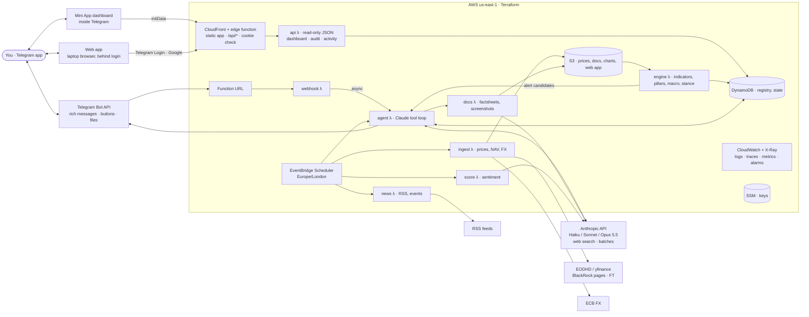

# MyPaisa Agent — Architecture (v2, the hybrid)

A private analyst for one household's investments, run entirely from a
Telegram chat by someone who is not a finance person. It keeps the record of
what is held and what it is worth, computes what moved and why, takes a stance
with a confidence score, explains it plainly, goes technical on request, asks
before it acts, and grades itself. A read-only web app behind a login shows
the same figures on a laptop, with the audit log of every change and a record
of what the agent did and spent. It runs on AWS in account `545595341442`,
`us-east-1`, with Claude through the Anthropic API. It never trades.

v2 folds in what `docs/RESEARCH.md` found in the Agentic Trading Desk and
Agent Toolbelt: the desk's deterministic indicator and pillar engine and its
discipline, the toolbelt's card shapes and portfolio review, and the layman's
Telegram front end both of them lack. v1 (prices, briefs, alerts, chat, news,
calls on Lambda) stands underneath; sections that have not changed are kept
short.

Animated version (v3 of the page, matching this document):
<https://claude.ai/artifact/DHWD7WFjsy7r3VmMvu9eDx>. The user journeys:
<https://claude.ai/artifact/LQAFk1kz4sddEMkKnwpbam>. The dashboard screens:
<https://claude.ai/artifact/A9mF3PJ91NJ9gRshFes5qp>. Sources for all three are
in `docs/design/`.

The component diagram, every service, the one agent and the DynamoDB entities
in detail, is a Lucidchart document: <https://lucid.app/lucidchart/d03dd3bc-9525-43b2-a16e-8696cbfdab86/edit>
(private to the account; share from the document's menu). Its rendered image
and the import JSON it was built from are in `docs/design/lucid/`.


Status: design only.

**Destination.** The web app is the future MyPaisa, the household wealth
tracker: assets of every kind (property, deposits, policies, pensions,
equities), debts, budget, a thirty-year forecast with XIRR, reports, in GBP
or INR. All of it read-only; every update comes through the bot. The current
[wealth-tracker](https://github.com/gilipersonal/wealth-tracker) repository
is the reference for those screens until they are rebuilt here with a new
design, and §12 is the road. None of that is a priority before phase 8. The
data model is shaped for it now, so that the ISA built in phase 1 and the
whole household's wealth later are the same records, not a migration.

---

## 1. The two rules, and two more

1. **Claude never produces a number.** Every figure comes from code with
   tests. Claude chooses what to say and how to say it.
2. **The bot cannot trade.** No broker login, no orders. It suggests only
   ISA-safe actions.
3. **The layman sees the summary; the detail is one tap away.** Every message
   has a plain top and a technical underside. Nothing technical is shown
   unasked.
4. **One write path.** Every change to the records, whatever the screen, goes
   through the bot: a card, a Confirm tap, an audit row. The web app, today
   and when it becomes the full MyPaisa, is read-only by construction.

---

## 2. What it does, as the user sees it

| You | The bot |
| --- | --- |
| Open the chat for the first time | A three-step setup: base currency, what you hold (send a factsheet or a screenshot, or type it), how often to be told things. You become the household's owner. |
| Send `/invite` | A one-time link. Your wife taps it on her phone; she is a member of the same household, with her own chat, her own accounts and her own preferences |
| Tap **Household** or **Me** on the Portfolio card | The household overview across every member and account, or your own accounts in detail. As owner you can open any member's detail; a member sees their own and the household totals |
| Send a factsheet PDF | Reads it, shows a card: name, ISIN, cost, what it holds, where it invests; you tap Confirm |
| Send a screenshot of your Monzo valuations | Reads the values, matches them to holdings, updates the records, shows a before/after card; you tap Confirm |
| Type "I put £200 into Balanced today" | Logs a contribution, adjusts units, confirms |
| Type "I want to log a transaction" | Asks one thing at a time, with buttons: bought or sold, which holding, how much, when; skips whatever you already said; a Confirm card at the end |
| Open the web app on your laptop | Log in with Telegram (a tap in the Telegram app) or with Google (the Gmail account linked to you), no password either way; the same dashboard, plus the audit log of every change and what the agent did and spent; read-only |
| Tap **Portfolio** | One table: each holding, value, day and month change, a stance chip (Add · Hold · Pause · Trim), confidence; a total line in GBP |
| Tap **Today** | The morning brief: what moved, why, anything to do |
| Tap a holding | Its card: value and history chart, stance with confidence and horizon, "Why?", "Technical", "What if?" |
| Tap **Technical** | A collapsed section opens: pillars, indicators, flags, macro regime, data quality, as numbers |
| Ask "should I add to Balanced this month?" | A stance card: ADD / HOLD / PAUSE with confidence, two reasons, what would change it, and the track record of that kind of call |
| Ask "what if the pound falls 10%?" | A scenario card from the look-through currency exposure |
| Tap **I acted** on a card | A decision record; the Saturday review compares it with what the signals said |
| Say "stop pinging me under 2%" | A preference card to confirm; saved |
| `/pause` | Everything stops until `/resume`; the kill switch |

Silence is a feature: about ten messages a week, two with sound at most.

---

## 3. System context

The compact view. The full component diagram, with the platform services, the
agent's tools and routing, and the DynamoDB entities, is the Lucidchart
document linked above.



One container image, eight handlers. The agent Lambda is the only one that
talks to you in the chat. The api Lambda is the only one the web app talks
to, and it can only read. Every other Lambda produces data they read, and
every one of them writes a `RunRecord` saying what it did (§10).

---

## 4. State: the holdings registry

The user said holdings will change and the system must save all state. The
registry is designed so that adding a new kind of thing adds data, not code.

### 4.1 Entities (DynamoDB, single table)

| Entity | Key fields | Notes |
| --- | --- | --- |
| **Portfolio** (household) | `id`, `name`, `base_ccy`, `created_by`, `budget_tokens_per_day` | The tenant. Every other item's partition key starts with the portfolio id. |
| **Member** | `portfolio_id`, `tg_user_id`, `display_name`, `role` (`owner` · `member` · `viewer`), `share_detail` (let other members see my accounts), `prefs` (thresholds, quiet hours, ping budget, privacy mode, simple/technical), `joined_at`, `invited_by`, `google_sub?`, `google_email?`, `google_linked_at?` | A person, identified by their Telegram account, with a Google account linked to it for the laptop. One chat with the bot per member. |
| **Invite** | `portfolio_id`, `token`, `role`, `created_by`, `expires_at`, `used_by?` | Single use, 24-hour expiry, bound to one portfolio and role. |
| **Account** | `portfolio_id`, `id`, `name`, `category` (`investment` · `cash` · `deposit` · `policy` · `pension` · `property` · `debt`), `type` (`ISA` · `GIA` · `SIPP` · `cash` · `fixed_deposit` · `policy` · `pension` · `property` · `mortgage` · `loan` · `card`), `ccy`, `institution` (`Monzo`, `LIC`, a bank, …), `country`, `owners[]` (member ids; two for a joint account) | A tax wrapper, a pot, a property or a loan belonging to one or two members. Finances are managed here, per member. Phase 1 uses `investment` and `cash`; the other categories wait for §12 but the field exists from day one. |
| **Instrument** | `id`, `kind` (`oeic` · `etf` · `stock` · `bond_etf` · `commodity_etc` · `cash` · later `property` · `deposit` · `policy` · `pension` · `debt`), `name`, `isin`, `sedol?`, `listing?` {MIC, ticker, ccy}, `yahoo_symbol?`, `base_ccy`, `exposure` {regions %, currencies %, asset classes %}, `benchmark?`, `ocf`, `price_sources[]` (ordered chain), `proxy?` (weighted basket), `country?`, `institution?`, `maturity_date?`, `rate?`, `schema_version` | The thing. Identifiers are optional because an OEIC has an ISIN and no ticker, a stock has both, cash has neither, a property has an address and a deposit has a maturity date. |
| **Position** | `account_id`, `instrument_id`, `units`, `avg_cost_gbp`, `target_weight?`, `protected` (never suggested for trim), `opened_at` | What is held, inside one member's account. The same instrument may sit in two members' accounts; the household view adds them up. |
| **Valuation** | `instrument_id`, `date`, `price`, `price_ccy`, `fx_to_gbp`, `units`, `value_gbp`, `source` (`nav` · `close` · `proxy` · `user_screenshot` · `user_typed` · `formula`), `provisional` | The time series the wealth tracker reads. User-supplied values are kept alongside computed ones; a gap between them is a signal (wrong units, a fee, a late NAV). |
| **Document** | `instrument_id`, `type` (`factsheet` · `kiid` · `annual_report` · `screenshot`), `s3_key`, `as_of`, `extracted` (JSON, with the source line for each figure), `confirmed_by_user` | The factsheet is the source of look-through until a better feed exists. |
| **Transaction** | `position_id` or `liability_id`, `date`, `type` (`buy` · `sell` · `dividend` · `fee` · `interest` · `rent` · `repayment` · `prepayment` · `rate_change` · `maturity`), `units?`, `amount`, `ccy`, `amount_gbp` | The dated cashflow ledger. From "I put £200 in", or extracted from a screenshot. XIRR, payoff curves and the forecast are computed from it, so every money movement is recorded with its date from day one. |
| **Liability** | `account_id`, `kind` (`mortgage` · `loan` · `card`), `principal`, `rate`, `term_months`, `started_at`, `emi`, `schedule[]` (computed), `ccy` | A debt: the balance against the original plan, the interest and principal split, the payoff date; its events are Transactions. Later, §12. |
| **NetWorth** | `portfolio_id`, `date`, `assets_gbp`, `debts_gbp`, by member, by category, by currency, by country | Computed daily by the engine from Valuation and Liability; the series the overview and the forecast chart read. Later, §12. |
| **Budget**, **ForecastAssumptions** | per member; per portfolio | Monthly income and planned spend with EMIs and surplus; the growth, contribution and surplus-allocation assumptions the thirty-year projection runs on. Later, §12. |
| **Signal** | `instrument_id`, `date`, indicators, pillars, flags, forecast range, data quality | From the engine. |
| **Stance** (call) | `instrument_id`, `made_at`, `action`, `horizon_days`, `confidence`, `reasons[]`, `invalidated_if[]`, `entry_px`, `state_bucket`, `graded` | Paper-traded and graded. |
| **MacroRegime** | `date`, per-basket composites and regimes | Shared by all instruments. |
| **AlertState**, **Decision**, **ChatTurn** | per member | A member's chat memory, decisions and alert cooldowns are their own. |
| **SentimentIndex**, **ArticleScore**, **WebhookSeen** | per portfolio or global | |
| **PendingAction** | `member_id`, `kind` (`log_transaction` · `add_holding` · `update_valuation` · `settings` · `confirm`), `step`, `collected` (the answers so far), `message_id`, `expires_at` (24 h) | The state of a guided flow: what the bot is waiting for from this member. The next message or tap resumes it; expiry clears it. |
| **AuditEvent** | `portfolio_id`, `ts`, `seq`, `actor` (a member id, or `system:ingest`, `system:engine`, `system:migration`), `via` (`typed` · `button` · `screenshot` · `factsheet` · `agent_proposal` · `schedule` · `migration`), `entity`, `entity_id`, `action` (`create` · `update` · `delete` · `confirm` · `reject`), `before`, `after`, `run_id`, `prev_hash`, `hash` | Append-only, one row per change to the records, written in the same transaction as the change. Hash-chained like the calls ledger, so a missing or edited row shows. See §4.6. |
| **RunRecord** | `run_id`, `function`, `trigger` (`message` · `callback` · `schedule:<name>` · `alarm`), `member_id?`, `started_at`, `finished_at`, `status`, `model_calls[]` (model, input, output and cached tokens, cost, ms), `tool_calls[]` (name, ms, ok, error), `messages_sent`, `outcome`, `error?` | What one run of any Lambda did and cost. 90-day TTL. The web app's Activity page and the cost guard rails read these. See §10. |

Signals and macro regimes are per instrument and shared by everyone who holds
it; stances are per position, because the horizon, the drift from target and
the "holding" flag belong to one member's account.

Every item carries `schema_version`; a migration is a Lambda that rewrites
items of an older version, run once from a script, never by hand.

### 4.2 Adding a holding, from Telegram

```mermaid
sequenceDiagram
  participant U as You
  participant A as agent λ
  participant D as docs λ
  participant B as Claude (Anthropic API)
  participant R as Registry
  U->>A: /add (or just sends a PDF)
  A->>U: "Send the factsheet, a screenshot, or tell me what it is"
  U->>A: factsheet.pdf
  A->>D: extract(factsheet)
  D->>B: PDF + schema (name, ISIN, OCF, allocation, top holdings, benchmark, currency)
  B-->>D: structured JSON with citations
  D-->>A: extracted + confidence per field
  A->>U: Card: what I read, with the low-confidence fields marked · [Confirm] [Edit] [Cancel]
  U->>A: Confirm
  A->>R: Instrument + Document; resolve price sources (ISIN → yahoo id, BlackRock page)
  A->>U: "Added. How much do you hold? Send a screenshot or type it."
  U->>A: screenshot
  A->>D: extract(screenshot)
  D->>B: image + schema (holding name, value, units?, date)
  A->>U: Card: Balanced £22,925 on 23 Oct · units 1,234.5 at NAV 18.57 · [Confirm]
  U->>A: Confirm
  A->>R: Position + Valuation(source=user_screenshot) + Transaction
```

Any field Claude is unsure of is shown in amber and asked about. A holding is
never saved without the Confirm tap. The same path handles an ETF (ISIN and
ticker from the factsheet), a share (ticker and exchange), or cash.

### 4.3 Kind profiles

A `kind` is a bundle of defaults, so a new holding of a known kind needs no
code. The profiles live in configuration, versioned with the registry.

| Kind | Price chain | Look-through | Engine | Cascade temperament |
| --- | --- | --- | --- | --- |
| `oeic` (a UK fund such as the Monzo BlackRock ones) | fund NAV chain (§5.1), proxy basket intraday | factsheet, then the product page | all pillars; macro from exposure weights | patient: ADD on steady trend, PAUSE on exhaustion |
| `etf` (UCITS or US-listed) | exchange close (EODHD, Twelve Data, yfinance), issuer NAV as check | issuer's holdings download (daily for iShares) | all pillars; macro from exposure weights | patient |
| `stock` | exchange close | the company itself; sector, country, currency | adds the Valuation pillar and the stock cards | cautious: single-name risk raises the bar for ADD; earnings dates block changes for two sessions |
| `bond_etf` | exchange close | duration, credit quality, currency from the holdings file | trend and momentum downweighted; risk pillar reads duration × rate moves | slow |
| `commodity_etc` (a metal, oil, or a basket) | exchange close; spot price as check | the metal and its pricing currency (usually USD) | no valuation; risk pillar weighted ×2; macro from dollar strength and real yields, not the equity basket | slowest to ADD, quickest to PAUSE; drawdown alerts at a wider band (12%) because 8% is a normal week for silver |
| `cash` | FX only | the currency | none | n/a; it is the thing contributions come from |
| `property`, `deposit`, `policy`, `pension` (later, §12) | none; the last user figure, or a formula (a deposit accrues at its rate to maturity, a policy follows its schedule) | the asset itself: country, currency, institution | no pillars; XIRR from the ledger; maturity and growth-rate panels | n/a; the bot asks for a valuation when one is overdue and announces a maturity before it lands |
| `debt` (`mortgage` · `loan` · `card`; later, §12) | none; the balance from the schedule and the logged events | the lender; currency | no pillars; interest split, payoff date, prepayment what-ifs | n/a; the bot asks when an EMI, a rate change or a preclosure is due |

Adding a kind that is not here (a bond, a gilt held directly, crypto) means
writing a profile and, if needed, a price plugin. Nothing else changes.

### 4.4 Worked example: today's holdings

Everything held through Monzo, in GBP, as it would sit in the registry. Rows
are what the bot would record after the factsheet and screenshot path; figures
marked ~ are examples.

| Instrument | Kind | ISIN | Listing recorded | Price chain | Exposure | Notes |
| --- | --- | --- | --- | --- | --- | --- |
| BlackRock MyMap (Monzo "Balanced") | `oeic` | from the factsheet | none (daily NAV) | yfinance `0P…L` → BlackRock page → FT → proxy → screenshot | ~66% shares, ~34% bonds; mostly USD under the hood | the proxy basket comes from its top holdings |
| iShares NASDAQ 100 UCITS ETF (Acc) | `etf` | IE00B53SZB19 | XLON `CNX1` GBP (the USD line is `CNDX`) | EODHD → Twelve Data (US line `QQQ` as a check) → yfinance `CNX1.L` | 100% USD, US large-cap tech, ~50% in the top ten | charge 0.30% |
| iShares Automation & Robotics UCITS ETF (Acc) | `etf` | IE00BYZK4552 | XLON `RBTX` GBP (USD line `RBOT`) | EODHD → yfinance `RBTX.L` | global, roughly equal-weighted small and mid caps; USD, JPY, EUR, TWD | charge 0.40%; overlaps the NASDAQ ETF in a few names (computed, not assumed) |
| iShares Physical Silver ETC | `commodity_etc` | IE00B4NCWG09 | XLON `ISLN` GBP (USD line `SSLN`) | EODHD → yfinance `ISLN.L`; silver spot × GBP/USD as the check | silver, USD-priced | not a fund: a debt security backed by bars in a vault; charge ~0.20% |
| Monzo pot | `cash` | — | — | — | GBP | where contributions come from |

Three things this example teaches the design:

- **The ISIN is shared by the USD and GBP lines**; only the ticker differs.
  The registry stores the listing separately, and the bot asks which line
  when the factsheet does not say (Monzo most likely holds the GBP line).
- **London GBP lines are often quoted in pence (GBX)** by Yahoo and some
  feeds. The price plugin normalises to pounds or every valuation is off by
  100×; a test asserts it.
- **Every holding here is a dollar asset in a sterling wrapper.** One move
  in GBP/USD moves all of them, so the FX line in the brief is a
  portfolio-level item, and the US macro basket matters far more than the
  UK one for this portfolio.

The platform fee Monzo charges on top of each product's own charge is part
of the cost drag in `fund-vs-benchmark`; it is a preference (percentage per
year), set once per account.

### 4.5 Identity, members and views

**There are no passwords.** Telegram authenticates every person who talks to
the bot, and it signs the identity it hands to the Mini App. On a laptop,
Google can vouch for the person instead, through a Google account linked to
the member once, from the chat. "Login" is: which Telegram or Google account
is this, which member is it linked to, and which household is that member in.

| Where | How the member is identified |
| --- | --- |
| The chat | Every update carries `from.id`, a stable numeric Telegram user id. The webhook already accepts only updates signed by Telegram (secret token); the old single-chat allowlist becomes a `Member` lookup. A known id acts as that member; an unknown id gets silence. |
| The Mini App | Telegram signs `initData` (an HMAC over the user and a timestamp, keyed by the bot token). The Function URL checks the signature and the age, looks up the member, and serves only what that member may see. |
| The web app in a browser | Either the Telegram Login Widget (one tap, confirmed in the Telegram app on the phone) or Sign in with Google (the Gmail account linked to the member). Both hand the api Lambda a signed proof of identity, which it verifies and maps to the member before setting the session cookie (§9.3). A Google account that is not linked to any member is refused, whatever its address. |
| The wealth tracker, later | Amazon Cognito (email, passkey, Google, MFA; free at this scale). A one-time code shown on the web and sent to the bot ties the Cognito user to the member. Not a priority now; nothing in the bot depends on it. |

**Joining.** The owner sends `/invite` (optionally `/invite viewer`). The bot
replies with a one-time deep link, `t.me/<bot>?start=<token>`, single use,
24-hour expiry, bound to this household and that role. The invitee opens it
on their own phone, becomes a member, and gets the three setup questions. The
owner removes a member with `/members`; a member who changes Telegram account
is simply re-invited. Private chats only: the bot ignores groups.

**Linking a Google account.** Each member links one Google account, from
their own phone, so that both identities are proven by the person who owns
them: on the web, Sign in with Google for an account not yet linked shows a
six-digit code that lasts ten minutes; the member sends `/link <code>` to the
bot from their own Telegram chat; the bot stores Google's stable account id
(`sub`) and the address on that member and confirms in both places. The
owner can also link on a member's behalf by address from `/members`, and
unlink from the same place; unlinking logs that account out everywhere.
`sub` is the key, the address is for display, so a renamed Gmail still works
and an address handed to someone else does not. Every link, unlink and web
login is an audit row.

**Roles.**

| Role | Can |
| --- | --- |
| owner | Invite and remove members, change any account or holding, set the household budget and settings, see every member's detail |
| member | Add, change and remove holdings in their own accounts; see the household overview; see their own detail; opt in to sharing their detail with the household |
| viewer | Read the household overview and whatever members share; nothing else |

**Views.** The Portfolio card and the dashboard have a switch: **Household**
(every account, every member, one total) and **Me** (my accounts). The owner,
and any member whose detail is shared, appear as further tabs. A member's
brief covers their own accounts plus one household line; the owner's brief
covers the household with a line per member. Alerts go to whoever owns the
account, and to the owner as well if the owner asks.

**Isolation.** Every item is keyed by the household, every tool call carries
the calling member as a principal, and the registry layer refuses a read or
write outside that member's rights. One DynamoDB table cannot enforce that
with IAM alone, so it is enforced in code and covered by tests ("member A can
never read household B; a member cannot read another member's detail unless
shared"). Each member's chat memory, decisions, preferences and cooldowns are
their own. A per-household Claude token ceiling sits under the account-level
budget, so one chatty member cannot spend the household's allowance.

**Scope.** Two members in one household is personal software. Several
unrelated households using a bot that says "ADD, 64% confidence" starts to
look like investment advice to the public, which is regulated in the UK. The
model supports more households; using it that way is a separate decision
about wording and scope, not a technical one.

### 4.6 The audit log

Every change to the records leaves a row. Not a log line that may or may not
be there, a row in the same DynamoDB transaction as the change, so a change
without its audit row cannot happen. Each row says who (the member, or the
system job), when, through what (a typed sentence, a button, a screenshot, a
factsheet, a proposal from the agent, a schedule), which record, what it was
before and what it is after, and which run made it. Rows are chained by hash,
the same way the stance ledger is, so a deleted or edited row breaks the chain
and the weekly check says so.

What counts as a change: holdings, positions, transactions, accounts,
members and invites, preferences, and every valuation a person supplied. The
nightly computed valuations and signals are a time series, not audit rows;
they are already dated and sourced, and logging each one would bury the rows
that matter.

Who sees what follows the roles in §4.5: a member sees the rows for their own
accounts and for the household-level records; the owner sees every row. The
rows are readable in two places: the Audit page of the web app, with filters
by member, record and date, and from the chat with a question such as "what
changed this week?", which the agent answers through `get_audit`. Rows are
never deleted; at a few hundred a year they cost nothing to keep.

---

## 5. Data layer

### 5.1 Price sources: one plugin per feed, a chain per kind, chosen by configuration

Every feed is a plugin behind one small contract, and which plugins run, in
which order, is configuration per environment. Yahoo Finance (`yfinance`,
free, no key) is the default everywhere and the only feed local development
needs. Switching to EODHD is a configuration change plus a key in SSM, not a
code change.

**The contract.** A plugin implements:

```python
class PriceSource(Protocol):
    name: str                                   # "yfinance" · "eodhd" · "twelvedata" · "issuer_page" · "ft" · "proxy" · "screenshot"
    def supports(self, instrument: Instrument) -> bool: ...
    def daily_bars(self, instrument: Instrument, since: date) -> Bars: ...   # native currency, with source, fetched_at, provisional
    def latest(self, instrument: Instrument) -> Quote | None: ...
    def fx(self, pair: str, since: date) -> Rates | None: ...                 # optional
```

Each plugin owns its own identifiers on the instrument (`identifiers`
holds the Yahoo symbol, the EODHD code, the Twelve Data symbol and the ISIN
side by side), its key in SSM (`/mypaisa-agent/<env>/<plugin>/api_key`),
its rate limit, its GBX-to-GBP normalisation, its freshness rule, and its
recorded fixtures. The ingest job sees only `Bars`, never a vendor shape.
A plugin that is not in any chain is never imported, so a missing key is
not an error.

**Chains by configuration.** The chain per kind lives in
`infra/terraform/envs/<env>.tfvars` and reaches the Lambdas as one
environment variable, with a per-instrument override in
`Instrument.price_sources[]` for the odd case:

```hcl
# envs/dev.tfvars (local uses the same shape from a .env file)
price_chains = {
  oeic      = ["yfinance", "issuer_page", "ft", "proxy", "screenshot"]
  lse_etf   = ["yfinance", "issuer_page", "stale"]
  us_etf    = ["twelvedata", "yfinance", "stale"]
  cash      = ["ecb", "twelvedata"]
}
# envs/prod.tfvars, once EODHD is chosen: put it first and add its key
#   lse_etf = ["eodhd", "yfinance", "issuer_page", "stale"]
#   us_etf  = ["twelvedata", "eodhd", "yfinance", "stale"]
```

The first plugin that answers with fresh data wins, and the brief says
which one did. `stale` is the last entry everywhere: the previous close,
labelled, never silently reused.

| Kind | Default chain (local, dev, and prod until switched) | With EODHD | Freshness |
| --- | --- | --- | --- |
| OEIC (Monzo's BlackRock funds) | yfinance on the fund's `0P…L` id · BlackRock UK product page · FT tearsheet · proxy basket · last user screenshot | unchanged; EODHD has no UK OEICs | NAV once a day, published next morning; proxy intraday, labelled provisional |
| ETF or ETC on LSE / Xetra | yfinance · issuer NAV (iShares publishes daily) · stale | eodhd · yfinance · issuer NAV · stale | Each exchange close; GBX normalised to GBP |
| ETF or stock on NYSE / Nasdaq | Twelve Data (free tier) · yfinance · stale | twelvedata · eodhd · yfinance · stale | 21:00 UK close |
| Stock on LSE / Xetra | as ETF on LSE / Xetra | as ETF on LSE / Xetra | same |
| Commodity ETC | as its listing, plus the metal's spot price × FX as a sanity check | same | same |
| Cash | ECB, Twelve Data as fallback | same | |

**Proving a plugin.** Every plugin passes the same contract test suite on
recorded responses: the same instrument and date range give the same `Bars`
shape, pounds not pence, the stale rule, idempotence per date, and a clean
failure when the vendor is down. Tests never touch the network; a deliberate
command refreshes the recordings. When two plugins are configured for the
same instrument the ingest job records both, and the Activity page (§9.3)
shows where they disagree (a close more than 0.2% apart, a missing day, a
late correction). That report is how the "free first, EODHD if London
closes prove unreliable" decision of phase 2 is made with numbers rather
than impressions.

Twelve Data's free tier (800 calls a day, US listings) also serves the US
macro basket and the earnings calendar; whether its free tier includes LSE
and Xetra is a phase 2 check that could make EODHD unnecessary.

Input hygiene, from the desk: drop interpolated bars, append today's close only
when the session has traded, mark a series STALE when its last bar is older
than the previous session and exclude it from scoring (the circuit breaker).
Every job is idempotent per date.

### 5.2 Look-through

From the factsheet (and later the product page): asset allocation, top
holdings, regional and currency split. It drives three things: the **proxy
basket** for a fund's intraday read, the **currency split** of each move, and
the **overlap review** across holdings. Refreshed when a new factsheet is
uploaded or monthly from the page.

### 5.3 FX, calendars, time

GBP base; USD, EUR and INR, all published daily by the ECB. Each member can
read figures in GBP or INR; the stored value is always both the native
amount and its GBP equivalent on the day. Exchange calendars XLON, XETR,
XNYS. All schedules in `Europe/London`.

---

## 6. The analysis engine (deterministic, ported from the desk)

### 6.1 Indicators

EMA 20/50/200 (SMA seed), Wilder RSI-14, MACD 12/26/9 with histogram slope,
TRIX-15 with EMA-9 signal, Bollinger 20/2 with %B, slopes vs 5 bars,
`bars_since_below_ema20`; plus ATR-14, realised volatility (20-day and EWMA)
and its 3-year percentile, drawdown from the 1-year high, 12-1 momentum,
proxy-vs-NAV gap. The desk's known-answer self-tests become golden-file tests
and also run at the start of every engine run; a failing self-test blocks
scoring that day and tells you.

### 6.2 Pillars (−2..+2 each)

| Pillar | Inputs | Source |
| --- | --- | --- |
| Trend | price vs EMA20, EMA20>EMA50, EMA50>EMA200, EMA200 slope; partial components labelled | desk |
| Momentum | RSI zones (45/55), MACD histogram sign, TRIX vs signal | desk |
| Macro | the cross-asset regime of the basket(s) the instrument is exposed to, weighted by look-through; US basket as the desk (RSP/SPY, HYG/LQD, IWM/SPY, SPY/TLT, XLY/XLP, SPY-TLT correlation, 10Y−2Y when available); UK and EU baskets from UCITS equivalents; for a commodity ETC, dollar strength and real yields instead of the equity basket | desk + ours |
| Risk | volatility percentile, drawdown depth, proxy gap, bars present, NAV age | ours |
| Valuation (stocks only, later) | P/E, P/S, FCF yield, EV/EBITDA vs sector; cheap…expensive | toolbelt |

Flags, from the desk: exhaustion, relentless-bearish, rebound, death-cross.

### 6.3 The holder's cascade

The desk's cascade rotates capital; ours accumulates with care. `holding` is
always true for a position and false for a watchlist item.

| Action | When | Framing |
| --- | --- | --- |
| **ADD** | Holding; trend ≥ 0 and momentum ≥ 0, or a rebound with healthy structure after a drawdown; risk not elevated | Make this month's contribution here, or bring it forward |
| **HOLD** | Default for a holding with no triggers | Nothing to do |
| **PAUSE** | Holding; exhaustion ≥ 2 or risk elevated or adverse macro | Keep what you have; delay new money until the next review |
| **TRIM** | Holding; drift above target by more than the band, or relentless-bearish ≥ 3 with a death-cross, and the position is not protected | Rebalance toward target; never "sell everything" |
| **REBALANCE** | Portfolio-level drift beyond the band | Move the next contributions, not the holdings, unless drift is large |
| **WAIT / WATCH** | Not holding; a candidate | No entry trigger yet; the trigger that would change it |

Adverse macro and elevated risk tighten the framing and lower confidence; they
never change the pillar numbers. Sentiment may tilt the action one notch only
when the price pillars do not contradict it. News alone never triggers a red
alert.

### 6.4 Confidence score

`confidence = clamp(0.5 + agreement + persistence + quality + history, 0, 0.95)`

- **agreement**: pillars pointing the same way (+0.05 each, −0.05 each
  against)
- **persistence**: bars the state has held (0 for 1 bar, up to +0.10 for 10+)
- **quality**: −0.10 if partial components, stale or provisional data, or a
  proxy gap over 1%
- **history**: the empirical hit-rate of past stances in the same state
  bucket, once 20 or more exist, pulling the score toward it

Shown as a percentage; below 55% the card says "no clear view". Calibrated
weekly (Brier score, reliability table by bucket); the mapping changes only
after 8 weeks of evidence and the change is logged.

### 6.5 Forecast ranges

1-month return distribution by volatility-scaled block bootstrap on the
instrument's own history: 10/50/90th percentiles and `P(fall > 5%)`.

### 6.6 Wealth maths (later, §12)

The same rule applies: code computes, Claude explains. For the full MyPaisa
the engine gains a `wealth/` module, deterministic and tested against known
answers:

- **XIRR** on the dated cashflow ledger of a position, an account, a member
  or the household, with the current value as the closing flow: Newton's
  method with a bisection fallback, matched to a spreadsheet's XIRR on
  fixture ledgers to the penny, and the same ledger the tracker's asset page
  shows.
- **Deposits and policies**: accrual at the stated rate to maturity, the
  maturity timeline (next twelve months, open-ended), what a maturing sum
  could do next.
- **Debts**: the EMI, the schedule, the interest and principal split per
  year, the balance curve against the original plan, prepayment and
  preclosure what-ifs.
- **Net worth**: the daily series by member, category, currency and country;
  the crossover of assets over debts.
- **The forecast**: a thirty-year projection from stated assumptions
  (growth per category, contributions, surplus allocation, maturities,
  EMIs ending), month by month, with the assumptions shown beside the curve
  and every change to them an audit row.

---

## 7. Research cards (from the toolbelt, rebuilt for funds)

Every card: a verdict from a fixed enum, a one-liner, evidence, a raw-data
block, `dataSources` with per-source success and `fetchedAt`, `generatedAt`.
Numbers computed, words synthesised, output via structured outputs.

| Card | For | Verdict enum |
| --- | --- | --- |
| `stance` | any holding | ADD · HOLD · PAUSE · TRIM · REBALANCE · WATCH, with confidence and horizon |
| `holding-profile` | fund, ETF | what it is, cost, where it invests, role in the portfolio |
| `overlap-review` | the portfolio | HHI, effective positions, look-through overlap, currency exposure, duration; weakest link; gaps |
| `fund-vs-benchmark` | fund, ETF | on_track · lagging · ahead, with tracking difference and cost drag |
| `bear-vs-bull` | any | bull_wins · slight_bull · too_close · slight_bear · bear_wins, three arguments each with evidence |
| `scenario` | the portfolio | impact of index and FX shocks from look-through |
| `valuation-snapshot`, `earnings-analysis` | stocks only, later | as the toolbelt |

---

## 8. The agent

One Claude tool loop (Sonnet 5.5 for chat and cards, Haiku 5.5 for filters
and scoring, Opus 5.5 for the Saturday review), with strict tools over the
registry, the engine and the cards, through the Anthropic API with the key in
SSM. Prompt caching on the system prompt, the tool list and the card rubrics.
Anthropic's server-side web search and web fetch (with citations) serve the
"Why?" button and the Saturday review; the nightly sentiment scoring goes
through the Message Batches API at half price. Refusal or error falls back to
the plain template.

**It asks before it acts, and asks when it is unsure.** The agent behaves like
a careful assistant rather than a form. When a request is missing something
it needs, it asks for that one thing, with buttons when the answer is from a
short list (which holding, bought or sold, today or yesterday) and a typed
reply otherwise. It never asks for what it can look up, and it skips every
question the sentence already answered: "I put £200 into Balanced today" goes
straight to the Confirm card. Every write is shown before it is saved. A
change that touches several records, such as a rebalance, is first proposed
as a plan with one Confirm, then carried out step by step, each step audited.
It also asks on its own account: on the first of the month whether the usual
contribution went in, after 35 days without a valuation whether a screenshot
is due, and when two members hold the same instrument whether a joint account
is meant. The mechanics are the `ask_user` tool, which ends the turn with a
question and its buttons, and a `PendingAction` row that records what the
bot is waiting for; the next message or tap from that member resumes the
flow, and a day of silence clears it.

**Borrowed patterns:** the bull/bear debate as two calls plus a judge for any
stance above 70% confidence and for the weekly review; a reflection step that
reads the last four weeks of stances and their grades before writing the
review; a per-run self-audit that lists what the bot told you this week so it
does not repeat itself.

**Tools:** `get_portfolio`, `get_holding(id)`, `get_signals(id)`,
`get_history(id, days)`, `get_macro`, `run_scenario`, `get_events`,
`get_sentiment`, `get_stances`, `get_scorecard`, `web_search` and `web_fetch`
(Anthropic's server tools), `extract_document(s3_key, schema)`, `propose_change(entity,
patch)` (saved only after Confirm), `log_decision`, `render_chart(spec)`, `ask_user(question, options[])` (ends
the turn with a question; the answer resumes it through `PendingAction`) and
`get_audit(filter)` (what changed, for "what did I change last week?").

**Guardrails in code, not prompt:** no tool can trade, spend beyond a search
query, delete data, or message anyone but your chat. Protected positions are
filtered before the cascade runs. The daily token ceiling, the weekly red
budget and quiet hours are enforced by the agent Lambda. `/pause` sets a flag
every scheduled run checks first.

---

## 9. Telegram front end

### 9.1 Navigation for a layman

- **Reply keyboard**, always visible: `Portfolio` · `Today` · `Ask` · `Settings`.
- **Menu button** with the commands: `/add`, `/update`, `/why`, `/whatif`,
  `/calls`, `/scorecard`, `/technical`, `/privacy`, `/pause`, `/help`; for
  the owner also `/invite` and `/members`.
- **Household and Me** on the Portfolio card: one tap switches between the
  household overview and your own accounts; the owner also gets a tab per
  member.
- **Cards** are rich messages where supported (Bot API 10.1+): a heading, a
  short table, buttons, and a collapsed **Technical details** section. Where
  rich messages are unavailable, the same card is HTML with a `Technical`
  button that edits the message in place.
- **Charts** as PNG (matplotlib, one house style, GBP axis, the stance
  horizon shaded), sent with the card; albums for the portfolio.
- **Glossary on tap**: any term in a technical section (RSI, drawdown, EMA)
  has a one-line explanation behind a button.
- **Two modes**: `simple` (default) and `technical` (every card expanded).
  Switch per message with the button or globally with `/technical`.
- **Guided flows**: logging a transaction, adding a holding, updating a
  valuation and changing a setting each run as a short series of questions
  with buttons, one per message, editing the same message in place so the
  chat stays tidy. Anything already said is skipped. Long lists (many
  holdings) become a short list plus "More" and "Type the name". A flow that
  gets no answer for a day is dropped quietly.

### 9.2 Example cards

```
📊 Portfolio · Thu 23 Oct · £24,110  ▲0.4% today  ▲2.1% month
───────────────────────────────────────────
Balanced (Monzo)    £22,925  ▲0.6%   HOLD   71%
Cash (Monzo pot)     £1,185   —       —
───────────────────────────────────────────
Nothing to do this week. Next review Saturday.
[Today] [Balanced ▸] [Technical ▾] [Ask]
```

```
Balanced (BlackRock MyMap 5) · £22,925
Stance: HOLD · 2 weeks · confidence 71%
Why: steady uptrend; volatility normal; pound moves explain most of
this week's wobble.
Would change if: a 5% fall from here, or UK inflation surprises on Wed.
Your track record on HOLD calls: 14 made, 11 held up.
[Why?] [What if?] [Technical ▾] [I acted]
   ▾ Technical details
   Trend +2 (price>EMA20, EMA20>50>200, EMA200↑)
   Momentum +1 (RSI 58, MACD hist>0, TRIX mixed)
   Macro US +1 Broadening · UK 0 Transitional
   Risk 0 (vol 48th pct, drawdown −1.9%, NAV 1 day old, proxy gap 0.3%)
   Range 1m: −4.8% … +4.1% · P(fall>5%) 8%
   Data: yfinance 0P…L ✓ · ECB ✓ · BlackRock page ✓ (22 Oct)
```

A guided flow, each reply editing the same message:

```
You:  I want to log a transaction
Bot:  What kind?                      [Bought] [Sold] [Dividend] [Fee]
You:  (Bought)
Bot:  Into which holding?             [Balanced] [NASDAQ 100] [Robotics]
                                      [Silver] [Something new]
You:  (Balanced)
Bot:  How much, in pounds?            [£100] [£200] [£500] [Type an amount]
You:  (£200)
Bot:  When?                           [Today] [Yesterday] [Pick a date]
You:  (Today)
Bot:  Bought £200 of Balanced (Monzo) on 23 Oct · about 10.8 units at NAV 18.57
      [Confirm] [Edit] [Cancel]
```

### 9.3 The web app: on a laptop and inside Telegram

One static app (the wealth tracker's Nocturne look, lightweight-charts),
built from the artboards in `docs/design/dashboard/` and laid out for both a
phone and a laptop screen. It has two front doors to the same pages:

| Door | Who opens it | How the member is identified |
| --- | --- | --- |
| **Mini App**, from the `web_app` button on the Portfolio card | a member on their phone, inside Telegram | Telegram's signed `initData`, checked for signature and age by the api Lambda |
| **Browser**, at the app's own address, with Telegram | a member on a laptop | the Telegram Login Widget: one tap, confirmed in the Telegram app on their phone, no password; the signed payload is checked by the api Lambda (HMAC keyed by the bot token, five-minute freshness) |
| **Browser**, the same address, with Google | a member on a laptop, or anywhere Telegram is not to hand | Sign in with Google (Google Identity Services): the browser gets an ID token from Google, posts it to the api Lambda, which verifies the signature against Google's published keys, the audience (our client id), the expiry and that the address is verified, then finds the member linked to that Google account (§4.5). Nothing else from Google is used or stored. |

Every door ends the same way: the api Lambda looks up the member and sets a
signed session cookie (member, household, role, expiry; thirty days on a
laptop, a day inside Telegram; `HttpOnly`, `Secure`, `SameSite=Lax`). From
then on a CloudFront Function checks the cookie's signature and expiry at the
edge on every request, before anything reaches S3 or the Lambda, and sends a
browser without one to the login page. The login page, the Mini App entry and
the static assets are the only public paths, and they contain no data. The
api Lambda checks membership and role again on every call, so removing a
member with `/members` locks them out at once, cookie or no cookie.

The pages, all read-only:

- **Overview, a holding, Overlap, Scorecard**: as the artboards, with the
  Household / Me / member switch from §4.5. Two columns at laptop width.
- **Audit**: the audit log of §4.6, newest first, filtered by member, record
  and date; each row shows before and after and links to the run that made
  it.
- **Activity**: what the agent and the jobs did (§10). Each run with its
  trigger, the model calls and their tokens and cost, the tools it called
  and how long they took, what it sent, and any error; a board of the
  scheduled jobs with their last and next run and the freshness of each
  holding's price; this month's Claude spend against the cap; alarms from
  the last seven days.

There is no write path. The api Lambda has only GET routes, the app has no
form that posts, and every change still goes through a card and a Confirm tap
in the chat, where it is audited. Privacy mode hides pounds here too. The app
lives on its own S3 bucket and CloudFront distribution per environment (the
same free flat-rate plan as the tracker), with the api Lambda's Function URL
as a second origin under `/api/*`, reachable only through CloudFront.

---

## 10. Observability: what the agent did, and what it cost

Three readers, three surfaces, one source of truth.

| Reader | Surface | What it answers |
| --- | --- | --- |
| You, in the web app | the Activity page (§9.3) and the Audit page (§4.6) | What did the bot do today, what did it call, what did it cost, what changed and who changed it |
| Whoever operates it, in AWS | one CloudWatch dashboard per environment, Logs Insights, X-Ray | Where did a run fail, which tool is slow, is a schedule late |
| The chat | alarms delivered as messages to the owner | Something needs a person: a job did not run, spend is near the cap, a feed is stale |

**The source of truth is the `RunRecord`.** Every Lambda, not only the
agent, writes one row per run when it finishes, success or failure: the
trigger, start and end, every model call with its model, input, output and
cached tokens and the cost computed from the price table, every tool call
with its duration and outcome, what was sent to whom, the outcome, and the
error if there was one. The agent also keeps the inputs and outputs of each
tool call, truncated, so "why did it say that" has an answer. Token counts
come from the API's own `usage` fields, so the cost shown is what will be
billed, reconciled weekly against the Anthropic Console. Rows expire after
ninety days.

**Logs, traces, metrics** come from Lambda Powertools, already in the stack:

- Structured JSON logs with the `run_id`, the member and the Telegram update
  id on every line, kept fourteen days, with saved Logs Insights queries for
  errors by function, slowest tool, tokens by day.
- One X-Ray trace per run, from the webhook through the agent to the
  Anthropic API, DynamoDB, S3 and Telegram, so a slow brief shows which hop
  was slow. Within the free tier at this volume.
- Ten custom metrics, the free allowance: runs, errors, model cost per day,
  tokens per day, tool latency, Telegram send failures, price freshness in
  days, schedule lateness, audit chain check, pending flows. One dashboard
  per environment shows them; the first three dashboards are free.

**Alarms**, each delivered to the owner's chat: an error in any function; the
07:45 dead man's switch when the brief has not gone out; daily model cost
over the ceiling; any holding's price older than two days; a burst of
rejected webhook calls; the audit chain failing its weekly check. Alarms are
also `RunRecord` rows of trigger `alarm`, so the Activity page lists them.

**Cost of watching** is inside the free tiers: fourteen-day logs, sampled
traces, ten metrics, one dashboard, and `RunRecord` rows that are a few
kilobytes each. Observability that costs more than the thing it watches has
failed; the budget line for it in §15 is pennies.

---

## 11. Notifications, news, calls

As v1, now per member: the 07:15 brief is written once for the household and
once for each member who wants one, each in their own preferences; the 21:15
wrap goes to whoever's accounts moved; tiered alerts (red with sound, max two
a week per member; amber silent; digest), cooldowns, quiet hours, Haiku
repeat filter, all per member. News from RSS, scored nightly by Haiku into a sentiment index;
event calendar (MPC, FOMC, ECB, CPI, earnings of top holdings). Stances are
paper-traded and graded; they appear only in the Saturday review until the
record beats the baseline for 8 weeks, then in weekday cards.

---

## 12. The road to MyPaisa, the wealth tracker (later, not a priority)

The web app of §9.3 grows into the household's whole wealth tracker. The
current wealth-tracker repository, a Next.js static export that resolves
everything from fixtures and has no backend, is the reference for what that
means; its screens are rebuilt here, on this backend, with a new design, and
the old repository is retired when the new app covers it. What stays fixed:

| | |
| --- | --- |
| **Read-only, everywhere** | No screen writes. Every property valuation, EMI, rent, maturity, prepayment and assumption change is a guided flow in the bot (§9.1), with a Confirm tap and an audit row. The web app's api Lambda keeps GET routes only. |
| **One backend** | The same DynamoDB table, entities (§4.1), identity (§4.5), audit log (§4.6) and observability (§10). The ISA of phase 1 and the household's property, deposits, policies, pensions and loans are rows of the same shapes. |
| **One identity** | The members and roles of §4.5, with figures masked for a `viewer` as the tracker masks them for a standard user. Telegram or Google to log in; no Cognito unless a separate login is ever wanted. |
| **Two currencies** | GBP and INR side by side, from the ECB's daily rates, chosen per member; USD and EUR for the holdings that trade in them. |
| **Numbers from code** | XIRR, schedules, net worth and the forecast from §6.6; Claude writes the words around them and answers "why is my net worth down this month?" from the same tools. |

The screens, from the tracker's own list, and what each reads:

| Screen | Reads | New in the bot |
| --- | --- | --- |
| Overview | `NetWorth` by member, category, country; maturing next; largest assets | nothing new; the Portfolio card grows into it |
| Assets, one asset | `Account`, `Position`, `Valuation`, the XIRR ledger from `Transaction`, documents | "add a property", "FD matured", "update the house valuation", "log the rent" |
| Debts, one loan | `Liability`, its `Transaction` events, the schedule, the audit rows | "add a loan", "prepaid £2,000", "rate changed to 6.1%", "preclose" |
| Budget | `Budget` per member, EMIs from `Liability` | "my salary is now …", "plan £400 a month for …" |
| Forecast | `ForecastAssumptions`, the projection from §6.6 | "assume 5% on property", "retire at 60" |
| Reports | composition by type and institution; exports | nothing; exports are GET |
| Access, Settings | `Member`, `Invite`, preferences | `/invite`, `/members`, `/settings`, already there |

Order of work in `PLAN.md` phase 9: the kinds and their bot flows first
(assets and debts), then the wealth maths and the forecast, then the
redesigned screens, then budget and reports, then retiring the old
repository. Each step ships read-only pages over data that the bot already
maintains, so nothing is shown that cannot be changed from the chat.

---

## 13. Tech stack (changes from v1 in bold)

| Layer | Choice |
| --- | --- |
| Language, packaging, checks, tests | Python 3.14, uv, ruff, pyright strict, pytest, hypothesis, moto, respx |
| Data | pandas, numpy, pyarrow; **exchange_calendars**; **feedparser, trafilatura** |
| **Engine** | **The desk's indicator and pillar logic ported to pandas with golden tests; macro baskets per region** |
| Claude | **the `anthropic` SDK against the Anthropic API, key in SSM**; structured outputs; server-side web search and fetch; Message Batches; **PDF and image input for documents** |
| **Documents** | **S3 + Claude extraction with citations; no OCR library** |
| Charts | matplotlib (Agg) for PNG; **lightweight-charts in the web app** |
| Telegram | Thin client on httpx; **rich messages with HTML fallback; Mini App `initData` validation (HMAC); Login Widget verification for the laptop** |
| Runtime | Lambda container image, arm64 |
| Scheduling, storage, secrets, infra, CI | EventBridge Scheduler, DynamoDB + S3, SSM, Terraform, GitHub Actions with OIDC |
| **Web app hosting** | **Its own S3 bucket and CloudFront distribution per environment; a CloudFront Function with KeyValueStore checks the session cookie at the edge; the `api` Lambda is a second origin under `/api/*`, reachable only through CloudFront** |
| **Observability** | **Powertools Logger, Tracer and Metrics; X-Ray; one CloudWatch dashboard and the alarms per environment; `RunRecord` and `AuditEvent` in DynamoDB behind the app's Activity and Audit pages** |

---

## 14. Security and privacy

As v1 (no keys, IAM in Terraform, OIDC pinned to this repository's ids,
webhook secret, chat allowlist, dedupe, untrusted text), plus: uploaded
documents stay in a private bucket with a lifecycle rule; extracted figures
carry their source line; screenshots are deleted after extraction unless you
say keep; privacy mode hides pounds in every card and in the Mini App; the
Mini App serves nothing without a valid, recent `initData` signature.

The web app adds: the Telegram Login payload is verified (HMAC keyed by the
SHA-256 of the bot token, `auth_date` within five minutes) and a Google ID
token is verified (RS256 signature against Google's JWKS, cached a day;
issuer; audience equal to our OAuth client id; expiry; `email_verified`;
the double-submit CSRF cookie Google's button sets) and mapped to a member
by `sub`, never by address, before any cookie is set; Google's OAuth client
id is configuration, not a secret, and no Google client secret exists
because the ID-token flow needs none; the session cookie is signed, `HttpOnly`, `Secure`, `SameSite=Lax`,
and checked at the CloudFront edge on every request; the signing secret
lives in SSM and the CloudFront KeyValueStore, put there by a command, never
by Terraform (the same reason the tracker's auth function is unmanaged), and
rotating it logs everyone out; the api Lambda re-checks membership and role
on every call and has no route that writes; its Function URL requires IAM
auth and is reachable only through CloudFront; responses carry a strict
Content-Security-Policy; the audit log is append-only and hash-chained. The
family should turn on Telegram's two-step verification, since a Telegram
account is now the key to both the chat and the web app.

---

## 15. Cost (monthly, at $1.30 to £1)

| Line | Lean | Standard | Full |
| --- | ---: | ---: | ---: |
| AWS, including the web app, X-Ray and the dashboard | £0.30 | £0.40 | £0.50 |
| Claude: briefs, alerts, chat, cards, Saturday review | £7 | £12 | £21 |
| Claude: sentiment scoring, via Batches | £1.50 | £2.50 | £2.50 |
| Claude: document extraction (a few PDFs and screenshots a month) | £0.20 | £0.20 | £0.20 |
| Claude: web search (~60 a month at $10 per 1,000) | £0.50 | £0.50 | £1 |
| Market data (EODHD All World EOD) | £0 | £16 | £16 |
| **Total, one member** | **£9.50** | **£32** | **£42** |
| Each further member (their briefs and chat) | +£2 | +£3 | +£5 |

Two members on the standard setup: about £35. The Claude lines are paid by
the monthly API credit that comes with the Max or Team plan ($100 a month on
Max 5x, about £77), spent through a Console organisation linked to the plan;
at these figures dev and prod together stay inside it, so the model's cash
cost is £0 and the cap is the credit itself. Stock fundamentals (EODHD
Fundamentals) would add about £46 a month and are not planned unless a single
share is added. A second *household* would add roughly a full set (£10–34),
since data feeds are shared but model calls are not.

---

## 16. Decisions (v2)

| Decision | Choice | Reason |
| --- | --- | --- |
| Engine | Port the desk's maths, rewrite its cascade | The maths is sound and self-tested; the cascade is for traders |
| Research cards | Toolbelt shapes, fund-first content | Same skeleton reads well; funds need different questions |
| Orchestration | One tool loop + a two-call debate, not an agent graph | One household; cost without accuracy otherwise |
| Ingestion | Factsheet PDF + screenshot through Claude, Confirm before save | The only path a layman will actually use |
| Front end | Telegram rich messages + PNG charts + one read-only web app, as a Mini App in Telegram and in a laptop browser | Simple by default, technical on tap, interactive when wanted; the laptop gets the audit log and the agent's activity |
| Confidence | Computed from agreement, persistence, quality, history; calibrated weekly | A number that is checked, not felt |
| Calls | Shadow until 8 weeks above baseline | Prove value before it reaches the chat |
| Identity | Telegram user id in the chat, signed `initData` in the Mini App, the Telegram Login Widget or Sign in with Google in a laptop browser, invites by one-time link; Cognito only when the wealth tracker is stitched on | No passwords to build, phish or forget; one person, two proofs of who they are, the same member either way |
| Tenancy | Household as the tenant, accounts per member, isolation in code with tests | Finances are managed per member; the household view is a sum, not a shared pot |
| Claude access | The Anthropic API, through a Console organisation linked to the Max or Team plan so its monthly API credit pays for the calls; one workspace per environment with its own spend limit; the key in SSM | Same per-token prices as Bedrock, no model-access form, the server tools and Batches come with it, and the plan's credit makes the model free at this volume |
| Web search | Anthropic's server-side web search and fetch | Citations built in; one fewer key to manage |
| Batch scoring | Message Batches for the nightly sentiment scoring | Half price; overnight latency is fine |
| Data feeds | One `PriceSource` contract, a plugin per feed, the chain per kind set per environment in configuration; yfinance by default, EODHD by putting it first in the chain and adding its key | Local development is free and keyless; a paid feed is a configuration change, not a code change; two configured feeds can be compared before one is trusted |
| Conversation | Guided flows with buttons, one question per message, `ask_user` and a `PendingAction` row with a day's expiry; Confirm before every write; a plan with one Confirm for multi-record changes | A layman answers taps, not forms; nothing is saved by surprise |
| Audit | An append-only, hash-chained `AuditEvent` in the same transaction as every record change; an Audit page and `get_audit` | A change without an audit row cannot happen; the chain shows tampering |
| Observability | A `RunRecord` per run of every Lambda, with tokens and cost from the API's own counts; Powertools logs, X-Ray, ten metrics, one dashboard per environment; alarms to the chat; an Activity page | What the agent did and spent is visible without opening the AWS console, inside the free tiers |
| Web app auth | A signed session cookie checked by a CloudFront Function at the edge, issued after `initData`, the Login Widget or a Google ID token is verified; membership re-checked by the api Lambda on every call | Nothing is served to a stranger, not even the page shell; nothing new to administer |
| Google sign-in | Google Identity Services directly, the ID token verified in the api Lambda, one Google account linked per member by a code typed into the chat; not Cognito | One script tag and one JWT check, no user pool, no hosted UI, no client secret; Google already enforces its own two-step verification; Cognito can federate to the same accounts later if the tracker needs it |
| Destination | The web app becomes MyPaisa, the whole wealth tracker, read-only, with the bot as the only write path; the current tracker repository is the screen reference and is retired when covered; the data model carries the extra kinds, categories and cashflow types from phase 1 | One backend, one audit trail, one identity, one place to secure writes; a migration avoided by adding empty fields now |

## 17. Open questions

- The Monzo fund's exact name and ISIN (factsheet in the app); whether the holdings sit in the Stocks & Shares ISA or a general account; the Monzo platform fee on your plan.
- Whether yfinance returns history for the fund's `0P…L` id; otherwise which page becomes the daily source.
- Whether Twelve Data's free tier serves LSE and Xetra daily closes (if so, EODHD is not needed).
- Rich messages: confirm block types and limits against the official Bot API changelog before relying on tables.
- UK and EU macro basket constituents (UCITS tickers) and their weights.
- A Google OAuth client id per environment, created in the Google Cloud Console with the app's hostname as an authorised JavaScript origin; the consent screen needs only the basic profile and email scopes, so no Google verification review applies.
- The Telegram Login Widget needs the app's domain set with `/setdomain` in BotFather; confirm the CloudFront default hostname is accepted (it is a plain hostname, so it should be), or whether a custom domain is wanted.
- Whether the CloudFront free flat-rate plan covers a second distribution in the account; if not, the web app goes under a path on the tracker's distribution with its own cache behaviours.
- For §12: which members report in INR; whether the redesigned screens are a new Claude Design project in Nocturne or evolve the tracker's design; and whether the old tracker's domain and distribution pass to the new app or are retired. Decisions for phase 9, not now.
