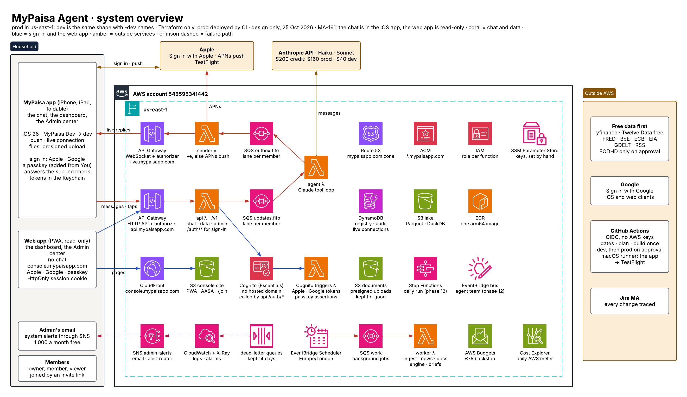
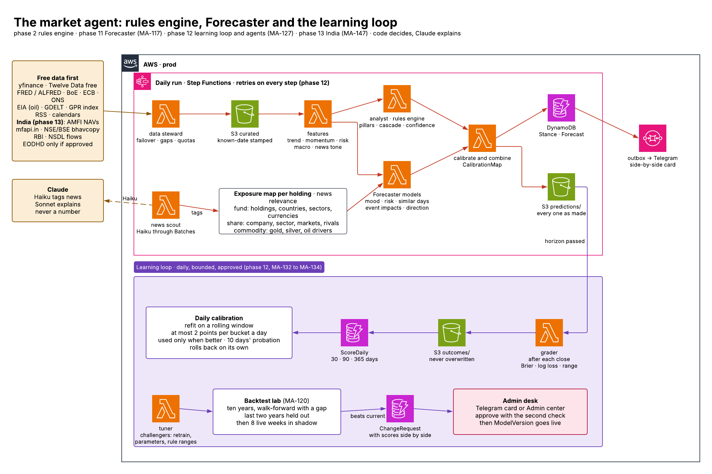
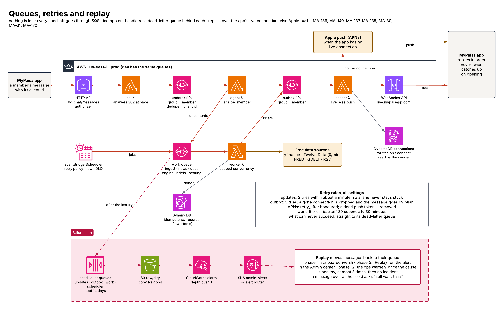

# MyPaisa Agent — Architecture (v3, the iOS app)

A private analyst for one household's investments, run from one app on the
household's iPhones and iPads by someone who is not a finance person. The app
is a chat: it keeps the record of what is held and what it is worth, computes
what moved and why, takes a stance with a confidence score, explains it
plainly, goes technical on request, asks before it acts, and grades itself.
Beside the chat the same app shows the household's dashboard, read-only: the
holdings, the audit log of every change, and a record of what the agent did
and spent. A web app, installable as a PWA, shows the same dashboard and the
owner's Admin center in any browser, read-only too. Members sign in with Apple
or Google, or a passkey on the web. It runs on AWS in account
`545595341442`, `us-east-1`, with Claude through the Anthropic API. It never
trades.

v3 (MA-161, 25 Oct 2026) moves the chat from a Telegram bot to one native
SwiftUI app for iOS and iPadOS 26, in Warm ledger on Liquid Glass (§9), and
keeps the web app for the read-only dashboard and the Admin center (§9.4). Arun: "redesign everything from Telegram to iOS app. No
more telegram login ... make the app into a cool mobile chatbot where they can
maintain everything and even see the dashboard of the holdings in the
household. Only iOS app is needed and nothing else for now." And, the same
evening: "we have webapp for the dashboard and admin portal pwa ... That will
still be there for the read only dashboard"; "The read only dashboard should
also be shown on the ios tablet duo." Everything behind
the front door (the registry, the audit log, the queues, the engine, the cards,
the budgets, the Forecaster, the agent team, India) stands as v2 drew it. v2
folded in what `docs/RESEARCH.md` found in the Agentic Trading Desk and Agent
Toolbelt: the desk's deterministic indicator and pillar engine and its
discipline, the toolbelt's card shapes and portfolio review, and the layman's
front end both of them lack. v1 (prices, briefs, alerts, chat, news, calls on
Lambda) stands underneath; sections that have not changed are kept short.

The design is drawn and explained in these places (24 Oct 2026, MA-141; redrawn for the iOS app and the web app on 25 Oct 2026, MA-161):

- **The architecture, in Lucid**, on AWS 2024 shapes, one Lucid document per
  view. They are private to the account; share them from each document's
  menu. The PNG exports embedded below, the Lucid Standard Import JSON and the
  script that generates it are in `docs/design/lucid/`.

  | View | Lucid document | Drawn in |
  | --- | --- | --- |
  | 1 System overview | [open](https://lucid.app/lucidchart/4ae817c6-847f-45f8-a10c-4509971c9c09/edit) | §3 |
  | 2 Environments, domains and delivery | [open](https://lucid.app/lucidchart/350c6593-a915-495f-88f1-a781b3ed1c5b/edit) | §18 |
  | 3 Identity and sign-in | [open](https://lucid.app/lucidchart/c23040ec-b253-47e2-a614-612dab962292/edit) | §4.5 |
  | 4 Queues, retries and replay | [open](https://lucid.app/lucidchart/ddc9bde5-18d4-468b-af6e-c1f86d7d7647/edit) | §21 |
  | 5 Where the data lives | [open](https://lucid.app/lucidchart/674e3574-9c79-403c-9157-72769a8d5fce/edit) | §20.6 |
  | 6 The market agent and the learning loop | [open](https://lucid.app/lucidchart/6f1b4c75-353c-49e5-b6e7-29fd2c18d356/edit) | §19, §22 |
  | 7 The agent team, settings, caps and alerts | [open](https://lucid.app/lucidchart/3c1a6c63-dd6b-4d6e-bd15-c2ea8fed15d4/edit) | §15.2, §20 |
  | Adding a holding (sequence) | [open](https://lucid.app/lucidchart/b50d49fd-c941-44a0-b623-7d3e99b57fd8/edit) | §4.2 |

- **The iOS app, in Claude Design** (MA-161): the screens in
  [MyPaisa iOS v1](https://claude.ai/design/p/43fdf88b-4960-4a4b-a4f1-fc653fcb7ab8)
  (three shell options, sign-in and joining, the chat and its cards, the
  dashboard, audit and activity, the Admin center, settings and notifications,
  iPad and the foldable) and the iOS kit in
  [MyPaisa DS v1](https://claude.ai/design/p/2f7310cd-e56a-4d13-8339-8fc637249c9a);
  the decision record is `docs/design/reviews/MA-161/decision.md`.
- **[MyPaisa Agent Journey](https://claude.ai/artifact/Mg2VPWVEAdbJPfeivYZ5J7)**:
  the flows end to end (invite, sign-in, adding a holding, logging money, the
  morning brief, a red alert, a question, the dashboard, the Admin center,
  failures and replay, the spend ladder, the first of the month, money in any
  currency, India), each across the member, the app, AWS, Claude and data
  lanes, with what the member sees, the safeguards and the Jira stories that
  build it.
- **[MyPaisa Market Agent](https://claude.ai/artifact/M1yBdJaBe1FmE7sv1V6wLb)**:
  the market side end to end: free data, the rules engine, news matched to
  holdings, the Forecaster's five models, both engines side by side, the
  daily learning loop, the strategy layer, how it proves itself,
  self-healing and the budgets.
- Earlier pages, kept for reference: the
  [animated architecture](https://claude.ai/artifact/DHWD7WFjsy7r3VmMvu9eDx)
  (v3, before the queues and the agent team), the
  [first user journeys](https://claude.ai/artifact/LQAFk1kz4sddEMkKnwpbam),
  the [dashboard screens](https://claude.ai/artifact/A9mF3PJ91NJ9gRshFes5qp),
  and the Telegram, Mini App and browser boards in
  [MyPaisa app v1](https://claude.ai/design/p/0bf02ae1-2de2-42a8-98ff-96046b2a26d7),
  superseded by the iOS app (MA-161).

Sources for the pages are in `docs/design/`; both new pages use MyPaisa DS v1,
"Warm ledger" (MA-101), with the crimson alert of MA-102, in light and dark.

Status: design only.

**Destination.** The app's dashboard is the future MyPaisa, the household
wealth tracker: assets of every kind (property, deposits, policies, pensions,
equities), debts, budget, a thirty-year forecast with XIRR, reports, in GBP
or INR. All of it read-only; every update comes through the chat. The current
[wealth-tracker](https://github.com/gilipersonal/wealth-tracker) repository
is the reference for those screens until they are rebuilt here with a new
design, and §12 is the road. None of that is a priority before phase 8. The
data model is shaped for it now, so that the ISA built in phase 1 and the
whole household's wealth later are the same records, not a migration.

---

## 1. The two rules, and two more

1. **Claude never produces a number.** Every figure comes from code with
   tests. Claude chooses what to say and how to say it.
2. **The app cannot trade.** No broker login, no orders. It suggests only
   ISA-safe actions.
3. **The layman sees the summary; the detail is one tap away.** Every message
   has a plain top and a technical underside. Nothing technical is shown
   unasked.
4. **One write path.** Every change to the records, whatever the screen, goes
   through the chat: a card, a Confirm tap, an audit row. The dashboard
   screens, today and when they become the full MyPaisa, are read-only by
   construction for the household's records. Arun, 24 Oct 2026: "Dashboard will be read only
   (except for admin)". The one exception is the owner's Admin center, which
   acts on admin settings and operations, never on a record, each behind the
   second check and an audit row (§4.5, §9.3).

---

## 2. What it does, as the user sees it

| You | MyPaisa |
| --- | --- |
| Open the app for the first time and sign in with Apple or Google | A three-step setup in the chat: base currency, what you hold (send a factsheet or a screenshot, or type it), how often to be told things. You become the household's owner. |
| Tap **Invite** in the Admin center (or type `/invite`) | A one-time link, sent with iOS's share sheet. Your wife opens it on her iPhone and signs in with her own Apple or Google account; she is a member of the same household, with her own chat, her own accounts and her own preferences |
| Tap **Household** or **Me** on Home or the Portfolio card | The household overview across every member and account, or your own accounts in detail. As owner you can open any member's detail; a member sees their own and the household totals |
| Send a factsheet PDF (the camera, a scan, Photos or Files) | Reads it, shows a card: name, ISIN, cost, what it holds, where it invests; you tap Confirm |
| Send a screenshot of your Monzo valuations | Reads the values, matches them to holdings, updates the records, shows a before/after card; you tap Confirm |
| Type "I put £200 into Balanced today" | Logs a contribution, adjusts units, confirms |
| Type "I put ₹20,000 into Balanced" | Balanced is in pounds, so MyPaisa says so and asks for the pounds that arrived, offers the day's ECB rate as an estimate, or a holding in rupees instead; nothing is saved until Confirm (§4.7) |
| Type "I want to log a transaction" | Asks one thing at a time, with chips: bought or sold, which holding, how much, when; skips whatever you already said; a Confirm card at the end |
| Open Home, or the app on your iPad or an open foldable | The same figures as a dashboard (on the iPad and the foldable too, with the chat beside it in a window over about 900 pt and a sheet away in a narrower one), plus the audit log of every change and what the agent did and spent; read-only |
| Open `console.mypaisapp.com` on your laptop, or the web app you installed | Sign in with Apple, Google or a passkey; the same dashboard, Audit and Activity, and for the owner the Admin center; read-only, and every change still made in the app's chat |
| Tap **Portfolio** | One table: each holding, value, day and month change, a stance chip (Add · Hold · Pause · Trim), confidence; a total line in GBP |
| Tap **Today** | The morning brief: what moved, why, anything to do |
| Tap a holding | Its screen: value and history chart, stance with confidence and horizon, "Why?", "Technical", "What if?", "Ask about it" |
| Tap **Technical** | A collapsed section opens: pillars, indicators, flags, macro regime, data quality, as numbers |
| Ask "should I add to Balanced this month?" | A stance card: ADD / HOLD / PAUSE with confidence, two reasons, what would change it, and the track record of that kind of call |
| Ask "what if the pound falls 10%?" | A scenario card from the look-through currency exposure |
| Tap **I acted** on a card | A decision record; the Saturday review compares it with what the signals said |
| Say "stop pinging me under 2%" | A preference card to confirm; saved |
| Pause MyPaisa in You, or type `/pause` | Everything scheduled stops until Resume (`/resume`); the kill switch |

Silence is a feature: about ten notifications a week, two with sound at most.

---

## 3. System context

Page 1 of the Lucid architecture ([open](https://lucid.app/lucidchart/4ae817c6-847f-45f8-a10c-4509971c9c09/edit)): the household's app on
the left (the iOS app and the web app), the chat path along the top (API Gateway, the chat api, the updates
queue, the agent, the outbox, the sender, the live connection and Apple push),
sign-in below it, the background jobs, the stores, and the failure path to the
admin's email.
The other six pages zoom into one part each and are drawn in their sections.



One container image and a handful of handlers: `api` (the chat routes, the
read-only data routes and the owner's admin routes), `agent`, `sender`,
`worker` (which runs each background job by its type: ingest, engine, news,
scoring, documents, briefs), `live` (the WebSocket connections), the
authorizer and the Cognito triggers.
Nothing waits on anything else directly:
your messages, MyPaisa's replies and every background job travel through SQS
queues that retry them and keep what still fails (§21). The agent Lambda is
the only one that talks to you in the chat, and the sender the only one that
delivers to the app. The api Lambda is the only one the app calls: its chat
routes put what you send on the updates queue, and apart from those and the
owner's admin actions in the Admin center (§9.3: the security actions, the
ceiling and caps, replays, agents' requests and settings, incidents), each
behind the second check, it can only read. Dev and prod are two copies of all of this (§18). Every other Lambda produces data they read, and
every one of them writes a `RunRecord` saying what it did (§10).

---

## 4. State: the holdings registry

The user said holdings will change and the system must save all state. The
registry is designed so that adding a new kind of thing adds data, not code.

### 4.1 Entities (DynamoDB, single table)

| Entity | Key fields | Notes |
| --- | --- | --- |
| **Portfolio** (household) | `id`, `name`, `base_ccy`, `created_by`, `budget_tokens_per_day` | The tenant. Every other item's partition key starts with the portfolio id. |
| **Member** | `portfolio_id`, `member_id`, `cognito_sub`, `display_name`, `role` (`owner` · `member` · `viewer`), `share_detail` (let other members see my accounts), `prefs` (thresholds, quiet hours, ping budget, privacy mode, simple/technical), `joined_at`, `invited_by`, `apple_sub?`, `google_sub?`, `google_email?`, `linked_at{}`, `status` (`active` · `paused` · `left`), `session_epoch` | A person, identified by their Apple or Google account (one or both, and passkeys), linked to one Cognito user (§4.5). One conversation with MyPaisa per member. |
| **Invite** | `portfolio_id`, `token`, `role`, `created_by`, `expires_at`, `used_by?` | Single use, 24-hour expiry, bound to one portfolio and role; opened as `https://console.mypaisapp.com/join/<token>`. |
| **Device** | `member_id`, `device_id`, `name`, `model`, `os`, `push_token?`, `push_env` (`sandbox` · `production`), `signed_in_at`, `last_seen_at` | One per signed-in iPhone or iPad: the sender pushes to its token (MA-170); the owner signs it out (MA-102); the member signs it out from You (MA-172). |
| **Connection** | `connection_id`, `member_id`, `device_id`, `opened_at`, `expires_at` | One per open live connection (§21): the sender posts each finished message to it; a TTL clears it. |
| **Account** | `portfolio_id`, `id`, `name`, `category` (`investment` · `cash` · `deposit` · `policy` · `pension` · `property` · `debt`), `type` (`ISA` · `GIA` · `SIPP` · `cash` · `fixed_deposit` · `policy` · `pension` · `property` · `mortgage` · `loan` · `card`), `ccy`, `institution` (`Monzo`, `LIC`, a bank, …), `country`, `owners[]` (member ids; two for a joint account) | A tax wrapper, a pot, a property or a loan belonging to one or two members. Finances are managed here, per member. Phase 1 uses `investment` and `cash`; the other categories wait for §12 but the field exists from day one. |
| **Instrument** | `id`, `kind` (`oeic` · `etf` · `stock` · `bond_etf` · `commodity_etc` · `cash` · later `property` · `deposit` · `policy` · `pension` · `debt`), `name`, `isin`, `sedol?`, `listing?` {MIC, ticker, ccy}, `yahoo_symbol?`, `base_ccy`, `exposure` {regions %, currencies %, asset classes %}, `benchmark?`, `ocf`, `price_sources[]` (ordered chain), `proxy?` (weighted basket), `country?`, `institution?`, `maturity_date?`, `rate?`, `schema_version` | The thing. Identifiers are optional because an OEIC has an ISIN and no ticker, a stock has both, cash has neither, a property has an address and a deposit has a maturity date. |
| **Position** | `account_id`, `instrument_id`, `units`, `ccy` (the currency it is bought and valued in, as the platform shows it), `avg_cost_gbp`, `target_weight?`, `protected` (never suggested for trim), `opened_at` | What is held, inside one member's account. The same instrument may sit in two members' accounts; the household view adds them up. Money logged against it is checked against `ccy` (§4.7). |
| **Valuation** | `instrument_id`, `date`, `price`, `price_ccy`, `fx_to_gbp`, `units`, `value_gbp`, `source` (`nav` · `close` · `proxy` · `user_screenshot` · `user_typed` · `formula`), `provisional` | The time series the wealth tracker reads. User-supplied values are kept alongside computed ones; a gap between them is a signal (wrong units, a fee, a late NAV). |
| **Document** | `document_id`, `kind` (`factsheet` · `kiid` · `annual_report` · `screenshot` · `cas` · `broker_export` · `spreadsheet` · `other`), `s3_key`, `sha256`, `mime`, `bytes`, `original_name`, `sent_by`, `sent_at`, `message_id`, `instrument_id?`, `import_id?`, `as_of`, `extracted` (JSON, with the source line for each figure), `confirmed_by_user` | **One row for every file a member sends, kept in S3 for good** (§4.6, MA-148). The factsheet is the source of look-through until a better feed exists. |
| **Transaction** | `position_id` or `liability_id`, `date`, `type` (`buy` · `sell` · `dividend` · `fee` · `interest` · `rent` · `repayment` · `prepayment` · `rate_change` · `maturity`), `units?`, `amount`, `ccy` (always the position's), `amount_gbp`, `orig_amount?`, `orig_ccy?`, `fx_rate?`, `fx_source?` (`as_credited` · `ecb` · `statement`), `fx_date?` | The dated cashflow ledger. From "I put £200 in", or extracted from a screenshot. XIRR, payoff curves and the forecast are computed from it, so every money movement is recorded with its date from day one. |
| **Liability** | `account_id`, `kind` (`mortgage` · `loan` · `card`), `principal`, `rate`, `term_months`, `started_at`, `emi`, `schedule[]` (computed), `ccy` | A debt: the balance against the original plan, the interest and principal split, the payoff date; its events are Transactions. Later, §12. |
| **NetWorth** | `portfolio_id`, `date`, `assets_gbp`, `debts_gbp`, by member, by category, by currency, by country | Computed daily by the engine from Valuation and Liability; the series the overview and the forecast chart read. Later, §12. |
| **Budget**, **ForecastAssumptions** | per member; per portfolio | Monthly income and planned spend with EMIs and surplus; the growth, contribution and surplus-allocation assumptions the thirty-year projection runs on. Later, §12. |
| **Signal** | `instrument_id`, `date`, indicators, pillars, flags, forecast range, data quality | From the engine. |
| **Stance** (call) | `instrument_id`, `made_at`, `action`, `horizon_days`, `confidence`, `reasons[]`, `invalidated_if[]`, `entry_px`, `state_bucket`, `graded` | Paper-traded and graded. |
| **Forecast** | `instrument_id`, `date`, `horizon_days` (20), `p_up`, `p_fall_5`, `range` {p10, p50, p90}, `mood`, `analogs` {count, recovered}, `events[]`, `drivers[]`, `model_version`, `graded` | One per holding per day from the Forecaster (§19), later; graded like a stance. |
| **Setting**, **ConfigVersion** | `key`, `value`, `schema` (type, range), `auto_band`, `approval` (`auto` · `admin`), `version`, `updated_by` (the admin or an agent), `reason`; one `ConfigVersion` row per change, never edited | Every behaviour the admin controls (§20.2). |
| **ChangeRequest** | `id`, `agent`, `setting` or `action`, `from`, `to`, `why`, `evidence` (S3 key), `cost`, `risk`, `undo`, `urgency`, `status` (`proposed` · `approved` · `rejected` · `expired` · `applied` · `rolled_back`), `decided_by`, `via` (`chat` · `admin_center`), `expires_at` | An agent's request for the admin's approval (§20.3). |
| **AdminQuestion**, **Incident** | the agent, the question or what happened, what was tried, the options, the answer or decision, timestamps | What agents need from the admin, and what they could not fix themselves (§20.3, §20.5). |
| **ScoreDaily** | `model`, `instrument_id`, `mood`, `date`, the day's graded count, hit rate, Brier score, log loss, range coverage, rolling 30, 90 and 365-day values | The learning loop's daily scoreboard (§20.4); the full outcomes live in S3. |
| **CalibrationMap** | `model`, `version`, `buckets[]` (said vs seen), `fitted_on`, `window`, `status` (`probation` · `live` · `rolled_back`) | The map from raw confidence to calibrated confidence (§20.4). |
| **ModelVersion** | `name`, `version`, `trained_at`, `data_through`, `s3_key`, `walk_forward` {brier, log_loss, vs_base_rate}, `live` {brier, weeks, vs_rules_engine}, `status` (`shadow` · `live` · `off`) | Which Forecaster model made a forecast, how it tested, and whether it may be shown (§19.6). |
| **MacroRegime** | `date`, per-basket composites and regimes | Shared by all instruments. |
| **AlertState**, **Decision**, **ChatTurn** | per member | A member's chat memory, decisions and alert cooldowns are their own. `ChatTurn` is one row per message, holding the model's content blocks exactly as returned, kept ninety days (§8). |
| **BudgetSettings** | `portfolio_id`, `ceiling_usd` (prod $160, dev $40: the Max 20x plan's $200 credit), `steps[]` (70, 85, 95, 100), `daily_guard_x` (3), `run_max_calls` (8), `hard_limit_usd` (the Console workspace limit, typed in to match it), `agent_shares{}` (§20.7), `member_share_pct` (60), `cycle_start_day` (the day the plan's credit renews), `updated_by`, `updated_at` | The Claude ceiling the owner moves in the Admin center; every change is an audit row (§15.1). |
| **AwsSpendMonth**, **AlertRule**, **Alert** | AWS and others: month to date by service and `env`, the forecast, `cap_gbp`, `steps[]`, `actions{}`, `step`; alert routing: type × severity → app, push, email, quiet hours, cooldown; each alert sent, where and when | The AWS meter and caps, and the alert router (§15.2). |
| **SpendMonth** | `portfolio_id`, `cycle` (its start date), `total_usd`, `by_member{}`, `by_feature{}`, `by_agent{}`, `by_model{}`, `by_day{}`, `step` | The running meter for one cycle, added to atomically after every model call and read before every call (§15.1). |
| **SentimentIndex**, **ArticleScore**, **MessageSeen** | per portfolio, global, or per member (the client ids already taken, §21.2) | |
| **PendingAction** | `member_id`, `kind` (`log_transaction` · `add_holding` · `update_valuation` · `settings` · `confirm`), `step`, `collected` (the answers so far), `message_id`, `expires_at` (24 h) | The state of a guided flow: what MyPaisa is waiting for from this member. The next message or tap resumes it; expiry clears it. |
| **AuditEvent** | `portfolio_id`, `ts`, `seq`, `actor` (a member id, or `system:ingest`, `system:engine`, `system:migration`), `via` (`typed` · `button` · `screenshot` · `factsheet` · `cas` · `broker_export` · `agent_proposal` · `schedule` · `migration`), `document_id?` (the file a change came from), `entity`, `entity_id`, `action` (`create` · `update` · `delete` · `confirm` · `reject`), `before`, `after`, `run_id`, `prev_hash`, `hash` | Append-only, one row per change to the records, written in the same transaction as the change. Hash-chained like the calls ledger, so a missing or edited row shows. See §4.6. |
| **RunRecord** | `run_id`, `function`, `trigger` (`message` · `action` · `schedule:<name>` · `alarm`), `member_id?`, `started_at`, `finished_at`, `status`, `model_calls[]` (model, input, output and cached tokens, cost, ms), `tool_calls[]` (name, ms, ok, error), `messages_sent`, `outcome`, `error?` | What one run of any Lambda did and cost. 90-day TTL. The app's Activity screen and the cost guard rails read these. See §10. |

Signals and macro regimes are per instrument and shared by everyone who holds
it; stances are per position, because the horizon, the drift from target and
the "holding" flag belong to one member's account.

Every item carries `schema_version`; a migration is a Lambda that rewrites
items of an older version, run once from a script, never by hand.

### 4.2 Adding a holding, from the chat

The file goes straight from the phone to the documents bucket through a
presigned upload, and every hop after that goes through a queue (§21): the
message waits in the member's lane, the document read is a job on the work
queue run by the worker, and every reply goes out through the outbox to the
app's live connection, or by push when the app is closed. The sequence in Lucid:
[open](https://lucid.app/lucidchart/b50d49fd-c941-44a0-b623-7d3e99b57fd8/edit).


Any field Claude is unsure of is shown in amber and asked about. A holding is
never saved without the Confirm tap. The same path handles an ETF (ISIN and
ticker from the factsheet), a share (ticker and exchange), or cash.

### 4.3 Kind profiles

A `kind` is a bundle of defaults, so a new holding of a known kind needs no
code. The profiles live in configuration, versioned with the registry.

| Kind | Price chain | Look-through | Engine | Cascade temperament |
| --- | --- | --- | --- | --- |
| `oeic` (a UK fund such as the Monzo BlackRock ones) | fund NAV chain (§5.1), proxy basket intraday | factsheet, then the product page | all pillars; macro from exposure weights | patient: ADD on steady trend, PAUSE on exhaustion |
| `etf` (UCITS or US-listed) | exchange close (EODHD, Twelve Data, yfinance), issuer NAV as check | issuer's holdings download (daily for iShares) | all pillars; macro from exposure weights | patient |
| `stock` | exchange close | the company itself; sector, country, currency | adds the Valuation pillar and the stock cards | cautious: single-name risk raises the bar for ADD; earnings dates block changes for two sessions |
| `bond_etf` | exchange close | duration, credit quality, currency from the holdings file | trend and momentum downweighted; risk pillar reads duration × rate moves | slow |
| `commodity_etc` (a metal, oil, or a basket) | exchange close; spot price as check | the metal and its pricing currency (usually USD) | no valuation; risk pillar weighted ×2; macro from dollar strength and real yields, not the equity basket | slowest to ADD, quickest to PAUSE; drawdown alerts at a wider band (12%) because 8% is a normal week for silver |
| `cash` | FX only | the currency | none | n/a; it is the thing contributions come from |
| `property`, `deposit`, `policy`, `pension` (later, §12) | none; the last user figure, or a formula (a deposit accrues at its rate to maturity, a policy follows its schedule) | the asset itself: country, currency, institution | no pillars; XIRR from the ledger; maturity and growth-rate panels | n/a; MyPaisa asks for a valuation when one is overdue and announces a maturity before it lands |
| `debt` (`mortgage` · `loan` · `card`; later, §12) | none; the balance from the schedule and the logged events | the lender; currency | no pillars; interest split, payoff date, prepayment what-ifs | n/a; MyPaisa asks when an EMI, a rate change or a preclosure is due |

Adding a kind that is not here (a bond, a gilt held directly, crypto) means
writing a profile and, if needed, a price plugin. Nothing else changes.

### 4.4 Worked example: today's holdings

Everything held through Monzo, in GBP, as it would sit in the registry. Rows
are what MyPaisa would record after the factsheet and screenshot path; figures
marked ~ are examples.

| Instrument | Kind | ISIN | Listing recorded | Price chain | Exposure | Notes |
| --- | --- | --- | --- | --- | --- | --- |
| BlackRock MyMap (Monzo "Balanced") | `oeic` | from the factsheet | none (daily NAV) | yfinance `0P…L` → BlackRock page → FT → proxy → screenshot | ~66% shares, ~34% bonds; mostly USD under the hood | the proxy basket comes from its top holdings |
| iShares NASDAQ 100 UCITS ETF (Acc) | `etf` | IE00B53SZB19 | XLON `CNX1` GBP (the USD line is `CNDX`) | EODHD → Twelve Data (US line `QQQ` as a check) → yfinance `CNX1.L` | 100% USD, US large-cap tech, ~50% in the top ten | charge 0.30% |
| iShares Automation & Robotics UCITS ETF (Acc) | `etf` | IE00BYZK4552 | XLON `RBTX` GBP (USD line `RBOT`) | EODHD → yfinance `RBTX.L` | global, roughly equal-weighted small and mid caps; USD, JPY, EUR, TWD | charge 0.40%; overlaps the NASDAQ ETF in a few names (computed, not assumed) |
| iShares Physical Silver ETC | `commodity_etc` | IE00B4NCWG09 | XLON `ISLN` GBP (USD line `SSLN`) | EODHD → yfinance `ISLN.L`; silver spot × GBP/USD as the check | silver, USD-priced | not a fund: a debt security backed by bars in a vault; charge ~0.20% |
| Monzo pot | `cash` | — | — | — | GBP | where contributions come from |

Three things this example teaches the design:

- **The ISIN is shared by the USD and GBP lines**; only the ticker differs.
  The registry stores the listing separately, and MyPaisa asks which line
  when the factsheet does not say (Monzo most likely holds the GBP line).
- **London GBP lines are often quoted in pence (GBX)** by Yahoo and some
  feeds. The price plugin normalises to pounds or every valuation is off by
  100×; a test asserts it.
- **Every holding here is a dollar asset in a sterling wrapper.** One move
  in GBP/USD moves all of them, so the FX line in the brief is a
  portfolio-level item, and the US macro basket matters far more than the
  UK one for this portfolio.

The platform fee Monzo charges on top of each product's own charge is part
of the cost drag in `fund-vs-benchmark`; it is a preference (percentage per
year), set once per account.

### 4.5 Identity, members and views


Page 3: the two doors (the iOS app and the web app), Sign in with Apple, Google and a passkey, the custom auth, Cognito, the Keychain and the session cookie, the authorizer, and the owner's sign-out and pause. [Open it in Lucid](https://lucid.app/lucidchart/c23040ec-b253-47e2-a614-612dab962292/edit).
**There are no passwords.** Apple or Google vouches for the person: Sign in
with Apple on any iPhone or iPad, or Sign in with Google for a member who
prefers it (Arun, 25 Oct 2026, MA-161: "No more telegram login, on Google SSO
or iOS login"). "Signing in" is: which Apple or Google account is this, which
member is it linked to, and which household is that member in.

**One identity store, on AWS from day one** (Arun, 24 Oct 2026; MA-109). Each
environment has its own Amazon Cognito user pool, `mypaisa-dev-users` and
`mypaisa-prod-users` (Essentials plan, free under 10,000 monthly users), with
one user per member: that member's Apple account, Google account and passkeys
are all linked to the same Cognito user. Password sign-in and self sign-up are
off, and a user is created only when someone joins through an invite.

| Step | How |
| --- | --- |
| The buttons | The app shows Apple's and Google's own buttons, Apple's first, and nothing else. Sign in with Apple runs natively (`ASAuthorizationAppleIDProvider`, no name or email asked for); Google runs through Google's iOS SDK in the system's web sheet, with PKCE. |
| The token | Before either sheet opens, the app asks the api for a one-time nonce (`/auth/nonce`); Apple's identity token (carrying the nonce's SHA-256) or Google's ID token (carrying the nonce) comes back. |
| The exchange | The app posts the token to `/auth/apple` or `/auth/google`. The api finds the member that provider account (`sub`) is linked to and starts Cognito's custom auth for them; the verify trigger checks the token against Apple's or Google's published keys: issuer, audience (the app's bundle id for Apple, the environment's Google iOS client id for Google), expiry, an issue time under five minutes, the nonce, and no replay. Cognito then issues that member's tokens. |
| An unknown account | An Apple or Google account linked to no member is refused, whatever its address, unless the request carries a valid invite token, which creates the member (Joining, below). A paused member gets one line and nothing else (MA-102). |
| In a browser | The web app (§9.4) shows the same two buttons, through Sign in with Apple's JS (the environment's Services ID as the audience) and Google Identity Services (the environment's Google web client id), and a passkey. The same `/auth/apple` and `/auth/google` exchange runs; no client secret is used. The api then sets an `HttpOnly`, `Secure`, `SameSite=Strict` session cookie for its own host, with five-minute access tokens behind it that page scripts never see. |
| A passkey | A member adds one from You in the app (MA-77). In the app it answers the second check (below), never the sign-in screen, which shows Apple and Google only; in a browser it signs in to the web app. To sign in with it, the page asks `/auth/passkey/options` for a one-time WebAuthn challenge, the device signs it under Face ID or Touch ID, and the assertion goes to `/auth/passkey`; the api starts Cognito's custom auth for the member whose credential it is, and the verify trigger checks the signature against that credential's stored public key, the challenge, the origin and the relying-party id. The relying-party id is the environment's console domain (`console.mypaisapp.com`, `console-dev.mypaisapp.com`): it is the web app's origin and serves the iOS app's association file, whose `webcredentials` entry lets one passkey work in both. MA-109 confirms it before anyone registers a passkey; changing it later strands every passkey made. In a browser the api then sets the same session cookie. |
| A new device | Signing in on a device or a browser the member has not used before sends a push to their other devices and a card in their chat: "Signed in on Asha's iPad, 09:12. Was this you?", with Sign out that device; the owner sees it in Members and devices (MA-102, MA-76). |
| On the device | Tokens live in the Keychain, this device only, readable after first unlock. Access tokens last five minutes and are refreshed in the background with the refresh token, which rotates on use. Each signed-in iPhone or iPad is a `Device` row with its name, model, last seen and push token. |
| Every call | The api's authorizer checks the access token, the member's status and session epoch on every HTTP call and every live connection (§21). Sign out everywhere and pause use Cognito's own calls (`AdminUserGlobalSignOut`, `AdminDisableUser`) together with the member's session epoch, so they take effect on the next request (MA-102); signing out one device deletes its `Device` row and revokes its refresh token. |

**The second check** (MA-76, MA-102). Some actions need proof that the member
is holding the device now: the owner's admin actions (§9.3), from the Admin
center or the admin's chat (§20.3), an
import's Confirm and rolling an import back (§18.5, §22.2), leaving the
household (MA-172), and nothing else. The app asks
the api for a challenge bound to that action, then gets a fresh assertion:
Sign in with Apple again (iOS shows a Face ID sheet), or, where the member has
added one, a passkey (Face ID); a member who signs in only with Google signs in
with Google again. In the web app it is a passkey or a fresh Apple or Google
sign-in in the browser. The api accepts the action only with an assertion under
five minutes old whose nonce is that challenge. The app's own Face ID lock
(MA-171) is a local comfort and never authorises anything on the server.

**Joining.** The owner taps Invite in the Admin center (or types `/invite`,
optionally `/invite viewer`). The api makes a one-time link,
`https://console.mypaisapp.com/join/<token>` (`console-dev` for dev), single use,
24-hour expiry, bound to this household and that role, and the owner sends it
with iOS's share sheet. The invitee opens it on their own iPhone: the link
opens MyPaisa (or a page saying where to get it, MA-73), shows the invite
("Arun invited you to the Dutta household"), and their Sign in with Apple or
Google creates their member and Cognito user; then the three setup questions.
The owner removes a member from Members and devices in the Admin center.

**More than one way in** (MA-77). A member can add a second sign-in, Apple or
Google, or a passkey, from You: already signed in, they complete the new
provider's sign-in, and the api links that `sub` to their Cognito user. `sub`
is the key and the address is for display, so a renamed account still works
and an address handed to someone else does not. The owner can unlink a
member's sign-in from the Admin center; unlinking signs that account out
everywhere. Every link, unlink and sign-in is an audit row. Leaving the
household (MA-172) deletes the member's Cognito user and revokes Apple's and
Google's tokens (Apple's through its REST endpoint, signed with the
environment's Sign in with Apple key from SSM); their accounts and history
stay with the household.

**Roles.**

| Role | Can |
| --- | --- |
| owner | Invite and remove members, change any account or holding, set the household budget and settings, see every member's detail. The owner is the household's one admin (Arun, 25 Oct 2026: "there is only 1 admin"): the only person who sees the Admin center, the agents' requests in the chat and the admin desk |
| member | Add, change and remove holdings in their own accounts; see the household overview; see their own detail; opt in to sharing their detail with the household |
| viewer | Read the household overview and whatever members share; nothing else |

**Views.** The Portfolio card and Home have a switch: **Household**
(every account, every member, one total) and **Me** (my accounts). The owner,
and any member whose detail is shared, appear as further tabs. A member's
brief covers their own accounts plus one household line; the owner's brief
covers the household with a line per member. Alerts go to whoever owns the
account, and to the owner as well if the owner asks.

**Isolation.** Every item is keyed by the household, every tool call carries
the calling member as a principal, and the registry layer refuses a read or
write outside that member's rights. One DynamoDB table cannot enforce that
with IAM alone, so it is enforced in code and covered by tests ("member A can
never read household B; a member cannot read another member's detail unless
shared"). Each member's chat memory, decisions, preferences and cooldowns are
their own. The monthly Claude ceiling is the household's (§15.1), and no
member may spend more than their share of it (60% by default), so one chatty
member cannot spend the household's allowance.

**Scope.** Two members in one household is personal software. Several
unrelated households using an app that says "ADD, 64% confidence" starts to
look like investment advice to the public, which is regulated in the UK. The
model supports more households; using it that way is a separate decision
about wording and scope, not a technical one.

### 4.6 The audit log

Every change to the records leaves a row. Not a log line that may or may not
be there, a row in the same DynamoDB transaction as the change, so a change
without its audit row cannot happen. Each row says who (the member, or the
system job), when, through what (a typed sentence, a button, a screenshot, a
factsheet, a proposal from the agent, a schedule), which record, what it was
before and what it is after, and which run made it. Rows are chained by hash,
the same way the stance ledger is, so a deleted or edited row breaks the chain
and the weekly check says so.

What counts as a change: holdings, positions, transactions, accounts,
members and invites, preferences, and every valuation a person supplied. The
nightly computed valuations and signals are a time series, not audit rows;
they are already dated and sourced, and logging each one would bury the rows
that matter.

Who sees what follows the roles in §4.5: a member sees the rows for their own
accounts and for the household-level records; the owner sees every row. The
rows are readable in two places: the Audit screen in the app, with filters
by member, record and date, and from the chat with a question such as "what
changed this week?", which the agent answers through `get_audit`. Rows are
never deleted; at a few hundred a year they cost nothing to keep.

**Every file is kept, and opens from the log** (Arun, 24 Oct 2026: "all
the files and images I send should be stored on S3 and I should be able to
view that in audit logs"). Every file or image a member sends (a factsheet,
a screenshot, a CAS statement, a broker export, a spreadsheet) is copied to
`s3://mypaisa-<env>-documents/<household>/<member>/<yyyy>/<mm>/` before
anything reads it, whatever happens next, with a `Document` row and an audit
row of its own; every change made from it carries its `document_id`
(MA-148). Nothing is deleted after reading: the bucket has no expiry rule,
and prod's is versioned and protected from destruction. On the Audit screen a
row made from a file shows its kind, name and size, a thumbnail for an
image, and Open; a Files view lists every file with the changes it fed
(MA-149). Open is a presigned link valid five minutes, given only after the
authorizer checks the role: a member opens their own files, the owner any,
a viewer none; each opening is itself an audit row, and the file opens in
Quick Look. In the chat a change card's Source button opens the original.

### 4.7 Money in any currency, checked against the holding (MA-156)

Arun, 24 Oct 2026: "On the telegram App, I should be able to add
transactions using Any currency for any fund and chatbot to figure what the
base currency of the holdings, If the holdings are in GBP and I try to invest
INR to GBP holding, chat should be able to correct me."

Every holding has one currency: the one it is bought and valued in, as the
platform shows it (`Position.ccy`). It is read from the factsheet or the
screenshot when the holding is added and shown on that Confirm card, so it is
confirmed once and never guessed again. A fund's own base currency
(`Instrument.base_ccy`, often USD) can differ from the share class a member
holds (GBP); the position's currency is the one that counts here.

| The member types | MyPaisa |
| --- | --- |
| "I put 200 into Balanced" | No currency named: the holding's is assumed, and the Confirm card says "£200, in pounds as Balanced is" |
| "I put £200 into Balanced" | Same currency: the card as in §4.2, then Confirm |
| "I put ₹20,000 into Balanced" | Saves nothing yet. "Balanced is held in pounds (GBP), so it can't take rupees. The rupees were changed to pounds on the way in." Then the guided flow's own amount question, asked again in the holding's currency: "How many pounds arrived?" Type them or send the platform's confirmation; the estimate is one tap with its figure on the button, **About £177.78 · ECB estimate** (marked an estimate, offered once the rates load; with privacy on it reads **Use the ECB estimate**); a rupee holding is named when there is one (**Nifty 50 instead**); **Cancel**. Confirm stays a separate tap (MA-156, option 1b, picked 25 Oct 2026) |
| "1.5 lakh into my Nifty 50 index fund" (phase 13) | An INR holding, so ₹1,50,000 with no question; pounds typed against it get the same correction the other way |
| "Which currency is Balanced in?" | "Pounds (GBP), from the factsheet you sent on 3 March" |

- **Reading amounts is code.** A parser reads symbols (£ $ € ₹), codes
  (GBP, USD, EUR, INR and every currency the ECB publishes), words (pounds,
  dollars, euros, rupees, Rs) and Indian number words (lakh, crore). Claude
  only fills the fields when the wording is free; the figure is always the
  member's own, echoed back for Confirm. "$" means US dollars unless the
  member holds another dollar, when MyPaisa asks which.
- **A converted figure is never Claude's.** The pounds typed in answer to
  "How many pounds arrived?" are the member's figure, recorded with the rupee
  amount and the rate the engine works out from them beside it. The ECB
  estimate button is the engine's conversion at the ECB reference rate
  for that day, or the last one published before it at a weekend or an ECB
  holiday (§5.3), with the rate and its date on the card. The ECB publishes
  each currency against the euro, so pounds to rupees is the engine's cross
  of the two euro rates of that day. It is marked an
  estimate until a statement, a screenshot or the next valuation confirms it.
  The button appears once the daily rates are loaded (MA-44, phase 2);
  before then it is left out and the question is the same.
- **Stored in the holding's currency, with the original kept.** The
  Transaction's `amount` and `ccy` are the position's; `orig_amount`,
  `orig_ccy`, `fx_rate`, `fx_source` and `fx_date` keep what was typed and
  how it became the recorded figure. The audit row (§4.6) shows both, and a
  screenshot or statement it came from is its `document_id`.
- **Every pair, both ways, every door.** The same check runs on a typed
  message, the guided flow, a screenshot, and a CAS or broker line (§22.2)
  whose currency differs from the holding's. Privacy mode shows no amount and
  no rate on the card, only words, currencies and dates (the rate with one
  amount would give the other away); Show amounts reveals one card.
- **Designed first.** Three options were drawn in Claude Design for the
  Telegram chat (`Currency check options.dc.html`, MyPaisa app v1) and Arun
  picked 1b on 25 Oct 2026 (`docs/design/reviews/MA-156/decision.md`). Since
  MA-161 the spec is the iOS board `iPhone · Currency check` in MyPaisa iOS v1
  (planned): it carries 1b's content and order (the amount asked again in the
  holding's currency, the ECB estimate one tap, Confirm a separate tap, no
  amount or rate with privacy on) into the app's guided flow. The Telegram
  boards stay only as the record of the pick; nothing is built from them. The
  states still to draw before the build are MA-156's `undrawn` list in
  `docs/trace.json`.

---

## 5. Data layer

### 5.1 Price sources: one plugin per feed, a chain per kind, chosen by configuration

Every feed is a plugin behind one small contract, and which plugins run, in
which order, is configuration per environment. Yahoo Finance (`yfinance`,
free, no key) is the default everywhere and the only feed local development
needs. Switching to EODHD is a setting plus a key in SSM, not a code
change, and it is a last resort: free sources first (yfinance, Twelve Data's
free tier, free websites where their terms allow), EODHD only when the data
steward shows a free source cannot serve a holding and the admin approves
(§20.3).

**The contract.** A plugin implements:

```python
class PriceSource(Protocol):
    name: str                                   # "yfinance" · "eodhd" · "twelvedata" · "issuer_page" · "ft" · "proxy" · "screenshot"
    def supports(self, instrument: Instrument) -> bool: ...
    def daily_bars(self, instrument: Instrument, since: date) -> Bars: ...   # native currency, with source, fetched_at, provisional
    def latest(self, instrument: Instrument) -> Quote | None: ...
    def fx(self, pair: str, since: date) -> Rates | None: ...                 # optional
```

Each plugin owns its own identifiers on the instrument (`identifiers`
holds the Yahoo symbol, the EODHD code, the Twelve Data symbol and the ISIN
side by side), its key in SSM (`/mypaisa-agent/<env>/<plugin>/api_key`),
its rate limit, its GBX-to-GBP normalisation, its freshness rule, and its
recorded fixtures. The ingest job sees only `Bars`, never a vendor shape.
A plugin that is not in any chain is never imported, so a missing key is
not an error.

**Chains by configuration.** The chain per kind lives in
each environment's Terraform root (`infra/dev/terraform.tfvars`,
`infra/prod/terraform.tfvars`) and reaches the Lambdas as one
environment variable, with a per-instrument override in
`Instrument.price_sources[]` for the odd case:

```hcl
# infra/dev/terraform.tfvars (local uses the same shape from a .env file)
price_chains = {
  oeic      = ["yfinance", "issuer_page", "ft", "proxy", "screenshot"]
  lse_etf   = ["yfinance", "twelvedata", "issuer_page", "stale"]
  us_etf    = ["twelvedata", "yfinance", "stale"]
  cash      = ["ecb", "twelvedata"]
}
# infra/prod/terraform.tfvars, once EODHD is chosen: put it first and add its key
#   lse_etf = ["eodhd", "yfinance", "twelvedata", "issuer_page", "stale"]
#   us_etf  = ["twelvedata", "eodhd", "yfinance", "stale"]
```

The first plugin that answers with fresh data wins, and the brief says
which one did. `stale` is the last entry everywhere: the previous close,
labelled, never silently reused.

| Kind | Default chain (local, dev, and prod until switched) | With EODHD | Freshness |
| --- | --- | --- | --- |
| OEIC (Monzo's BlackRock funds) | yfinance on the fund's `0P…L` id · BlackRock UK product page · FT tearsheet · proxy basket · last user screenshot | only if approved: EODHD by ISIN under `.EUFUND` (many UK funds are listed; how far back each fund's history goes is checked with the free key first), then the default chain | NAV once a day, published next morning; proxy intraday, labelled provisional |
| ETF or ETC on LSE / Xetra | yfinance · Twelve Data (free tier, if it serves the exchange) · issuer NAV (iShares publishes daily) · stale | eodhd · yfinance · Twelve Data · issuer NAV · stale | Each exchange close; GBX normalised to GBP |
| ETF or stock on NYSE / Nasdaq | Twelve Data (free tier) · yfinance · stale | twelvedata · eodhd · yfinance · stale | 21:00 UK close |
| Stock on LSE / Xetra | as ETF on LSE / Xetra | as ETF on LSE / Xetra | same |
| Commodity ETC | as its listing, plus the metal's spot price × FX as a sanity check | same | same |
| Cash | ECB, Twelve Data as fallback | same | |

**Proving a plugin.** Every plugin passes the same contract test suite on
recorded responses: the same instrument and date range give the same `Bars`
shape, pounds not pence, the stale rule, idempotence per date, and a clean
failure when the vendor is down. Tests never touch the network; a deliberate
command refreshes the recordings. When two plugins are configured for the
same instrument the ingest job records both, and the Activity page (§9.3)
shows where they disagree (a close more than 0.2% apart, a missing day, a
late correction). That report is how the "free first, EODHD if London
closes prove unreliable" decision of phase 2 is made with numbers rather
than impressions.

Twelve Data's free tier (8 credits a minute, 800 a day) is used for
everything it serves: first in the chain for the US lines, the US macro
basket, the earnings calendar and the FX fallback, and second for London and
Frankfurt closes from day one. Whether the free tier actually returns LSE
and Xetra bars is not known; the chain simply skips a plugin that answers
nothing, and the source-comparison report shows what it served. If it does
serve them, EODHD is unnecessary. The daily credit budget is enforced in the
plugin: the ingest job spends at most 200 a day, so the agent's own calls
(symbol search, the earnings calendar on demand) never run the tier dry.

Input hygiene, from the desk: drop interpolated bars, append today's close only
when the session has traded, mark a series STALE when its last bar is older
than the previous session and exclude it from scoring (the circuit breaker).
Every job is idempotent per date.

### 5.2 Look-through

From the factsheet (and later the product page): asset allocation, top
holdings, regional and currency split. It drives three things: the **proxy
basket** for a fund's intraday read, the **currency split** of each move, and
the **overlap review** across holdings. Refreshed when a new factsheet is
uploaded or monthly from the page.

### 5.3 FX, calendars, time

GBP base; USD, EUR and INR, all published daily by the ECB. Each member can
read figures in GBP or INR; the stored value is always both the native
amount and its GBP equivalent on the day. Money typed in one currency for a
holding in another is checked and converted as in §4.7. Exchange calendars XLON, XETR,
XNYS. All schedules in `Europe/London`.

---

## 6. The analysis engine (deterministic, ported from the desk)

### 6.1 Indicators

EMA 20/50/200 (SMA seed), Wilder RSI-14, MACD 12/26/9 with histogram slope,
TRIX-15 with EMA-9 signal, Bollinger 20/2 with %B, slopes vs 5 bars,
`bars_since_below_ema20`; plus ATR-14, realised volatility (20-day and EWMA)
and its 3-year percentile, drawdown from the 1-year high, 12-1 momentum,
proxy-vs-NAV gap. The desk's known-answer self-tests become golden-file tests
and also run at the start of every engine run; a failing self-test blocks
scoring that day and tells you.

### 6.2 Pillars (−2..+2 each)

| Pillar | Inputs | Source |
| --- | --- | --- |
| Trend | price vs EMA20, EMA20>EMA50, EMA50>EMA200, EMA200 slope; partial components labelled | desk |
| Momentum | RSI zones (45/55), MACD histogram sign, TRIX vs signal | desk |
| Macro | the cross-asset regime of the basket(s) the instrument is exposed to, weighted by look-through; US basket as the desk (RSP/SPY, HYG/LQD, IWM/SPY, SPY/TLT, XLY/XLP, SPY-TLT correlation, 10Y−2Y when available); UK and EU baskets from UCITS equivalents; for a commodity ETC, dollar strength and real yields instead of the equity basket | desk + ours |
| Risk | volatility percentile, drawdown depth, proxy gap, bars present, NAV age | ours |
| Valuation (stocks only, later) | P/E, P/S, FCF yield, EV/EBITDA vs sector; cheap…expensive | toolbelt |

Flags, from the desk: exhaustion, relentless-bearish, rebound, death-cross.

### 6.3 The holder's cascade

The desk's cascade rotates capital; ours accumulates with care. `holding` is
always true for a position and false for a watchlist item.

| Action | When | Framing |
| --- | --- | --- |
| **ADD** | Holding; trend ≥ 0 and momentum ≥ 0, or a rebound with healthy structure after a drawdown; risk not elevated | Make this month's contribution here, or bring it forward |
| **HOLD** | Default for a holding with no triggers | Nothing to do |
| **PAUSE** | Holding; exhaustion ≥ 2 or risk elevated or adverse macro | Keep what you have; delay new money until the next review |
| **TRIM** | Holding; drift above target by more than the band, or relentless-bearish ≥ 3 with a death-cross, and the position is not protected | Rebalance toward target; never "sell everything" |
| **REBALANCE** | Portfolio-level drift beyond the band | Move the next contributions, not the holdings, unless drift is large |
| **WAIT / WATCH** | Not holding; a candidate | No entry trigger yet; the trigger that would change it |

Adverse macro and elevated risk tighten the framing and lower confidence; they
never change the pillar numbers. Sentiment may tilt the action one notch only
when the price pillars do not contradict it. News alone never triggers a red
alert.

### 6.4 Confidence score

`confidence = clamp(0.5 + agreement + persistence + quality + history, 0, 0.95)`

- **agreement**: pillars pointing the same way (+0.05 each, −0.05 each
  against)
- **persistence**: bars the state has held (0 for 1 bar, up to +0.10 for 10+)
- **quality**: −0.10 if partial components, stale or provisional data, or a
  proxy gap over 1%
- **history**: the empirical hit-rate of past stances in the same state
  bucket, once 20 or more exist, pulling the score toward it

Shown as a percentage; below 55% the card says "no clear view". Calibrated
weekly (Brier score, reliability table by bucket); the mapping changes only
after 8 weeks of evidence and the change is logged. From phase 12 the
learning loop grades every day and moves the map daily within small bounds,
with an automatic rollback; changes to the rules themselves still need
evidence and the admin's approval (§20.4).

### 6.5 Forecast ranges

1-month return distribution by volatility-scaled block bootstrap on the
instrument's own history: 10/50/90th percentiles and `P(fall > 5%)`.

### 6.6 Wealth maths (later, §12)

The same rule applies: code computes, Claude explains. For the full MyPaisa
the engine gains a `wealth/` module, deterministic and tested against known
answers:

- **XIRR** on the dated cashflow ledger of a position, an account, a member
  or the household, with the current value as the closing flow: Newton's
  method with a bisection fallback, matched to a spreadsheet's XIRR on
  fixture ledgers to the penny, and the same ledger the tracker's asset page
  shows.
- **Deposits and policies**: accrual at the stated rate to maturity, the
  maturity timeline (next twelve months, open-ended), what a maturing sum
  could do next.
- **Debts**: the EMI, the schedule, the interest and principal split per
  year, the balance curve against the original plan, prepayment and
  preclosure what-ifs.
- **Net worth**: the daily series by member, category, currency and country;
  the crossover of assets over debts.
- **The forecast**: a thirty-year projection from stated assumptions
  (growth per category, contributions, surplus allocation, maturities,
  EMIs ending), month by month, with the assumptions shown beside the curve
  and every change to them an audit row.

---

## 7. Research cards (from the toolbelt, rebuilt for funds)

Every card: a verdict from a fixed enum, a one-liner, evidence, a raw-data
block, `dataSources` with per-source success and `fetchedAt`, `generatedAt`.
Numbers computed, words synthesised, output via structured outputs.

| Card | For | Verdict enum |
| --- | --- | --- |
| `stance` | any holding | ADD · HOLD · PAUSE · TRIM · REBALANCE · WATCH, with confidence and horizon |
| `holding-profile` | fund, ETF | what it is, cost, where it invests, role in the portfolio |
| `overlap-review` | the portfolio | HHI, effective positions, look-through overlap, currency exposure, duration; weakest link; gaps |
| `fund-vs-benchmark` | fund, ETF | on_track · lagging · ahead, with tracking difference and cost drag |
| `bear-vs-bull` | any | bull_wins · slight_bull · too_close · slight_bear · bear_wins, three arguments each with evidence |
| `scenario` | the portfolio | impact of index and FX shocks from look-through |
| `valuation-snapshot`, `earnings-analysis` | stocks only, later | as the toolbelt |

---

## 8. The agent

One Claude tool loop (Sonnet 5.5 for chat and cards, Haiku 5.5 for filters
and scoring, Opus 5.5 for the Saturday review), with strict tools over the
registry, the engine and the cards, through the Anthropic API with the key in
SSM. Prompt caching on the system prompt, the tool list and the card rubrics.
Anthropic's server-side web search and web fetch (with citations) serve the
"Why?" button and the Saturday review; the nightly sentiment scoring goes
through the Message Batches API at half price. Refusal or error falls back to
the plain template.

**It asks before it acts, and asks when it is unsure.** The agent behaves like
a careful assistant rather than a form. When a request is missing something
it needs, it asks for that one thing, with buttons when the answer is from a
short list (which holding, bought or sold, today or yesterday) and a typed
reply otherwise. It never asks for what it can look up, and it skips every
question the sentence already answered: "I put £200 into Balanced today" goes
straight to the Confirm card. Every write is shown before it is saved. A
change that touches several records, such as a rebalance, is first proposed
as a plan with one Confirm, then carried out step by step, each step audited.
It also asks on its own account: on the first of the month whether the usual
contribution went in, after 35 days without a valuation whether a screenshot
is due, and when two members hold the same instrument whether a joint account
is meant. The mechanics are the `ask_user` tool, which ends the turn with a
question and its buttons, and a `PendingAction` row that records what MyPaisa
is waiting for; the next message or tap from that member resumes the
flow, and a day of silence clears it.

**Chat memory: keep it all, send little** (MA-115). Every message is kept,
one `ChatTurn` row each, for ninety days; only the current conversation is
sent to Claude. A conversation ends after thirty minutes of silence or when a
guided flow finishes, but stays open while MyPaisa waits on an `ask_user`
answer (up to the `PendingAction`'s day). A new conversation starts from the
fixed part (system prompt, tools, card rubrics; cached with the one-hour TTL,
since household messages often come more than five minutes apart) and a few
one-line notes on the member's recent conversations, written by Haiku when
each one closed. The notes come after the cached part, so both members share
one cached copy of it. Nothing else from old chats is sent: the agent looks
up what it needs (`get_audit`, `get_portfolio`, `get_stances`), as it never
asks for what it can look up. A conversation that passes about 50,000 tokens
starts afresh from a summary. Re-sending whole histories would cost 7p to 85p
a message after a month and keep growing; this way a message costs about
1.5p to 3p on Sonnet.

**Two rules the loop keeps, from the API as it is now.** History is
append-only: each response's content is stored exactly as returned and an
earlier turn is never edited or trimmed, because the 5.5 models tie their
thinking to the conversation and an edited history is refused on newer
accounts; a conversation is shortened only by starting a new one. And no tool
call is forced: `tool_choice` stays `auto` (forcing one is an error on Sonnet
5.5 and Opus 5.5), tools are `strict: true`, and the prompt says which tool
to use.

**Borrowed patterns:** the bull/bear debate as two calls plus a judge for any
stance above 70% confidence and for the weekly review; a reflection step that
reads the last four weeks of stances and their grades before writing the
review; a per-run self-audit that lists what MyPaisa told you this week so it
does not repeat itself.

**Tools:** `get_portfolio`, `get_holding(id)`, `get_signals(id)`,
`get_history(id, days)`, `get_macro`, `run_scenario`, `get_events`,
`get_sentiment`, `get_stances`, `get_scorecard`, `web_search` and `web_fetch`
(Anthropic's server tools), `extract_document(s3_key, schema)`, `propose_change(entity,
patch)` (saved only after Confirm), `log_decision`, `chart_series(id, days)` (the series a card's chart is drawn from), `ask_user(question, options[])` (ends
the turn with a question; the answer resumes it through `PendingAction`) and
`get_audit(filter)` (what changed, for "what did I change last week?").

**Guardrails in code, not prompt:** no tool can trade, spend beyond a search
query, delete data, or message anyone but the member it is answering. Protected positions are
filtered before the cascade runs. The monthly Claude ceiling with its
ladder and guards (§15.1), the weekly red budget and quiet hours are enforced
by the agent Lambda. `/pause` sets a flag
every scheduled run checks first.

---

## 9. The iOS app

One SwiftUI app, **MyPaisa**, for iPhone and iPad on iOS and iPadOS 26 and
later, with a **MyPaisa Dev** build that points at dev (MA-161, MA-165). It is
the chat and the dashboard in one: the member talks to MyPaisa, and the
household's figures are a tap away. Beside it, the web app (§9.4) shows the
same read-only dashboard and the owner's Admin center in a browser, as a PWA.
There is no bot, no Mac app and no Android app (Arun, 25 Oct 2026: "Only iOS app
is needed and nothing else for now"; "we have webapp for the dashboard and
admin portal pwa"). Its screens are drawn in Claude Design, in
the MyPaisa iOS v1 project on the iOS kit of MyPaisa DS v1
(`docs/design/README.md`); the decision record is
`docs/design/reviews/MA-161/decision.md`.

### 9.1 The shell, the chat and the size classes

**The shell** (MA-163) is 1a, **Chat first**, Arun's pick on 26 Oct 2026 from
three options drawn on `Shell options.dc.html`: the app opens to the chat, the
household's total rides in a glass strip at the top, and pulling it down opens
Home. The other two stay on the board as the record: 1b **Ask from anywhere**
(the app opens to Home, and the composer rides on every tab as the tab bar's
bottom accessory) and 1c **One timeline** (the chat is the app, under a rail of
pinned live cards).

- **Tabs on iPhone:** Chat · Home · Activity · You, with Search as iOS 26's
  separate search tab (MA-180); the owner opens the Admin center from You. The
  tab bar is Liquid Glass and shrinks to its selected tab as content scrolls.
- **The composer:** a glass field with a **+** for the camera, a document scan
  (VisionKit), Photos and Files (PDFs, images, workbooks), and shortcut chips
  above it that follow the conversation (Portfolio, Today, Add a holding, Log
  money, Ask about Balanced). The commands still work when typed: `/add`,
  `/update`, `/why`, `/whatif`, `/calls`, `/scorecard`, `/technical`,
  `/privacy`, `/pause`, `/resume`, `/help`; for the owner `/invite` and
  `/members` open their Admin center screens.
- **The conversation:** the member's messages in navy bubbles; MyPaisa's words
  unbubbled beside its mark, streamed word by word while it writes; **cards**
  as Warm ledger cards with their own buttons, drawn natively from the agent's
  JSON (MA-174), every figure in them from code. Every card has a plain top and
  a **Technical** fold; any term in a technical section explains itself on a
  tap.
- **Household and Me** on the Portfolio card and on Home: one tap switches
  between the household and your own accounts; the owner also gets a tab per
  member.
- **Charts** in Swift Charts, one house style (MA-56): the GBP axis, the stance
  horizon shaded, drawn from the series the card or the screen carries, with
  an audio graph for VoiceOver.
- **Two modes:** `simple` (default) and `technical` (every card expanded), per
  card with its fold or everywhere from You or `/technical`.
- **Guided flows:** logging a transaction, adding a holding, updating a
  valuation and changing a setting each run as a short series of questions, one
  card per question, edited in place so the conversation stays tidy; answers
  are chips, Pick a date opens the system's date picker, and anything already
  said is skipped. Long lists (many holdings) become a short list plus More and
  Type the name. A flow that gets no answer for a day is dropped quietly.
- **Push** (MA-170): the brief, the wrap, alerts, and replies that finish while
  the app is closed arrive as notifications; a red alert is time-sensitive with
  sound, amber is passive; no amount shows on the lock screen unless the member
  turns that on, and never with privacy mode on.
- **Offline** (MA-173): the last Home, holdings and conversation stay on the
  device (file protection complete) and show their time; a message typed
  offline waits and goes once the network is back; Confirm needs a connection.

**Devices and size classes.** The app lays itself out by width, never by
device, so it fits every iPhone, every iPad in every multitasking size, and a
foldable or two-panel device (Arun's "Duo"), folded or open:

| Width | Where | Layout |
| --- | --- | --- |
| Compact, under about 600 pt | iPhone in portrait; the smaller iPhones in landscape; Slide Over and one-third Split View; a foldable when folded | The tab bar; one column; sheets for detail; the chat is a tab |
| Regular, about 600 to 900 pt | iPad in portrait; two-thirds Split View; a foldable open; a Stage Manager window | The sidebar, collapsing to a tab bar at the top; the chat as a sheet over the screen, from its Ask or ⌘K |
| Regular, over about 900 pt | iPad in landscape; a large Stage Manager window | The sidebar, the screen, and the chat beside every screen as a trailing column |

The rule is the window's width, never the device: widen past about 900 pt and
the sheet becomes the trailing column, narrow below it and the column becomes
the sheet, with matched geometry and no reload (the boards of
`iPad and foldable.dc.html`). A fold, a rotation or a resize keeps the conversation, the scroll position and
any guided flow. With a hardware keyboard, Return sends, ⌘K focuses the
composer, ⌘1 to ⌘5 open the sections and ⌘F searches. Every screen works from
xSmall to AX5 Dynamic Type, with VoiceOver, Increase Contrast, Reduce
Transparency and Reduce Motion (MA-181).

**Legible at 25% brightness** (MA-181). Arun, 25 Oct 2026: "the text and
component should be clearly visible even in 25% mobile brightness". Every
colour pair in light and dark, text on glass included, meets two limits, one
at full brightness and one with the screen at 25%: primary text 7:1 and 4.5:1,
secondary and coloured text 4.5:1 and 3:1, meaningful marks (chart lines,
bars on their track, a switch's ring) 3:1 and 1.8:1, and what must only be
seen (a privacy mask, an empty track) 1.5:1 and 1.25:1. `scripts/contrast_check.py`
measures every pair in MyPaisa DS v1's `tokens.css` and the glass fills of
`ios.css`, fails closed, and is a gate on every PR; the app's snapshot tests
render every screen in both themes. Glass carries labels only, never body
copy, at a fill dense enough to hold them over the brightest content.

**Motion** (MA-182). One motion system for every component and chart, in the
app and the web app, drawn on the iOS kit's `12 · Motion` board and shared by
every board through `motion.css` and `motion.js`. Content moves, the glass bars
stay put: cards and rows arrive with SwiftUI's `.smooth` spring and a 45 ms
stagger (at most eight); controls answer a touch with `.snappy`; only a success
(Saved, Face ID passed) uses `.bouncy`. The composer, the tab bar's lens and the
attachment menu morph through a `GlassEffectContainer`. Every figure is a
`numericText` content transition: it counts up once when it first appears, and
afterwards only its changed digits roll. Charts draw in under a mask, their dots
and labels landing after, and scrub with a glass lollipop and a selection haptic
at each point; a range change morphs the series. A holding row zooms into its
screen (`navigationTransition(.zoom)`); messages push in from the bottom; the
streamed words fade in as they arrive; a red alert's mark pulses once. Haptics:
success on Saved, a warning on a refusal, selection on chips, segments and
scrubbing, a light impact on Send. Nothing loops forever, and under Reduce
Motion every movement becomes a short cross-fade or lands at once. The web app
plays the same choreography in CSS, the Web Animations API and View
Transitions.

**The look: Warm ledger on Liquid Glass.** MyPaisa DS v1, Warm ledger (MA-101),
stays the system: Monzo's warmth on Apple's HIG. Its tokens become the app's
colour assets (light, dark, increased contrast), its type scale is Dynamic
Type, SF Pro Rounded carries the hero figures and SF Symbols the icons. Liquid
Glass is the layer of controls above the content, as Apple's guidelines say:
the tab bar, the sidebar, toolbar buttons, the composer and its chips, menus
and partial sheets. Content (the navy hero, the cards, lists, charts and
messages) stays solid; glass never sits on glass; only a group's primary
control is tinted coral; red stays for alerts that ask for action. The app icon
is the 1c Watcher mark (MA-103) in Apple's layered format, with a DEV band on
MyPaisa Dev.

### 9.2 Example cards

The cards say what MyPaisa's cards said; the app draws them natively, with
their buttons and the Technical fold (illustrative figures).

```
Portfolio · Fri 23 Oct
£24,110        ▲ £96 · 0.4% today   ▲ 2.1% this month
Balanced (Monzo)        £22,925  ▲0.6%
NASDAQ 100 ETF             £512  ▲0.9%
Robotics ETF               £304  ▼0.3%
Silver ETC                 £188  ▲1.2%
Cash (Monzo pot)           £181   —
Nothing to do this week. Next review Saturday.
[Open Home] [Balanced ›] [Technical ▾]
```

```
Balanced (BlackRock MyMap 5) · £22,925
Stance: HOLD · 2 weeks · confidence 71% · a view, not advice
Why: steady uptrend; volatility normal; pound moves explain most of
this week's wobble.
Would change if: a 5% fall from here, or UK inflation surprises on Wed.
Your track record on HOLD calls: 14 made, 11 held up.
[Why?] [What if?] [Technical ▾] [I acted]
   ▾ Technical details
   Trend +2 (price>EMA20, EMA20>50>200, EMA200↑)
   Momentum +1 (RSI 58, MACD hist>0, TRIX mixed)
   Macro US +1 Broadening · UK 0 Transitional
   Risk 0 (vol 48th pct, drawdown −1.9%, NAV 1 day old, proxy gap 0.3%)
   Range 1m: −4.8% … +4.1% · P(fall>5%) 8%
   Data: yfinance 0P…L ✓ · ECB ✓ · BlackRock page ✓ (22 Oct)
```

A guided flow, each question a card edited in place:

```
You:      I want to log a transaction
MyPaisa:  What kind?                  (Bought) (Sold) (Dividend) (Fee)
You:      Bought
MyPaisa:  Into which holding?         (Balanced) (NASDAQ 100) (Robotics)
                                      (Silver) (Something new)
You:      Balanced
MyPaisa:  How much, in pounds?        (£100) (£200) (£500) (Type an amount)
You:      £200
MyPaisa:  When?                       (Today) (Yesterday) (Pick a date)
You:      Today
MyPaisa:  Bought £200 of Balanced (Monzo) on 23 Oct · about 10.8 units at NAV 18.57
          [Confirm] [Edit] [Cancel]
```

### 9.3 The dashboard, inside the app

Home, a holding, Overlap, Scorecard, Audit and Files, Activity, Search and, for
the owner, the Admin center are screens of the same app (MA-78, MA-79), built
from the boards in MyPaisa iOS v1: one spec, drawn for iPhone and for iPad and
the foldable, in light and dark (`docs/design/README.md`). Arun, 25 Oct 2026:
"The read only dashboard should also be shown on the ios tablet duo": every
one of these screens is laid out for the iPad and the open foldable too, with
the chat beside it in a window over about 900 pt and a sheet away in a
narrower one (§9.1).
The web app shows the same screens in a browser (§9.4).

The screens, all read-only:

- **Home, a holding, Overlap, Scorecard**: as the boards, with the Household /
  Me / member switch from §4.5. A holding's screen has Why?, What if?, Ask about
  it, and Update value, which opens the chat with the guided flow already
  started (MA-80). On an iPad or a foldable the chat sits beside them in a
  window over about 900 pt, and is a sheet away in a narrower one (§9.1).
- **Audit**: the audit log of §4.6, newest first, filtered by member, record
  and date; each row shows before and after and links to the run that made it,
  and a row made from a file opens that file in Quick Look; **Files** lists
  every file sent (MA-149).
- **Activity**: what the agent and the jobs did (§10). Each run with its
  trigger, the model calls and their tokens and cost, the tools it called and
  how long they took, what it sent, and any error; a board of the scheduled
  jobs with their last and next run and the freshness of each holding's price;
  this month's Claude spend against the ceiling and the step it is on; alarms
  from the last seven days.
- **Search** (MA-180): holdings, audit rows, files and the member's own past
  answers, within the member's rights.

Every figure comes from the api at `api.mypaisapp.com` (`api-dev` for MyPaisa
Dev), whose authorizer checks the access token, the member's status and
session epoch on every call, so removing or pausing a member locks them out at
once. The app keeps the last figures for offline use, encrypted at rest by
iOS's file protection, and shows their time.

There is no write path for the household's records outside the chat, in the
app or on the web. The
api's data routes are GET only; no screen posts a record (the CAS password of
§22.2 is typed only to open a file on the device, and changes nothing); every
change still goes through a card and a Confirm tap in the chat, where it is
audited. The exceptions are the owner's admin settings and operations in the
Admin center (Arun, 24 Oct 2026: "Dashboard will be read only (except for
admin)"): the security actions (sign out a device or everywhere, pause,
restore, unlink; MA-102); the Claude ceiling with its member share, renewal
day and hard limit, the caps, their alert thresholds and the alert routing,
quiet hours and cooldowns (§15.1, §15.2, MA-116, MA-137); replaying
dead-lettered work (§21.3, MA-145); approving or rejecting an agent's request
and rolling a setting back (§20.2, §20.3, MA-130); and choosing how an
incident ends (§20.5, MA-135). Each is behind the second check (§4.5), writes
an audit row, and none changes the household's records. Privacy mode hides
pounds here too. Each environment has its own API Gateway HTTP API (`api-dev`,
`api`), WebSocket API (`live-dev`, `live`) and console site (`console-dev`,
`console`), §18.

### 9.4 The web app: the dashboard and the Admin center in a browser

Arun, 25 Oct 2026: "we have webapp for the dashboard and admin portal pwa ...
That will still be there for the read only dashboard". One static app in
`web/`, at `console.mypaisapp.com` (`console-dev` for dev), installable as a
Progressive Web App on a laptop, an iPad or a phone (MA-183, MA-73). It has no
chat: every change is still a card and a Confirm tap in the iOS app.

- **The pages:** Home, a holding, Overlap, Scorecard, Audit and Files,
  Activity, and for the owner the Admin center: the same read-only screens as
  §9.3, from the browser boards in the MyPaisa app v1 Claude Design project
  (picked on MA-70 before MA-161, with the sign-in page redrawn for Apple,
  Google and a passkey; MA-183, MA-184, MA-185), in Warm ledger with
  lightweight-charts and the motion of §9.1. Two columns at laptop width; the
  adaptive shell of MyPaisa DS v1 below it.
- **Sign-in** (MA-185): Sign in with Apple, Google or a passkey, as §4.5's
  browser row; the api sets the `HttpOnly`, `Secure`, `SameSite=Strict` session
  cookie for its own host (thirty days on a laptop), with five-minute access
  tokens behind it; the console and the api are the same site, so no token is
  ever visible to page scripts; CORS admits only that environment's console
  (and `localhost` in dev). The Admin center's actions need the second check
  (§4.5): a passkey or a fresh sign-in.
- **The PWA:** a manifest with the app icon, a service worker that caches the
  shell and nothing else (no figure is kept on a shared laptop), standalone
  display, and an install prompt only after a second visit. Privacy mode hides
  pounds here too.
- **One site, two jobs:** the console also serves the iOS app's
  `apple-app-site-association` file (its `applinks` for the links, and its
  `webcredentials`, so a passkey made in the app signs in to the web app; §4.5), so an invite link
  (`https://console.mypaisapp.com/join/<token>`) or a link to a holding opens
  the iOS app on a phone that has it, and the web page anywhere else (MA-73).
- **Hosting:** S3 and CloudFront per environment, with the existing wildcard
  certificate and strict security headers; the static shell is public and holds
  no data; every figure comes from the api, whose authorizer checks the
  session, the member's status and session epoch on every call.

---

## 10. Observability: what the agent did, and what it cost

Three readers, three surfaces, one source of truth.

| Reader | Surface | What it answers |
| --- | --- | --- |
| You, in the app | the Activity screen (§9.3) and the Audit screen (§4.6) | What did MyPaisa do today, what did it call, what did it cost, what changed and who changed it |
| Whoever operates it, in AWS | one CloudWatch dashboard per environment, Logs Insights, X-Ray | Where did a run fail, which tool is slow, is a schedule late |
| The chat | alarms delivered as messages to the owner | Something needs a person: a job did not run, Claude spend has reached a step of the ladder (§15.1), a feed is stale |

**The source of truth is the `RunRecord`.** Every Lambda, not only the
agent, writes one row per run when it finishes, success or failure: the
trigger, start and end, every model call with its model, input, output and
cached tokens and the cost computed from the price table, every tool call
with its duration and outcome, what was sent to whom, the outcome, and the
error if there was one. The agent also keeps the inputs and outputs of each
tool call, truncated, so "why did it say that" has an answer. Token counts
come from the API's own `usage` fields, so the cost shown is what will be
billed, reconciled weekly against the Anthropic Console. Rows expire after
ninety days.

**Logs, traces, metrics** come from Lambda Powertools, already in the stack:

- Structured JSON logs with the `run_id`, the member and the client message
  id on every line, kept fourteen days, with saved Logs Insights queries for
  errors by function, slowest tool, tokens by day.
- One X-Ray trace per run, from the chat api through the agent to the
  Anthropic API, DynamoDB, S3, the live connection and Apple push, so a slow
  brief shows which hop was slow. Within the free tier at this volume.
- Ten custom metrics, the free allowance: runs, errors, model cost per day,
  tokens per day, tool latency, delivery failures (live and push), price freshness in
  days, schedule lateness, audit chain check, pending flows. One dashboard
  per environment shows them; the first three dashboards are free.

**Alarms**, each delivered to the owner's chat: an error in any function; the
07:45 dead man's switch when the brief has not gone out; each step of the
Claude ladder and the daily guard (§15.1); any holding's price older than two days; a burst of
rejected api calls; the audit chain failing its weekly check. Alarms are
also `RunRecord` rows of trigger `alarm`, so the Activity screen lists them.

**Cost of watching** is inside the free tiers: fourteen-day logs, sampled
traces, ten metrics, one dashboard, and `RunRecord` rows that are a few
kilobytes each. Observability that costs more than the thing it watches has
failed; the budget line for it in §15 is pennies.

---

## 11. Notifications, news, calls

As v1, now per member and by push (§9.1, MA-170): the 07:15 brief is written once for the household and
once for each member who wants one, each in their own preferences; the 21:15
wrap goes to whoever's accounts moved; tiered alerts (red with sound, max two
a week per member; amber silent; digest), cooldowns, quiet hours, Haiku
repeat filter, all per member. News from RSS, scored nightly by Haiku into a sentiment index;
event calendar (MPC, FOMC, ECB, CPI, earnings of top holdings). Stances are
paper-traded and graded; they appear only in the Saturday review until the
record beats the baseline for 8 weeks, then in weekday cards.

---

## 12. The road to MyPaisa, the wealth tracker (later, not a priority)

The dashboard of §9.3 grows into the household's whole wealth tracker. The
current wealth-tracker repository, a Next.js static export that resolves
everything from fixtures and has no backend, is the reference for what that
means; its screens are rebuilt here, on this backend, with a new design, and
the old repository is retired when the new app covers it. What stays fixed:

| | |
| --- | --- |
| **Read-only, everywhere** | No screen writes the household's records; the Admin center holds only the owner's admin settings and operations (§9.3): the security actions, the ceiling and caps, replays, agents' requests and settings, incidents, each behind a second check. Every property valuation, EMI, rent, maturity, prepayment and assumption change is a guided flow in the chat (§9.1), with a Confirm tap and an audit row; years of history come in through the Excel importer, sent in the chat (MA-111). The api's data routes stay GET only. |
| **One backend** | The same DynamoDB table, entities (§4.1), identity (§4.5), audit log (§4.6) and observability (§10). The ISA of phase 1 and the household's property, deposits, policies, pensions and loans are rows of the same shapes. |
| **One identity** | The members and roles of §4.5, with figures masked for a `viewer` as the tracker masks them for a standard user. Apple, Google or a passkey to sign in, through each environment's Cognito pool. |
| **Two currencies** | GBP and INR side by side, from the ECB's daily rates, chosen per member; USD and EUR for the holdings that trade in them. |
| **Numbers from code** | XIRR, schedules, net worth and the forecast from §6.6; Claude writes the words around them and answers "why is my net worth down this month?" from the same tools. |

The screens, from the tracker's own list, and what each reads:

| Screen | Reads | New in the chat |
| --- | --- | --- |
| Overview | `NetWorth` by member, category, country; maturing next; largest assets | nothing new; the Portfolio card grows into it |
| Assets, one asset | `Account`, `Position`, `Valuation`, the XIRR ledger from `Transaction`, documents | "add a property", "FD matured", "update the house valuation", "log the rent" |
| Debts, one loan | `Liability`, its `Transaction` events, the schedule, the audit rows | "add a loan", "prepaid £2,000", "rate changed to 6.1%", "preclose" |
| Budget | `Budget` per member, EMIs from `Liability` | "my salary is now …", "plan £400 a month for …" |
| Forecast | `ForecastAssumptions`, the projection from §6.6 | "assume 5% on property", "retire at 60" |
| Reports | composition by type and institution; exports | nothing; exports are GET |
| Access, Settings | `Member`, `Invite`, preferences | `/invite`, `/members`, `/settings`, already there |

Order of work in `PLAN.md` phase 9: the kinds and their chat flows first
(assets and debts), then the wealth maths and the forecast, then the
redesigned screens, then budget and reports, then retiring the old
repository. Each step ships read-only pages over data that MyPaisa already
maintains, so nothing is shown that cannot be changed from the chat.

### 12.1 Any question, answered from a read-only SQL copy of the ledger (MA-104)

Arun, 24 Oct 2026: "I will be making such queries in future about my
transactions and investments." Questions nobody planned for ("average
monthly dividend per member over two years", "how much went into ISAs versus
pensions since 2024") are answered without a database running all month:

- A nightly job exports the household's ledger (transactions, valuations,
  net worth, positions, accounts) to S3 as Parquet, under that household's
  prefix, encrypted, with a set retention.
- A `query_ledger_sql` tool runs DuckDB inside the Lambda over that
  household's files only. Claude writes the SQL from the question; the query
  is read-only (SELECT only), stops at 10,000 rows or 10 seconds, and cannot
  reach another household's prefix.
- The figures in the answer come from the result, never from the model, and
  the SQL is shown under the answer's Technical section so every answer can
  be checked. The card is designed first.
- The structured `query_ledger` tool (MA-62) stays the first choice; this one
  is for the questions it cannot express. Optionally (MA-104), the same
  files can be read with Athena or with DuckDB on the owner's laptop; either
  needs a read-only role of its own for that prefix, since no human role
  reads prod's records today (§18.1; the AWS MCP reads only metadata, §18.4), and
  the role is decided when the story starts.

---

## 13. Tech stack (changes from v1 in bold)

| Layer | Choice |
| --- | --- |
| Language, packaging, checks, tests | Python 3.14, uv, ruff, pyright strict, pytest, hypothesis, moto, respx |
| Data | pandas, numpy, pyarrow; **exchange_calendars**; **feedparser, trafilatura** |
| **Engine** | **The desk's indicator and pillar logic ported to pandas with golden tests; macro baskets per region** |
| Claude | **the `anthropic` SDK against the Anthropic API, key in SSM**; structured outputs; server-side web search and fetch; Message Batches; **PDF and image input for documents** |
| **Documents** | **S3 + Claude extraction with citations; no OCR library** |
| **The app** | **One SwiftUI app for iOS and iPadOS 26 (Liquid Glass), Swift 6; Swift Charts; SwiftData for the offline copy; AuthenticationServices (Sign in with Apple, passkeys) and Google Sign-In for iOS; LocalAuthentication for the app lock; UserNotifications; VisionKit, PhotosUI and Quick Look for files; XcodeGen, swift-format, XCTest and snapshot tests; TestFlight (§9, §18.4)** |
| Charts | **Swift Charts in the app and lightweight-charts in the web app, from the engine's series; no image is drawn on the server** |
| **Identity** | **Amazon Cognito (Essentials), one user pool per environment: Sign in with Apple and Google verified in custom-auth Lambdas, passkeys; five-minute access tokens in the Keychain** |
| Runtime | Lambda container image, arm64; **handlers `api`, `agent`, `sender`, `worker` (each job by its type), `live`, the authorizer and the Cognito triggers** |
| **Delivery to the app** | **The sender posts to the API Gateway WebSocket API's connections and sends Apple push over HTTP/2 with a token key (§21)** |
| **Queues** | **SQS: a FIFO queue in (one lane per member), a FIFO queue out (one lane per member), a work queue for background jobs, and a dead-letter queue behind each, with alarms and replay (§21)** |
| Scheduling, storage, secrets, infra, CI | EventBridge Scheduler, DynamoDB + S3, SSM, Terraform only, GitHub Actions with OIDC; **dev and prod as two isolated copies in one account (§18)** |
| **The web app** | **A static PWA in `web/` (MyPaisa DS v1, lightweight-charts, the shared motion in CSS and the Web Animations API), on S3 + CloudFront at `console(-dev).mypaisapp.com`, which also serves the iOS app's apple-app-site-association file (§9.4)** |
| **Endpoints** | **API Gateway HTTP API at `api(-dev).mypaisapp.com` and WebSocket API at `live(-dev).mypaisapp.com`; scheduled Lambdas have no public endpoint** |
| **Observability** | **Powertools Logger, Tracer and Metrics; X-Ray; one CloudWatch dashboard and the alarms per environment; `RunRecord` and `AuditEvent` in DynamoDB behind the app's Activity and Audit screens** |
| **Caps and alerts** | **The app's meters and steps (§15); Cost Explorer read once a day for the AWS meter; AWS Budgets at £75 as the backstop; SNS `mypaisa-<env>-admin-alerts` for the admin's email** |
| **Orchestration (phase 12)** | **Step Functions for the daily run; an EventBridge custom bus, `mypaisa-<env>-events`, between the agents (§20)** |
| **Design and diagrams** | **Lucidchart on the AWS 2024 shapes, generated by `docs/design/lucid/gen_aws_architecture.py`; explainer pages as claude.ai artifacts and the app's boards in Claude Design, in MyPaisa DS v1, "Warm ledger" (MA-101), on Liquid Glass (MA-161)** |

---

## 14. Security and privacy

As v1 (no keys, IAM in Terraform, OIDC pinned to this repository's ids,
dedupe, untrusted text), plus: every file a member sends is kept for good in a
private, encrypted bucket
and opens only through five-minute links after a role check (§4.6, MA-148,
MA-149); extracted figures carry their source line, and extracted records
never keep a PAN, an address or an account number; a protected PDF's
password is never stored; privacy mode hides pounds in every card, every
screen and every notification.

The web app keeps v2's browser rules (§9.4): the session cookie is `HttpOnly`,
`Secure`, `SameSite=Strict`, set by the api for its own host; CORS admits only
that environment's console; responses carry a strict Content-Security-Policy;
the service worker caches the shell only.

The iOS app adds: identity is Cognito's, one pool per environment (§4.5). Apple's
and Google's identity tokens are verified in Cognito's custom-auth Lambdas
against the providers' published keys (issuer, audience, expiry, an issue time
under five minutes, the api's one-time nonce, replay refused) and mapped to a
member through the `sub` linked to their Cognito user, never by address;
passkeys are WebAuthn, checked in the same custom auth, with the
environment's console domain as the relying-party id, fixed before anyone
registers (§4.5). Tokens live in the Keychain, this device only; access tokens
last five minutes; refresh tokens rotate; the api's authorizer checks the
token, the member's status and session epoch on every call and every live
connection; tokens from one environment are refused by the other. The second
check is a fresh, server-verified Sign in with Apple, passkey or Google
assertion bound to the action (§4.5, MA-76); a local Face ID never authorises
anything on the server. The app pins no certificates but trusts only HTTPS
(App Transport Security), keeps its offline copy under complete file
protection, hides its snapshot in the app switcher, and shows no amount in a
notification unless the member asks. Push payloads carry no figures the lock
screen would show. The audit log is append-only and hash-chained.

The two environments share one AWS account and are kept apart by IAM: every
Lambda role reaches only its own environment's resources; the developer's role
works in dev and an explicit deny keeps it out of anything tagged `env=prod`;
prod changes only through CI from `main`, after approval (§18). Secret values
live only in SSM, set by hand; Terraform creates the parameters with a
write-only placeholder (`value_wo`), so no secret ever reaches its state: with
`value`, the AWS provider would store the decrypted value on every refresh,
whatever `ignore_changes` says (MA-159). Each
member should keep two-factor authentication on their Apple Account and Google
account and a passcode with Face ID on each device (MA-72), since that account
and that device are now the key to the app.

---

## 15. Cost (monthly, at $1.30 to £1)

| Line | Lean | Standard | Full |
| --- | ---: | ---: | ---: |
| AWS, both environments, including API Gateway (HTTP and WebSocket), the web app's console, Cognito (free under 10,000 monthly users), X-Ray and the dashboards; Apple push is free | £0.50 | £0.70 | £1 |
| Apple Developer Program ($99 a year, for Sign in with Apple, push and TestFlight; MA-162) | £6.35 | £6.35 | £6.35 |
| Claude: briefs, alerts, chat, cards, Saturday review | £7 | £12 | £21 |
| Claude: sentiment scoring, via Batches | £1.50 | £2.50 | £2.50 |
| Claude: document extraction (a few PDFs and screenshots a month) | £0.20 | £0.20 | £0.20 |
| Claude: web search (~60 a month at $10 per 1,000) | £0.50 | £0.50 | £1 |
| Market data (EODHD Historian, £19.99 a month) | £0 | £20 | £20 |
| **Total, one member** | **£16** | **£42** | **£52** |
| Each further member (their briefs and chat) | +£2 | +£3 | +£5 |

Two members on the standard setup: about £45, of which about £6 is Apple's developer membership. The Claude lines are paid by
the monthly API credit that comes with the Max 20x plan ($200 a month,
about £154), spent through a Console organisation linked to the plan;
at these figures dev and prod together stay inside it, so the model's cash
cost is £0. The agents' allowance is the Max 20x plan's credit, $200 a month
(about £154) across prod and dev, $160 and $40 by default, each a ceiling the
admin moves (§15.1); AWS and other services have their own cap, £50 by
default (§15.2). Stock fundamentals (EODHD
Fundamentals) would add £59.99 a month (£49.99 paid yearly), or the
All-in-One plan at £99.99 would replace both, and are not planned unless a
single share is added; EODHD's prices as shown on its pricing page on 24 Oct
2026. A second *household* would add roughly a full set (£10–34),
since data feeds are shared but model calls are not.

### 15.1 The Claude budget and its ceiling

Arun, 24 Oct 2026 (MA-112): "I have on prod a budget of $100 per month ... It
should be configurable for me to move the ceiling up/down from Admin portal."
Raised the same day (MA-127, MA-137): "Claude Spend Budget will be £200, I
have Max x20 plan which give me that. Threshold to be set and kept
configurable which I can control from Web portal Admin." AWS and others
"will be separate £50".

**The allowance is the plan's credit.** The Max 20x plan's API credit is
$200 a month, about £154 at $1.30, rather than £200; the defaults stay
inside it so nothing reaches a card: a prod ceiling of $160 and a dev
ceiling of $40, each a setting the admin moves. Ceilings are in dollars, as
the credit and the Console are; the Admin center shows pounds beside them at
the day's ECB rate. With no payment method and auto-reload off, the credit
itself is the last stop. Going past $200 (to a full £200, about $260, say)
means adding a card on the Console organisation, so when prod's and dev's
ceilings together would pass the credit, the Admin center warns that the
extra needs a card and asks for an explicit yes (MA-116).

**What $160 buys.** Two members are expected to spend about $24 a month on
the standard setup and $39 on the full one (the Claude lines above, in
dollars, about £18 to £30), plus a few pounds once the Forecaster and the
agents of §20 run. The ceiling is a guard against a bad month or a runaway
loop, not a ration.

| Line, two members | Standard | Full |
| --- | ---: | ---: |
| Briefs, alerts, chat, cards, Saturday review | $20 | $34 |
| Sentiment scoring, via Batches | $3 | $3 |
| Document extraction | $0.25 | $0.25 |
| Web search | $0.65 | $1.30 |
| **Expected** | **$24** | **$39** |
| **Prod ceiling** | **$160** | **$160** |

**The ceiling, set by the admin.** `BudgetSettings` holds the monthly
ceiling ($160 in prod, $40 in dev), the steps of the ladder (70%, 85%, 95%,
100%), each member's share (60%), the daily guard (three times the daily
average), the calls per run (eight), each agent's
share (§20.7), and the day the plan's credit renews, which starts each
cycle. The admin moves the ceiling up or down in the Admin center (MA-116),
or from phase 12 in the admin's chat (§20.3): the admin only, behind
the second check (MA-76, MA-102), with an audit row and a message to the
admin in the chat; it takes effect on the next model call. Lowering it below what is already
spent puts MyPaisa straight onto the step that implies, and the Admin center
says which before Confirm. The chat can report spend (`get_spend`) but not
change it.

**The meter** (MA-113). Every model call's cost is worked out from the API's
own `usage` counts and the price table: input, output and thinking, cache
writes and reads, web searches, Batches at half price. It is added to the
cycle's `SpendMonth` row with an atomic add, by member, feature, agent,
model and day, and written on the `RunRecord` as before. Before every call the agent
reads that row, one item, and the step decides whether and how the call is
made. The meter is reconciled weekly against the Console (§10).

**The ladder** (MA-113, MA-114):

| Spent this cycle | What happens |
| --- | --- |
| under 70% | Normal. |
| 70% | One message to the owner: what is spent, on what, and the days left. Nothing changes. |
| 85% | Savers: the bull/bear debate is skipped, the Saturday review runs on Sonnet instead of Opus, "Why?" searches are limited to three a day, and the nightly sentiment scoring pauses (stances keep the last index). The owner is told. |
| 95% | Essentials only: chat answers on Haiku; the brief, the wrap and alerts go out as their plain templates with the engine's numbers; reading a factsheet or screenshot still works. The owner is told. |
| 100% | Claude stops until the cycle renews or the owner raises the ceiling. Every card goes out as its plain template, buttons and guided flows work as before, and a typed message gets one line saying free text is back on the renewal day. |

Alerts are never dropped at any step: a template needs no model. Raising the
ceiling moves MyPaisa back up the ladder at the next call.

**Guards under the ladder**, so one bad hour cannot spend a month:

- **Per member:** no member spends more than their share of the ceiling; past
  it, that member's chat runs at the 95% step for the rest of the cycle.
- **Per day:** no day spends more than three times the cycle's daily average
  (about $16 a day at a $160 ceiling); past it, the rest of the day runs at the 95%
  step.
- **Per run:** at most eight model calls in one run; a loop that reaches it
  stops and says so.

**The backstop is the Console.** Each workspace's spend limit in the Claude
Console is set by hand to its hard limit ($160 for prod and $40 for dev to
start) and stops the key outright if the meter is ever wrong. The Admin
center moves the ceiling anywhere from $10 to that hard limit; to go higher, raise the Console limit
first and then type the new hard limit into the Admin center. The app holds
no Console admin key, so it cannot change the Console itself.

**One credit, two environments.** The plan's $200 credit pays for both
workspaces, and the two workspace limits ($160 and $40) add up to it, so
neither environment can eat the other's share.

### 15.2 Caps and alerts, set by the admin in the Admin center (MA-137)


Page 7: the two caps, the meters, the alert router and where each alert goes; the agent team and the settings service of §20 sit above them. [Open it in Lucid](https://lucid.app/lucidchart/3c1a6c63-dd6b-4d6e-bd15-c2ea8fed15d4/edit).
Every threshold below is a setting the admin changes in the Admin center's
Spend and Alerts pages (and, from phase 12, from the admin's chat, §20.3),
behind the second check, each change an audit row and a message in the admin's chat.

**Claude.** The ceiling per environment, the ladder's steps (any ascending
list; 70%, 85%, 95% and 100% by default), what each step does (§15.1), the
member share, the daily guard, the calls per run and each agent's share
(§20.7). Hard stops behind them: the Console workspace limits, then the
credit itself.

**AWS and others.** AWS has no true spending cap, so the app caps by acting:

| Setting | Default |
| --- | --- |
| Monthly cap for AWS and paid data feeds, both environments | £50 |
| Alert steps | 50%, 80%, 100%, and when the month's forecast passes the cap |
| At 80% | Dev's schedules pause |
| At 100% | Dev pauses; prod's non-essential jobs (back-fills, retraining, challengers) pause; the brief, alerts and the chat never stop |

The meter reads Cost Explorer once a day (month to date by service and by the
`env` tag, and the month's forecast), about $0.01 a request, into
`AwsSpendMonth`; AWS's own figures lag by up to a day, and the page says
so. The actions are flags the jobs read, as `/pause` is, never changes to AWS
resources, so Terraform stays the only thing that changes infrastructure.
Behind them sits one AWS Budgets cost budget at a hard limit (£75 by
default, set in dollars), made by Terraform and not from the app: it alerts
on actual and forecast spend, and its action stops dev's schedules.
Monitoring is free, and so are the first two action-enabled budgets; raising
the hard limit is a pull request.

**Alerts.** One router sends every alert by a matrix the admin sets:

| Alert | App | Push | Email |
| --- | --- | --- | --- |
| Claude or AWS step reached, forecast over the cap | yes | yes | yes |
| Incident, an approval waiting (§20.3) | yes | yes | critical only |
| Data feed stale, a job failed | yes | yes | no |
| Holding alerts (§11) | members' own, as today | members' own, as today | no |

- **App:** the Alerts screen in the Admin center and its badge, for the admin
  only, for system alerts; members' holding alerts arrive in their own chat.
- **Push:** to the admin's devices; critical alerts time-sensitive with sound,
  the rest passive and silent; no amounts on the lock screen.
- **Email:** through Amazon SNS, a topic `mypaisa-<env>-admin-alerts` with the
  admin's address subscribed (put in SSM by hand, the subscription made by
  Terraform, confirmed once by clicking the link AWS sends). The first 1,000
  email notifications a month are free, far more than this needs. Email
  carries system alerts only, never a holding's value, unless the admin
  turns that on.

Each channel has quiet hours that a critical alert may break through, every
alert has a cooldown so it is not repeated, and non-urgent alerts can go to
a daily digest instead.

---

## 16. Decisions (v2)

| Decision | Choice | Reason |
| --- | --- | --- |
| Engine | Port the desk's maths, rewrite its cascade | The maths is sound and self-tested; the cascade is for traders |
| Files | Every file a member sends kept in S3 for good, with a `Document` row, linked from the audit log and opened from the Audit page (MA-148, MA-149) | Arun, 24 Oct 2026: "all the files and images I send should be stored on S3 and I should be able to view that in audit logs"; replaces deleting screenshots after extraction |
| Indian markets | Phase 13 (§22, MA-147): AMFI, mfapi.in, yfinance `.NS`/`.BO` and the bhavcopy, free first; the existing portfolio imported from a CAS or a broker export | Arun's Indian mutual funds and shares, to be fed later |
| Research cards | Toolbelt shapes, fund-first content | Same skeleton reads well; funds need different questions |
| Orchestration | One tool loop + a two-call debate, not an agent graph | One household; cost without accuracy otherwise |
| Ingestion | Factsheet PDF + screenshot through Claude, Confirm before save | The only path a layman will actually use |
| Front end | One native SwiftUI app for iPhone and iPad (iOS 26, Liquid Glass, Warm ledger): the chat with native cards and Swift Charts, and the read-only dashboard, Audit, Activity and the Admin center on every size of iPhone, iPad and foldable, with the chat beside them over about 900 pt and a sheet away below; and the web app, a read-only PWA for the same dashboard and the Admin center in a browser; no Telegram (MA-161, 25 Oct 2026) | Arun: "a cool mobile chatbot where they can maintain everything and even see the dashboard"; "we have webapp for the dashboard and admin portal pwa"; native sign-in, push and Face ID for the chat, any browser for reading |
| Confidence | Computed from agreement, persistence, quality, history; calibrated weekly | A number that is checked, not felt |
| Calls | Shadow until 8 weeks above baseline | Prove value before it reaches the chat |
| The kill switch's name | `/pause` and `/resume`, kept though PAUSE is also a stance; the stance only appears on a holding's card with its confidence, never as a command (Arun, 24 Oct 2026, MA-35) | One word everyone already uses for stopping. Three different things share it: `/pause` is the household's kill switch, a flag every scheduled run checks first (§2, §8); the Admin center's Pause of a member disables that person's sign-in through Cognito and signs them out until the owner restores them (MA-102, §4.5); the PAUSE stance is a view on one holding |
| One admin | The owner is the household's only admin: the Admin center, the agents' requests in the chat, the admin desk, approvals and alerts are theirs alone; no role makes a second admin (Arun, 25 Oct 2026: "there is only 1 admin") | One person decides every change to the system; the second check and the audit row are enough without a second approver |
| Money in any currency | Each position has one currency; an amount typed in another is never saved as it is: MyPaisa names the holding's currency and asks for the amount that arrived, or offers the ECB rate as a marked estimate; the original amount, rate and source are kept on the transaction (MA-156, 24 Oct 2026) | Rupees are never recorded as pounds; the number stays the member's or the engine's, never Claude's |
| Identity | Amazon Cognito from day one, one user pool per environment: Sign in with Apple and Google (custom auth over their identity tokens) and passkeys linked to one user per member; invites by one-time link; replaces the earlier "Cognito only later" (MA-106, 24 Oct 2026) and Telegram's sign-in (MA-161, 25 Oct 2026) | No passwords; one identity however you arrive; sign-out, pause and MFA come built in; free at this scale |
| Tenancy | Household as the tenant, accounts per member, isolation in code with tests | Finances are managed per member; the household view is a sum, not a shared pot |
| Claude access | The Anthropic API, through a Console organisation linked to the Max or Team plan so its monthly API credit pays for the calls; one workspace per environment with its own spend limit; the key in SSM | Same per-token prices as Bedrock, no model-access form, the server tools and Batches come with it, and the plan's credit makes the model free at this volume |
| Web search | Anthropic's server-side web search and fetch | Citations built in; one fewer key to manage |
| Batch scoring | Message Batches for the nightly sentiment scoring | Half price; overnight latency is fine |
| Data feeds | One `PriceSource` contract, a plugin per feed, the chain per kind a setting; yfinance and Twelve Data's free tier first, free websites where their terms allow, EODHD only as a last resort on the admin's approval | Local development is free and keyless; a paid feed is a configuration change, not a code change; two configured feeds can be compared before one is trusted |
| Conversation | Guided flows with buttons, one question per message, `ask_user` and a `PendingAction` row with a day's expiry; Confirm before every write; a plan with one Confirm for multi-record changes | A layman answers taps, not forms; nothing is saved by surprise |
| Audit | An append-only, hash-chained `AuditEvent` in the same transaction as every record change; an Audit page and `get_audit` | A change without an audit row cannot happen; the chain shows tampering |
| Observability | A `RunRecord` per run of every Lambda, with tokens and cost from the API's own counts; Powertools logs, X-Ray, ten metrics, one dashboard per environment; alarms to the chat; an Activity page | What the agent did and spent is visible without opening the AWS console, inside the free tiers |
| App sessions | In the web app, v2's `HttpOnly`, `SameSite=Strict` session cookie on the api's host. In the iOS app, Cognito tokens in the Keychain, this device only; five-minute access tokens, rotating refresh tokens; a `Device` row per signed-in device; the api's authorizer checks token, status and epoch on every call and live connection; the second check a fresh, server-verified assertion | Sign-out and pause take effect on the next request; nothing a lost phone holds outlives a sign-out |
| Apple and Google sign-in | Native Sign in with Apple and Google's iOS SDK, one Google iOS client per environment; a second sign-in added from You while signed in | One identity per member across Apple, Google and passkeys; Apple's own button first, as its guidelines ask of an app that offers Google |
| Environments | One AWS account, every component twice (`mypaisa-dev-*`, `mypaisa-prod-*`), isolated by IAM and tags; separate app builds (MyPaisa Dev, MyPaisa), Claude keys and SSM paths; dev holds synthetic data, prod starts empty (§18) | Arun's choice (24 Oct 2026): one account to run, two environments that cannot touch each other |
| Claude budget | The agents' allowance is the Max 20x plan's $200 monthly credit across prod and dev ($160 and $40 by default, each a ceiling the admin moves); AWS and others have their own cap (£50); every step, action and alert route set in the Admin center (§15.2); a ladder steps down at 85% and 95% and stops at 100%, with guards per member, per day and per run; the Console workspace limit is the hard backstop (§15.1, MA-112) | Arun's budget (24 Oct 2026); MyPaisa degrades to templates rather than going silent, and a runaway loop cannot spend a month |
| Chat memory | Every message kept ninety days, only the current conversation sent, with notes on recent ones; history append-only (§8, MA-115) | Pennies a message instead of a cost that grows every day |
| Delivery | Terraform only; the AWS MCP reads; GitHub CI builds once, deploys dev, then prod after approval, with smoke tests and rollback; a nightly drift check (§18) | Every change is reviewed, repeatable and visible; nothing in prod changes by hand |
| Forecaster | A second engine, phase 11, beside the rules engine and never replacing it: market mood and risk first, direction last; shown for a holding only after 8 live weeks beating the base rate and the rules engine; switches itself off when its record slips (§19, MA-117) | Arun's goal is fewer deep falls and steady growth; risk can be forecast, short-term direction mostly cannot, and an engine that has not proved itself should not speak |
| Queues | SQS between every part that could fail: messages in and replies out through FIFO queues with one lane per member, background jobs through a work queue, retries with backoff, idempotent handlers, a dead-letter queue behind each with an alarm and replay (§21, MA-138) | Arun: "resilient and self heal with retries from Queues"; nothing a member sends, nothing MyPaisa sends and no day's work is lost to a bad minute somewhere else |
| Agent team | Narrow agents (data, news, the rules engine, the Forecaster, grading and tuning, operations, the chat, the admin desk), each with its own tools, model and budget share; every behaviour a setting; any change outside a setting's automatic band only on the admin's approval, in the chat or the Admin center; daily grading and bounded daily recalibration; self-repair within bounds, an incident otherwise (§20, MA-127) | Arun's goals: everything configurable, nothing changed without asking, a system that learns from its own record and fixes what it safely can |
| Destination | The app's dashboard becomes MyPaisa, the whole wealth tracker, read-only, with the chat as the only write path; the current tracker repository is the screen reference and is retired when covered; the data model carries the extra kinds, categories and cashflow types from phase 1 | One backend, one audit trail, one identity, one place to secure writes; a migration avoided by adding empty fields now |

## 17. Open questions

- The Monzo fund's exact name and ISIN (factsheet in the app); whether the holdings sit in the Stocks & Shares ISA or a general account; the Monzo platform fee on your plan.
- Whether yfinance returns history for the fund's `0P…L` id; otherwise which page becomes the daily source.
- Whether Twelve Data's free tier serves LSE and Xetra daily closes (if so, EODHD is not needed); answered by the source-comparison report in the first weeks of phase 2, since it sits second in the London chain from day one.
- UK and EU macro basket constituents (UCITS tickers) and their weights.
- A Google iOS client per environment, created in the Google Cloud Console for the app's bundle id (an iOS client has no secret); the consent screen needs only the basic profile and email scopes, so no Google verification review applies. Its id goes into that environment's SSM path after the apply that made the parameter (MA-143, MA-109).
- The Apple Developer Program at $99 a year (MA-162): needed for Sign in with Apple, push and TestFlight.
- "Duo" in Arun's request is read as a foldable or two-panel Apple device; the layouts follow width, so any such device is covered (§9.1).
- The passkey relying-party id for each environment: the console's domain is the plan (§4.5); MA-109 confirms it before anyone registers a passkey.
- The oldest device the household uses: iOS and iPadOS 26 need an iPhone 11 or later (an iPhone XS or XR cannot run the app); a household device older than that needs a decision before MA-165 sets the deployment target.
- For the Forecaster (§19): the drawdown budget and how much yearly growth may be given up to cut the deepest falls (F7); whether share-level fundamentals are worth their cost; each data source's terms for personal use.
- Whether Claude spend should ever go past the plan's $200 credit (a full £200 is about $260; the extra needs a card).
- The day the plan's API credit renews each month, so the ceiling's cycle starts on it; and whether to buy Console credits if the prod ceiling is ever raised past what the $200 credit covers with dev's share taken out (§15.1).
- Whether the CloudFront free flat-rate plan covers the two consoles' distributions beside the tracker's; if not, they run on pay-as-you-go, which at this traffic is pennies.
- For §12: which members report in INR (the redesigned screens use MyPaisa DS v1, picked on MA-101); and what the apex `mypaisapp.com` shows once the old tracker is retired (MA-97). Decisions for phase 9, not now.

## 18. Environments, domains and delivery


Page 2: one account, what is shared in it, dev and prod side by side with their own keys, and how a change reaches each. [Open it in Lucid](https://lucid.app/lucidchart/350c6593-a915-495f-88f1-a781b3ed1c5b/edit).
Arun's decisions, 24 Oct 2026 (MA-106): "I will be developing local, from day 1
I need the auth to be fixed using AWS tech"; one AWS account with every
component twice; dev seeded with synthetic data, prod a clean slate; everything
on AWS through Terraform, read with the AWS MCP; prod deployed only by GitHub
CI; `console-dev.mypaisapp.com` and `console.mypaisapp.com` for the web app.
On 25 Oct 2026 (MA-161) the Telegram bot gave way to the iOS app, which reaches
each environment through `api` and `live`; the consoles stay, for the web app
and the iOS app's links (§18.2).

### 18.1 Two environments, one account

One AWS account (`us-east-1`), every component twice. Names are
`mypaisa-<env>-<part>` and every resource carries the tag `env`. Nothing is
shared between the two except the account, the DNS zone and the certificate.

| Part | dev | prod |
| --- | --- | --- |
| DynamoDB (registry, transactions, audit) | `mypaisa-dev-*`, synthetic data | `mypaisa-prod-*`, empty at launch; deletion protection and point-in-time recovery |
| S3 (documents, the console, exports, imports) | `mypaisa-dev-*` | `mypaisa-prod-*`, versioned |
| Lambdas, API, schedules | `mypaisa-dev-*`; the schedules are off unless switched on | `mypaisa-prod-*` |
| Cognito user pool | `mypaisa-dev-users` | `mypaisa-prod-users` |
| Secrets, SSM | `/mypaisa-agent/dev/...` | `/mypaisa-agent/prod/...` |
| App build | MyPaisa Dev (`com.mypaisapp.agent.dev`), on TestFlight and from Xcode | MyPaisa (`com.mypaisapp.agent`), on TestFlight after Arun approves |
| Apple push key | its own, sandbox and production | its own |
| Claude API key and ceiling | its own workspace key; a $40 ceiling | its own workspace key; a $160 ceiling the admin moves, with the Console limit as the hard backstop (§15.1) |
| Google iOS client | its own | its own |

**Kept apart by IAM, not by trust.** Each Lambda's role names only its own
environment's resources. The developer's role works in dev; an explicit deny
keeps it out of anything tagged `env=prod`, so a slip on a laptop cannot touch
the household's data. Tokens from one pool are refused by the other
environment's api.

**Local development** runs the code on the laptop against dev in AWS: the
MyPaisa Dev build from Xcode on the simulator or a device against `api-dev` and
`live-dev`, the web app from `localhost` against `api-dev`, the dev Cognito
pool for sign-in, and the Lambdas' handlers in tests with moto. There is no local copy of AWS.

**Data.** Dev is seeded with synthetic data shaped on real Monzo funds (the
names, ISINs and factsheets Arun supplies, never his balances) by a seed
script that can wipe and reseed (MA-110). Prod starts empty and fills only
through the app: the chat's guided flows, and for years of history the Excel
importer (§18.5). No script writes to prod tables.

### 18.2 Domains

`mypaisapp.com` is registered in Route 53. The zone, the registration and the
certificate (the apex and `*.mypaisapp.com`, in `us-east-1`) belong to the
wealth tracker's Terraform (`wealth-tracker/infra/terraform/dns/`, its own
state). MyPaisa looks them up by name and creates only its own six records (`api`, `live` and `console`, each for dev and prod); the
apex keeps serving the old tracker until MA-97 hands the zone over.

| Name | What | dev | prod |
| --- | --- | --- | --- |
| API | API Gateway HTTP API custom domain: `/auth/nonce`, `/auth/apple`, `/auth/google`, `/auth/passkey/options`, `/auth/passkey`, `/v1/chat/...`, `/v1/...` (read-only data), `/v1/admin/...`, `/v1/devices`, `/v1/uploads` | `api-dev.mypaisapp.com` | `api.mypaisapp.com` |
| Live | API Gateway WebSocket API custom domain: the app's live connection (§21) | `live-dev.mypaisapp.com` | `live.mypaisapp.com` |
| Sign-in | No domain of its own: the app and the web app sign in through the api's `/auth/*` routes, which call Cognito's API; the passkeys' relying party is the console's domain (§4.5) | (`console-dev.mypaisapp.com`) | (`console.mypaisapp.com`) |
| Console | S3 + CloudFront: the web app (a PWA), the iOS app's `apple-app-site-association` file and the invite page; no data | `console-dev.mypaisapp.com` | `console.mypaisapp.com` |

The scheduled Lambdas (the brief, the wrap, the refreshers) have no public
address. The iOS app talks only to `api` and `live` over HTTPS; the web app to
`api`, whose site it shares, so its `SameSite=Strict` session cookie travels
with its calls.

### 18.3 Identity

§4.5 and §14 hold the detail. In short: one Cognito user pool per environment,
Essentials plan; one user per member, with their Apple account, Google account
and passkeys linked to it; Apple's and Google's identity tokens verified by
custom-auth Lambda triggers; five-minute access tokens and rotating refresh
tokens in the Keychain; the second check a fresh, server-verified assertion;
sign-out of a device or everywhere and pause through Cognito and the member's
session epoch (MA-102). Built in phase 1, so every later piece starts
signed in (MA-109).

### 18.4 Delivery

**Terraform only.** `infra/modules/mypaisa` holds the whole stack once;
`infra/dev` and `infra/prod` call it with their own settings and keep separate
state (`mypaisa-agent/<env>/infra.tfstate` in the existing state bucket). A
change is planned to a file, the plan is read, and that file is applied.
Prod resources that hold data carry `prevent_destroy`. Secret values are put in
SSM by hand, after the first apply; Terraform creates each parameter with a
write-only placeholder (`value_wo`, §14), so no value reaches its state. The
AWS MCP is for reading (describe, logs, metrics, costs) and never changes a
resource (`.claude/rules/aws-changes.md`).

**GitHub CI, as on smart-clearance** (MA-25, MA-107):

| Stage | When | What |
| --- | --- | --- |
| Gates | every PR | ruff, pyright, pytest (AWS faked with moto), `terraform fmt` and `validate`, tflint, a security scan of the Terraform, gitleaks, pip-audit, the `jira-key` check |
| Web gates | every PR touching `web/` | Playwright at phone and laptop widths in both themes, with `prefers-reduced-motion` both ways; the contrast gate (`scripts/contrast_check.py`) on every PR |
| iOS gates | every PR touching `ios/` | on a macOS runner: swift-format, build, unit and UI tests on the simulator, snapshot tests (iPhone and iPad, light and dark, Large and AX5), the accessibility audit (MA-166) |
| Plan | every PR touching `infra/` | `terraform plan` for dev and prod, posted on the PR |
| Build | merge to `main` | the Lambda packages built once and stored by digest; the same build goes to both environments |
| Dev | after the build | apply dev, deploy, smoke tests against `api-dev` |
| Dev app | after dev passes | the web app synced to dev's console bucket and its CloudFront cache cleared; when `ios/` changed, MyPaisa Dev archived and uploaded to TestFlight (MA-167) |
| Prod | after dev passes and Arun approves in the GitHub `prod` environment | apply prod, deploy behind each Lambda's `live` alias, smoke tests, automatic rollback to the previous version on failure; then the web app synced to prod's console and MyPaisa uploaded to TestFlight, so a new front end never meets an old api (MA-167) |
| Drift | nightly | `terraform plan` for both environments; any difference is a message in the admin's chat (MA-108) |

CI reaches AWS through the account's GitHub OIDC provider with three roles:
`ci-plan` (read only, any branch), `ci-dev-deploy` (`main` only) and
`ci-prod-deploy` (`main` and the `prod` environment only). These roles, and
the developer role, live in a small root of their own, `infra/bootstrap`,
applied once from the laptop, since CI cannot assume a role that does not
exist yet. Actions are pinned
to commit SHAs, workflows hold `contents: read` unless a step needs more, and
runs of the same workflow on the same branch never overlap.

### 18.5 Hydrating prod: the Excel importer

Prod starts empty, and years of past investments are needed for XIRR. They come
in through one versioned Excel template (MA-111), sent in the chat as a file:

1. MyPaisa reads the workbook and checks it against the template's version:
   sheets, columns, types, dates, currencies, known holdings.
2. A dry run shows what would be added, what is already there (matched by a
   fingerprint of each row, so sending the same file twice adds nothing) and
   every row it refuses, with the reason.
3. Confirm, with the second check (MA-102), writes the rows in batches, each
   with its audit row, under one import id.
4. Any import can be rolled back by its id.

The same importer works in dev against the synthetic data, so it is tested
before it ever touches prod. It is built in phase 9, after the wealth
tracker's data is mapped (MA-105).

---

## 19. The Forecaster: a second engine beside the rules engine (phase 11, later)




Page 6: free data in, the rules engine and the Forecaster side by side, calibration, the card, and the daily learning loop of §20.4 below them. [Open it in Lucid](https://lucid.app/lucidchart/6f1b4c75-353c-49e5-b6e7-29fd2c18d356/edit).
Arun, 24 Oct 2026 (MA-117): "My target is to minimize loss and grow money
over time steadily ... another agent which will give really predictive
recommendation side by side with the one you are building ... I want this
view of web dashboard as well as integration with my Telegram app."

The rules engine of §6 stays as it is: transparent, fixed rules that a person
can check by hand. The Forecaster is a second engine beside it that learns
from ten years of history, gives its own view of each holding, and is graded
on the same track record. It never replaces the rules engine and never trades.
(It is not the thirty-year wealth forecast of §12, which projects stated
assumptions.)

### 19.1 What can and cannot be forecast

| Can | Cannot |
| --- | --- |
| How rough the next few weeks will be, and the chance of a deep fall: calm and rough spells cluster, so risk is far more forecastable than direction | Tomorrow's up or down: short-term moves are mostly noise, and a tool claiming 80 to 90% accuracy has learned its past by heart |
| The market's mood (calm and rising, choppy, stressed, falling) | Rare shocks: wars and pandemics have too few past cases for confident numbers |
| What usually followed days like today, and how a holding moved after past events of a kind | Candles or opening prices for OEICs: they price once a day and deal at the next day's price |
| A modest, honest edge on direction over weeks, not days | Anything faster than the household can act on |

So the horizon is four weeks (20 trading days), the first aim is avoiding deep
falls, and direction is the last and least trusted piece.

### 19.2 Data, as it was known on each day (F1, MA-119)

Ten years, from 2015 or inception, in Parquet in the `mypaisa-<env>-lake`
bucket and queried with DuckDB (the same DuckDB-over-Parquet approach as MA-104's ledger export):

| Kind | What | Chosen source | Cost |
| --- | --- | --- | --- |
| Shares, ETFs, commodity ETCs | Daily open, high, low, close and volume; the top constituents of each fund and the index it tracks | yfinance first, Twelve Data's free tier second; EODHD Historian (30+ years, 100,000 calls a day, its news feed included) only if approved | Free; EODHD £19.99 a month (£199.90 a year) only if approved |
| UK funds (OEICs) | The daily price (one a day, no candles) | Yahoo's `0P…` id; the fund manager's page (BlackRock, Vanguard); EODHD by ISIN under `.EUFUND` only if approved | Free; inside the EODHD line if approved |
| Commodity drivers | Gold, silver, Brent and WTI futures; daily Brent and WTI | yfinance; the US Energy Information Administration (EIA) | Free |
| Economy | Policy rates, 2-year and 10-year yields, real yields, inflation, unemployment, each as first published | FRED with its ALFRED archive; Bank of England; ECB; ONS | Free |
| Market stress | VIX, high-yield and investment-grade credit spreads, the dollar index | yfinance, FRED | Free |
| World events | Daily event counts and tone by country and theme; the geopolitical risk index | GDELT; the Caldara and Iacoviello GPR index | Free |
| News | Stories on the household's holdings, their countries and sectors | GDELT; the RSS feeds of §11; EODHD's news feed only if EODHD is approved | Free |
| Calendars | Central bank decisions, inflation releases, earnings of top holdings, elections | The banks' and the ONS's published calendars; earnings dates from EODHD or yfinance | Free |

**When EODHD is taken: only when it has to be** (Arun, 24 Oct 2026). Both
engines run on yfinance, Twelve Data's free tier and free websites where
their terms allow. EODHD is switched on only when the data steward (§20.1)
shows that no free source can serve a named holding (or its ten-year
history) and the admin approves the request, which shows the evidence, the
£19.99 a month and the headroom in the £50 line for AWS and others. Before
it asks, it tries EODHD's free key on that holding and records what comes
back. A paid feed not needed for 60 days is proposed for cancellation. Share-level
fundamentals (£59.99 a month, or £99.99 for the All-in-One plan) only if
shares are added and their cards are wanted.

**Not chosen**, with the reason: Morningstar and FE fundinfo (the industry's
UK fund data, sold on business licences); Twelve Data Grow ($79 a month; UK
funds only on Pro at $229) while EODHD covers both; Alpha Vantage premium
(from $49.99) and Marketaux (about $29) for news sentiment, while Claude Haiku
tags the news (§19.3), with Marketaux the fallback if that tagging falls
short; EODHD itself, until a free source fails (above).

**Shares come from another platform.** Monzo offers only BlackRock funds and
ETFs, gold and silver among them, and no individual shares; a share would be
held on another platform, in an `Account` with its own `institution`, and
reaches MyPaisa the same way (a statement, a screenshot or a typed line).

Every row carries the date it became known, and revisions are added rather
than overwritten, so a backtest of 2018 sees only what was known in 2018. A
daily refresh runs after the close; a gap or a stale feed is an alarm in the
chat. Each source's terms are recorded; the use is personal.

### 19.3 Matching news and events to the holdings (F1, F4; MA-119, MA-122)

**Every holding has an exposure map**, kept on the instrument's `exposure`
(§4) and refreshed on its own clock:

| Kind | What it is exposed to | Refreshed |
| --- | --- | --- |
| OEIC or ETF | Its top holdings, countries, sectors and currencies, from the factsheet and the holdings file (look-through, §5.2) | Monthly; iShares files daily |
| Share | The company, its sector, its main markets, its main suppliers and rivals | Each quarter's results |
| Commodity ETC | Its drivers. Gold: real yields, the dollar, central-bank buying, geopolitical stress. Silver: gold's drivers and industrial demand. Oil: OPEC+ decisions, stockpiles, supply from the Middle East and Russia, world growth | A fixed list, reviewed yearly |
| Cash | Its interest rate and currency | With the rate |

**Each day's stories are tagged.** The news of §19.2 goes to Claude Haiku
through Batches, which tags each story with the companies, countries,
sectors, commodities and central banks it names, its event type (§19.4) and
the direction it points. The tags are checked weekly on a labelled sample.

**Relevance is worked out in code**: a story's weight on a holding is the
holding's exposure to the entities the story names. A chip-export story
reaches a NASDAQ fund through its chipmakers' weight; an OPEC+ cut reaches an
oil holding through its first driver; a surprise from the Fed reaches gold
through real yields and the dollar. Stories under a floor are dropped; the
rest are stored on `ArticleScore` (`entities[]`, `event_type`, `matches[]`).

**Where the matches go**: into the event-impact lookup (how this holding
moved after past events of that type), into the direction forecast as
features, and into the morning brief ("3 stories touch your holdings
today", each with its holding and the measured past effect). Code produces
every number; news alone never raises a red alert (§6.3).

### 19.4 The models (F3 to F5, MA-121 to MA-123)

| Model | Answers | Method | Trust |
| --- | --- | --- | --- |
| Market mood | Calm and rising, choppy, stressed or falling, with its probability | A regime model over cross-asset features, smoothed so it does not flip daily | Good |
| Risk | Four-week volatility and the chance of a fall over 5%, per holding | A volatility model and gradient-boosted trees, combined and calibrated | Good |
| Similar days | What followed the 30 days since 2015 most like today, after 5, 20 and 60 days | Nearest neighbours over a feature vector, the last 20 days left out | Good, and easy to explain |
| Event impacts | How this holding moved after past rate surprises, inflation surprises, elections, conflict, tariffs, pandemics, earnings misses, OPEC+ decisions | Event studies: average move, spread, number of cases, confidence interval; under 8 cases marked low confidence | Fair |
| Direction | The chance of being up in four weeks, the likely range (10th, 50th, 90th percentile) and the main drivers | Gradient-boosted trees combined with the four above, calibrated; conformal intervals for the range | Modest |

Claude's part is the same as everywhere (§1): it files each day's news under
the event types (Haiku, through Batches) and explains the result. Every
number, the event impacts included, comes from code.

### 19.5 The strategy layer: where the goal is won (F7, MA-125)

Forecasts become suggestions about the money the household already moves:
contributions always continue; new money tilts away from holdings in a
stressed or falling mood or with a high chance of a deep fall; a trend
filter; rebalancing within bands; and a drawdown budget the owner sets. It
never says sell everything, stays ISA-safe, and only suggests (§1). It shows
as the suggested split on the first-of-the-month contribution prompt, beside
the rules engine's.

### 19.6 How it proves itself (F2, MA-120)

- **A backtest lab** replays any strategy one day at a time over the ten
  years, with fees, next-day pricing for OEICs and monthly contributions, and
  reports yearly growth, the worst fall, the worst year, time below a
  previous high and the calls' calibration, against buy-and-hold with
  monthly contributions and a simple trend rule. Its first report is the
  rules engine itself, years before its live track record could say as much.
- **Walk-forward tests** train on the past and test on the years after, with
  a gap so no window overlaps; the last two years are held back for a final
  test. A model that does not beat the base rate there is not used.
- **Practice first.** Every forecast is a `Forecast` row, graded when its four
  weeks are up. For each holding the Forecaster appears in weekday cards only
  after 8 live weeks beating both the base rate and the rules engine; until
  then it appears only in the Saturday review, labelled "in practice".
- **It switches itself off** when its live record is worse than the base rate
  for four weeks, and the owner is told. Models are retrained monthly; each
  version is a `ModelVersion` row with its test scores.

### 19.7 How it is shown (F6, MA-124)

In the chat, beside the rules engine (illustrative figures):

```
NASDAQ 100 ETF
Rules engine   PAUSE · 64%
Forecaster     next 4 weeks
  Chance up          52%
  Chance of −5%      21%   (usually 12%)
  Likely range       −7% … +6%
  Market mood        Stressed, since 3 Oct
  Similar days       31 since 2015; 18 recovered within 4 weeks
  Main drivers       momentum fading, US yields rising, chip export news
[Why?] [Chart] [Track record]
```

When the two engines disagree, the card says so; below the confidence floor
it says "no clear view". On the dashboard, a Forecast screen per holding: a fan
chart of the likely range, the mood timeline, the similar days drawn over
today's chart, the event-impact table, the main drivers, candles for ETFs and
shares, and both engines' track records side by side. Both are designed first
(design-first), with privacy mode and both themes.

### 19.8 Where it runs and what it costs

The data is small (a few thousand days for a few dozen series), so daily
forecasts run in a Lambda from the same image, and the monthly retrain runs
in a Lambda too (up to 15 minutes and 10 GB), moving to a Fargate task only
if it outgrows that; the one-off GDELT backfill runs as such a task. Models
are files in S3 behind their `ModelVersion` rows. The data is free; EODHD Historian (£19.99 a month)
only if a free source fails and the admin approves (§19.2), inside the £50
line for AWS and others; compute is a few dollars a month; Haiku filing the news is
well under a dollar a month, inside the Claude ceiling of §15.1.

### 19.9 Order

F1 (data) and F2 (the lab) can start any time after phase 2, and F2's first
report tests the rules engine. F3 and F4 follow, F5 after them, F6 once the
dashboard and the track record exist (phases 5 and 6), F7 after F2 and F3. F2,
F3 and F7 do most of the work for the goal; F5 is the least reliable piece.
The bounds of §4.5 hold: this is software for one household; sharing its
calls with other households would start to look like regulated advice.

---

## 20. The agent team: configured, approved, self-healing, self-learning (phase 12, later)

Arun, 24 Oct 2026 (MA-127): "Keep everything configurable which I can
control by Admin Web portal or telegram bots (only for admin) talking to
Agents. The Agents should be able to ask me what is needed and ask for my
approval for any kind of changes ... recalibrate and tuning you algorithms
on daily basis ... This should be self healing and self learning system ...
For any kind of issues, connect with the admin for approval ... This app is
just for my household."

Three rules hold for every agent. **Code decides, Claude explains**: models
and rules produce every number and decision; Claude tags, writes, asks and
answers. **Nothing changes without a trace**: every behaviour is a setting,
and every change is a version and an audit row. **Outside its band, it
asks**: an agent may act on its own only inside the automatic band its
settings allow; anything else is a request to the admin.

### 20.1 The agents

| Agent | Its job | Brain | On its own | Asks the admin |
| --- | --- | --- | --- | --- |
| **Concierge** (the `agent` Lambda) | Talks to members in the chat; routes the admin's instructions to the admin desk | Sonnet, Haiku for small turns | Answers, reads, proposes changes to records with a Confirm card (§8) | n/a: members confirm their own records |
| **Data steward** | Keeps prices and data flowing from free sources; watches freshness, gaps, disagreement and free quotas | Code; Haiku writes its requests | Fails over within the chain, retries, fills gaps, labels stale data | A new or reordered source, any paid feed, a source's terms |
| **News scout** | Collects news and events, tags them, matches them to holdings (§19.3) | Haiku through Batches; code scores | Tags and matches | A new feed or event type |
| **Analyst** | The rules engine (§6) | Code only | Runs daily | Any rule threshold change (through the tuner) |
| **Forecaster** | The models of §19 | Code; Sonnet writes the explanations | Runs daily; switches itself off when its record slips | Promotions (through the tuner) |
| **Grader and tuner** | The learning loop (§20.4) | Code; Sonnet writes the weekly and monthly reviews | Grades daily, moves calibration within bounds, rolls back a worse map | Promoting a challenger, any change to rules or models |
| **Ops warden** | Runs the daily pipeline and repairs it (§20.5) | Code; Haiku summarises incidents | Retries, catches up, rolls back to the last good version | Anything it cannot fix: an incident |
| **Budget keeper** | The meter, the ladder and the guards (§15.1) | Code | Steps down and back up | Ceilings and shares are the admin's |
| **Admin desk** | The one channel between agents and the admin (§20.3) | Code; Haiku turns the admin's words into a request | Queues, batches, reminds, expires | It is the asking |

Each agent is a Lambda with its own role, tools, model routing and budget
share. They do not call each other directly: they publish events on the
`mypaisa-<env>-events` EventBridge bus and leave work in DynamoDB, and the
daily pipeline is a Step Functions state machine (§20.5). No agent can
trade, read a secret, delete data or apply infrastructure: secrets are put
in SSM by hand, and infrastructure changes only through Terraform and CI
(`.claude/rules/aws-changes.md`); an agent can at most open a Jira issue
proposing one.

### 20.2 Settings: one store for every behaviour (E1, MA-129)

Every behaviour the household might want to change is a `Setting`: the data
source chains, rule thresholds and model parameters, horizons, schedules,
alert budgets, ceilings and agent shares, and the learning loop's own
bounds. Each has a schema with an allowed range, an **automatic band**
(how far an agent may move it without asking; often zero), and an approval
rule. Defaults live in `config/defaults.yaml`, validated in CI; the live
values in DynamoDB, one `ConfigVersion` row per change, never edited, with
a daily snapshot to S3. One settings service makes every change and enforces
the schema, the range and the approval rule, so no agent can write a
setting directly. Lambdas read settings through a cache of a minute at
most. Secrets stay in SSM and infrastructure in Terraform: a setting may
name a secret, never hold one.

### 20.3 The admin desk: the owner's chat and the Admin center, the admin only (E2, MA-130)

The admin is the owner, the household's one admin (Arun, 25 Oct 2026:
"there is only 1 admin"); members and viewers never see the desk. Both doors show the same queue:

- **In the chat**, in the admin's own conversation with MyPaisa, and by push.
  A request arrives as a card, for example:

  ```
  Data steward asks
  yfinance has not returned Balanced for 3 days; Twelve Data does not list it.
  EODHD's free key returns its history back to 2019.
  Switch on EODHD Historian at £19.99 a month?
  AWS and others: £3 of £50 used this month.
  Undo: switch it off; nothing else changes.
  [Approve] [Reject] [Why?] [Later]
  ```

- **In the Admin center**, its Approvals, Settings, Agents and Incidents
  screens (designed first).

Approving needs the second check (§4.5, MA-76): a fresh Sign in with Apple or
passkey under Face ID, or for a member who signs in only with Google, Google
again. Deciding in one place updates the other. Each
request says what changes, from and to, why with its evidence, the cost and
the budget left, the risk and the undo, and when it expires. Agents also ask
plain questions ("Which fund is the Monzo Balanced fund's ISIN?") with
buttons or a typed answer that resumes their work. The admin gives
instructions in their own words ("put Twelve Data first for London", "lower dev to $30",
"why did the Forecaster go quiet on silver?"); the concierge turns an
instruction into the same request with a Confirm card, and a question into an
answer from the agent concerned. Non-urgent requests wait for one daily
digest; incidents come at once; a rejected request is not proposed again
for the period its setting names. Every decision is audited.

### 20.4 The learning loop: grade daily, calibrate daily, change rules on evidence (E4 to E6, MA-132 to MA-134)

Every prediction is kept exactly as it was made, with the versions of its
model and settings and the date its inputs were known, and graded against
what prices actually did:

1. **Grade, every day.** After the close, each prediction whose horizon has
   passed gets its outcome: the realised return, hit or miss, Brier score,
   log loss, whether it fell inside its range. A late price correction adds
   a regraded outcome; nothing is overwritten. `ScoreDaily` keeps the
   scoreboard per model, holding and market mood, rolling over 30, 90 and
   365 days.
2. **Calibrate, every day, within bounds.** The calibration map of the rules
   engine and of each Forecaster model is refitted on a rolling window. A new
   map is used only if it beats the current one on the held-back part of the
   window, only where a bucket has enough graded cases, and no bucket moves
   more than two points in a day. It then serves a probation of 10 trading
   days and is rolled back on its own if it does worse.
3. **Change rules and models on evidence, with approval.** Challengers (the
   monthly retrain, other parameters, rule thresholds within their ranges)
   are tested over ten years and run live in shadow. One that beats the
   current version in the held-out years and over 8 live weeks, by more than
   a margin, is proposed on the admin desk with the scores side by side.
   After a promotion the old version stays ready and is restored on its own
   if the new one slips.
4. **Report.** A line in the admin's daily digest, the scoreboard in the
   Saturday review, and a monthly note on what changed and why.

Why not retune the rules themselves every day: a day's outcomes are mostly
noise, and a system that chases yesterday learns noise. Calibration moves a
little every day; structure moves only on weeks of evidence. That is how
accuracy and, above all, honest confidence grow over the years.

### 20.5 Self-healing (E7, MA-135)

The daily run (ingest, engine, Forecaster, grade, calibrate, brief) is one
Step Functions state machine with retries and backoff on every step and
idempotent writes, its jobs carried by the queues of §21. When a dead-letter
queue fills, the ops warden finds the cause (Apple push, the Anthropic API, a
data source, a deploy) and, once it is healthy again, replays the messages
at most three times with growing gaps; a message that fails the same way
again becomes an incident with its errors attached. What the system fixes on its own, and tells the admin in
the digest: a failed step retried; a source failed over within its chain; a
gap filled on the next run; a missed schedule caught up; a model or a
calibration map rolled back to its last good version; a step that still
fails skipped, its output labelled stale. Everything else is an `Incident`
on the admin desk with what happened, what was tried and the choices. Every
agent reports a heartbeat, and a silent one is an incident. The 07:45 dead
man's switch, the nightly drift check (MA-108) and the Lambda rollback
(MA-107) stay as they are.

### 20.6 Where the data lives


Page 5: the one DynamoDB table and its entity groups, the S3 lake and its prefixes, DuckDB, the documents bucket and the console site, and SSM. [Open it in Lucid](https://lucid.app/lucidchart/674e3574-9c79-403c-9157-72769a8d5fce/edit).
**S3**, the record, in the `mypaisa-<env>-lake` bucket, versioned, in
Parquet, queried with DuckDB:

| Prefix | What | Kept |
| --- | --- | --- |
| `raw/<source>/dt=` | Each source's answer as fetched, for replay | 90 days in Standard, then Infrequent Access; GDELT's raw files 30 days, its daily aggregates for good |
| `curated/` | Prices, the economy, events and news matches, with the date each was known | For good |
| `features/dt=` | Each day's feature snapshot | For good |
| `predictions/model=/dt=` | Every stance and forecast as made | For good |
| `outcomes/model=/dt=` | Every grade | For good |
| `models/<name>/<version>/`, `calibration/` | Model files, training notes, test reports, calibration maps | For good |
| `reports/`, `config/snapshots/` | Backtests, reviews, the daily settings snapshot | For good |

**DynamoDB**, the state, small and fast: `Setting` and `ConfigVersion`,
`ChangeRequest`, `AdminQuestion` and `Incident`, `ScoreDaily`,
`CalibrationMap`, `ModelVersion`, the latest `Forecast` and `Stance` rows,
`BudgetSettings` and `SpendMonth`, beside the registry of §4. A household's
whole history stays in the low gigabytes, so storage costs pennies.

### 20.7 Budgets for the team (E8, MA-136)

**Claude: the plan's $200 a month for the agents** across both environments
($160 prod, $40 dev by default; §15.1). Each agent has a share of its environment's
ceiling, metered by agent; the defaults, each a setting:

| Agent | Share |
| --- | ---: |
| Concierge (the chat, cards, briefs) | 55% |
| Forecaster explanations | 10% |
| News scout | 10% |
| Grader and tuner reviews | 10% |
| Admin desk | 5% |
| Data steward and ops warden | 5% |
| Reserve, the chat first | 5% |

An agent past its share drops to its 95% step (§15.1); the reserve covers
the chat before anything else.

**AWS and other services: £50 a month** across both environments by default,
with its steps, actions and alerts set in the Admin center (§15.2). Paid data
feeds (none by default) are recorded as subscriptions against the same cap, so a request to switch
one on shows the headroom left. Expected use is a few pounds: Lambda,
DynamoDB, Step Functions and EventBridge sit inside their free tiers at this
volume.

### 20.8 Order

The settings store (E1) and the admin desk (E2) are useful long before the
rest and can come forward once the dashboard and the second check exist
(phases 5 and MA-102). The data steward (E3) follows phase 2's sources;
grading and calibration (E4, E5) can start as soon as there are graded
stances (phase 6); challengers (E6) need the Forecaster (phase 11); the ops
warden (E7) and the agent budgets (E8) come with them. One household, its
one admin, and nothing shared: the bounds of §4.5 stand.

---

## 21. Queues: nothing lost, everything retried (MA-138)




Page 4: the three queues and their consumers, the idempotency records, the retry rules, and the failure path from the dead-letter queues to replay. [Open it in Lucid](https://lucid.app/lucidchart/ddc9bde5-18d4-468b-af6e-c1f86d7d7647/edit).
Arun, 24 Oct 2026: "Add SQS, the system should be resilient and self heal
with retries from Queues."

Every place where one part hands work to another goes through an SQS queue.
A queue holds the work until it succeeds, retries it with backoff when it
fails, and keeps it in a dead-letter queue when it has failed too often, so
a bad minute at Apple's push service, at the Anthropic API or at a data source costs a
delay, never a message or a day's work.

### 21.1 The queues

| Queue | Carries | Lanes | Consumer | Tries, then |
| --- | --- | --- | --- | --- |
| `mypaisa-<env>-updates.fifo` | Every message and card tap the chat api accepts | One per member (message group); the app's client id dedupes | `agent` | 3 within about a minute, then its dead-letter queue, and the member is told it was kept |
| `mypaisa-<env>-outbox.fifo` | Every message, card and card edit MyPaisa sends | One per member, so a brief's messages arrive in order | `sender`: to each of the member's live connections, and by Apple push to each device without one | 5, honouring APNs' `retry-after`, then its dead-letter queue |
| `mypaisa-<env>-work` | Background jobs: each instrument's ingest, each news feed, each document read, the engine, each brief, scoring | None needed | `worker` (the same image, running each job by its type) | 5, backoff from 30 seconds to 30 minutes, then its dead-letter queue |

The chat api checks the member's token, queues the message and answers `202`
at once, so the app never waits on the agent; the agent streams its words to
the open app over the live connection while it writes, and the finished
message goes through the outbox, so nothing depends on a socket staying up: on
opening, the app asks for everything after the last turn it has. Each member's messages are handled one
at a time and in order, while members run in parallel; that keeps a guided
flow and the append-only chat history (§8) in step. A card tap is
acknowledged at once and its effect queued, so the button never spins. The
scheduler puts jobs on the work queue (each schedule has its own retry
policy and dead-letter queue), a finished job can queue the next (ingest,
then engine, then brief), and from phase 12 the Step Functions run of §20.5
drives the same jobs.

### 21.2 Rules every consumer keeps

- **Idempotent.** Every handler records what it has done (Powertools
  idempotency, keyed by the app's client id, the message id, or the job id and date), so a
  retry or a replay never does anything twice.
- **Backoff, not hammering.** A failed message comes back after a growing
  wait; the work queue's maximum concurrency keeps yfinance, Twelve Data's
  free tier (8 calls a minute) and the other free sources inside their
  limits; reserved concurrency on the agent keeps Claude calls and spend in
  bounds (§15.1).
- **Fail fast on what cannot succeed.** A malformed message, an unknown member or
  an instrument with no source goes straight to the dead-letter queue with its
  reason, instead of using up its tries.
- **Never silent.** The brief, the wrap and alerts are always attempted; if
  their inputs are late they go out labelled stale.
- **Settings.** Tries, backoff, concurrency and the replay limits are
  settings (§15.2, §20.2).

### 21.3 Dead-letter queues and replay

Each queue, and the scheduler, has a dead-letter queue. Messages stay there
14 days, SQS's limit, and a copy goes to `raw/dlq/` in S3 for good. Each
dead-letter queue has an alarm the moment it holds anything, which reaches
the admin through the alert router (§15.2) as "failed work".

Replay moves dead-lettered messages back to their queue:

| From | How |
| --- | --- |
| Phase 1 (MA-139, MA-140) | `scripts/redrive.sh <queue>` |
| Phase 5 (MA-137, MA-145) | A Replay button on the alert, in the Admin center and in the admin's chat, behind the second check |
| Phase 12 (MA-135, MA-146) | The ops warden replays on its own once the cause is healthy again, at most three times per message with growing gaps; a message that fails the same way again becomes an incident |

Replays are safe: handlers are idempotent; a message more than an hour old is
answered "still want this?" rather than acted on; and a Confirm tap whose
`PendingAction` has expired is refused, so an old tap can never save a
change by surprise.

### 21.4 Cost

SQS's free tier is a million requests a month. The household sends and
receives a few thousand messages and jobs a month; the larger part is the
Lambda service polling the three queues while they are empty, which counts
as requests too. Dev's queue triggers are switched off while dev's schedules
are, so the expected cost is nothing to about a dollar a month, measured in
the first month and inside the AWS cap of §15.2. The dead-letter alarms cost
a few pence each beyond CloudWatch's ten free alarms.

---

## 22. Indian markets: shares, ETFs and mutual funds (phase 13, later)

Arun, 24 Oct 2026 (MA-147): "If later I want to add Indian market in the mix
will it work? ... I also have some existing portfolio of MF and stock in
India market which I will feed later." It works without changing the core:
currency, country and the kind of holding are data (§4), every feed is a
plugin in a chain (§5.1), and the INR view is already planned (phase 9).
India adds plugins, two kinds, account types, a macro basket and an
importer.

### 22.1 Sources, free first (IN1, MA-151)

| Holding | First (free) | Fallback (free) | Paid, only on the admin's approval |
| --- | --- | --- | --- |
| Indian mutual funds | AMFI's daily NAV file for every scheme, the official industry source, matched by AMFI scheme code and ISIN | mfapi.in (free JSON with each scheme's full NAV history; community-run, so a fallback and the history source, not the record); a screenshot | none needed |
| NSE and BSE shares and ETFs | yfinance with `.NS`, then `.BO` tickers: daily candles and ten years of history | The exchanges' own bhavcopy end-of-day files, free to download for personal use; stale last | Twelve Data's Grow plan ($79 a month; its free tier has no NSE or BSE); Zerodha Kite Connect at ₹500 a month with history, if the member has a Zerodha account |
| Look-through of funds | The fund houses' monthly portfolio disclosures, which SEBI requires | The factsheet | none |
| INR exchange rate | The ECB's daily reference rate (it includes INR) | The RBI/FBIL reference rate | none |
| Economy and stress | RBI's database (policy rate, yields), MOSPI's inflation, India VIX, NSDL's daily foreign portfolio investor flows | FRED's India series | none |
| News and events | Economic Times, Mint and Business Standard by RSS; NSE company announcements; GDELT's India coverage | none | none |

Two new kinds: `in_mutual_fund`, one NAV a day and no candles, like a UK
OEIC; and `in_listed`, an NSE or BSE share or ETF with daily candles. NSE
and BSE close at 15:30 IST (10:00 or 11:00 UK time) and AMFI's NAVs arrive
by the UK evening, so the jobs run on the work queue after those times and
the 07:15 brief carries India's previous day. NSE's trading holidays come
from the exchange's calendar.

### 22.2 The existing Indian portfolio, imported once (IN2, MA-152)

| What the member holds | The file to send | What it gives |
| --- | --- | --- |
| Mutual funds, every fund house | The detailed Consolidated Account Statement (CAS) PDF from CAMS, KFintech or MF Central | Every folio and scheme, units, and every purchase, SIP, switch and redemption since inception, so cost and XIRR are right from day one |
| Shares, ETFs and funds in demat | The NSDL or CDSL CAS, or the broker's holdings and tradebook export (for example Zerodha Console's CSV) | Holdings and quantities by ISIN, and the trades from the tradebook |
| Anything else | A screenshot or a typed line | One holding at a time, as for the UK funds |

The files are parsed by code (an open-source CAS parser, pinned and tested
on synthetic statements); Claude reads only a file the parsers cannot. Each
holding is matched by ISIN: a fund to its AMFI scheme code, a share or ETF
to its `.NS` or `.BO` listing; anything unmatched is listed, never guessed.
The import has the Excel importer's safety (§18.5, MA-111): a dry run, one
summary card, fingerprints so the same statement never adds twice, Confirm
with the second check, rollback by import id, and an audit row per change
that names the file it came from. The file itself is kept in S3 like every
other (§4.6, MA-148). A protected PDF's password is typed once into the
app, which opens the file on the device and sends the statement's lines with
the original; the password is never stored, logged or sent; or the member
sends an unlocked copy. The records never keep the PAN, the address or an
account number, though the file is kept as sent.

### 22.3 Accounts, currency and suggestions (IN3, MA-153)

New account types `demat`, `mf_folio`, `nre` and `nro` (and `ppf`, `nps`,
`elss` if one is held), each with country `IN` and currency INR. Every
Indian figure shows in INR with its GBP value beside it; the household
total is in the base currency with the INR view one tap away (MA-94).
Rupees typed against a pound holding, or pounds against an Indian one, get
the correction of §4.7 (MA-156).
Privacy mode hides rupees as it hides pounds. "ISA-safe" becomes
"wrapper-aware": a suggestion names only actions that suit the account it is
about, and MyPaisa still never trades. For a UK resident many Indian funds
are not UK "reporting funds", so gains may be taxed differently; MyPaisa
flags those holdings in plain words and says to check with a tax adviser.
It never gives tax advice. The cards and pages are designed first.

### 22.4 The engine and the Forecaster (IN4, MA-154)

An India basket joins the UK, EU and US ones in the macro pillar (§6.2):
the Nifty 50 against Indian government bonds, India VIX, the rupee against
the dollar, foreign portfolio investor flows and the RBI's policy rate. The
news scout reads the Indian feeds, and the exposure maps come from the fund
houses' monthly disclosures. The calendars add the RBI's policy dates,
India's inflation releases, NSE holidays and results season. The Forecaster
(§19) and its lab take the Indian holdings on the same terms: nothing is
shown until its gates are passed.

### 22.5 Cost and order

On the free path India costs nothing beyond a few more jobs a day inside the
free tiers. A paid feed is a request to the admin with its price, counted
inside the £50 cap (§15.2). IN1 comes first; IN2 needs IN1, the Excel
importer (MA-111) and file keeping (MA-148); IN3 needs both; IN4 needs IN1
and, for the Forecaster, phase 11.
