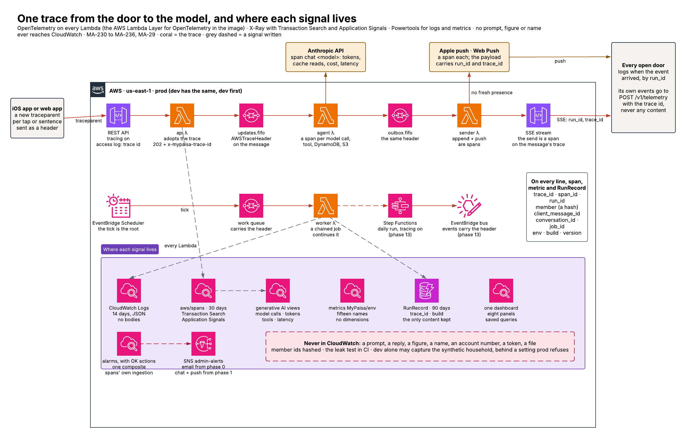
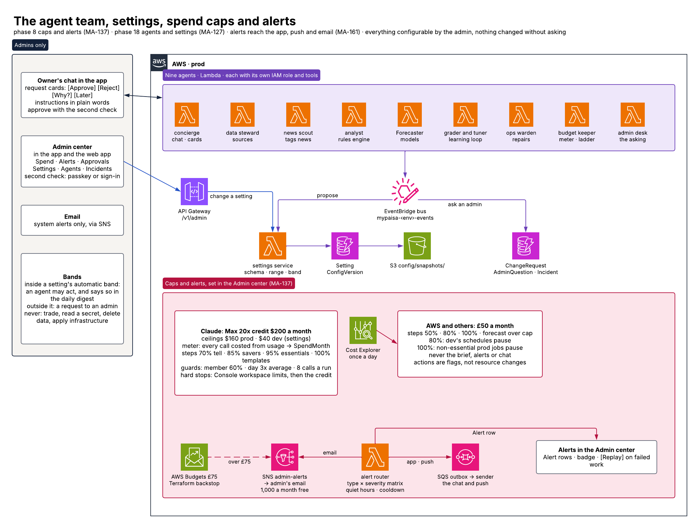
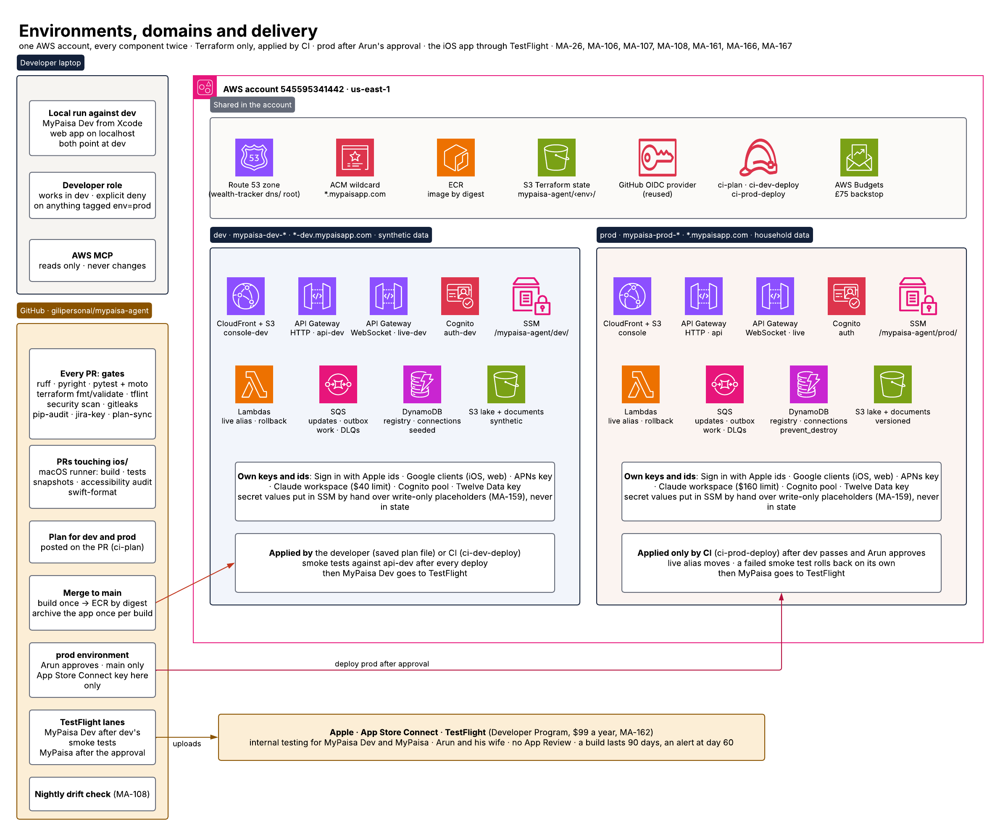

# MyPaisa Agent — Architecture (v4, the whole wealth first, at every door)

A private analyst and wealth keeper for one household, used by someone who is
not a finance person, through one chat at every door: the iOS app on the
household's iPhones and iPads, and the web app in any browser, at desktop and
phone width. The chat registers and keeps everything the household owns and
owes in the UK and India, asks on its own when something is due, computes
what moved and why, takes a stance with a confidence score, explains it
plainly, goes technical on request, asks before it acts, and grades itself.
Beside the chat, at both doors, the dashboard shows the household's whole
wealth: net worth, assets, debts, the budget, the Projection, the audit log of
every change, and a record of what the agent did and spent. Anything new is
created in the chat; an existing figure can be corrected in place where it
shows (§1, rule 4). Members sign in with Apple or Google, or a passkey on the
web. It runs on AWS in account `545595341442`, `us-east-1`, with Claude
through the Anthropic API. It never trades.

v4 (MA-186, 26 Oct 2026) puts the household's whole wealth first, built
together with the agentic setup, layer by layer, at both doors in every phase
(PLAN's phases 0 to 9; the market side follows in phases 10 to 20). The old
wealth tracker and MyPaisa become one product: one dashboard of everything the
family owns and owes in the UK and India, each member's assets and debts, a
budget from statements and monthly check-ins, and a Projection the AI drives
and code computes. The chat registers and maintains everything, with no forms,
and asks on its own ("was this month's EMI paid?"). Arun: "Keep the entire
structure dynamic. This is not a traditional transaction SQL structure"; "The
UI should only allow editing existing figures by hand, no creation"; and, for
the app, "Performance is key … silky smooth like Monzo". So kinds are data,
records are documents and their history is events (§4.8); commitments and
check-ins replace the one-off reminders (§4.9); anything new is created in the
chat and a figure is corrected in place, through one write service (§4.10);
the web app is a full door with the chat, a SvelteKit 3 PWA at
`dashboard(-dev).mypaisapp.com` (§9.4); the iOS app is a React Native shell
with a native SwiftUI core (§9.5); live delivery is SSE on the api host
(§21.5); and the Projection is computed by code from priors and the
household's own history (§6.6). v4 keeps v3's Warm ledger on Liquid Glass, its
sign-in and its Admin center; it supersedes v3's read-only dashboard, the web
app without the chat, the app built in SwiftUI alone, the `console` and `live`
hosts and the WebSocket. The old tracker holds no real data: its tested maths
and its screens are ported, not imported (§12).

v3 (MA-161, 25 Oct 2026) moves the chat from a Telegram bot to one native
SwiftUI app for iOS and iPadOS 26, in Warm ledger on Liquid Glass (§9), and
keeps the web app for the read-only dashboard and the Admin center (§9.4). Arun: "redesign everything from Telegram to iOS app. No
more telegram login ... make the app into a cool mobile chatbot where they can
maintain everything and even see the dashboard of the holdings in the
household. Only iOS app is needed and nothing else for now." And, the same
evening: "we have webapp for the dashboard and admin portal pwa ... That will
still be there for the read only dashboard"; "The read only dashboard should
also be shown on the ios tablet duo." Everything behind
the front door (the registry, the audit log, the queues, the engine, the cards,
the budgets, the Forecaster, the agent team, India) stands as v2 drew it. v2
folded in what `docs/RESEARCH.md` found in the Agentic Trading Desk and Agent
Toolbelt: the desk's deterministic indicator and pillar engine and its
discipline, the toolbelt's card shapes and portfolio review, and the layman's
front end both of them lack. v1 (prices, briefs, alerts, chat, news, calls on
Lambda) stands underneath; sections that have not changed are kept short.

The design is drawn and explained in these places (24 Oct 2026, MA-141; redrawn for the iOS app and the web app on 25 Oct 2026, MA-161; the Lucid views redrawn for v4 on 26 Oct 2026, MA-225; the trace drawn as view 9 the same day, MA-236; the plain-words page added on 27 Oct 2026, MA-239, and the technical page the same day, MA-244):

- **The architecture, in Lucid**, on AWS 2024 shapes, one Lucid document per
  view. They are private to the account; share them from each document's
  menu. The PNG exports embedded below, the Lucid Standard Import JSON and the
  script that generates it are in `docs/design/lucid/`.

  | View | Lucid document | Drawn in |
  | --- | --- | --- |
  | 1 System overview | [open](https://lucid.app/lucidchart/4ae817c6-847f-45f8-a10c-4509971c9c09/edit) | §3 |
  | 2 Environments, domains and delivery | [open](https://lucid.app/lucidchart/350c6593-a915-495f-88f1-a781b3ed1c5b/edit) | §18 |
  | 3 Identity and sign-in | [open](https://lucid.app/lucidchart/c23040ec-b253-47e2-a614-612dab962292/edit) | §4.5 |
  | 4 Queues, retries and replay | [open](https://lucid.app/lucidchart/ddc9bde5-18d4-468b-af6e-c1f86d7d7647/edit) | §21 |
  | 5 Where the data lives | [open](https://lucid.app/lucidchart/674e3574-9c79-403c-9157-72769a8d5fce/edit) | §20.6 |
  | 6 The market agent and the learning loop | [open](https://lucid.app/lucidchart/6f1b4c75-353c-49e5-b6e7-29fd2c18d356/edit) | §19, §22 |
  | 7 The agent team, settings, caps and alerts | [open](https://lucid.app/lucidchart/3c1a6c63-dd6b-4d6e-bd15-c2ea8fed15d4/edit) | §15.2, §20 |
  | Adding a record (sequence) | [open](https://lucid.app/lucidchart/b50d49fd-c941-44a0-b623-7d3e99b57fd8/edit) | §4.2, §4.10 |
  | 9 One trace from the door to the model | [open](https://lucid.app/lucidchart/3692ebe8-3794-4ff5-9658-83a8da565dfb/edit) | §10 |

- **The iOS app, in Claude Design** (MA-161): the screens in
  [MyPaisa iOS v1](https://claude.ai/design/p/43fdf88b-4960-4a4b-a4f1-fc653fcb7ab8)
  (three shell options, sign-in and joining, the chat and its cards, the
  dashboard, audit and activity, the Admin center, settings and notifications,
  iPad and the foldable) and the iOS kit in
  [MyPaisa DS v1](https://claude.ai/design/p/2f7310cd-e56a-4d13-8339-8fc637249c9a);
  the decision record is `docs/design/reviews/MA-161/decision.md`.
- **The whole-wealth screens** (MA-186, drawn by MA-193): the web chat,
  registration by chat, in-place correction, check-in cards, statement
  review, the dashboard across the UK and India, Assets and Debts, Budget,
  Projection, the admin's plan items and Activity, as browser boards at
  desktop and at 390 (the phone-web door) in MyPaisa app v1 and for iPhone and
  iPad in MyPaisa iOS v1, from one illustrative figure set
  (`docs/design/figures/household-v4.json`), with a clickable Prototype v4 at
  all three doors for Arun to walk through and pick from.
- **[MyPaisa Agent Journey](https://claude.ai/artifact/Mg2VPWVEAdbJPfeivYZ5J7)**:
  the flows end to end (invite, sign-in, adding a holding, logging money, the
  morning brief, a red alert, a question, the dashboard, the Admin center,
  failures and replay, the spend ladder, the first of the month, money in any
  currency, India), each across the member, the app, AWS, Claude and data
  lanes, with what the member sees, the safeguards and the Jira stories that
  build it.
- **[Inside MyPaisa](https://claude.ai/artifact/NQecwzUjudjq1Kigri13g5)** (MA-239): the whole architecture in
  plain words, with animations, for someone who is not technical: the parts
  as a small office, the admin's journey in nine steps from the sign-in
  screen to the chatbot answering a what-if, a map that plays one message
  through the system (a question, a file, a check-in, a failure and its
  replay), the agent team and the admin desk, the safety nets, the two
  environments and a day with MyPaisa.
- **[MyPaisa Architecture v4](https://claude.ai/artifact/QputM7CuDn3Zv5s7TGyGL9)** (MA-244): the same
  architecture, technical and animated, on AWS-style service icons: a system
  map that plays five journeys hop by hop (a question, a factsheet, a
  check-in, the 07:15 brief, a failure and its replay), one message as an
  OpenTelemetry trace with its GenAI spans, the concierge's Claude tool loop
  and its tools, the nine agents with the kind of agent each is and the
  models it uses, the routing across Opus, Sonnet and Haiku with the spend
  ladder, where the data lives, delivery and the guardrails.
- **[MyPaisa Guardrails and Evals](https://claude.ai/artifact/K4esevpFaFVYQKk2QAw3bT)** (MA-258): §23 as an
  explainer, plain or technical at a switch, with six animated diagrams: the
  five fences, the policy gate, the tests on change, watching live, the
  judges' calibration and growth through the manifest.
- **[MyPaisa Market Agent](https://claude.ai/artifact/M1yBdJaBe1FmE7sv1V6wLb)**:
  the market side end to end: free data, the rules engine, news matched to
  holdings, the Forecaster's five models, both engines side by side, the
  daily learning loop, the strategy layer, how it proves itself,
  self-healing and the budgets.
- Earlier pages, kept for reference: the
  [animated architecture](https://claude.ai/artifact/DHWD7WFjsy7r3VmMvu9eDx)
  (v3, before the queues and the agent team; superseded by MyPaisa Architecture v4, MA-244), the
  [first user journeys](https://claude.ai/artifact/LQAFk1kz4sddEMkKnwpbam),
  the [dashboard screens](https://claude.ai/artifact/A9mF3PJ91NJ9gRshFes5qp),
  and the Telegram and Mini App boards in
  [MyPaisa app v1](https://claude.ai/design/p/0bf02ae1-2de2-42a8-98ff-96046b2a26d7),
  superseded by the iOS app (MA-161); that project's browser boards stay the
  web app's spec (§9.4).

Sources for the pages are in `docs/design/`; the four explainer pages use MyPaisa DS v1,
"Warm ledger" (MA-101), with the crimson alert of MA-102, in light and dark.

Status: design only.

**Destination.** The dashboard is MyPaisa, the household wealth tracker:
assets of every kind (savings, property, deposits, policies, pensions, and
investments in the UK and India), debts (loans, mortgages, cards, EMIs), the
budget, the Projection with XIRR, reports, in GBP or INR. It is built first,
in PLAN's phases 2 to 9, one layer per phase, each shipped at both doors and
ending in a demo; §12 is the road. Anything new is created in the chat, and
an existing figure is corrected in place (rule 4). The old
[wealth-tracker](https://github.com/gilipersonal/wealth-tracker) repository
holds no real data; its tested maths and its list of screens are ported here,
and it is retired in phase 9. The first record of phase 2 and the whole
household's wealth are the same structure (§4.8), so nothing is migrated as
the layers are added.

---

## 1. The two rules, and two more

1. **Claude never produces a number.** Every figure comes from code with
   tests. Claude chooses what to say and how to say it.
2. **The app cannot trade.** No broker login, no orders. It suggests only
   ISA-safe actions.
3. **The layman sees the summary; the detail is one tap away.** Every message
   has a plain top and a technical underside. Nothing technical is shown
   unasked.
4. **One write service: create in the chat, correct in place.** Anything new
   (a record, an event, a kind, a plan item) is created only in the chat: a
   card, a Confirm tap, an audit row. An existing figure that its kind marks
   editable (a value, a rate, a date, an amount, an assumption) can be
   corrected in place on any screen, at either door: tap it, type the new
   value, see the before and after, Save. Nothing is created in place. Both
   paths run through one write service, which validates the change against
   the kind and writes it with its audit row (§4.10). Arun, 24 Oct 2026:
   "Dashboard will be read only (except for admin)"; widened on 26 Oct 2026
   (MA-186): "The UI should only allow editing existing figures by hand, no
   creation." The Admin center's exception stays: it acts on admin settings
   and operations, never on a record, each behind the second check and an
   audit row (§4.5, §9.3).

---

## 2. What it does, as the user sees it

| You | MyPaisa |
| --- | --- |
| Open the app for the first time and sign in with Apple or Google | A three-step setup in the chat: base currency, what you hold (send a factsheet or a screenshot, or type it), how often to be told things. You become the household's owner. |
| Tap **Invite** in the Admin center (or type `/invite`) | A one-time link, sent with iOS's share sheet. Your wife opens it on her iPhone and signs in with her own Apple or Google account; she is a member of the same household, with her own chat, her own accounts and her own preferences |
| Tap **Household** or **Me** on Home or the Portfolio card | The household overview across every member and account, or your own accounts in detail. As owner you can open any member's detail; a member sees their own and the household totals |
| Send a factsheet PDF (the camera, a scan, Photos or Files) | Reads it, shows a card: name, ISIN, cost, what it holds, where it invests; you tap Confirm |
| Send a screenshot of your Monzo valuations | Reads the values, matches them to holdings, updates the records, shows a before/after card; you tap Confirm |
| Type "I put £200 into Balanced today" | Logs a contribution, adjusts units, confirms |
| Type "I put ₹20,000 into Balanced" | Balanced is in pounds, so MyPaisa says so and asks for the pounds that arrived, offers the day's ECB rate as an estimate, or a holding in rupees instead; nothing is saved until Confirm (§4.7) |
| Type "I want to log a transaction" | Asks one thing at a time, with chips: bought or sold, which holding, how much, when; skips whatever you already said; a Confirm card at the end |
| Open Home, or the app on your iPad or an open foldable | The same figures as a dashboard (on the iPad and the foldable too, with the chat beside it from about 1133 pt, a sheet away from about 600 to 1133 pt, and a tab in a compact window (every iPhone, a folded foldable, Slide Over)), plus the audit log of every change and what the agent did and spent; anything new is made in the chat, and a figure is corrected where it shows |
| Open `dashboard.mypaisapp.com` on your laptop or your phone's browser, or the web app you installed | Sign in with Apple, Google or a passkey; the same chat, dashboard, Audit and Activity, and for the owner the Admin center; the chat beside the dashboard on a laptop and a tab at phone width; replies stream in as they are written (§9.4, §21.5) |
| Start something on the laptop and pick up the phone | One conversation per member at every door: a flow started on the laptop finishes on the phone, and a Confirm on the phone moves the laptop's dashboard at once (§21.5) |
| Type "£5,000 in Monzo savings", or "an SBI FD of ₹5 lakh at 7.1% for three years" | Drafts the record, asks only what is missing (whose is it? which bank?) one thing at a time with chips, and shows a Confirm card with the figures code computed, such as the maturity value and date; the owner can register for any member, and the card names the owner (§4.8) |
| A check-in arrives: "HDFC car loan: was November's EMI paid?" | Tap Paid: the card already shows what will be written, so the tap is the Confirm, with Undo. Not yet asks again in a few days; Different amount and Paid off in full open a short flow, and paid off in full closes the loan (§4.9) |
| Send a bank or card statement (PDF, CSV or XLSX) | Every line categorised, transfers and EMIs recognised so nothing counts twice, one review card by category with the uncertain lines in amber, one Confirm; the file is kept for good (§4.9, §12) |
| Tap a figure on any screen, such as an FD's rate, and type the new one | A before → after line with Save; saved as a correction with its audit row; only figures the kind marks editable, and only on your own records unless you are the owner (§4.10) |
| Open Projection, or ask "what if we buy a house in 2028?" | The household's net worth month by month to the horizon (20 years at first; 5, 10, 20 or 30), with its range, milestones (loans ending, maturities, plan items) and the assumptions with their sources; the Plans and Budget forecast tabs; a what-if shows as an unsaved scenario; every figure from the engine (§6.6). Plan items and saved assumptions are the owner's |
| As the owner, say "£4,000 a month from Jan 2029 for my kid's schooling", "my salary goes to £8,000 a month from Sep 2028" or "₹2 cr to close my SBI home loan" | The agent asks only what is missing (whose, until when, how it grows, paid from where), shows an impact card from the engine, and saves the plan item on Confirm with its audit row; the Projection and the Budget forecast move. If the plan leaves the household short, it proposes ways to rearrange the budget, and Confirm applies the one you pick, this month's budget included (§6.6) |
| Tap **Portfolio** | One table: each holding, value, day and month change, a stance chip (Add · Hold · Pause · Trim), confidence; a total line in GBP |
| Tap **Today** | The morning brief: what moved, why, anything to do |
| Tap a holding | Its screen: value and history chart, stance with confidence and horizon, "Why?", "Technical", "What if?", "Ask about it" |
| Tap **Technical** | A collapsed section opens: pillars, indicators, flags, macro regime, data quality, as numbers |
| Ask "should I add to Balanced this month?" | A stance card: ADD / HOLD / PAUSE with confidence, two reasons, what would change it, and the track record of that kind of call |
| Ask "what if the pound falls 10%?" | A scenario card from the look-through currency exposure |
| Tap **I acted** on a card | A decision record; the Saturday review compares it with what the signals said |
| Say "stop pinging me under 2%" | A preference card to confirm; saved |
| Pause MyPaisa in You, or type `/pause` | Everything scheduled stops until Resume (`/resume`); the kill switch |

Silence is a feature: about ten notifications a week, two with sound at most.

---

## 3. System context

Page 1 of the Lucid architecture ([open](https://lucid.app/lucidchart/4ae817c6-847f-45f8-a10c-4509971c9c09/edit)): the household's doors on
the left (the iOS app and the web app), the chat path along the top (API Gateway, the chat api, the updates
queue, the agent, the outbox, the sender, the SSE stream on the api host back to both doors, and Apple push and
Web Push), sign-in below it, the background jobs, the stores, and the failure path to the
admin's email.
The other six pages zoom into one part each and are drawn in their sections.


One container image and a handful of handlers: `api` (a FastAPI app wrapped in
`Mangum` for the chat routes, the data routes, the one correction route and the
owner's admin routes, MA-265, MA-266), `agent`,
`sender`, `worker` (which runs each background job by its type: ingest,
engine, news, scoring, documents, briefs, check-ins, the nightly views and
Projection runs), `stream` (the SSE stream on the api host, a FastAPI app on
Uvicorn as a separate build target of the same Dockerfile through the Lambda
Web Adapter 1.1, §21.5, MA-266), the
authorizer and the Cognito triggers.
Nothing waits on anything else directly:
your messages, MyPaisa's replies and every background job travel through SQS
queues that retry them and keep what still fails (§21). The agent Lambda is
the only one that talks to you in the chat, and the sender the only one that
delivers to the doors: it appends to each member's stream log, which the
stream sends to every open door, and sends Apple push and Web Push to a device
with no open stream. The api Lambda, with the stream beside it on the same
host, is the only one the doors call: its chat routes put what you send on
the updates queue, and apart from those, the correction route
(`PATCH /v1/records/{id}`, only for figures a kind marks editable, through the
write service, §4.10) and the owner's admin actions in the Admin center (§9.3:
the security actions, the ceiling and caps, replays, agents' requests and
settings, incidents), each admin action behind the second check, it can only
read. Dev and prod are two copies of all of this (§18). Every other Lambda produces data they read, and
every one of them writes a `RunRecord` saying what it did (§10).

---

## 4. State: the holdings registry

The user said holdings will change and the system must save all state. The
registry is designed so that adding a new kind of thing adds data, not code.
Since v4 the household's own records are one dynamic structure: kinds as
data, records as documents, history as events, figures as views (§4.8). The
entities below hold the market side, identity, the agents and the operations
beside it, and say where a v3 entity now lives inside that structure.

### 4.1 Entities (DynamoDB, single table)

| Entity | Key fields | Notes |
| --- | --- | --- |
| **Portfolio** (household) | `id`, `name`, `base_ccy`, `created_by`, `budget_tokens_per_day` | The tenant. Every other item's partition key starts with the portfolio id. |
| **Member** | `portfolio_id`, `member_id`, `cognito_sub`, `display_name`, `role` (`owner` · `member` · `viewer`), `share_detail` (let other members see my accounts), `prefs` (thresholds, quiet hours, ping budget, privacy mode, simple/technical), `joined_at`, `invited_by`, `apple_sub?`, `google_sub?`, `google_email?`, `linked_at{}`, `status` (`active` · `paused` · `left`), `session_epoch` | A person, identified by their Apple or Google account (one or both, and passkeys), linked to one Cognito user (§4.5). One conversation with MyPaisa per member. |
| **Invite** | `portfolio_id`, `token`, `role`, `created_by`, `expires_at`, `used_by?` | Single use, 24-hour expiry, bound to one portfolio and role; opened as `https://dashboard.mypaisapp.com/join/<token>` (`dashboard-dev` for dev). |
| **Device** | `member_id`, `device_id`, `name`, `model`, `os`, `push_token?`, `push_env` (`sandbox` · `production`), `web_push?` (an installed web app's push subscription), `signed_in_at`, `last_seen_at` | One per signed-in iPhone, iPad or browser: the sender pushes to its token or its Web Push subscription when it has no fresh `Presence` (MA-170, §11); the owner signs it out (MA-102); the member signs it out from You (MA-172). |
| **Presence** | `member_id`, `device_id`, `door` (`ios` · `web`), `stream_id`, `seen_at`, `expires_at` | One per open stream (§21.5), refreshed while it is open; push goes only to a device with no fresh presence. A TTL clears it. Replaces v3's `Connection`, which held a WebSocket connection. |
| **StreamEvent** (the stream's event log) | `member_id`, `seq` (a per-member counter), `type` (`message` · `card` · `card_edit` · `checkin` · `records.changed` · `resync`), `payload`, `expires_at` (a TTL of at least seven days) | The member's stream log: the sender appends every finished message, card, check-in and record change in order; the stream sends what comes after `Last-Event-ID`, or `?after=` after a reload, and a door further behind than the log gets `resync` (§21.5). |
| **TurnBuffer**, **LiveHead** | `member_id`, `turn_id`, the text so far, `updated_at`; `member_id`, the latest `seq`, `turn_id?`, `updated_at` | The words of a turn while the agent writes them, updated about every 200 ms; and the one small item the stream polls (every 200 ms during a turn, every 1 to 2 s when idle) to know there is something new (§21.5). |
| **Account** | `portfolio_id`, `id`, `name`, `category` (`investment` · `cash` · `deposit` · `policy` · `pension` · `property` · `debt`), `type` (`ISA` · `GIA` · `SIPP` · `cash` · `fixed_deposit` · `policy` · `pension` · `property` · `mortgage` · `loan` · `card`), `ccy`, `institution` (`Monzo`, `LIC`, a bank, …), `country`, `owners[]` (member ids; two for a joint account) | A tax wrapper, a pot, a property or a loan belonging to one or two members. Finances are managed here, per member. For the household's own records an account is a `Record` of an account kind (§4.8), these fields its kind's attributes: an ISA is a record, and its funds are child records. |
| **Instrument** | `id`, `kind` (`oeic` · `etf` · `stock` · `bond_etf` · `commodity_etc` · `cash`; `in_mutual_fund` · `in_listed`, §22), `name`, `isin`, `sedol?`, `listing?` {MIC, ticker, ccy}, `yahoo_symbol?`, `base_ccy`, `exposure` {regions %, currencies %, asset classes %}, `benchmark?`, `ocf`, `price_sources[]` (ordered chain), `proxy?` (weighted basket), `country?`, `institution?`, `maturity_date?`, `rate?`, `schema_version` | The thing, as the market knows it. Identifiers are optional because an OEIC has an ISIN and no ticker, a stock has both, cash has neither. It stays the shared market reference: a household's holding record points at it by `instrument_id` (§4.8), while a property, a deposit, a policy or a loan is a record of its kind with no instrument. |
| **Position** | `account_id`, `instrument_id`, `units`, `ccy` (the currency it is bought and valued in, as the platform shows it), `avg_cost_gbp`, `target_weight?`, `protected` (never suggested for trim), `opened_at` | What is held, inside one member's account. The same instrument may sit in two members' accounts; the household view adds them up. Money logged against it is checked against `ccy` (§4.7). For the household's own records a holding is a child `Record` of its account (§4.8), these fields its attributes and its buys and sells its events. |
| **Valuation** | `instrument_id`, `date`, `price`, `price_ccy`, `fx_to_gbp`, `units`, `value_gbp`, `source` (`nav` · `close` · `proxy` · `user_screenshot` · `user_typed` · `formula`), `provisional` | The price series per instrument that market-priced records are valued from; a record's own value series is a view (§4.8). User-supplied values are kept alongside computed ones; a gap between them is a signal (wrong units, a fee, a late NAV). |
| **Document** | `document_id`, `kind` (`factsheet` · `kiid` · `annual_report` · `screenshot` · `cas` · `broker_export` · `statement` · `payslip` · `spreadsheet` · `other`), `s3_key`, `sha256`, `mime`, `bytes`, `original_name`, `sent_by`, `sent_at`, `message_id`, `instrument_id?`, `import_id?`, `as_of`, `extracted` (JSON, with the source line for each figure), `confirmed_by_user` | **One row for every file a member sends, kept in S3 for good** (§4.6, MA-148). The factsheet is the source of look-through until a better feed exists. |
| **Transaction** | `position_id` or `liability_id`, `date`, `type` (`buy` · `sell` · `dividend` · `fee` · `interest` · `rent` · `repayment` · `prepayment` · `rate_change` · `maturity`), `units?`, `amount`, `ccy` (always the position's), `amount_gbp`, `orig_amount?`, `orig_ccy?`, `fx_rate?`, `fx_source?` (`as_credited` · `ecb` · `statement`), `fx_date?` | The dated cashflow ledger. From "I put £200 in", or extracted from a screenshot. For the household's own records these are `Event`s of the record's kind (§4.8), with these fields in their payload; XIRR, payoff curves and the Projection are computed from them, so every money movement is recorded with its date. |
| **Liability** | `account_id`, `kind` (`mortgage` · `loan` · `card`), `principal`, `rate`, `term_months`, `started_at`, `emi`, `schedule[]` (computed), `ccy` | A debt: the balance against the original plan, the interest and principal split, the payoff date. For the household's own records a mortgage, a loan or a card is a `Record` of a debt kind (§4.8) with dated terms (a floating-rate reset, a fixed rate that ends), a prepay mode (a shorter term or a lower EMI, by country), balance checkpoints and, for a card, revolving debt from its statements; its schedule is computed (§6.6). Phase 4. |
| **NetWorth** | `portfolio_id`, `date`, `assets_gbp`, `debts_gbp`, by member, by category, by currency, by country | A view, materialised from the records' events and the prices and rebuilt after a kind changes (§4.8); the series the dashboard and the Projection read. Phase 2, in GBP or INR from phase 3. |
| **Budget**, **ProjectionAssumptions**, **ProjectionRun** | per member; per portfolio; per run: `inputs_hash`, `seed`, `engine_version`, `horizon`, `percentiles` (p10, p50, p90), `milestones[]` | Income with its history and dated future changes, a monthly plan per category (each with its `inflation_key`) and plan against actual, the actuals from statements and check-ins, every amount take-home (phase 6, §12, MA-96, MA-261); the assumption set the Projection runs on, each figure with its source, saved by the admin alone (§4.5); one row per Projection run, so any curve can be reproduced (§6.6, phase 7). `ForecastAssumptions` is renamed: Forecast stays the market's word (§19). |
| **Kind** | `kind`, `version`, `fields[]` (typed; required, optional or derived; `editable` or not), `valuation` (a method from the library), `events[]`, `commitments[]` and `checkins[]` (templates), `grouping` {class, liquidity, country}, `presentation`, `status` (`proposed` · `approved`) | A kind of asset or debt, as data, versioned (§4.8). The admin approves a new one; it adds no screen, form or tool. |
| **Record** | `portfolio_id`, `record_id`, `kind`, `kind_version`, `owners[]` ({member, share_pct}), `country`, `ccy`, `liquidity`, `status` (`open` · `closed` · `matured` · `sold`), `parent_id?`, `instrument_id?`, `attrs{}` | One thing the household owns or owes, as a document (§4.8). Never deleted; closing it is a status. |
| **Event** | `record_id`, `seq`, `type` (one the kind accepts), `effective_date`, `payload{}`, `source`, `actor`, `document_id?` | A record's history, append-only and hash-chained with the audit log; a correction or a reversal is a new event (§4.8, §4.10). |
| **Commitment** | `commitment_id`, `record_id?` or `member_id`, `type` (`emi` · `card_bill` · `sip` · `rent` · `premium` · `salary` · `maturity` · `valuation_due` · …), `amount?`, `ccy`, `schedule`, `autopay`, `grace_days`, `payer?`, `ends_at?` | Any expected, dated money tied to a record or a member (§4.9); income commitments accept dated future changes (§12, MA-96). |
| **CheckIn** | `id` (`commitment#due_date`), `status` (`open` · `answered` · `assumed` · `overdue`), `message_id`, `answer?`, `answered_by?`, `event_id?` | One occurrence of a commitment, created once by a conditional put; answered by a tap, a short flow or a statement (§4.9). |
| **PlanItem** | `plan_item_id`, `effect` (`new_flow` · `change_flow` · `record_event`), `type` (`income` · `spend`), `member_id`, `for_member?`, `category`, `one_off` or `recurring` (`monthly` · `termly` · `yearly`), `start`, `end?` (a date, after N months, until an age, or open), `amount`, `ccy`, `growth` (a fixed `growth_pct`, the category's prior, or none), `target_ref?` (the commitment, record or category a `change_flow` changes and how: set to, or changed by an amount or a percentage; the record a `record_event` acts on), `funded_from?`, `source_text`, `status` (`active` · `paused` · `done`), `version`, `created_by` | A future change for the Projection, the admin's alone (§4.5, §6.6): a new flow, a change to an existing flow from a date, or an event on a record such as a loan prepaid or closed. Every amount is take-home. `source_text` keeps the admin's own words (MA-261). |
| **Signal** | `instrument_id`, `date`, indicators, pillars, flags, forecast range, data quality | From the engine. |
| **Stance** (call) | `instrument_id`, `made_at`, `action`, `horizon_days`, `confidence`, `reasons[]`, `invalidated_if[]`, `entry_px`, `state_bucket`, `graded` | Paper-traded and graded. |
| **Forecast** | `instrument_id`, `date`, `horizon_days` (20), `p_up`, `p_fall_5`, `range` {p10, p50, p90}, `mood`, `analogs` {count, recovered}, `events[]`, `drivers[]`, `model_version`, `graded` | One per holding per day from the Forecaster (§19), later; graded like a stance. |
| **Setting**, **ConfigVersion** | `key`, `value`, `schema` (type, range), `auto_band`, `approval` (`auto` · `admin`), `version`, `updated_by` (the admin or an agent), `reason`; one `ConfigVersion` row per change, never edited | Every behaviour the admin controls (§20.2). |
| **ChangeRequest** | `id`, `agent`, `setting` or `action`, `from`, `to`, `why`, `evidence` (S3 key), `cost`, `risk`, `undo`, `urgency`, `status` (`proposed` · `approved` · `rejected` · `expired` · `applied` · `rolled_back`), `decided_by`, `via` (`chat` · `admin_center`), `expires_at` | An agent's request for the admin's approval (§20.3). |
| **AdminQuestion**, **Incident** | the agent, the question or what happened, what was tried, the options, the answer or decision, timestamps | What agents need from the admin, and what they could not fix themselves (§20.3, §20.5). |
| **ScoreDaily** | `model`, `instrument_id`, `mood`, `date`, the day's graded count, hit rate, Brier score, log loss, range coverage, rolling 30, 90 and 365-day values | The learning loop's daily scoreboard (§20.4); the full outcomes live in S3. |
| **CalibrationMap** | `model`, `version`, `buckets[]` (said vs seen), `fitted_on`, `window`, `status` (`probation` · `live` · `rolled_back`) | The map from raw confidence to calibrated confidence (§20.4). |
| **ModelVersion** | `name`, `version`, `trained_at`, `data_through`, `s3_key`, `walk_forward` {brier, log_loss, vs_base_rate}, `live` {brier, weeks, vs_rules_engine}, `status` (`shadow` · `live` · `off`) | Which Forecaster model made a forecast, how it tested, and whether it may be shown (§19.6). |
| **MacroRegime** | `date`, per-basket composites and regimes | Shared by all instruments. |
| **AlertState**, **Decision**, **ChatTurn** | per member | A member's chat memory, decisions and alert cooldowns are their own. `ChatTurn` is one row per message, holding the model's content blocks exactly as returned, kept ninety days (§8). |
| **BudgetSettings** | `portfolio_id`, `ceiling_usd` (prod $160, dev $40: the Max 20x plan's $200 credit), `steps[]` (70, 85, 95, 100), `daily_guard_x` (3), `run_max_calls` (8), `hard_limit_usd` (the Console workspace limit, typed in to match it), `agent_shares{}` (§20.7), `member_share_pct` (60), `cycle_start_day` (the day the plan's credit renews), `eval_caps{}` (prod's overnight judges: 3% of the ceiling; the evals workspace's live evals: $10 a run, $30 a month; §23.7), `updated_by`, `updated_at` | The Claude ceiling the owner moves in the Admin center; every change is an audit row (§15.1). |
| **AwsSpendMonth**, **AlertRule**, **Alert** | AWS and others: month to date by service and `env`, the forecast, `cap_gbp`, `steps[]`, `actions{}`, `step`; alert routing: type × severity → app, push, email, quiet hours, cooldown; each alert sent, where and when | The AWS meter and caps, and the alert router (§15.2). |
| **SpendMonth** | `portfolio_id`, `cycle` (its start date), `total_usd`, `by_member{}`, `by_feature{}`, `by_agent{}`, `by_model{}`, `by_day{}`, `step` | The running meter for one cycle, added to atomically after every model call and read before every call (§15.1). |
| **SentimentIndex**, **ArticleScore**, **MessageSeen** | per portfolio, global, or per member (the client ids already taken, §21.2) | |
| **PendingAction** | `member_id`, `flow_id`, `kind` (`log_transaction` · `add_holding` · `update_valuation` · `register_record` · `record_event` · `checkin` · `statement` · `plan_item` · `rearrange_budget` · `settings` · `confirm`), `step`, `collected` (the answers so far), `draft_hash?`, `message_id`, `expires_at` (24 h) | The state of the guided flows: what MyPaisa is waiting for from this member. Several can be open at once, keyed by flow id, so a check-in arriving mid-way does not wipe a half-registered FD. A draft (§4.8) is hashed here, and Confirm commits exactly that draft. The next message or tap resumes its flow; expiry clears it. |
| **AuditEvent** | `portfolio_id`, `ts`, `seq`, `actor` (a member id, or `system:ingest`, `system:engine`, `system:migration`), `via` (`typed` · `button` · `screenshot` · `factsheet` · `cas` · `broker_export` · `statement` · `checkin` · `inline_edit` · `agent_proposal` · `schedule` · `migration`), `document_id?` (the file a change came from), `entity`, `entity_id`, `action` (`create` · `update` · `delete` · `confirm` · `reject`), `before`, `after`, `run_id`, `prev_hash`, `hash` | Append-only, one row per change to the records, written in the same transaction as the change. Hash-chained like the calls ledger, so a missing or edited row shows. See §4.6. |
| **RunRecord** | `run_id`, `trace_id`, `build`, `version`, `function`, `trigger` (`message` · `action` · `schedule:<name>` · `alarm` · `deploy`), `member_id?`, `started_at`, `finished_at`, `status`, `model_calls[]` (model, input, output, cache-read and cache-write tokens, cost, ms, time to the first token, stop reason, refused or fell back), `tool_calls[]` (name, ms, ok, error class, input and output sizes, the truncated input and output), `messages_sent`, `checks[]` (the policy gate's decisions, the figure check, the member's signals; §23.4), `outcome`, `error?` | What one run of any Lambda did and cost, and the trace it is on. 90-day TTL. Activity at every door and the cost guard rails read these; the only place a tool's input and output are kept outside `ChatTurn`. See §10. |
| **EvalResult**, **EvalLabel** | `run_id` or `case_id`, `judge`, `judge_version`, `verdict` (`pass` · `fail` · `unknown`), `reason`, `flags[]`, `at`; the admin's `label` per failure mode with a one-line critique, the labelled run's transcript, `labelled_at` | A judge's verdict on a live run or a case, and the admin's own reading that calibrates it (§23.4, §23.5). A label keeps its run's transcript past the run's ninety days, so a changed judge is measured again on the same runs. Kept beside the runs, in the household's own table, and stored nowhere else. |

Signals and macro regimes are per instrument and shared by everyone who holds
it; stances are per position, because the horizon, the drift from target and
the "holding" flag belong to one member's account.

Every item carries `schema_version`; a migration is a Lambda that rewrites
items of an older version, run once from a script, never by hand. The
household's records need none: a kind's new version is data, and its views are
rebuilt from the events (§4.8).

### 4.2 Adding a holding, from the chat

The file goes straight from the phone to the documents bucket through a
presigned upload, and every hop after that goes through a queue (§21): the
message waits in the member's lane, the document read is a job on the work
queue run by the worker, and every reply goes out through the outbox to the
member's stream at every open door (§21.5), or by push when none is open. The
sequence in Lucid:
[open](https://lucid.app/lucidchart/b50d49fd-c941-44a0-b623-7d3e99b57fd8/edit).
It adds a fund from its factsheet as a record (`draft_record`, `ask_user` and
the Confirm card, §4.8), then corrects a figure in place at the other door;
both go through the one write service, each change with its audit row in one
transaction (§4.10).


Any field Claude is unsure of is shown in amber and asked about. A holding is
never saved without the Confirm tap. The same path handles an ETF (ISIN and
ticker from the factsheet), a share (ticker and exchange), or cash, and since
v4 any kind of record, from a sentence, a screenshot or a statement (§4.8).

### 4.3 Kind profiles

A `kind` is a bundle of defaults, so a new holding of a known kind needs no
code. Since v4 each profile is part of a kind spec (§4.8), data versioned with
the registry; the table below is the market and valuation side of those
specs.

| Kind | Price chain | Look-through | Engine | Cascade temperament |
| --- | --- | --- | --- | --- |
| `oeic` (a UK fund such as the Monzo BlackRock ones) | fund NAV chain (§5.1), proxy basket intraday | factsheet, then the product page | all pillars; macro from exposure weights | patient: ADD on steady trend, PAUSE on exhaustion |
| `etf` (UCITS or US-listed) | exchange close (EODHD, Twelve Data, yfinance), issuer NAV as check | issuer's holdings download (daily for iShares) | all pillars; macro from exposure weights | patient |
| `stock` | exchange close | the company itself; sector, country, currency | adds the Valuation pillar and the stock cards | cautious: single-name risk raises the bar for ADD; earnings dates block changes for two sessions |
| `bond_etf` | exchange close | duration, credit quality, currency from the holdings file | trend and momentum downweighted; risk pillar reads duration × rate moves | slow |
| `commodity_etc` (a metal, oil, or a basket) | exchange close; spot price as check | the metal and its pricing currency (usually USD) | no valuation; risk pillar weighted ×2; macro from dollar strength and real yields, not the equity basket | slowest to ADD, quickest to PAUSE; drawdown alerts at a wider band (12%) because 8% is a normal week for silver |
| `cash` | FX only | the currency | none | n/a; it is the thing contributions come from |
| `property`, `deposit`, `policy`, `pension` (phases 2 and 3, §4.8) | none; the last user figure, or a formula (a deposit accrues at its rate to maturity, a policy follows its schedule) | the asset itself: country, currency, institution | no pillars; XIRR from the ledger; maturity and growth-rate panels | n/a; MyPaisa asks for a valuation when one is due and announces a maturity before it lands, through the kind's check-ins (§4.9) |
| `debt` (`mortgage` · `loan` · `card`; phase 4, §4.8) | none; the balance from the schedule and the logged events; a card's from its statements | the lender; currency | no pillars; interest split, payoff date, prepayment what-ifs | n/a; MyPaisa asks when an EMI, a card bill, a rate change or a preclosure is due, through the kind's check-ins (§4.9) |

Adding a kind that is not here (a gilt held directly, crypto, a Sukanya
Samriddhi account) means a kind spec built from the templates, which the agent
can propose and the admin approves (`propose_kind`, §4.8), and, if it is
priced, a price plugin. Nothing else changes.

### 4.4 Worked example: today's holdings

Everything held through Monzo, in GBP, as it would sit in the registry. Rows
are what MyPaisa would record after the factsheet and screenshot path; figures
marked ~ are examples.

| Instrument | Kind | ISIN | Listing recorded | Price chain | Exposure | Notes |
| --- | --- | --- | --- | --- | --- | --- |
| BlackRock MyMap (Monzo "Balanced") | `oeic` | from the factsheet | none (daily NAV) | yfinance `0P…L` → BlackRock page → FT → proxy → screenshot | ~66% shares, ~34% bonds; mostly USD under the hood | the proxy basket comes from its top holdings |
| iShares NASDAQ 100 UCITS ETF (Acc) | `etf` | IE00B53SZB19 | XLON `CNX1` GBP (the USD line is `CNDX`) | EODHD → Twelve Data (US line `QQQ` as a check) → yfinance `CNX1.L` | 100% USD, US large-cap tech, ~50% in the top ten | charge 0.30% |
| iShares Automation & Robotics UCITS ETF (Acc) | `etf` | IE00BYZK4552 | XLON `RBTX` GBP (USD line `RBOT`) | EODHD → yfinance `RBTX.L` | global, roughly equal-weighted small and mid caps; USD, JPY, EUR, TWD | charge 0.40%; overlaps the NASDAQ ETF in a few names (computed, not assumed) |
| iShares Physical Silver ETC | `commodity_etc` | IE00B4NCWG09 | XLON `ISLN` GBP (USD line `SSLN`) | EODHD → yfinance `ISLN.L`; silver spot × GBP/USD as the check | silver, USD-priced | not a fund: a debt security backed by bars in a vault; charge ~0.20% |
| Monzo pot | `cash` | — | — | — | GBP | where contributions come from |

Three things this example teaches the design:

- **The ISIN is shared by the USD and GBP lines**; only the ticker differs.
  The registry stores the listing separately, and MyPaisa asks which line
  when the factsheet does not say (Monzo most likely holds the GBP line).
- **London GBP lines are often quoted in pence (GBX)** by Yahoo and some
  feeds. The price plugin normalises to pounds or every valuation is off by
  100×; a test asserts it.
- **Every holding here is a dollar asset in a sterling wrapper.** One move
  in GBP/USD moves all of them, so the FX line in the brief is a
  portfolio-level item, and the US macro basket matters far more than the
  UK one for this portfolio.

The platform fee Monzo charges on top of each product's own charge is part
of the cost drag in `fund-vs-benchmark`; it is a preference (percentage per
year), set once per account.

### 4.5 Identity, members and views


Page 3: the two doors (the iOS app and the web app), Sign in with Apple, Google and a passkey, the custom auth, Cognito, the Keychain and the session cookie, the authorizer, and the owner's sign-out and pause. [Open it in Lucid](https://lucid.app/lucidchart/c23040ec-b253-47e2-a614-612dab962292/edit).
**There are no passwords.** Apple or Google vouches for the person: Sign in
with Apple on any iPhone or iPad, or Sign in with Google for a member who
prefers it (Arun, 25 Oct 2026, MA-161: "No more telegram login, on Google SSO
or iOS login"). "Signing in" is: which Apple or Google account is this, which
member is it linked to, and which household is that member in.

**One identity store, on AWS from day one** (Arun, 24 Oct 2026; MA-109). Each
environment has its own Amazon Cognito user pool, `mypaisa-dev-users` and
`mypaisa-prod-users` (Essentials plan, free under 10,000 monthly users), with
one user per member: that member's Apple account, Google account and passkeys
are all linked to the same Cognito user. Password sign-in and self sign-up are
off, and a user is created only when someone joins through an invite.

| Step | How |
| --- | --- |
| The buttons | The app shows Apple's and Google's own buttons, Apple's first, and nothing else. Sign in with Apple runs natively (`ASAuthorizationAppleIDProvider`, no name or email asked for); Google runs through Google's iOS SDK in the system's web sheet, with PKCE. |
| The token | Before either sheet opens, the app asks the api for a one-time nonce (`/auth/nonce`); Apple's identity token (carrying the nonce's SHA-256) or Google's ID token (carrying the nonce) comes back. |
| The exchange | The app posts the token to `/auth/apple` or `/auth/google`. The api finds the member that provider account (`sub`) is linked to and starts Cognito's custom auth for them; the verify trigger checks the token against Apple's or Google's published keys: issuer, audience (the app's bundle id for Apple, the environment's Google iOS client id for Google), expiry, an issue time under five minutes, the nonce, and no replay. Cognito then issues that member's tokens. |
| An unknown account | An Apple or Google account linked to no member is refused, whatever its address, unless the request comes from the app with a valid invite token, which creates the member (Joining, below; a browser never joins). A paused member gets one line and nothing else (MA-102). |
| In a browser | The web app (§9.4) shows the same two buttons, through Sign in with Apple's JS (the environment's Services ID as the audience) and Google Identity Services (the environment's Google web client id), and a passkey. The same `/auth/apple` and `/auth/google` exchange runs; no client secret is used. The api then sets an `HttpOnly`, `Secure`, `SameSite=Strict` session cookie for its own host, with five-minute access tokens behind it that page scripts never see. |
| A passkey | A member adds one from You in the app (MA-77). In the app it answers the second check (below), never the sign-in screen, which shows Apple and Google only; in a browser it signs in to the web app. To sign in with it, the page asks `/auth/passkey/options` for a one-time WebAuthn challenge, the device signs it under Face ID or Touch ID, and the assertion goes to `/auth/passkey`; the api starts Cognito's custom auth for the member whose credential it is, and the verify trigger checks the signature against that credential's stored public key, the challenge, the origin and the relying-party id. The relying-party id is the environment's dashboard domain (`dashboard.mypaisapp.com`, `dashboard-dev.mypaisapp.com`): it is the web app's origin and serves the iOS app's association file, whose `webcredentials` entry lets one passkey work in both. MA-109 confirms it before anyone registers a passkey; changing it later strands every passkey made. In a browser the api then sets the same session cookie. |
| A new device | Signing in on a device or a browser the member has not used before sends a push to their other devices and a card in their chat: "New sign-in to MyPaisa: an iPad, with Google, today at 19:41. Was this you?", with Yes, it was me and No, sign it out (which signs that device out). Until the member answers, Members and devices shows it as not confirmed, and the owner's chat gets one line with Open Admin center (MA-102, MA-76). |
| On the device | Tokens live in the Keychain, this device only, readable after first unlock. Access tokens last five minutes and are refreshed in the background with the refresh token, which rotates on use. Each signed-in iPhone or iPad is a `Device` row with its name, model, last seen and push token. |
| Every call | The api's authorizer checks the access token, the member's status and session epoch on every HTTP call and when a stream opens, and the open stream checks them again every 60 seconds (§21.5). Sign out everywhere and pause use Cognito's own calls (`AdminUserGlobalSignOut`, `AdminDisableUser`) together with the member's session epoch, so they take effect on the next request (MA-102); signing out one device deletes its `Device` row and revokes its refresh token. |

**The second check** (MA-76, MA-102). Some actions need proof that the member
is holding the device now: the owner's admin actions (§9.3), from the Admin
center or the admin's chat (§20.3), an
import's Confirm and rolling an import back (§18.5, §22.2), leaving the
household (MA-172), approving a new kind (`propose_kind`, §4.8; Arun, 26 Oct
2026, MA-197: a kind changes what every member can register), and nothing else. A bank or card statement sent for the
budget is routine, not an import, so it needs no second check (§4.9); the Excel
history importer keeps it. Plan items and saved Projection assumptions change
a plan, not the records, and need none either (§6.6). The app asks
the api for a challenge bound to that action, then gets a fresh assertion:
Sign in with Apple again (iOS shows a Face ID sheet), or, where the member has
added one, a passkey (Face ID); a member who signs in only with Google signs in
with Google again. In the web app it is a passkey or a fresh Apple or Google
sign-in in the browser. The api accepts the action only with an assertion under
five minutes old whose nonce is that challenge. The app's own Face ID lock
(MA-171) is a local comfort and never authorises anything on the server.

**Joining.** The owner taps Invite in the Admin center (or types `/invite`,
optionally `/invite viewer`). The api makes a one-time link,
`https://dashboard.mypaisapp.com/join/<token>` (`dashboard-dev` for dev), single use,
24-hour expiry, bound to this household and that role, and the owner sends it
with iOS's share sheet. The invitee opens it on their own iPhone: the link
opens MyPaisa (or a page saying where to get it, MA-73), shows the invite
("Arun invited you to the Dutta household"), and their Sign in with Apple or
Google creates their member and Cognito user; then the three setup questions.
The owner removes a member from Members and devices in the Admin center.

**More than one way in** (MA-77). A member can add a second sign-in, Apple or
Google, or a passkey, from You: already signed in, they complete the new
provider's sign-in, and the api links that `sub` to their Cognito user. `sub`
is the key and the address is for display, so a renamed account still works
and an address handed to someone else does not. The owner can unlink a
member's sign-in from the Admin center; unlinking signs that account out
everywhere. Every link, unlink and sign-in is an audit row. Leaving the
household (MA-172) deletes the member's Cognito user and revokes Apple's and
Google's tokens (Apple's through its REST endpoint, signed with the
environment's Sign in with Apple key from SSM); their accounts and history
stay with the household.

**Roles.**

| Role | Can |
| --- | --- |
| owner | Invite and remove members, register and correct any member's records, set the household budget and settings, see every member's detail, and alone add plan items, apply a rearrangement of the budget and save the Projection's assumptions (§6.6). The owner is the household's one admin (Arun, 25 Oct 2026: "there is only 1 admin"): the only person who sees the Admin center, the agents' requests in the chat and the admin desk |
| member | Register, correct and close their own records (anything new in the chat, an editable figure in place, §4.10); see the household overview; see their own detail; view the Projection and ask what-ifs, saving nothing; opt in to sharing their detail with the household |
| viewer | Read the household overview and whatever members share; nothing else |

**Views.** The Portfolio card and Home have a switch: **Household**
(every account, every member, one total) and **Me** (my accounts). The owner,
and any member whose detail is shared, appear as further tabs. A member's
brief covers their own accounts plus one household line; the owner's brief
covers the household with a line per member. Alerts go to whoever owns the
account, and to the owner as well if the owner asks.

**Isolation.** Every item is keyed by the household, every tool call carries
the calling member as a principal, and the registry layer refuses a read or
write outside that member's rights. One DynamoDB table cannot enforce that
with IAM alone, so it is enforced in code and covered by tests ("member A can
never read household B; a member cannot read another member's detail unless
shared"). Each member's chat memory, decisions, preferences and cooldowns are
their own. The monthly Claude ceiling is the household's (§15.1), and no
member may spend more than their share of it (60% by default), so one chatty
member cannot spend the household's allowance.

**Scope.** Two members in one household is personal software. Several
unrelated households using an app that says "ADD, 64% confidence" starts to
look like investment advice to the public, which is regulated in the UK. The
model supports more households; using it that way is a separate decision
about wording and scope, not a technical one.

### 4.6 The audit log

Every change to the records leaves a row. Not a log line that may or may not
be there, a row in the same DynamoDB transaction as the change, so a change
without its audit row cannot happen. Each row says who (the member, or the
system job), when, through what (a typed sentence, a button, a screenshot, a
factsheet, a proposal from the agent, a schedule), which record, what it was
before and what it is after, and which run made it. Rows are chained by hash,
the same way the stance ledger is, so a deleted or edited row breaks the chain
and the weekly check says so.

What counts as a change: records and their events, holdings, positions,
transactions, accounts, corrections in place (`via: inline_edit`), check-in
answers, kinds, commitments, plan items and saved assumptions, members and
invites, preferences, and every valuation a person supplied. The
nightly computed valuations and signals are a time series, not audit rows;
they are already dated and sourced, and logging each one would bury the rows
that matter.

Who sees what follows the roles in §4.5: a member sees the rows for their own
accounts and for the household-level records; the owner sees every row. The
rows are readable in two places: the Audit screen at every door, with filters
by member, record and date, and from the chat with a question such as "what
changed this week?", which the agent answers through `get_audit`. Rows are
never deleted; at a few hundred a year they cost nothing to keep.

**Every file is kept, and opens from the log** (Arun, 24 Oct 2026: "all
the files and images I send should be stored on S3 and I should be able to
view that in audit logs"). Every file or image a member sends (a factsheet,
a screenshot, a CAS statement, a broker export, a spreadsheet) is copied to
`s3://mypaisa-<env>-documents/<household>/<member>/<yyyy>/<mm>/` before
anything reads it, whatever happens next, with a `Document` row and an audit
row of its own; every change made from it carries its `document_id`
(MA-148). Nothing is deleted after reading: the bucket has no expiry rule,
and prod's is versioned and protected from destruction. On the Audit screen a
row made from a file shows its kind, name and size, a thumbnail for an
image, and Open; a Files view lists every file with the changes it fed
(MA-149). Open is a presigned link valid five minutes, given only after the
authorizer checks the role: a member opens their own files, the owner any,
a viewer none; each opening is itself an audit row, and the file opens in
Quick Look. In the chat a change card's Source button opens the original.

### 4.7 Money in any currency, checked against the holding (MA-156)

Arun, 24 Oct 2026: "On the telegram App, I should be able to add
transactions using Any currency for any fund and chatbot to figure what the
base currency of the holdings, If the holdings are in GBP and I try to invest
INR to GBP holding, chat should be able to correct me."

Every holding has one currency: the one it is bought and valued in, as the
platform shows it (`Position.ccy`). It is read from the factsheet or the
screenshot when the holding is added and shown on that Confirm card, so it is
confirmed once and never guessed again. A fund's own base currency
(`Instrument.base_ccy`, often USD) can differ from the share class a member
holds (GBP); the position's currency is the one that counts here.

| The member types | MyPaisa |
| --- | --- |
| "I put 200 into Balanced" | No currency named: the holding's is assumed, and the Confirm card says "£200, in pounds as Balanced is" |
| "I put £200 into Balanced" | Same currency: the card as in §4.2, then Confirm |
| "I put ₹20,000 into Balanced" | Saves nothing yet. "Balanced is held in pounds (GBP), so it can't take rupees. The rupees were changed to pounds on the way in." Then the guided flow's own amount question, asked again in the holding's currency: "How many pounds arrived?" Type them or send the platform's confirmation; the estimate is one tap with its figure on the button, **About £177.78 · ECB estimate** (marked an estimate, offered once the rates load; with privacy on it reads **Use the ECB estimate**); a rupee holding is named when there is one (**Nifty 50 instead**); **Cancel**. Confirm stays a separate tap (MA-156, option 1b, picked 25 Oct 2026) |
| "1.5 lakh into my Nifty 50 index fund" (phase 5) | An INR holding, so ₹1,50,000 with no question; pounds typed against it get the same correction the other way |
| "Which currency is Balanced in?" | "Pounds (GBP), from the factsheet you sent on 3 March" |

- **Reading amounts is code.** A parser reads symbols (£ $ € ₹), codes
  (GBP, USD, EUR, INR and every currency the ECB publishes), words (pounds,
  dollars, euros, rupees, Rs) and Indian number words (lakh, crore). Claude
  only fills the fields when the wording is free; the figure is always the
  member's own, echoed back for Confirm. "$" means US dollars unless the
  member holds another dollar, when MyPaisa asks which.
- **A converted figure is never Claude's.** The pounds typed in answer to
  "How many pounds arrived?" are the member's figure, recorded with the rupee
  amount and the rate the engine works out from them beside it. The ECB
  estimate button is the engine's conversion at the ECB reference rate
  for that day, or the last one published before it at a weekend or an ECB
  holiday (§5.3), with the rate and its date on the card. The ECB publishes
  each currency against the euro, so pounds to rupees is the engine's cross
  of the two euro rates of that day. It is marked an
  estimate until a statement, a screenshot or the next valuation confirms it.
  The button appears once the daily rates are loaded (MA-44, phase 3);
  before then it is left out and the question is the same.
- **Stored in the holding's currency, with the original kept.** The
  Transaction's `amount` and `ccy` are the position's; `orig_amount`,
  `orig_ccy`, `fx_rate`, `fx_source` and `fx_date` keep what was typed and
  how it became the recorded figure. The audit row (§4.6) shows both, and a
  screenshot or statement it came from is its `document_id`.
- **Every pair, both ways, every door.** The same check runs on a typed
  message, the guided flow, a screenshot, and a CAS or broker line (§22.2)
  whose currency differs from the holding's. Privacy mode shows no amount and
  no rate on the card, only words, currencies and dates (the rate with one
  amount would give the other away); Show amounts reveals one card.
- **Designed first.** Three options were drawn in Claude Design for the
  Telegram chat (`Currency check options.dc.html`, MyPaisa app v1) and Arun
  picked 1b on 25 Oct 2026 (`docs/design/reviews/MA-156/decision.md`). Since
  MA-161 the spec is the iOS board `iPhone · Currency check` in MyPaisa iOS v1
  (planned): it carries 1b's content and order (the amount asked again in the
  holding's currency, the ECB estimate one tap, Confirm a separate tap, no
  amount or rate with privacy on) into the app's guided flow. The Telegram
  boards stay only as the record of the pick; nothing is built from them. The
  states still to draw before the build are MA-156's `undrawn` list in
  `docs/trace.json`.

### 4.8 The dynamic structure (kinds, records, events, views)

Arun, 26 Oct 2026 (MA-186): "Keep the entire structure dynamic. This is not a
traditional transaction SQL structure." Four ideas carry it. They are built in
phase 2 (MA-27, MA-28, MA-197) and every wealth phase after it adds only kinds.

1. **Kinds are data.** A versioned kind spec (`Kind`, §4.1) holds:
   - the fields: typed; required, optional or derived; and which are
     editable in place (§4.10);
   - the valuation method;
   - the events it accepts;
   - its commitment and check-in templates (§4.9);
   - its dashboard grouping: class, liquidity, country;
   - how it is presented.

   The valuation methods and event handlers are a fixed, tested code library:
   last figure, accrual, amortising, revolving, market-priced, and the PPF,
   EPF, NPS, SGB and LIC schedules (§6.6). A spec only combines them. A new
   kind, or a new field on a kind, is data: the agent can propose one from the
   templates ("Sukanya Samriddhi: accrual at its rate to 21 years"), the admin
   approves it behind the second check (`propose_kind`, §4.5, §8), and it is
   versioned. No screen, form or
   tool is added.
2. **Records are documents.** `Record {kind, kind_version, owners[{member,
   share_pct}], country, ccy, liquidity, status, parent_id?, instrument_id?,
   attrs{}}`. An ISA account is a record, and its funds are child records.
   `Instrument` stays the shared market reference (§4.1).
3. **History is events.** `Event {record, type, effective_date, payload{},
   source, actor, document_id?}`:
   - append-only;
   - hash-chained with the audit log (§4.6);
   - never edited: a correction or a reversal is a new event (§4.10);
   - a record's current state is the fold of its events through its kind's
     handlers.
4. **Figures are views.** Each record's value series, `NetWorth`, the budget
   month, the commitments due and the Projection runs are materialised from
   the events. They can be rebuilt after a spec changes, so the structure
   evolves without a migration.

`Account`, `Position`, `Liability` and `Transaction` (§4.1) fold into Record
and Event for the household's own records. There is no relational schema:
questions nobody planned for read the nightly Parquet exports of the events
and views through DuckDB (§12.1, MA-104). In code (`src/mypaisa_agent/registry/`,
MA-27, MA-28, MA-265, MA-270), the single table is accessed through a thin typed
repository on Pydantic v2, `boto3` (`TypeSerializer` and `TypeDeserializer`
with `Decimal` conversion at the wire boundary) and `mypy-boto3-dynamodb`
(`boto3-stubs[dynamodb]`) under strict `pyright`, with a `TransactWriteUnit`
builder that refuses to commit a mutation without its hash-chained `AuditEvent`,
a client guard that refuses `Scan`, and HMAC-signed opaque cursor tokens for
pagination. Amazon DocumentDB and ORM layers such
as PynamoDB are not used: DocumentDB costs £75 to £110 a month across `dev` and
`prod` and needs a VPC, whereas DynamoDB's native `Map` and `List` attributes,
`TransactWriteItems` (up to 100 items) and single-table `Query` run inside the
free tier over stateless HTTPS (`docs/RESEARCH.md` §6.2).

The model covers these cases:

| Case | How |
| --- | --- |
| Dated loan terms | A floating-rate reset, or a fixed rate that ends and turns variable, is an event dated when it takes effect |
| Prepayment | Shortens the term or lowers the EMI, defaulting by country |
| A loan or a pot that started years ago | A balance checkpoint, so it can start part-way through without its history |
| Cards | Revolving debt, kept from their statements (§4.9) |
| Joint records | Two owners with their shares; a check-in asks the payer and tells the other owner |
| An FD's `on_maturity` | Renew, renew with interest, or pay out; a renewal starts a successor record linked to the old one |
| SIPs and RDs | Commitments, with an annual step-up |
| Closure | `closed`, `matured` or `sold`, never a delete |

**The flow, whatever the kind:**

1. A sentence, a screenshot or a statement comes in.
2. The agent drafts the record with `draft_record`, or something that happened
   to one with `draft_event`, passing each field as a name and the member's
   own text. Code parses and types every value against the spec, derives what
   it can (an EMI, a maturity, an end date) and returns what is missing or
   uncertain.
3. The agent asks only what is missing, one thing at a time, with chips. It
   never asks what it can look up.
4. A Confirm card shows the figures code computed. The draft is hashed in
   `PendingAction`, and Confirm commits exactly that draft through the write
   service (§4.10).
5. The event and its audit row are written in one transaction.

Each member registers their own records; the owner can register for any
member, and the card names the owner. `PendingAction` holds several open
flows, keyed by flow id, so a check-in arriving mid-way does not wipe a
half-registered FD.

The kinds arrive layer by layer: savings, cash, a property's value and a
pension's value in phase 2; savers, fixed and recurring deposits, PPF, EPF,
NPS and policies in phase 3; loans, mortgages, EMIs and cards in phase 4;
shares, ETFs, OEICs, mutual funds, bonds and gold, in the UK and India, in
phase 5.

### 4.9 Commitments and check-ins

The agent asks; the member taps. Built in phase 4 (MA-205) and used by every
kind after it, this replaces §8's one-off reminders (the first-of-the-month
question and the 35-day nudge for a valuation).

- **What a check-in is.** A `Commitment` (§4.1) is any expected, dated money
  tied to a record or a member: an EMI, a card bill, a SIP, rent, a premium,
  a salary, a maturity, a valuation due. Its kind's templates make it when the
  record is confirmed. A `CheckIn` is one occurrence, with the id
  `commitment#due_date`, created once by a conditional put, so a retry never
  asks twice.
- **The daily job.** A worker job, code with no LLM, finds what is due and
  puts each check-in card straight on the outbox, with push (no amounts on the
  lock screen, MA-170):

  ```
  HDFC car loan: was November's EMI paid?
  [Paid] [Not yet] [Different amount] [Paid off in full]
  ```

- **Answers.**
  - **Paid:** the card already shows exactly what will be written, so the tap
    is the Confirm, with Undo. One transaction moves the check-in to
    answered, writes the event and its audit row (`via: checkin`), and
    updates the commitment.
  - **Not yet:** asks again in a few days, then shows as overdue.
  - **Different amount** and **Paid off in full** open a short flow. Paid off
    in full closes the record, ends the commitment and runs the Projection
    again.
- **Several due at once** become one card with All paid.
- **Joint records:** the payer is asked, and the other owner is told.
- **Autopay** commitments are assumed paid after their grace period unless a
  statement or the member says otherwise, and are listed in a weekly digest,
  which keeps to about ten notifications a week (§11).
- **A statement that shows the payment answers the check-in by itself**
  (below).
- **The same machinery covers** an FD's maturity (renewed, withdrawn or
  moved, §4.8), a card bill (in full, the minimum, or part), a SIP (went
  through, skipped or stopped), a salary (credited or changed) and a
  valuation due (a property every six months).

**Statements** (phase 6, MA-218). A bank or card statement (PDF, CSV or XLSX,
from UK and Indian banks) sent in the chat is kept in S3 for good, like every
file (§4.6), and then read:

- each line is categorised, the merchant memory first, then Haiku for the
  merchants it has not seen;
- transfers are recognised (a card payment, a move between the household's own
  accounts, an EMI matched to its commitment), so nothing counts twice; on a
  card only interest and fees are spending, and an EMI's principal is saving;
- one review card follows, grouped by category with the uncertain lines in
  amber, and one Confirm;
- a payment it shows answers its check-in.

A statement is routine, so it takes no second check (§4.5); the Excel history
importer keeps its own (§18.5).

**The month closes on the 1st** (phase 6, MA-220). A check-in shows last
month's plan against actual per category, asks only for what no statement
covered (cash, a bank with no statement), and closes the month with one
Confirm. The Budget screen reads the result (§12).

### 4.10 Writing: create in the chat, correct in place

Rule 4 (§1), built in phase 2 (MA-201):

- **Creating** anything (a record, an event, a kind, a commitment, a plan
  item) happens only in the chat: a card, a Confirm tap, an audit row. A
  check-in's tap is the Confirm of an exact card (§4.9).
- **Correcting an existing figure** works in place on any screen, at either
  door: a value, a rate, a date, an amount or an assumption.
  1. Tap the figure and type the new value.
  2. A before → after line appears, with Save.
  3. Save writes the change as a `correction` event with its audit row
     (`via: inline_edit`).
- **Nothing can be created in place,** and a derived figure (an EMI, a
  maturity value, net worth) is not editable: its inputs are.
- **One write service** takes both paths. It validates the change against the
  kind spec (the field exists, is `editable`, and has the right type and
  range; or, for the admin's `PlanItem` and `ProjectionAssumptions` changes,
  against their schema, §6.6), writes the event and its audit row in one transaction (§4.6), and
  the views move. Save carries the figure the screen showed and is refused if
  the record has moved since, so two doors never overwrite each other. A
  confirmed change reaches every open door on the stream as
  `records.changed` (§21.5).
- **The api's correction route** is `PATCH /v1/records/{id}`, for the spec's
  editable fields (and the admin's plan items and saved Projection assumptions,
  §6.6) only; every other data route is GET.
- **Who may change what:**
  - a member corrects their own records' figures;
  - the owner corrects anyone's;
  - plan items, a rearrangement's Confirm and saved Projection assumptions
    are the admin's alone (§4.5, §6.6).
- **The Admin center** stays the one other exception: the owner's admin
  settings and operations, never a record, each behind the second check
  (§9.3).

---

## 5. Data layer

### 5.1 Price sources: one plugin per feed, a chain per kind, chosen by configuration

Every feed is a plugin behind one small contract, and which plugins run, in
which order, is configuration per environment. Yahoo Finance (`yfinance`,
free, no key) is the default everywhere and the only feed local development
needs. Switching to EODHD is a setting plus a key in SSM, not a code
change, and it is a last resort: free sources first (yfinance, Twelve Data's
free tier, free websites where their terms allow), EODHD only when the data
steward shows a free source cannot serve a holding and the admin approves
(§20.3).

**The contract.** A plugin implements:

```python
class PriceSource(Protocol):
    name: str                                   # "yfinance" · "eodhd" · "twelvedata" · "issuer_page" · "ft" · "proxy" · "screenshot"
    def supports(self, instrument: Instrument) -> bool: ...
    def daily_bars(self, instrument: Instrument, since: date) -> Bars: ...   # native currency, with source, fetched_at, provisional
    def latest(self, instrument: Instrument) -> Quote | None: ...
    def fx(self, pair: str, since: date) -> Rates | None: ...                 # optional
```

Each plugin owns its own identifiers on the instrument (`identifiers`
holds the Yahoo symbol, the EODHD code, the Twelve Data symbol and the ISIN
side by side), its key in SSM (`/mypaisa-agent/<env>/<plugin>/api_key`),
its rate limit, its GBX-to-GBP normalisation, its freshness rule, and its
recorded fixtures. The ingest job sees only `Bars`, never a vendor shape.
A plugin that is not in any chain is never imported, so a missing key is
not an error.

**Chains by configuration.** The chain per kind lives in
each environment's Terraform root (`infra/dev/terraform.tfvars`,
`infra/prod/terraform.tfvars`) and reaches the Lambdas as one
environment variable, with a per-instrument override in
`Instrument.price_sources[]` for the odd case:

```hcl
# infra/dev/terraform.tfvars (local uses the same shape from a .env file)
price_chains = {
  oeic      = ["yfinance", "issuer_page", "ft", "proxy", "screenshot"]
  lse_etf   = ["yfinance", "twelvedata", "issuer_page", "stale"]
  us_etf    = ["twelvedata", "yfinance", "stale"]
  cash      = ["ecb", "twelvedata"]
}
# infra/prod/terraform.tfvars, once EODHD is chosen: put it first and add its key
#   lse_etf = ["eodhd", "yfinance", "twelvedata", "issuer_page", "stale"]
#   us_etf  = ["twelvedata", "eodhd", "yfinance", "stale"]
```

The first plugin that answers with fresh data wins, and the brief says
which one did. `stale` is the last entry everywhere: the previous close,
labelled, never silently reused.

| Kind | Default chain (local, dev, and prod until switched) | With EODHD | Freshness |
| --- | --- | --- | --- |
| OEIC (Monzo's BlackRock funds) | yfinance on the fund's `0P…L` id · BlackRock UK product page · FT tearsheet · proxy basket · last user screenshot | only if approved: EODHD by ISIN under `.EUFUND` (many UK funds are listed; how far back each fund's history goes is checked with the free key first), then the default chain | NAV once a day, published next morning; proxy intraday, labelled provisional |
| ETF or ETC on LSE / Xetra | yfinance · Twelve Data (free tier, if it serves the exchange) · issuer NAV (iShares publishes daily) · stale | eodhd · yfinance · Twelve Data · issuer NAV · stale | Each exchange close; GBX normalised to GBP |
| ETF or stock on NYSE / Nasdaq | Twelve Data (free tier) · yfinance · stale | twelvedata · eodhd · yfinance · stale | 21:00 UK close |
| Stock on LSE / Xetra | as ETF on LSE / Xetra | as ETF on LSE / Xetra | same |
| Commodity ETC | as its listing, plus the metal's spot price × FX as a sanity check | same | same |
| Cash | ECB, Twelve Data as fallback | same | |

**Proving a plugin.** Every plugin passes the same contract test suite on
recorded responses: the same instrument and date range give the same `Bars`
shape, pounds not pence, the stale rule, idempotence per date, and a clean
failure when the vendor is down. Tests never touch the network; a deliberate
command refreshes the recordings. When two plugins are configured for the
same instrument the ingest job records both, and the Activity page (§9.3)
shows where they disagree (a close more than 0.2% apart, a missing day, a
late correction). That report is how the "free first, EODHD if London
closes prove unreliable" decision of phase 10 is made with numbers rather
than impressions.

Twelve Data's free tier (8 credits a minute, 800 a day) is used for
everything it serves: first in the chain for the US lines, the US macro
basket, the earnings calendar and the FX fallback, and second for London and
Frankfurt closes from day one. Whether the free tier actually returns LSE
and Xetra bars is not known; the chain simply skips a plugin that answers
nothing, and the source-comparison report shows what it served. If it does
serve them, EODHD is unnecessary. The daily credit budget is enforced in the
plugin: the ingest job spends at most 200 a day, so the agent's own calls
(symbol search, the earnings calendar on demand) never run the tier dry.

Input hygiene, from the desk: drop interpolated bars, append today's close only
when the session has traded, mark a series STALE when its last bar is older
than the previous session and exclude it from scoring (the circuit breaker).
Every job is idempotent per date.

### 5.2 Look-through

From the factsheet (and later the product page): asset allocation, top
holdings, regional and currency split. It drives three things: the **proxy
basket** for a fund's intraday read, the **currency split** of each move, and
the **overlap review** across holdings. Refreshed when a new factsheet is
uploaded or monthly from the page.

### 5.3 FX, calendars, time

GBP base; USD, EUR and INR, all published daily by the ECB. Each member can
read figures in GBP or INR; the stored value is always both the native
amount and its GBP equivalent on the day. Money typed in one currency for a
holding in another is checked and converted as in §4.7. Exchange calendars XLON, XETR,
XNYS. All schedules in `Europe/London`.

---

## 6. The analysis engine (deterministic, ported from the desk)

### 6.1 Indicators

EMA 20/50/200 (SMA seed), Wilder RSI-14, MACD 12/26/9 with histogram slope,
TRIX-15 with EMA-9 signal, Bollinger 20/2 with %B, slopes vs 5 bars,
`bars_since_below_ema20`; plus ATR-14, realised volatility (20-day and EWMA)
and its 3-year percentile, drawdown from the 1-year high, 12-1 momentum,
proxy-vs-NAV gap. The desk's known-answer self-tests become golden-file tests
and also run at the start of every engine run; a failing self-test blocks
scoring that day and tells you.

### 6.2 Pillars (−2..+2 each)

| Pillar | Inputs | Source |
| --- | --- | --- |
| Trend | price vs EMA20, EMA20>EMA50, EMA50>EMA200, EMA200 slope; partial components labelled | desk |
| Momentum | RSI zones (45/55), MACD histogram sign, TRIX vs signal | desk |
| Macro | the cross-asset regime of the basket(s) the instrument is exposed to, weighted by look-through; US basket as the desk (RSP/SPY, HYG/LQD, IWM/SPY, SPY/TLT, XLY/XLP, SPY-TLT correlation, 10Y−2Y when available); UK and EU baskets from UCITS equivalents; for a commodity ETC, dollar strength and real yields instead of the equity basket | desk + ours |
| Risk | volatility percentile, drawdown depth, proxy gap, bars present, NAV age | ours |
| Valuation (stocks only, later) | P/E, P/S, FCF yield, EV/EBITDA vs sector; cheap…expensive | toolbelt |

Flags, from the desk: exhaustion, relentless-bearish, rebound, death-cross.

### 6.3 The holder's cascade

The desk's cascade rotates capital; ours accumulates with care. `holding` is
always true for a position and false for a watchlist item.

| Action | When | Framing |
| --- | --- | --- |
| **ADD** | Holding; trend ≥ 0 and momentum ≥ 0, or a rebound with healthy structure after a drawdown; risk not elevated | Make this month's contribution here, or bring it forward |
| **HOLD** | Default for a holding with no triggers | Nothing to do |
| **PAUSE** | Holding; exhaustion ≥ 2 or risk elevated or adverse macro | Keep what you have; delay new money until the next review |
| **TRIM** | Holding; drift above target by more than the band, or relentless-bearish ≥ 3 with a death-cross, and the position is not protected | Rebalance toward target; never "sell everything" |
| **REBALANCE** | Portfolio-level drift beyond the band | Move the next contributions, not the holdings, unless drift is large |
| **WAIT / WATCH** | Not holding; a candidate | No entry trigger yet; the trigger that would change it |

Adverse macro and elevated risk tighten the framing and lower confidence; they
never change the pillar numbers. Sentiment may tilt the action one notch only
when the price pillars do not contradict it. News alone never triggers a red
alert.

### 6.4 Confidence score

`confidence = clamp(0.5 + agreement + persistence + quality + history, 0, 0.95)`

- **agreement**: pillars pointing the same way (+0.05 each, −0.05 each
  against)
- **persistence**: bars the state has held (0 for 1 bar, up to +0.10 for 10+)
- **quality**: −0.10 if partial components, stale or provisional data, or a
  proxy gap over 1%
- **history**: the empirical hit-rate of past stances in the same state
  bucket, once 20 or more exist, pulling the score toward it

Shown as a percentage; below 55% the card says "no clear view". Calibrated
weekly (Brier score, reliability table by bucket); the mapping changes only
after 8 weeks of evidence and the change is logged. From phase 18 the
learning loop grades every day and moves the map daily within small bounds,
with an automatic rollback; changes to the rules themselves still need
evidence and the admin's approval (§20.4).

### 6.5 Forecast ranges

1-month return distribution by volatility-scaled block bootstrap on the
instrument's own history: 10/50/90th percentiles and `P(fall > 5%)`.

### 6.6 Wealth maths (phases 2 to 7)

The same rule applies: code computes, Claude explains. The engine gains a
`wealth/` module, deterministic and tested against known answers. It starts
from the old wealth tracker's tested TypeScript maths (`xirr.ts`,
`amortisation.ts` with its prepay modes, `forecast.ts`, `budget.ts` and
`currency.ts`; 646 tests), ported with their cases as golden fixtures (MA-105,
phase 3), and extends it:

- **Net worth** (phase 2; in GBP or INR from phase 3): the daily series by
  member, category, currency and country, materialised from the events
  (§4.8); the crossover of assets over debts.
- **Deposits and policies** (phase 3, MA-94): accrual at the stated rate to
  maturity, with the PPF, EPF, NPS, SGB and LIC schedules; the maturity
  timeline (next twelve months, open-ended); what a maturing sum could do
  next.
- **Debts** (phase 4, MA-204): the EMI, the schedule, the interest and
  principal split per year, the balance curve against the original plan,
  prepayment and preclosure what-ifs. A loan's terms are dated, and its events
  replay in order: a rate change, a floating-rate reset, the end of a fixed
  rate, a drawdown, a charge. A prepayment shortens the term or lowers the
  EMI, defaulting by country; a balance checkpoint starts a loan part-way
  through. **Cards** are revolving debt: the balance, the due date and the
  minimum come from statements; a payment is a transfer, and only interest
  and fees are spending. Every figure matches the fixtures to the penny.
- **XIRR** (phase 5, MA-212) on the dated events of a holding, an account, a
  member or the household, with the current value as the closing flow:
  Newton's method with a bisection fallback, matched to a spreadsheet's XIRR
  on fixture ledgers to the penny, the old tracker's cases included. When it
  cannot be computed it returns nothing, with the reason, and the agent asks
  for past transactions or an estimate, marked as an estimate wherever the
  return shows (MA-215).
- **Budget** (phase 6): plan against actual per category, income, EMIs,
  surplus and savings rate, per member and for the household (§12).
- **The Projection** (phase 7), below.

**Projection, not forecast.** Forecast stays the market's word: a holding's
next four weeks (§6.5, §19). The Projection is the household's net worth over
the years (MA-191). `ForecastAssumptions` becomes `ProjectionAssumptions`, and
each run is a `ProjectionRun` (§4.1).

**The engine** (`wealth/projection.py`, MA-219) runs month by month to a
horizon (20 years by default; the screen offers 5, 10, 20 and 30), with a
today's-money toggle, money in `Decimal` rounded half-even only where it is
shown or stored. Every amount is take-home: the engine does no tax maths
(Arun, 28 Oct 2026, MA-261). Its inputs:

- **Geography.** Each record's country sets its inflation (consumer prices,
  with category overrides such as education and health) and its wage-growth
  prior. GBP/INR drifts each year by the gap
  between the two countries' inflation.
- **Income.** Each member's current net salary. Its growth blends the
  member's own measured history (the yearly growth over past years' salaries)
  with the country's wage-growth prior, weighted by how many years of history
  there are.
- **Returns.**
  - Contractual rates are used as they are: an FD, PPF, a bond's yield to
    maturity.
  - Market assets take their observed XIRR shrunk toward a long-run prior for
    their asset class and country, with weight
    w = (T/σ²)/(T/σ² + 1/τ²) on the observed figure and 1 − w on the prior,
    where T is the years of history, σ the asset's yearly volatility and τ
    how far the class's true return is believed to stray from its prior. Two
    years of equity history barely moves the prior; twenty years does.
  - With no history, the agent asks for past transactions (to compute the
    XIRR) or an estimate, which stays marked as an estimate.
  - Every rate can be corrected in place (§4.10).
- **Debts** amortise to their real end dates, freeing their EMIs.
- **Also:** maturities, the commitments, the budget's spend inflating by
  country, and the admin's plan items (below).
- **Surplus** is allocated by a rule.
- **Constraints:** a locked pension cannot cover a shortfall before it
  unlocks.

**Plan items and their effects** (MA-261). Each month the engine resolves the
flows in one order: the commitments; then `change_flow` plan items (a salary,
a SIP or a budget category set to, or changed by, an amount or a percentage
from a date, the latest start winning for the same target); then `new_flow`
plan items; then `record_event` plan items (a loan prepaid is re-amortised;
one that covers the balance closes it and frees its EMI from the next month);
then spend inflation by country and category; then the surplus rule. Growth
steps up on each anniversary of a plan's start, fixed or at its category's
prior (school fees, for instance). A one-off draws on `funded_from`; when
none is named it is paid from the surplus and then cash in its currency
first, and a pool running short is a flag, never silent borrowing. Each flow
is kept in its own currency and converted at that month's projected GBP/INR
rate.

**What it puts out.**

- The net-worth path (deterministic, then the fan).
- The **budget forecast** (MA-262): per month and per year, income by member,
  spend by category, EMIs, each plan item, the surplus, the savings rate and
  closing cash.
- A **trace** for every figure: the flows that make it, so "why is 2031's
  surplus −£600?" is answered from code.
- Its tests hold the ledger: every month, opening cash plus its flows equals
  closing cash; a closed loan has no EMI after it; a paused plan changes
  nothing.

**How it runs.**

- The deterministic base path ships first; a Monte Carlo fan (p10, p50, p90)
  follows, its seed stored.
- Each run is a `ProjectionRun`: the inputs hash (the records, the priors
  and every active plan item's version), the seed, the engine version, the
  percentiles and the milestones, so any curve can be reproduced. The
  nightly job runs it again, and so does a record closing or being
  corrected, a statement confirmed, a month closed, a plan item created,
  corrected, paused or ended, or an assumption changing; each door shows the
  new run on `records.changed` (§21.5).
- The engine ports the old tracker's tested `forecast.ts`, `budget.ts` and
  `amortisation.ts` with their cases as golden fixtures, then extends them:
  property, savings and pensions, the Monte Carlo, the priors and the
  country.
- **Priors** (long-run returns, inflation and wage growth per country) are
  versioned settings with their sources, set by the admin (MA-221).

**What the AI does** (MA-223). Code produces every number; the model never
does (rule 1).

1. Proposes the assumption set from the data, with the reason for each
   figure.
2. Answers what-ifs ("what if we buy a house in 2028?") by filling a typed
   override for `run_projection` (§8). A validator refuses any number not
   traceable to the member's words or a named preset; the result shows as an
   unsaved scenario card.
3. Explains what drives the curve, from the engine's trace.
4. Raises the trouble flags code computes, such as cash going negative when
   fees start.
5. Notices milestones: a loan ending frees its EMI.
6. Turns the admin's words into a plan item (MA-222, MA-261): "£4,000 a month
   from Jan 2029 for my kid's schooling", "my salary goes to £8,000 a month
   from Sep 2028", "₹2 cr to close my SBI home loan". `propose_plan_item`
   returns what is missing, and the agent asks only that, at most three
   questions with chips (whose, until when, how it grows, paid from where);
   then an impact card from the engine (net worth at 5, 10 and 20 years, the
   surplus each year, the first month cash would go negative, new
   milestones) and one Confirm. Every number traces to the admin's words, a
   named prior or the engine.
7. Rearranges the budget (MA-263). When a plan leaves cash below zero or the
   surplus below the admin's floor (a monthly surplus kept among the
   Projection's assumptions, £500 to start, the admin's alone, holding while
   anyone in the household earns a salary; in retirement only cash running
   out is flagged; Arun, 28 Oct 2026, MA-264), code works out the options
   with a deterministic goal-seek (trim a category from a date, pause or reduce a
   SIP, move a plan's start, draw from a named pool, change the surplus
   rule); `rearrange_budget` returns them and the agent ranks and explains
   them, each as an unsaved scenario card. The admin's Confirm applies one,
   as Claude proposes a change and you accept it (Arun, 28 Oct 2026):
   `change_flow` plan items from their dates and, where it touches this
   month, the current month's budget plan, each with its audit row and Undo.

**The admin's alone** (MA-222). Plan items are future one-off or recurring
income and spends, changes to existing flows and events on records, with a
start, an end, a currency and a growth rate. They
are created through the admin's chat (`propose_plan_item`) and corrected,
paused or ended in place by the admin only, as are the saved assumptions and
a rearrangement's Confirm. They need no second check, since they change a
plan, not the records (§4.5). Each change writes its audit row with the
admin's own words (`source_text`), the plan item's version before and after,
and the Projection run before and after with the change it made to net worth
at 20 years (MA-261). Members view the Projection, the plans and the Budget
forecast, and ask what-ifs, but save nothing.

**The screen** (§9.3, MA-224): the fan in GBP or INR, opening at 20 years
with 5, 10, 20 and 30 to choose; milestones on the line (loans ending,
maturities, plan items); the assumptions panel (the admin's floor among
them), each figure with its source and editable by the admin; the Plans tab,
each plan on a timeline, corrected or paused in place by the admin, with Add
in chat, since nothing is created in place; the Budget forecast tab
(MA-262), each year's leanest month against the floor first, each year
expandable to its months and every figure opening its flows; scenario chips;
Ask. MA-264 drew it; Arun picked the Budget forecast's 1a, the chat's 2a and
the Plans tab's 3a on 28 Oct 2026 (`docs/design/reviews/MA-264/decision.md`).

---

## 7. Research cards (from the toolbelt, rebuilt for funds)

Every card: a verdict from a fixed enum, a one-liner, evidence, a raw-data
block, `dataSources` with per-source success and `fetchedAt`, `generatedAt`.
Numbers computed, words synthesised, output via structured outputs.

| Card | For | Verdict enum |
| --- | --- | --- |
| `stance` | any holding | ADD · HOLD · PAUSE · TRIM · REBALANCE · WATCH, with confidence and horizon |
| `holding-profile` | fund, ETF | what it is, cost, where it invests, role in the portfolio |
| `overlap-review` | the portfolio | HHI, effective positions, look-through overlap, currency exposure, duration; weakest link; gaps |
| `fund-vs-benchmark` | fund, ETF | on_track · lagging · ahead, with tracking difference and cost drag |
| `bear-vs-bull` | any | bull_wins · slight_bull · too_close · slight_bear · bear_wins, three arguments each with evidence |
| `scenario` | the portfolio | impact of index and FX shocks from look-through |
| `valuation-snapshot`, `earnings-analysis` | stocks only, later | as the toolbelt |

---

## 8. The agent

One Claude tool loop (Sonnet 5.5 for chat and cards, Haiku 5.5 for filters
and scoring, Opus 5.5 for the Saturday review), written as a thin explicit
Python loop (`AnthropicAgentRunner`, MA-271) directly on the `anthropic` SDK and Pydantic v2 (`@tool` with a
typed `RunContext`, inspired by PydanticAI, rather than LangGraph or CrewAI;
`docs/RESEARCH.md` §6.3, MA-265), with strict tools over the
registry, the engine and the cards, through the Anthropic API with the key in
SSM. Prompt caching on the system prompt, the tool list and the card rubrics.
Anthropic's server-side web search and web fetch (with citations) serve the
"Why?" button and the Saturday review, in a call of their own that holds a
holding's name and ISIN but no household figure (§23.2); the nightly sentiment scoring goes
through the Message Batches API at half price. Refusal or error falls back to
the plain template.

**It asks before it acts, and asks when it is unsure.** The agent behaves like
a careful assistant rather than a form. When a request is missing something
it needs, it asks for that one thing, with buttons when the answer is from a
short list (which holding, bought or sold, today or yesterday) and a typed
reply otherwise. It never asks for what it can look up, and it skips every
question the sentence already answered: "I put £200 into Balanced today" goes
straight to the Confirm card. Every write is shown before it is saved. A
change that touches several records, such as a rebalance, is first proposed
as a plan with one Confirm, then carried out step by step, each step audited.
The one change to the records that starts outside the chat is a correction
in place: it shows its before and after with Save, and goes through the same
write service (§4.10).

**Registering anything by talking** (§4.8). Whatever the kind, a sentence, a
screenshot or a statement becomes a draft: `draft_record` or `draft_event`
passes each field as a name and the member's own text, and code parses,
types, derives and says what is missing. The agent asks for that, one thing at
a time with chips, then shows a Confirm card with the figures code computed.
A draft is saved only by Confirm.

**It asks on its own account, through commitments and check-ins** (§4.9).
Code decides, with no LLM, when an EMI, a card bill, a SIP, a premium, a
salary, a maturity or a valuation is due, and puts the check-in card on the
outbox. The card shows exactly what a tap writes, so its Paid is the Confirm,
with Undo; Different amount and Paid off in full open a short flow. On the 1st
a check-in closes last month's budget, asking only for what no statement
covered. These replace the first-of-the-month question and the 35-day nudge
for a valuation. The agent still asks, when two members hold the same thing,
whether a joint record is meant.

**Statements are categorised** (§4.9). Each line of a bank or card statement
is matched against the merchant memory first; Haiku categorises the merchants
it has not seen, and its answers join the memory once the member confirms the
review card. Transfers, card payments and EMIs are recognised by code.

The mechanics are the `ask_user` tool, which ends the turn with a question and
its buttons, and a `PendingAction` row per open flow, keyed by flow id, that
records what MyPaisa is waiting for; the next message or tap from that member
resumes its flow, and a day of silence clears it.

**Chat memory: keep it all, send little** (MA-115). Every message is kept,
one `ChatTurn` row each, for ninety days; only the current conversation is
sent to Claude. A conversation ends after thirty minutes of silence or when a
guided flow finishes, but stays open while MyPaisa waits on an `ask_user`
answer (up to the `PendingAction`'s day). A new conversation starts from the
fixed part (system prompt, tools, card rubrics; cached with the one-hour TTL,
since household messages often come more than five minutes apart) and a few
one-line notes on the member's recent conversations, written by Haiku when
each one closed. The notes come after the cached part, so both members share
one cached copy of it. Nothing else from old chats is sent: the agent looks
up what it needs (`get_audit`, `get_portfolio`, `get_stances`), as it never
asks for what it can look up. A conversation that passes about 50,000 tokens
starts afresh from a summary. Re-sending whole histories would cost 7p to 85p
a message after a month and keep growing; this way a message costs about
1.5p to 3p on Sonnet.

**Two rules the loop keeps, from the API as it is now.** History is
append-only: each response's content is stored exactly as returned and an
earlier turn is never edited or trimmed, because the 5.5 models tie their
thinking to the conversation and an edited history is refused on newer
accounts; a conversation is shortened only by starting a new one. And no tool
call is forced: `tool_choice` stays `auto` (forcing one is an error on Sonnet
5.5 and Opus 5.5), tools are `strict: true`, and the prompt says which tool
to use.

**Borrowed patterns:** the bull/bear debate as two calls plus a judge for any
stance above 70% confidence and for the weekly review; a reflection step that
reads the last four weeks of stances and their grades before writing the
review; a per-run self-audit that lists what MyPaisa told you this week so it
does not repeat itself.

**Tools:** `get_portfolio`, `get_holding(id)`, `get_signals(id)`,
`get_history(id, days)`, `get_macro`, `run_scenario`, `get_events`,
`get_sentiment`, `get_stances`, `get_scorecard`, `web_search` and `web_fetch`
(Anthropic's server tools), `extract_document(s3_key, schema)`, `propose_change(entity,
patch)` (saved only after Confirm), `log_decision`, `chart_series(id, days)` (the series a card's chart is drawn from), `ask_user(question, options[])` (ends
the turn with a question; the answer resumes it through `PendingAction`) and
`get_audit(filter)` (what changed, for "what did I change last week?"). For
the household's records (§4.8): `list_kinds` and `describe_kind` (what can be
registered, and a kind's fields); `draft_record(kind, fields)` and
`draft_event(record, type, fields)` (each field a name and the member's own
text; code parses and types every value against the spec, derives what it can,
such as the EMI, the maturity and the end date, and returns what is missing or
uncertain; the draft is hashed in `PendingAction`, and Confirm commits exactly
that draft); `get_networth(view)`, `get_commitments(window)` and
`get_budget(month)` (reading the views); `query_ledger` and `query_ledger_sql` (questions over the ledger: the structured one first, MA-62, and SQL on the read-only copy for the rest, §12.1); `get_spend` (what the cycle has spent, reported, never changed, §15.1); `run_projection(overrides)` (a
what-if through a typed override, never saved, §6.6); and, for the admin only,
enforced in code, not in the prompt, `propose_kind` (a new kind, or a new field
on one, from the templates, approved behind the second check and versioned), `propose_plan_item` (a
future change for the Projection: a new flow, a change to an existing flow, or
an event on a record, returning what is missing and the engine's impact, saved
only after the admin's Confirm) and `rearrange_budget` (the options code works
out to cover a shortfall, each applied only on the admin's Confirm, §6.6).

**Guardrails in code, not prompt:** no tool can trade, spend beyond a search
query, delete data, or message anyone but the member it is answering. A draft
tool writes nothing: only a Confirm, a check-in's tap or a Save in place
commits, through the write service (§4.10). Protected positions are
filtered before the cascade runs. The monthly Claude ceiling with its
ladder and guards (§15.1), the weekly red budget and quiet hours are enforced
by the agent Lambda. `/pause` sets a flag
every scheduled run checks first. These are the first layer of §23.2: every
call of our own tools also passes a policy gate in code against the agent's
manifest, third-party text reaches the model only as labelled data, a
conversation that has read it loses every tool that sends data out, and every
figure a reply states is checked against the tool results and the member's
own words; §23 holds the guardrails and the evals that test them on every
change.

---

## 9. The iOS app

One app, **MyPaisa**, for iPhone and iPad on iOS and iPadOS 26 and later,
with a **MyPaisa Dev** build that points at dev (MA-161, MA-165), built as a
React Native shell with a native SwiftUI core, as bong-panjika is built
(§9.5). It is the chat and the dashboard in one: the member talks to MyPaisa,
and the household's figures are a tap away. Beside it, the web app (§9.4) is
the same chat, dashboard and Admin center in a browser, at desktop and phone
width, as a PWA. There is no bot, no Mac app and no Android app (Arun, 25 Oct
2026: "Only iOS app is needed and nothing else for now"; "we have webapp for
the dashboard and admin portal pwa"); on 26 Oct 2026 (MA-186) both doors
became full doors, built in parallel in every phase, and the app's measure is
Arun's "Performance is key … silky smooth like Monzo". Its screens are drawn
in Claude Design, in the MyPaisa iOS v1 project on the iOS kit of MyPaisa DS
v1 (`docs/design/README.md`); the decision record is
`docs/design/reviews/MA-161/decision.md`, and the whole-wealth screens are
drawn by MA-193.

### 9.1 The shell, the chat and the size classes

**The shell** (MA-163) is 1a, **Chat first**, Arun's pick on 26 Oct 2026 from
three options drawn on `Shell options.dc.html`: the app opens to the chat, the
household's total rides in a glass strip at the top, and pulling it down opens
Home. The other two stay on the board as the record: 1b **Ask from anywhere**
(the app opens to Home, and the composer rides on every tab as the tab bar's
bottom accessory) and 1c **One timeline** (the chat is the app, under a rail of
pinned live cards).

- **Tabs on iPhone:** Chat · Home · Activity · You, with Search as iOS 26's
  separate search tab (MA-180); the owner opens the Admin center from You. The
  tab bar is the system's own, Liquid Glass, hosted by the shell through
  Fabric (§9.5), and shrinks to its selected tab as content scrolls.
- **The composer:** a glass field with a **+** for the camera, a document scan
  (VisionKit), Photos and Files (PDFs, images, workbooks), and shortcut chips
  above it that follow the conversation (Portfolio, Today, Add a holding, Log
  money, Ask about Balanced). The commands still work when typed: `/add`,
  `/update`, `/why`, `/whatif`, `/calls`, `/scorecard`, `/technical`,
  `/privacy`, `/pause`, `/resume`, `/help`; for the owner `/invite` and
  `/members` open their Admin center screens.
- **The conversation:** the member's messages in navy bubbles; MyPaisa's words
  unbubbled beside its mark, streamed word by word while it writes (§21.5);
  **cards** as Warm ledger cards with their own buttons, drawn natively from
  the agent's versioned JSON (MA-174), the same JSON the web app draws with
  Svelte components, every figure in them from code. Every card has a plain top and
  a **Technical** fold; any term in a technical section explains itself on a
  tap.
- **Household and Me** on the Portfolio card and on Home: one tap switches
  between the household and your own accounts; the owner also gets a tab per
  member.
- **Charts** in Swift Charts, one house style (MA-56): the GBP axis, the stance
  horizon shaded, drawn from the series the card or the screen carries, with
  an audio graph for VoiceOver.
- **Two modes:** `simple` (default) and `technical` (every card expanded), per
  card with its fold or everywhere from You or `/technical`.
- **Guided flows:** logging a transaction, adding a holding, registering any
  record (§4.8), answering a check-in that needs more than a tap (§4.9),
  updating a valuation and changing a setting each run as a short series of
  questions, one
  card per question, edited in place so the conversation stays tidy; answers
  are chips, Pick a date opens the system's date picker, and anything already
  said is skipped. Long lists (many holdings) become a short list plus More and
  Type the name. A flow that gets no answer for a day is dropped quietly.
- **Push** (MA-170): the brief, the wrap, alerts, check-ins, and replies that
  finish while the app is closed arrive as notifications; a red alert is time-sensitive with
  sound, amber is passive; no amount shows on the lock screen unless the member
  turns that on, and never with privacy mode on.
- **Offline** (MA-173): the last Home, holdings and conversation stay on the
  device (file protection complete) and show their time; a message typed
  offline waits and goes once the network is back; Confirm needs a connection.

**Devices and size classes.** The app lays itself out by width, never by
device, so it fits every iPhone, every iPad in every multitasking size, and a
foldable or two-panel device (Arun's "Duo"), folded or open:

| Width | Where | Layout |
| --- | --- | --- |
| Compact: under about 600 pt, and every iPhone | Every iPhone, in portrait or landscape; Slide Over and one-third Split View; a foldable when folded | The tab bar; one column; sheets for detail; the chat is a tab |
| Regular, about 600 to 900 pt | iPad in portrait; two-thirds Split View; a foldable open; a Stage Manager window | The sidebar, collapsing to a tab bar at the top; the chat as a sheet over the screen, from its Ask or ⌘K |
| Regular, about 900 to 1133 pt | A 13-inch iPad upright; a wide Split View pane or Stage Manager window | The sidebar and the screen; the chat as a sheet over the screen, from the sidebar's Chat, its Ask or ⌘K |
| Regular, from about 1133 pt | iPad in landscape, from the iPad mini up; a large Stage Manager window | The sidebar, the screen, and the chat beside every screen as a trailing column |

The rule is the window's width, never the device, with one exception: an iPhone is always compact, its tab bar in
either orientation, as option 1a draws it (`iPhone · Landscape`). Widen past about 900 pt and
the sidebar opens beside the screen; widen past about 1133 pt and the sheet becomes the trailing column, narrow below it
and the column becomes the sheet, with matched geometry and no reload (the boards of
`iPad and foldable.dc.html`). Arun, 27 Oct 2026 (MA-240): from 900 to 1133 pt the screen beside both the sidebar and
the chat fell to about 360 to 480 pt, too narrow for the screens as drawn, so there the chat is a sheet away. A fold, a rotation or a resize keeps the conversation, the scroll position and
any guided flow. With a hardware keyboard, Return sends, ⌘K focuses the
composer, ⌘1 to ⌘5 open the sections and ⌘F searches. Every screen works from
xSmall to AX5 Dynamic Type, with VoiceOver, Increase Contrast, Reduce
Transparency and Reduce Motion (MA-181). Local multi-simulator Maestro flows
(`.maestro/` and `scripts/maestro_local.py`, MA-273, MA-274; §9.5, §18.4,
`docs/RESEARCH.md` §8) verify all four width sub-bands and live rotation across
1133 pt on Apple Silicon, while `XCUITest` exercises the hardware keyboard `⌘*`
shortcuts (MA-166).

**Legible at 25% brightness** (MA-181). Arun, 25 Oct 2026: "the text and
component should be clearly visible even in 25% mobile brightness". Every
colour pair in light and dark, text on glass included, meets two limits, one
at full brightness and one with the screen at 25%: primary text 7:1 and 4.5:1,
secondary and coloured text 4.5:1 and 3:1, meaningful marks (chart lines,
bars on their track, a switch's ring) 3:1 and 1.8:1, and what must only be
seen (a privacy mask, an empty track) 1.5:1 and 1.25:1. `scripts/contrast_check.py`
measures every pair in MyPaisa DS v1's `tokens.css` and the glass fills of
`ios.css`, fails closed, and is a gate on every PR; the app's snapshot tests
render every screen in both themes. Glass carries labels only, never body
copy, at a fill dense enough to hold them over the brightest content.

**Motion** (MA-182). One motion system for every component and chart, in the
app and the web app, drawn on the iOS kit's `12 · Motion` board and shared by
every board through `motion.css` and `motion.js`. Content moves, the glass bars
stay put: cards and rows arrive with SwiftUI's `.smooth` spring and a 45 ms
stagger (at most eight); controls answer a touch with `.snappy`; only a success
(Saved, Face ID passed) uses `.bouncy`. The composer, the tab bar's lens and the
attachment menu morph through a `GlassEffectContainer`. Every figure is a
`numericText` content transition: it counts up once when it first appears, and
afterwards only its changed digits roll. Charts draw in under a mask, their dots
and labels landing after, and scrub with a glass lollipop and a selection haptic
at each point; a range change morphs the series. A holding row zooms into its
screen (`navigationTransition(.zoom)`); messages push in from the bottom; the
streamed words fade in as they arrive; a red alert's mark pulses once. Haptics:
success on Saved, a warning on a refusal, selection on chips, segments and
scrubbing, a light impact on Send. Nothing loops forever, and under Reduce
Motion every movement becomes a short cross-fade or lands at once. The web app
plays the same choreography with Motion 14 (springs tuned to the same curves),
Svelte transitions, CSS transitions and View Transitions (MA-229).

**The look: Warm ledger on Liquid Glass.** MyPaisa DS v1, Warm ledger (MA-101),
stays the system: Monzo's warmth on Apple's HIG. Its tokens become the app's
colour assets (light, dark, increased contrast), its type scale is Dynamic
Type, SF Pro Rounded carries the hero figures and SF Symbols the icons. Liquid
Glass is the layer of controls above the content, as Apple's guidelines say:
the tab bar, the sidebar, toolbar buttons, the composer and its chips, menus
and partial sheets. Content (the navy hero, the cards, lists, charts and
messages) stays solid; glass never sits on glass; only a group's primary
control is tinted coral; red stays for alerts that ask for action. The app icon
is the 1c Watcher mark (MA-103) in Apple's layered format, with a DEV band on
MyPaisa Dev.

### 9.2 Example cards

The cards say what MyPaisa's cards said; the app draws them natively, with
their buttons and the Technical fold (illustrative figures).

```
Portfolio · Fri 23 Oct
£24,110        ▲ £96 · 0.4% today   ▲ 2.1% this month
Balanced (Monzo)        £22,925  ▲0.6%
NASDAQ 100 ETF             £512  ▲0.9%
Robotics ETF               £304  ▼0.3%
Silver ETC                 £188  ▲1.2%
Cash (Monzo pot)           £181   —
Nothing to do this week. Next review Saturday.
[Open Home] [Balanced ›] [Technical ▾]
```

```
Balanced (BlackRock MyMap 5) · £22,925
Stance: HOLD · 2 weeks · confidence 71% · a view, not advice
Why: steady uptrend; volatility normal; pound moves explain most of
this week's wobble.
Would change if: a 5% fall from here, or UK inflation surprises on Wed.
Your track record on HOLD calls: 14 made, 11 held up.
[Why?] [What if?] [Technical ▾] [I acted]
   ▾ Technical details
   Trend +2 (price>EMA20, EMA20>50>200, EMA200↑)
   Momentum +1 (RSI 58, MACD hist>0, TRIX mixed)
   Macro US +1 Broadening · UK 0 Transitional
   Risk 0 (vol 48th pct, drawdown −1.9%, NAV 1 day old, proxy gap 0.3%)
   Range 1m: −4.8% … +4.1% · P(fall>5%) 8%
   Data: yfinance 0P…L ✓ · ECB ✓ · BlackRock page ✓ (22 Oct)
```

A guided flow, each question a card edited in place:

```
You:      I want to log a transaction
MyPaisa:  What kind?                  (Bought) (Sold) (Dividend) (Fee)
You:      Bought
MyPaisa:  Into which holding?         (Balanced) (NASDAQ 100) (Robotics)
                                      (Silver) (Something new)
You:      Balanced
MyPaisa:  How much, in pounds?        (£100) (£200) (£500) (Type an amount)
You:      £200
MyPaisa:  When?                       (Today) (Yesterday) (Pick a date)
You:      Today
MyPaisa:  Bought £200 of Balanced (Monzo) on 23 Oct · about 10.8 units at NAV 18.57
          [Confirm] [Edit] [Cancel]
```

### 9.3 The dashboard, inside the app

Since v4 the dashboard is the household's whole wealth, built a layer per
phase (phases 2 to 9): Overview, Assets and one asset, Debts and one loan,
Budget and Projection, beside Home, a holding, Overlap, Scorecard, Audit and
Files, Activity, Search and, for the owner, the Admin center. They are screens
of the same app (MA-78, MA-79, MA-95), built from the boards in MyPaisa iOS
v1: one spec, drawn for iPhone and for iPad and the foldable, in light and
dark (`docs/design/README.md`). Arun, 25 Oct 2026, asked for the dashboard
"on the ios tablet duo" too: every one of these screens is
laid out for the iPad and the open foldable too, with the chat beside it from
about 1133 pt, a sheet away from about 600 to 1133 pt, and a tab in a compact window (every iPhone, a folded foldable, Slide Over) (§9.1).
The web app shows the same screens in a browser (§9.4).

The screens, where anything new is made in the chat and a figure its kind
marks editable is corrected in place (§4.10):

- **Overview** (from phase 2, complete in phase 9): net worth in GBP or INR,
  switchable per member, with the ECB rate and its date and the change since
  last month; liquid now, at maturity and locked-in upside; where it sits;
  what we owe and how it runs off; this month's cash flow; invested against
  owed and where they cross; by member and by country (UK and India);
  maturing next; where growth comes from; the largest assets; and what's due
  (EMIs, maturities, open check-ins, §4.9).
- **Assets and one asset** (savings, property and pensions from phase 2,
  deposits and policies from phase 3, investments in phase 5): filters by
  kind, member, country and maturity window; one asset's value, its XIRR with
  the working, its event timeline and its files.
- **Debts and one loan** (phase 4): the outstanding total, the EMIs and the
  interest left, by member; one loan's balance against its plan, the yearly
  split, the end date, prepayment what-ifs from the engine, its events and
  its files.
- **Budget** (phase 6): plan against actual per category, income, EMIs,
  surplus and savings rate, per member and for the household, in GBP or INR
  (§12).
- **Projection** (phase 7): the fan in GBP or INR, in today's money or not,
  opening at 20 years with 5, 10, 20 and 30 to choose; milestones on the line;
  the assumptions panel (the admin's floor among them), each figure with its
  source and editable by the admin; the Plans tab (each plan on a timeline,
  corrected or paused in place by the admin, Add in chat) and the Budget
  forecast tab (each year to the horizon, its leanest month against the
  floor first, expandable to months, every figure opening its flows);
  scenario chips; Ask (§6.6).
- **Correction in place** on any of these: tap a figure its kind marks
  editable, type the new value, see a before → after line, Save; it is saved
  as a `correction` event with its audit row (`via: inline_edit`). Nothing can
  be created in place (§4.10).
- **Home, a holding, Overlap, Scorecard**: as the boards, with the Household /
  Me / member switch from §4.5. A holding's screen has Why?, What if?, Ask about
  it, and Update value, which opens the chat with the guided flow already
  started (MA-80); a figure on it can also be corrected in place. On an iPad or a foldable the chat sits beside them from
  about 1133 pt, is a sheet away from about 600 to 1133 pt, and is a tab in a compact window (every iPhone, a folded foldable, Slide Over) (§9.1).
- **Audit**: the audit log of §4.6, newest first, filtered by member, record
  and date; each row shows before and after and links to the run that made it,
  and a row made from a file opens that file in Quick Look; **Files** lists
  every file sent (MA-149).
- **Activity**: what the agent and the jobs did (§10), from phase 1. Each run with its
  trigger, the model calls and their tokens and cost, the tools it called and
  how long they took, what it proposed and sent, and any error; a board of the scheduled
  jobs with their last and next run and the freshness of each holding's price;
  this month's Claude spend against the ceiling and the step it is on; alarms
  from the last seven days.
- **Search** (MA-180): records, holdings, audit rows, files and the member's
  own past answers, within the member's rights.

Every figure comes from the api at `api.mypaisapp.com` (`api-dev` for MyPaisa
Dev), whose authorizer checks the access token, the member's status and
session epoch on every call, so removing or pausing a member locks them out at
once. A change confirmed at any door reaches every open door on the stream as
`records.changed`, and the figures move (§21.5). The app keeps the last
figures for offline use, encrypted at rest by iOS's file protection, and shows
their time.

Nothing new is created outside the chat, in the app or on the web. The api's
data routes are GET only, with one exception: `PATCH /v1/records/{id}` takes a
correction to a field its kind marks editable (and the admin's plan items and
saved Projection assumptions, §6.6), through the write service
(§4.10). No screen creates a record (the CAS password of §22.2 is typed only to
open a file on the device, and changes nothing); everything new still goes
through a card and a Confirm tap in the chat, where it is audited. The other
exceptions are the owner's admin settings and operations in the Admin center:
the security actions (sign out a device or everywhere, pause, restore, unlink;
MA-102); the Claude ceiling with its member share, renewal day and hard limit,
the caps, their alert thresholds and the alert routing, quiet hours and
cooldowns (§15.1, §15.2, MA-116, MA-137); replaying dead-lettered work (§21.3,
MA-145); approving or rejecting an agent's request and rolling a setting back
(§20.2, §20.3, MA-130); choosing how an incident ends (§20.5, MA-135); and on
the Evals page, labelling runs for the judges, turning a failed run into a
test case and moving the eval caps (§23.5, §23.7, MA-255). Each
is behind the second check (§4.5), writes an audit row, and none changes the
household's records. Privacy mode hides pounds and rupees here too. Each
environment has its own api host (`api-dev`, `api`), with the stream on it
(§21.5), and its own dashboard site (`dashboard-dev`, `dashboard`), §18.

### 9.4 The web app: the dashboard and the Admin center in a browser

Arun kept the web app on 25 Oct 2026 (MA-161) for the dashboard and the Admin
center; on 26 Oct 2026 (MA-186) it became a full door with the chat, built in
every phase beside the iOS app. One SvelteKit 3 app (Svelte 5 runes,
adapter-static, a single-page app) in `web/`, at `dashboard.mypaisapp.com`
(`dashboard-dev` for dev), installable as a Progressive Web App on a laptop, an
iPad or a phone (MA-73, MA-194), at desktop and phone width.

- **The chat** (MA-199): the same conversation as the iOS app, one per member,
  streamed over SSE (§21.5); every card drawn by Svelte components from the
  same versioned JSON (MA-174), with its chips and Confirm, Edit and Cancel;
  files and photos through a presigned upload, kept for good (MA-148); text
  typed offline kept and sent once the browser is back online. At desktop
  width the chat sits beside the dashboard; at phone width it is a tab. A flow
  started on the laptop finishes on the phone.
- **The pages:** Overview, Assets, Debts, Budget, Projection, Home, a holding,
  Overlap, Scorecard, Audit and Files, Activity, and for the owner the Admin
  center: the screens of §9.3 with the same correction in place (§4.10), from
  the browser boards in the MyPaisa app v1 Claude Design project, at desktop
  and at 390 (the phone-web door; the earlier boards picked on MA-70 before
  MA-161, with the sign-in page redrawn for Apple, Google and a passkey;
  MA-183, MA-184, MA-185; the whole-wealth screens drawn by MA-193), in Warm
  ledger, with the motion of §9.1. Two columns at laptop width; the adaptive
  shell of MyPaisa DS v1 below it.
- **The stack** (MA-229, the one Smart Clearance's frontend runs, at its
  latest): SvelteKit 3.1, Svelte 5.57 and Vite 8.3 in TypeScript 6.0, a pnpm 12
  workspace; Tailwind CSS 4.3 with its theme mapped onto the Warm ledger
  tokens; shadcn-svelte 1.7 components on bits-ui 2.20, owned in
  `web/src/lib/components/ui/`; Lucide icons; TanStack Query 6.3 (the SSE
  stream writes into its cache), Table 9.3 for the lists, Virtual 3.13 for
  the chat and long lists, and Form 1.33 for the in-place correction and the
  Admin center's settings (still no creation form); shadcn-svelte's charts on
  LayerChart 2.9 for the dashboard, and lightweight-charts 5.2 only for the
  market side's price charts; Motion 14 and Svelte transitions. Tests:
  Vitest 5, Playwright 1.64 with axe, and a pixel parity check of each screen
  against its board.
- **Shared code:** the card types, the OpenAPI 3.1 endpoint types generated from
  FastAPI via `openapi-typescript` (`web/src/lib/api-types.d.ts`, MA-266), the
  formatting (GBP and INR with lakh and crore, privacy masking) and the view
  models live in `web/src/lib/`, written once and imported by path by the iOS
  app's shell (§9.5).
- **Sign-in** (MA-185): Sign in with Apple, Google or a passkey, as §4.5's
  browser row; the api sets the `HttpOnly`, `Secure`, `SameSite=Strict` session
  cookie for its own host (thirty days on a laptop), with five-minute access
  tokens behind it; the dashboard and the api are the same site, so no token is
  ever visible to page scripts, and the cookie reaches the stream on the api
  host; CORS admits only that environment's dashboard (and `localhost` in
  dev). The Admin center's actions need the second check (§4.5): a passkey or
  a fresh sign-in.
- **The PWA:** a manifest with the app icon, a service worker that caches the
  shell and nothing else (no figure is kept on a shared laptop), standalone
  display, and an install prompt only after a second visit. Web Push reaches an
  installed web app when it is closed (§11, MA-200). Privacy mode hides pounds
  here too.
- **One site, two jobs:** the dashboard also serves the iOS app's
  `apple-app-site-association` file (its `applinks` for the links, and its
  `webcredentials`, so a passkey made in the app signs in to the web app; §4.5), so an invite link
  (`https://dashboard.mypaisapp.com/join/<token>`) or a link to a holding opens
  the iOS app on a phone that has it, and the web page anywhere else (MA-73).
  The file is `web/static/.well-known/apple-app-site-association`, uploaded
  with `Content-Type: application/json`. There is no S3 error-page fallback:
  a CloudFront Function sends extension-less page paths to the app's shell
  and leaves `/.well-known/` and every real file alone, so the association
  file is always served as itself (MA-229).
- **Hosting:** S3 and CloudFront per environment, with the existing wildcard
  certificate and strict security headers; the Content-Security-Policy carries
  the hashes SvelteKit generates for its inline scripts, so it needs no
  `unsafe-inline`; the static shell is public and holds no data; every figure
  comes from the api, whose authorizer checks the session, the member's status
  and session epoch on every call.
- **Budgets:** INP at most 200 ms and LCP at most 2.5 s on a mid-range phone;
  60 fps scrolling; Playwright screenshots at 390 and 1440 in both themes on
  every PR (§18.4).

### 9.5 The iOS app's build: a React Native shell with a native SwiftUI core

Arun, 26 Oct 2026 (MA-186), asked for a native SwiftUI core inside a React
Native shell, as bong-panjika is built: "Performance is key … silky smooth like
Monzo". It follows bong-panjika's `frontend-native-apple`, with its
`swiftui-first` and `native-apple` skills adapted here (MA-165, MA-166).

- **The shell:** bare React Native 0.88 with React 19.3, the New
  Architecture, Hermes, TypeScript 6.0, no Expo (MA-229). It owns the navigation (the system tab bar,
  `UITabBar`, through Fabric), the store, the api and SSE client (§21.5),
  sign-in orchestration, push registration and the shared models.
- **The core:** every piece a member looks at is SwiftUI, hosted through a
  Fabric component and fed one formatted JSON model:
  - the chat timeline and its cards;
  - the composer;
  - the hero and the figure rows;
  - the correction in place (§4.10);
  - Swift Charts;
  - the sheets.

  The shell formats; the SwiftUI piece only draws, so a scroll never waits on
  JavaScript.
- **The look:** Liquid Glass and the iOS kit of MyPaisa DS v1, as already
  picked (§9.1).
- **Shared TypeScript:** the card types, the formatting (lakh and crore,
  privacy masking) and the view models are written once in `web/src/lib/`
  (§9.4) and imported by path, through Metro's `watchFolders` and a `#lib`
  alias.
- **Smoothness has a budget,** in a `PERFORMANCE.md` with its benches,
  measured on the phone:
  - 0 dropped frames at 120 Hz scrolling the chat and the dashboard, and as
    cards arrive;
  - a chart scrub at 120 Hz;
  - a launch budget.
- **Tests** (MA-166, MA-273, MA-274; `docs/RESEARCH.md` §8): Jest for the shell; XCUITest, snapshot and
  accessibility checks for the SwiftUI pieces; and a local Maestro workspace
  (`.maestro/` driven by `scripts/maestro_local.py` across an isolated cloned
  simulator pool so automated runs never collide with interactive Maestro MCP
  sessions) sharing one canonical `mp.*` selector dictionary (`TestIDs.swift`
  and `web/src/lib/test-ids.ts`), `.accessibilityElement(children: .contain)` on
  every interactive card and Swift Chart, `MYPAISA_STATIC_MOTION=1` for
  deterministic spring settling, and `xcrun simctl` plus host Local File Provider
  harnesses (via `maestro_local.py`'s localhost bridge) for Face ID
  (`BiometricKit_Sim`), Universal Links, simulated APNs push, Photos `addMedia`
  images, Local File Provider PDFs and workbooks, `AX5` Dynamic Type, offline
  queue flush, and live rotation across all four width sub-bands (`⌘*` hardware
  keyboard shortcuts run in `XCUITest`).
- **The shell's libraries** (MA-229, bong-panjika's, at their latest):
  TanStack Query 5.105 for React on the same query core as the web app, using
  the query definitions in `web/src/lib/`; Reanimated 4.7 with Worklets 0.13
  and Gesture Handler 3.4 for the shell's own motion and gestures; MMKV 4.3 on
  Nitro Modules 0.37 for the offline store. Tailwind and shadcn are the web's
  look; here every pixel stays SwiftUI, from the same tokens.
- **Dependencies:** Swift Package Manager from day one, through React Native
  0.88's `react-native spm` (opt-in and hardened in 0.88); never CocoaPods,
  whose trunk goes read-only on 2 Dec 2026. A native library that cannot
  build with Swift Package Manager is replaced (MA-229).
- **Bundle ids** are unchanged (`com.mypaisapp.agent`, `com.mypaisapp.agent.dev`).

This replaces v3's app built in SwiftUI alone with XcodeGen; what a member
sees, the size classes, the motion and the 25% brightness rule of §9.1 are
unchanged.

---

## 10. Observability: what the agent did, what it cost, and one trace from the door to the model

Arun, 26 Oct 2026 (MA-230): "I need AWS monitoring, tracing and
Observability for LLMs and all components. Do whatever is best and tell me
what can be done for end to end traceability across apps and agents.
Application will do audits, anyway." The audit of what changed stays the
app's (§4.6); this section is how everything else is watched, from the first
run: every Lambda, both doors, the queues, every model call, and from phase 18
the agent team.

Three readers, three surfaces, one source of truth. Activity is built in
phase 1 at both doors (MA-196), before the first record, so each layer can be
followed run by run as it is built: each run's trigger and steps, the tools it
called, what it proposed, its tokens and its cost.

| Reader | Surface | What it answers |
| --- | --- | --- |
| You, at every door | the Activity screen in the app and the web app (§9.3, §9.4) and the Audit screen (§4.6) | What did MyPaisa do today, what did it read, which tools did it call, what did it propose, what did it cost, what changed and who changed it |
| Whoever operates it, in AWS | one CloudWatch dashboard per environment, Logs Insights, Transaction Search and Application Signals (the traces, the service map), CloudWatch's generative AI views | Where did a message or a run slow down or fail, at which hop, in which tool, on which model; is a schedule late; what did a day of Claude cost, by feature |
| The chat | alarms delivered as messages to the owner | Something needs a person: a job did not run, Claude spend has reached a step of the ladder (§15.1), a feed is stale, a door is crashing |

One rule joins the three surfaces: every run has one `run_id` and one trace
id, and both are on every log line, every span, every metric line, the
`RunRecord` and the envelope of everything the run sends to a door. Whichever
surface you start from, the same id opens the others.

### 10.1 The source of truth: the `RunRecord`

Every Lambda, not only the agent, writes one row per run when it finishes,
success or failure (§4.1): the trigger, start and end, the `trace_id`, the
`build` and the alias version that ran, every model call with its model, its
input, output, cache-read and cache-write tokens, the cost computed from the
price table, its latency and time to the first token, its stop reason and
whether it refused or fell back to the template; every tool call with its
duration, outcome, error class and the sizes of its input and output; what was
sent to whom; the outcome; and the error if there was one. The agent also
keeps the inputs and outputs of each tool call, truncated, so "why did it say
that" has an answer: the row in the household's own table is the only place
that content is kept outside `ChatTurn`, read through the api by role, and
never copied to CloudWatch (§10.9). Its `checks` hold what the guards decided and what the member did next, the online evals' first reading (§23.4). Token counts come from the API's own
`usage` fields, so the cost shown is what will be billed, reconciled weekly
against the Anthropic Console (§15.1). Rows expire after ninety days. An
alarm is a row of trigger `alarm` and a release a row of trigger `deploy`, so
Activity lists both beside the runs.

### 10.2 One trace, end to end



Page 9: the trace from the doors through API Gateway, the api, the queues, the agent, the model, the sender, the stream and push, the scheduled and daily runs, and where each signal is kept. [Open it in Lucid](https://lucid.app/lucidchart/3692ebe8-3794-4ff5-9658-83a8da565dfb/edit).

A message is one trace from the finger to the push, and a scheduled job one
trace from its tick to the last thing it sent. Nothing in the path is allowed
to start a fresh trace of its own.

| Hop | Who carries it | How |
| --- | --- | --- |
| A tap or a sentence at a door | the iOS app, the web app | a new W3C `traceparent` per action, sent as a header on the call and kept beside the `client_message_id` in the door's own ring of events (MA-232, MA-234) |
| API Gateway to `api` | API Gateway, the FastAPI `api` | API Gateway's tracing on; FastAPI's `CorrelationMiddleware` and `opentelemetry-instrumentation-fastapi` adopt the door's `traceparent` and API Gateway's `request_id`, record a span per route template (`http.route`) for Application Signals, answer `202` with `x-mypaisa-trace-id` and `x-request-id` (on errors and `422` validations too, MA-266), and write the trace id and request id into the access and application log lines |
| `api` to `updates.fifo` to `agent` | SQS, Lambda | the header rides the message as its `AWSTraceHeader` system attribute, outside the size quota, and Lambda's SQS event source continues it with no code |
| Inside the agent | the agent | one span per model call (§10.4), per tool call, per DynamoDB, S3 and SQS call and per push, each with `run_id`, the member's hash and the conversation id as attributes |
| `agent` to `outbox.fifo` to `sender`, then the stream log, Apple push and Web Push | SQS, Lambda, the sender | the same header; the sender's append and each push are spans, and every `StreamEvent` and push payload carries the `run_id` and `trace_id` of the run that made it in its envelope, and nothing else of the trace (§21.5) |
| The stream to the doors | the stream, the doors | the stream's send is a span on the message's trace; the door records when the event arrived against its own clock, so "I waited twenty seconds" has both ends (MA-234) |
| A schedule tick to `work` to `worker`, and the chained jobs | EventBridge Scheduler, SQS | the tick is the root; the work queue carries it, and a job that queues the next (ingest, then engine, then brief) continues it [verify whether the Scheduler passes a header to its target; if not, the first job starts the trace and its `job_id` names the tick] |
| The daily run (phase 18) | Step Functions, the event bus | tracing on for the state machine and the bus's events carry the header (§10.8) |
| A replay (§21.3) | `scripts/redrive.sh`, later the ops warden | a new trace, linked to the original by its `run_id` and an OpenTelemetry span link, so a message that failed twice is two traces that point at each other |
| A release (§18.4) | CI | every span and log line carries `build` (the git sha) and the alias version as resource attributes, and the release writes a `RunRecord` of trigger `deploy`, so a change in behaviour lines up with the deploy that made it |

**The correlation keys**, the same names everywhere: `trace_id`, `span_id`,
`run_id`, `request_id` (on HTTP routes), `member` (a hash of the member id; never the id, a name or an
address), `client_message_id`, `conversation_id`, `job_id`, `env`, `build`,
`version`, `door` and `app_version`.

**What you ask, and where it is answered.** "Why was my 9:41 message slow":
Activity shows the run, its `run_id` is a filter in Transaction Search, and
the trace shows each hop's time. "What happened to one member today": the
saved query on the member's hash. "Which deploy broke the brief": the brief's
trace carries its `build`, beside the `deploy` rows. "Where does Claude's
money go": the model panel, by feature and model (§10.5). "Did the push
arrive": the sender's span and the door's event on the same trace.

### 10.3 Instrumentation: OpenTelemetry on every Lambda

- **One standard.** Traces are OpenTelemetry. The AWS Lambda Layer for
  OpenTelemetry (the Application Signals build of the AWS Distro for
  OpenTelemetry, Python) is unzipped into `/opt` in the container image,
  because a container image cannot attach a layer, and every function runs
  with `AWS_LAMBDA_EXEC_WRAPPER=/opt/otel-instrument`, active tracing on,
  `OTEL_SERVICE_NAME` set to its handler (`mypaisa-<env>-api`, `-agent`,
  `-sender`, `-worker`, `-stream`) and `OTEL_RESOURCE_ATTRIBUTES` carrying
  `env`, `build` and `version`. Spans go to X-Ray's OTLP endpoint and, with
  Transaction Search on, every span is kept in the `aws/spans` log group with
  W3C ids. At this volume there is no reason to sample, so nothing is: the
  one trace a month you need is never the one that was dropped.
- **Powertools stays** for Logger, Metrics (the embedded metric format),
  idempotency and parameters. Its Tracer is not used: it is a wrapper on the
  X-Ray SDK, two tracers in one process trace twice, and the X-Ray SDK knows
  nothing of the GenAI conventions. The log formatter adds the OpenTelemetry
  `trace_id` and `span_id` to every line, so Transaction Search and
  Application Signals join the logs to the trace.
- **Cold start.** The layer enables only the AWS SDK, FastAPI (`opentelemetry-instrumentation-fastapi` on `api` and `stream`, MA-266) and HTTP instrumentations
  by default, which is all the handlers need (FastAPI; boto3; httpx to the Anthropic
  API and to APNs). The `api` is the latency-sensitive function: MA-232
  measures its cold start with the layer and keeps it under 300 ms [verify];
  if it cannot, the api keeps those instrumentations and nothing more.
- **The doors carry no SDK.** A `traceparent` is sixteen random bytes and a
  version byte; each door makes one per action and sends it. What the door
  observed goes through `POST /v1/telemetry` (MA-234), a route of the api like
  any other, authorised the same way: no CloudWatch RUM script, no identity
  pool for it, no third party.
- **The local stack** (§18.1) exports spans to the console, or into memory
  for tests. **The leak test** (MA-232): a recorded conversation with figures,
  names and a statement replays on the local stack, and no span attribute,
  span name, log line or metric line holds a prompt, a reply, an amount, a
  name, a token or an account number. It runs in CI with the other gates, and
  the smoke test after each dev deploy asserts one trace from `api` to
  `sender` through the X-Ray API (§18.4).

### 10.4 Model and tool spans: what Claude did, in the open conventions

Every call to the Anthropic API goes through one wrapper (MA-233) that opens a
span named `chat <model>` and sets:

- **the OpenTelemetry GenAI conventions** (Development status as of October
  2026, with the Anthropic page's cache attributes): `gen_ai.provider.name`
  `anthropic`, `gen_ai.operation.name`, `gen_ai.request.model`,
  `gen_ai.response.model`, `gen_ai.request.max_tokens`,
  `gen_ai.usage.input_tokens`, `gen_ai.usage.output_tokens`, the cache read
  and cache write token counts, `gen_ai.response.finish_reasons`, and
  `gen_ai.tool.name` on each tool span;
- **MyPaisa's own:** `mypaisa.cost_usd` (from the price table, the same figure
  the meter adds, §15.1), `mypaisa.feature` (chat, brief, wrap, review,
  scoring, extraction, search, notes, evals), `mypaisa.agent` (§20.1),
  `mypaisa.step` (the ladder's step at the time), `mypaisa.cache_hit`,
  `mypaisa.ttft_ms`, `mypaisa.refusal`, `mypaisa.fallback` (the plain template
  went out instead), `mypaisa.batch` for Batches, and `run_id`, `member` and
  `conversation_id`;
- **never** the prompt, the reply, a figure, a name or a document. Dev alone
  may capture the prompt and the reply on the span, behind a setting that prod
  refuses, so CloudWatch's trace explorer shows the synthetic household's
  conversations in full while nothing of the real one leaves DynamoDB.

Each tool call is a span `tool <name>` with its duration, outcome, error class
and the sizes of its input and output; the truncated input and output stay on
the `RunRecord` (§10.1). The server-side web search and fetch appear as what
the API reports of them: their count and their cost.

With these attributes the spans appear as they are in CloudWatch's generative
AI observability (generally available since October 2025, at no charge beyond
the telemetry it reads: model invocations, tokens, tool calls, latency and
errors, per agent) and in CloudWatch Omni's trace, session and topology views
(September 2026): the same spans read through the newer console when it is
wanted, and nothing is sent twice.

**Quality is read from what members did**, not from the model's word for it:
proposals confirmed against cancelled, a question asked twice, refusals,
template fallbacks, tool errors, the per-run self-audit's repeats (§8) and,
from phase 13, every stance graded (§20.4). They are metrics (§10.5), and the
weekly review's first table. The online evals (§23.4) read the same signals
from each run's `checks` and judge the flagged runs and a sample overnight.

**Three counts of one thing.** The meter's weekly reconciliation against the
Console (§15.1) also checks the spans' token totals against the `SpendMonth`
row: the API's `usage`, the meter and the spans must agree to the token.

### 10.5 Metrics, the dashboard and the saved queries

Metrics are few on purpose. CloudWatch's first ten custom metrics and ten
alarms are free and each further metric is $0.30 a month, so the fixed set
below is the whole of it, fifteen names with no dimensions; everything finer
(the model, the feature, the tool, the door, the schedule) is a field of the
metric line itself, which is also a log line, and lives in the log lines and
the span attributes, which cost nothing more to keep and are queried in Logs
Insights and Transaction Search. Lambda, API Gateway, SQS, DynamoDB and
Cognito publish their own metrics free (§10.7). Emitted through Powertools
Metrics in the namespace `MyPaisa/<env>`; the names are variables of the
Terraform module (MA-231), so code and the dashboard name them once.

| Group | Metrics | Alarm (§10.6) |
| --- | --- | --- |
| Schedules | `ScheduleLateness` (seconds, the latest schedule; the schedule in the line) | over 10 minutes; the 07:45 dead man's switch |
| The model (MA-233) | `ModelCostUSD`, `Tokens` (in, out and cache reads, each in the line), `CacheReadTokens`, `TimeToFirstToken`, `Refusals`, `TemplateFallbacks` | a day's cost past the daily guard (§15.1); refusals or fallbacks above 5% of calls in an hour |
| Tools | `ToolErrors` (the tool in the line; latency from the spans) | errors above 5% of calls in an hour; a tool's p95 over 10 s, from the spans |
| Quality | `ProposalsCancelled` (confirmed in the line) | cancelled above a third of proposals in a day |
| Delivery | `StreamResyncs`, `PushFailures` | any resync; push failures over 5 in an hour |
| Data | `PriceFreshnessDays` (the oldest; the instrument in the line), `AuditChainOk` | a price older than two days; the chain failing its weekly check |
| The doors (MA-234) | `ClientFirstWord` (ms; the door and the version in the line), `ClientErrors`, `ClientCrashes` | first word p95 over 5 s for an hour; any crash in prod |

**One dashboard per environment** (three are free), eight panels: *today*
(Application Signals' service map and each function's errors and p95, the
api's 5xx and latency, the composite alarm's state); *the chat* (the time to
the first word as the server and the doors saw it, resumes and resyncs, push
failures, the open streams from the stream function's concurrency); *the
model* (cost by day against the ceiling and the ladder's step, tokens and the
cache-read share, the time to the first token, refusals and fallbacks, and a
Logs Insights table of today's cost by feature and model); *tools* (errors,
and the slowest tools from the spans); *queues and schedules* (each queue's
age and depth, the dead-letter queues, lateness); *data* (price freshness,
the audit chain, the nightly views' run); *quality* (cancelled against
confirmed, questions repeated, by week); *deploys and alarms* (the `deploy`
and `alarm` rows, in order).

**Saved queries**, in Terraform with the dashboard: errors by function in the
last day; one run by `run_id`; one trace's lines by `trace_id`; a member's day
by hash; the slowest tools; tokens and cost by feature and model by day;
refusals and fallbacks with their run ids; the stream's resumes and resyncs by
door; the doors' crashes by app version; deploys and alarms.

### 10.6 Alarms, and who hears them

- an error or a throttle in any function; the api's 5xx, or its p95 over 2 s
  for fifteen minutes;
- a queue's oldest message over five minutes; any dead-letter queue holding
  anything (§21.3);
- the 07:45 dead man's switch when the brief has not gone out, and any
  schedule ten minutes late;
- each step of the Claude ladder and the daily guard (§15.1), and a day's cost
  past the guard;
- refusals or template fallbacks above 5% of calls in an hour; a tool's p95
  over 10 s; no model call in an hour that had messages;
- any holding's price older than two days; the audit chain failing its weekly
  check;
- a burst of rejected api calls (401 and 403 over twenty in five minutes, with
  the access log saying from where); refused sign-ins over ten in five minutes;
- any stream resync; push failures over five in an hour; a door's first word
  p95 over 5 s for an hour; any crash in prod;
- the AWS cap's steps (§15.2) and the AWS Budgets backstop; and the watching
  itself: the `aws/spans` log group's ingestion over 1 GB a day, so
  observability can never run away;
- from phase 18, a silent heartbeat (§10.8).

**Routes.** Every alarm goes to `mypaisa-<env>-admin-alerts` (SNS, the admin's
email) from phase 0 (MA-231). From phase 1 an alarm is also a `RunRecord` of
trigger `alarm` and a message on the owner's outbox (MA-29), so it reaches the
chat and push; phase 11 makes it a card with its own push rules (MA-61), and
phase 8's alert router adds quiet hours, cooldowns, the digest and the Replay
button on a dead-letter alarm (§15.2, MA-137, MA-145). The composite alarm
`mypaisa-<env>-unhealthy` (any function error, any dead-letter depth, the
api's 5xx) is what pages the owner when something large breaks, one message
rather than ten; the money and data alarms page on their own. Every alarm has
an OK action, so the chat also says when it is over.

### 10.7 The rest of AWS

Each component is watched through what AWS already publishes free, with the
trace id joining it to the rest; nothing paid is switched on for it.

| Component | Watched through | Where it shows |
| --- | --- | --- |
| API Gateway | an access log in JSON (request id, trace id, route, status, latency, the member's hash from the authorizer, never a body), 14 days; `5XXError`, `4XXError`, `Latency`, `Count`; the stream route's integration latency | the today panel; the rejected-calls alarm |
| Lambda | `Errors`, `Throttles`, `Duration`, `ConcurrentExecutions` (the stream's reserved concurrency near its cap); Application Signals' latency and faults per operation | the today panel; the error alarms. Lambda Insights is not used |
| SQS | the age of the oldest message, the visible count, each dead-letter queue's depth | the queues panel; the queue alarms |
| DynamoDB | throttled requests, system errors, consumed capacity (the on-demand cost line), the TTL deletes; prod's point-in-time recovery in the nightly drift check (MA-108) | the data panel |
| S3 | through the app: the `Document` rows and the nightly export's `RunRecord`; request metrics and access logs stay off (paid, and nothing in them the rows do not say) | Activity, the Files view (§4.6) |
| CloudFront | the CloudFront Function's `FunctionExecutionErrors` and `FunctionThrottles`; the web app's own errors through `/v1/telemetry` (MA-234) | the doors panel |
| Cognito | `SignInSuccesses` and the throttles; the custom-auth triggers log every refused token with its reason, never the token | the refused sign-ins alarm |
| EventBridge Scheduler | each schedule's failed invocations and its dead-letter queue; the tick's `RunRecord` | the schedules panel; the lateness alarm |
| Step Functions (phase 18) | `ExecutionsFailed`, `ExecutionsTimedOut`; tracing on | the daily run's trace (§10.8) |
| SSM | a parameter read failing is that function's error; CloudTrail records every put (who, when; never the value) | the error alarms; the trail |
| The account | CloudTrail, the audit of AWS itself and the nightly drift check's evidence (MA-108); AWS Health events to the admin's email through an EventBridge rule; AWS Budgets and Cost Explorer for the AWS meter (§15.2) | the admin's email; the Admin center's Spend |

Everything above exists twice, once per environment (§18.1). Prod is read
through the AWS MCP or the console, read-only: its dashboard, logs, traces and
metrics, never a record or a secret (§18.4).

### 10.8 The agent team (phase 18)

The daily run is one Step Functions execution with tracing on; each state's
Lambda continues its trace, and an event on `mypaisa-<env>-events` carries the
header to its consumer, so one day's run is one trace from the tick to the
brief's push, and each agent is a service of its own on the map
(`OTEL_SERVICE_NAME` per agent, named as §20.1 names it) beside the
concierge's chat traces. The ops warden's replay starts a new trace linked to
the original; an `Incident` row carries the trace id and the run ids it
covers; every agent's heartbeat is a metric, and a silent one is an alarm as
well as an incident (§20.5). The grader's scores and the tuner's changes are
already `RunRecord` and audit rows; the trace adds how long each step took and
what it cost (MA-235).

### 10.9 Privacy, retention and cost

**Never in CloudWatch:** a prompt, a reply, a figure, a name, an account
number, a token, a file, a push payload's plain line. Member ids are hashed on
every line and span; API Gateway's access log has no bodies. Content lives in
the household's own table (`ChatTurn`, `RunRecord`, §4.1) under the app's
roles; dev's synthetic household may be captured in full behind a setting
prod refuses (§10.4). The leak test holds the line in CI (§10.3).

**Kept for:** logs 14 days; spans 30 days (`aws/spans`); metrics as CloudWatch
keeps them, 15 months at no charge; `RunRecord` rows 90 days; the release's
record for good in GitHub.

**Cost, prod, a month** (dev is pennies while it sleeps; custom metrics are
prorated by the hour they receive data):

| Line | About | Notes |
| --- | ---: | --- |
| Logs, about 200 MB ingested, 14 days | £0.10 | $0.50 per GB |
| Spans, about 6,000 runs of about 25 spans, 150 MB | £0.05 | $0.35 per GB in Transaction Search; indexing beyond the free 1% stays off |
| Application Signals, about 100,000 signals | £0.15 | $1.50 per million after the three-month free allowance |
| X-Ray traces | £0 | inside the free 100,000 a month |
| Custom metrics, fifteen, ten free | £1.20 | $0.30 each |
| Alarms, about twenty and one composite, ten free | £1 | $0.10 standard, $0.50 composite |
| Dashboards (three free), saved queries, Logs Insights on the dashboard | £0 | the queries scan a few hundred MB |
| **Total** | **about £2.50** | inside the £50 AWS cap (§15.2); the AWS line of §15 |

**Rules.** Dev first: Transaction Search and Application Signals are switched
on in dev, their first month is measured, and the figure is put to Arun before
prod's apply (`.claude/rules/aws-changes.md`). An ingestion alarm on
`aws/spans` (§10.6). Observability that costs more than the thing it watches
has failed: about £2.50 of watching against £7 to £21 of Claude.

### 10.10 The stories

| Key | Phase | What |
| --- | --- | --- |
| MA-230 | 0 | This record |
| MA-231 | 0 | The watch tower in Terraform: log groups, Transaction Search and Application Signals, the dashboard, the saved queries, the alarms that need no code |
| MA-236 | 0 | The Lucid page that draws one trace from the door to the model |
| MA-29 | 1 | The handler base: the `RunRecord`, Logger, Metrics, OpenTelemetry on every function, the error alarm to the owner |
| MA-232 | 1 | One trace from the door to the model and back; the correlation keys; the leak test; the smoke test's trace |
| MA-233 | 1 | Model and tool spans in the open conventions, the model panel and its alarms |
| MA-234 | 1 | The doors' telemetry: the time to the first word, resumes, errors, crashes, through `/v1/telemetry` |
| MA-196 | 1 | Activity at every door |
| MA-137, MA-145 | 8 | The alert router; Replay on a dead-letter alarm |
| MA-61 | 11 | The dead man's switch and the alarms as cards with push |
| MA-235 | 18 | The daily run and every agent on one trace; replays and incidents linked; heartbeats |

---

## 11. Notifications, news, calls

As v1, now per member and by push (§9.1, MA-170): Apple push to the iOS app,
and Web Push to an installed web app (MA-200), each only to a device with no
fresh presence on the stream (§21.5) and with no amounts on the lock screen
unless the member chooses. The Web Push key (VAPID) is a write-only SSM
parameter (§14). The 07:15 brief is written once for the household and
once for each member who wants one, each in their own preferences; the 21:15
wrap goes to whoever's accounts moved; tiered alerts (red with sound, max two
a week per member; amber silent; digest), cooldowns, quiet hours, Haiku
repeat filter, all per member. News from RSS, scored nightly by Haiku into a sentiment index;
event calendar (MPC, FOMC, ECB, CPI, earnings of top holdings). Stances are
paper-traded and graded; they appear only in the Saturday review until the
record beats the baseline for 8 weeks, then in weekday cards.

Check-ins (§4.9, phase 4) arrive the same way, decided by code. Several due at
once share one card; autopay commitments are assumed paid after their grace
period and listed in a weekly digest (MA-211) instead of one notification each.
Together they keep the household to about ten notifications a week, two with
sound at most (§2).

---

## 12. The road to MyPaisa, the wealth tracker

The dashboard of §9.3 grows into the household's whole wealth tracker, first,
in PLAN's phases 2 to 9: one layer per phase, each shipped at both doors and
ending in a demo Arun can click, and in an update to the agent-journey
explainer. The current wealth-tracker repository, a Next.js static export over
two invented seed families that resolves everything from fixtures and has no
backend, holds no real data: nothing persists, and its sign-in is simulated.
What it has is worth keeping: well-tested TypeScript maths (`xirr.ts`,
`amortisation.ts` with its prepay modes, `forecast.ts`, `budget.ts`,
`currency.ts`; 646 tests) and a complete set of screens. So its maths is
ported with its cases as golden fixtures and its screen list kept as the
check on what the new dashboard covers (MA-105, phase 3); its screens are
rebuilt here, on this backend, with a new design. The family's real data
arrives through the chat, statements and the Excel history importer, never
from the old tracker. The old repository is retired in phase 9 (MA-97). What
stays fixed:

| | |
| --- | --- |
| **Create in the chat, correct in place** | Anything new (a record, an event, a kind, a plan item) is created only in the chat, with a Confirm tap and an audit row (§9.1): every property valuation, EMI, rent, maturity, prepayment and plan item. An existing figure its kind marks editable is corrected in place on any screen, through the same write service and with its audit row (§4.10). The api's data routes stay GET only, apart from the correction route, `PATCH /v1/records/{id}`. The Admin center holds only the owner's admin settings and operations (§9.3): the security actions, the ceiling and caps, replays, agents' requests and settings, incidents, each behind a second check. Years of history come in through the Excel importer, sent in the chat (MA-111). |
| **One backend** | The same DynamoDB table, entities (§4.1), identity (§4.5), audit log (§4.6) and observability (§10). The first savings record of phase 2 and the household's property, deposits, policies, pensions, investments and loans are records of one structure (§4.8). |
| **One identity** | The members and roles of §4.5, with figures masked for a `viewer` as the tracker masks them for a standard user. Apple, Google or a passkey to sign in, through each environment's Cognito pool. |
| **Two currencies** | GBP and INR side by side, from the ECB's daily rates, chosen per member (phase 3); USD and EUR for the holdings that trade in them. |
| **Numbers from code** | XIRR, schedules, net worth, the budget and the Projection from §6.6; Claude writes the words around them and answers "why is my net worth down this month?" from the same tools. |

The screens, from the tracker's own list, and what each reads:

| Screen | Reads | New in the chat |
| --- | --- | --- |
| Overview | `NetWorth` and the other views by member, class and country; commitments due; maturing next; largest assets | nothing new; the first dashboard of phase 2 grows into it, complete in phase 9 with the old tracker's cards |
| Assets, one asset | asset `Record`s and their `Event`s, prices (`Valuation`), XIRR from the events, documents | "£5,000 in Monzo savings", "add a property", "FD matured", "update the house valuation", "log the rent" |
| Debts, one loan | debt `Record`s, their events, the schedule, the audit rows | "add a loan", "prepaid £2,000", "rate changed to 6.1%", "preclose", the EMI's check-in |
| Budget | `Budget` per member: income with its history and dated future changes, the plan per category with its inflation key, the actuals from statements and check-ins; EMIs and card payments from the commitments; amounts are take-home | "my salary is now …", "plan £400 a month for …", a statement, the check-in on the 1st |
| Projection | `ProjectionAssumptions`, `ProjectionRun`, plan items, the budget forecast (§6.6) | "what if we buy a house in 2028?"; for the owner, a plan item ("£4,000 a month from Jan 2029 for my kid's schooling"), a rearrangement or a saved assumption |
| Reports | composition by type and institution; exports | nothing; exports are GET |
| Access, Settings | `Member`, `Invite`, preferences | `/invite`, `/members`, `/settings`, already there |

**Budget: statements plus monthly check-ins** (phase 6). Income is each
member's take-home salary and its history (past years' figures, so growth can
be measured), from the chat or payslips, kept as income commitments that accept
dated future changes so phase 7's plan items can change them (MA-96, MA-261).
The plan is a monthly amount per category; categories are data the household
changes by chat, each carrying its inflation key, and EMIs and card payments
come from the commitments. The actuals come from statements, categorised and
reviewed with one Confirm, and from the check-in on the 1st, which asks for
what no statement covered (§4.9). Every amount is take-home, with no tax maths.
The screen shows plan against actual per category, income, EMIs, surplus and
savings rate, per member and for the household, in GBP or INR.

Order of work, as PLAN's phases:

| Phase | Layer |
| --- | --- |
| 2 | The first record: the dynamic structure (§4.8), the write service with correction in place (§4.10), savings, cash, a property's value and a pension's value, and the first dashboard |
| 3 | Deposits, policies and two currencies: the accrual kinds, the maturity outcomes, GBP or INR, and the old tracker's maths as golden fixtures |
| 4 | Debts and check-ins: loans, mortgages, EMIs and cards; commitments and check-ins (§4.9); Debts and one loan |
| 5 | Investments, priced: UK and Indian holdings, the minimal prices, XIRR, SIPs as commitments; Assets and one asset |
| 6 | Budget: statements and the check-in on the 1st |
| 7 | The Projection (§6.6) |
| 8 | Audit, Search and the Admin center at every door |
| 9 | The whole dashboard: the Overview complete, reports and exports, the Excel history importer for prod (MA-111), the read-only SQL copy (§12.1), and the old tracker retired |

Each phase ships pages over data that MyPaisa already maintains, so nothing is
shown that cannot be created in the chat or corrected in place.

**Cutover** (phase 9, MA-97). The apex `mypaisapp.com` redirects to
`dashboard.mypaisapp.com`; the old tracker's `dev.` and prod distributions are
retired; and the zone moves into this repo. Until then the apex still serves
the old tracker, so the session cookie is never widened to `.mypaisapp.com`
(§14).

### 12.1 Any question, answered from a read-only SQL copy of the ledger (MA-104)

Arun, 24 Oct 2026: "I will be making such queries in future about my
transactions and investments." Questions nobody planned for ("average
monthly dividend per member over two years", "how much went into ISAs versus
pensions since 2024") are answered without a database running all month:

- A nightly job exports the household's ledger (the records, their events,
  the views such as net worth, and the valuations) to S3 as Parquet, under that household's
  prefix, encrypted, with a set retention.
- A `query_ledger_sql` tool runs DuckDB inside the Lambda over that
  household's files only. Claude writes the SQL from the question; the query
  is read-only (SELECT only), stops at 10,000 rows or 10 seconds, and cannot
  reach another household's prefix. DuckDB runs with external access off
  and its configuration locked, so a query cannot read a URL or a local file,
  over views of the asker's own scope, so a member sees only what they may
  see (§4.5, §23.2).
- The figures in the answer come from the result, never from the model, and
  the SQL is shown under the answer's Technical section so every answer can
  be checked. The card is designed first.
- The structured `query_ledger` tool (MA-62) stays the first choice; this one
  is for the questions it cannot express. Optionally (MA-104), the same
  files can be read with Athena or with DuckDB on the owner's laptop; either
  needs a read-only role of its own for that prefix, since no human role
  reads prod's records today (§18.1; the AWS MCP reads only metadata, §18.4), and
  the role is decided when the story starts.

---

## 13. Tech stack (changes from v1 in bold)

| Layer | Choice |
| --- | --- |
| Language, packaging, checks, tests | Python 3.14, uv, ruff, pyright strict, pytest, hypothesis, moto, respx |
| Data | pandas, numpy, pyarrow; **exchange_calendars**; **feedparser, trafilatura** |
| **Engine** | **The desk's indicator and pillar logic ported to pandas with golden tests; macro baskets per region** |
| Claude | **the `anthropic` SDK against the Anthropic API, key in SSM**; structured outputs; server-side web search and fetch; Message Batches; **PDF and image input for documents** |
| **Documents** | **S3 + Claude extraction (strict JSON, each field's source line and confidence; the extractor has no tools, §23.2); no OCR library** |
| **The app** | **One app for iOS and iPadOS 26 (Liquid Glass): a React Native shell (bare React Native 0.88, the New Architecture, Hermes, TypeScript, no Expo, Swift Package Manager) with a native SwiftUI core in Swift 6, every piece a member looks at hosted through Fabric and fed one formatted JSON model (§9.5); Swift Charts; AuthenticationServices (Sign in with Apple, passkeys) and Google Sign-In for iOS; LocalAuthentication for the app lock; UserNotifications; VisionKit, PhotosUI and Quick Look for files; Jest for the shell, swift-format, XCUITest, snapshot and accessibility tests for the SwiftUI pieces, and a `PERFORMANCE.md` with its benches; TestFlight (§9, §18.4)** |
| Charts | **Swift Charts in the app and shadcn-svelte's charts on LayerChart in the web app (lightweight-charts for the market side's price charts), from the engine's series; no image is drawn on the server** |
| **Identity** | **Amazon Cognito (Essentials), one user pool per environment: Sign in with Apple and Google verified in custom-auth Lambdas, passkeys; five-minute access tokens in the Keychain** |
| **Records** | **Kinds as data, records as documents, append-only events and materialised views in the one DynamoDB table, through a thin typed repository on Pydantic v2, `boto3` and `mypy-boto3-dynamodb` with `TransactWriteUnit` (§4.8, MA-265; no DocumentDB); one write service for the chat's Confirm and the correction in place (§4.10); nightly Parquet exports read with DuckDB (§12.1)** |
| **Wealth maths** | **`wealth/`: XIRR, accrual, loan schedules, the budget and the Projection, deterministic then Monte Carlo, with the old tracker's tested cases as golden fixtures (§6.6)** |
| Runtime | Lambda container image, arm64; **handlers `api` (FastAPI on `Mangum`, MA-266), `agent`, `sender`, `worker` (each job by its type), `stream` (FastAPI on Uvicorn as a separate build target of the same Dockerfile, through the Lambda Web Adapter 1.1, MA-229, MA-266), the authorizer and the Cognito triggers** |
| **Delivery to the doors** | **SSE on the api host: the sender appends to each member's stream log, the stream sends it to every open door, and Apple push (HTTP/2 with a token key) and Web Push reach a device with no fresh presence (§21.5)** |
| **Queues** | **SQS: a FIFO queue in (one lane per member), a FIFO queue out (one lane per member), a work queue for background jobs, and a dead-letter queue behind each, with alarms and replay (§21)** |
| Scheduling, storage, secrets, infra, CI | EventBridge Scheduler, DynamoDB + S3, SSM, Terraform only, GitHub Actions with OIDC; **dev and prod as two isolated copies in one account (§18)** |
| **The web app** | **A SvelteKit 3 PWA in `web/` (Svelte 5 runes, adapter-static; Tailwind CSS 4 over MyPaisa DS v1's tokens, shadcn-svelte on bits-ui, TanStack Query, Table, Virtual and Form, LayerChart, the shared motion in Motion 14; MA-229) with the chat, the dashboard and the Admin center at desktop and phone width; svelte-check, eslint, vitest and Playwright; on S3 + CloudFront at `dashboard(-dev).mypaisapp.com`, which also serves the iOS app's apple-app-site-association file (§9.4)** |
| **Endpoints** | **API Gateway at `api(-dev).mypaisapp.com`, with the stream, `/v1/stream`, on the same host (§21.5); scheduled Lambdas have no public endpoint** |
| **Local** | **The whole app on the laptop: a moto server for DynamoDB, S3 and SQS (no Docker), the handlers behind one local ASGI app with SSE, the SvelteKit dev server, the iOS simulator, and a scripted agent that replays recorded conversations (§18.1)** |
| **Observability** | **OpenTelemetry on every Lambda (the AWS Lambda Layer for OpenTelemetry unzipped into the image), X-Ray with Transaction Search and Application Signals, CloudWatch's generative AI views for the model and tool spans; Powertools Logger and Metrics, not its Tracer; one trace from the door to the model and back, with the correlation keys on every line and span; one CloudWatch dashboard and the alarms per environment; `RunRecord` and `AuditEvent` in DynamoDB behind Activity and Audit at every door (§10)** |
| **Caps and alerts** | **The app's meters and steps (§15); Cost Explorer read once a day for the AWS meter; AWS Budgets at £75 as the backstop; SNS `mypaisa-<env>-admin-alerts` for the admin's email** |
| **Orchestration (phase 18)** | **Step Functions for the daily run; an EventBridge custom bus, `mypaisa-<env>-events`, between the agents (§20)** |
| **Design and diagrams** | **Lucidchart on the AWS 2024 shapes, generated by `docs/design/lucid/gen_aws_architecture.py`; explainer pages as claude.ai artifacts and the app's boards in Claude Design, in MyPaisa DS v1, "Warm ledger" (MA-101), on Liquid Glass (MA-161)** |

---

## 14. Security and privacy

As v1 (no keys, IAM in Terraform, OIDC pinned to this repository's ids,
dedupe, untrusted text), plus: every file a member sends is kept for good in a
private, encrypted bucket
and opens only through five-minute links after a role check (§4.6, MA-148,
MA-149); extracted figures carry their source line, and extracted records
never keep a PAN, an address or an account number; a protected PDF's
password is never stored; privacy mode hides pounds in every card, every
screen and every notification.

Untrusted text is no longer only the web's: every third-party text, a file's
included, reaches a model only as labelled data, files are read by a
quarantined extractor with no tools, and a conversation that has read such
text, with every note and summary drawn from it, loses every tool that sends
data out; a red-team suite proves it on every change (§23.2, §23.3). The
doors render a reply as plain text and card fields, with no remote image and
no link the reply invents.

The web app keeps v2's browser rules (§9.4): the session cookie is `HttpOnly`,
`Secure`, `SameSite=Strict`, set by the api for its own host; CORS admits only
that environment's dashboard; responses carry a strict Content-Security-Policy,
with SvelteKit's script hashes; the service worker caches the shell only. The
cookie is never widened to `.mypaisapp.com` while the apex still serves the
old tracker (until the cutover of phase 9, §12). The stream on the api host
re-checks the member's status and session epoch every 60 seconds, so a
sign-out or a pause ends an open stream at once (§21.5, MA-102). The Web Push
key (VAPID) is a write-only SSM parameter like every secret: Terraform makes it
with a placeholder, and Arun puts the value by hand after the apply
(`.claude/rules/aws-changes.md`).

The correction route takes only the fields a kind marks editable, only on
records the member may correct (their own; the owner, anyone's), and only
through the write service, which validates and audits it (§4.10); plan items
and saved assumptions only from the admin.

The iOS app adds: identity is Cognito's, one pool per environment (§4.5). Apple's
and Google's identity tokens are verified in Cognito's custom-auth Lambdas
against the providers' published keys (issuer, audience, expiry, an issue time
under five minutes, the api's one-time nonce, replay refused) and mapped to a
member through the `sub` linked to their Cognito user, never by address;
passkeys are WebAuthn, checked in the same custom auth, with the
environment's dashboard domain as the relying-party id, fixed before anyone
registers (§4.5). Tokens live in the Keychain, this device only; access tokens
last five minutes; refresh tokens rotate; the api's authorizer checks the
token, the member's status and session epoch on every call and when a stream
opens, and the stream again every 60 seconds; tokens from one environment are
refused by the other. The second
check is a fresh, server-verified Sign in with Apple, passkey or Google
assertion bound to the action (§4.5, MA-76); a local Face ID never authorises
anything on the server. The app pins no certificates but trusts only HTTPS
(App Transport Security), keeps its offline copy under complete file
protection, hides its snapshot in the app switcher, and shows no amount in a
notification unless the member asks. Push payloads carry no figures the lock
screen would show. The audit log is append-only and hash-chained.

The two environments share one AWS account and are kept apart by IAM: every
Lambda role reaches only its own environment's resources; the developer's role
works in dev and an explicit deny keeps it out of anything tagged `env=prod`;
prod changes only through CI from `main`, after approval (§18). Secret values
live only in SSM, set by hand; Terraform creates the parameters with a
write-only placeholder (`value_wo`), so no secret ever reaches its state: with
`value`, the AWS provider would store the decrypted value on every refresh,
whatever `ignore_changes` says (MA-159). Each
member should keep two-factor authentication on their Apple Account and Google
account and a passcode with Face ID on each device (MA-72), since that account
and that device are now the key to the app.

---

## 15. Cost (monthly, at $1.30 to £1)

| Line | Lean | Standard | Full |
| --- | ---: | ---: | ---: |
| AWS, both environments, including API Gateway, the stream (below), the web app's site, Cognito (free under 10,000 monthly users), and the watching of §10.9 (the spans, Application Signals, the metrics and alarms past the free ten: about £2.50 in prod); Apple push and Web Push are free | £3 | £3.50 | £4 |
| Apple Developer Program ($99 a year, for Sign in with Apple, push and TestFlight; MA-162) | £6.35 | £6.35 | £6.35 |
| Claude: briefs, alerts, chat, cards, Saturday review | £7 | £12 | £21 |
| Claude: sentiment scoring, via Batches | £1.50 | £2.50 | £2.50 |
| Claude: document extraction (a few PDFs and screenshots a month) | £0.20 | £0.20 | £0.20 |
| Claude: web search (~60 a month at $10 per 1,000) | £0.50 | £0.50 | £1 |
| Market data (EODHD Historian, £19.99 a month) | £0 | £20 | £20 |
| **Total, one member** | **£19** | **£45** | **£55** |
| Each further member (their briefs and chat) | +£2 | +£3 | +£5 |

Not in the table: the live evals in their own Console workspace (§23.7), up
to $30 (about £23) in a month of prompt or tool changes and nothing in a
quiet one, paid from the same credit; and the overnight judges, under $1
inside prod's ceiling.

Two members on the standard setup: about £48, of which about £6 is Apple's developer membership and about £2.50 the watching of §10.9. The Claude lines are paid by
the monthly API credit that comes with the Max 20x plan ($200 a month,
about £154), spent through a Console organisation linked to the plan;
at these figures dev and prod together stay inside it, so the model's cash
cost is £0. The agents' allowance is the Max 20x plan's credit, $200 a month
(about £154) across prod and dev, $160 and $40 by default, each a ceiling the
admin moves (§15.1); AWS and other services have their own cap, £50 by
default (§15.2). Stock fundamentals (EODHD
Fundamentals) would add £59.99 a month (£49.99 paid yearly), or the
All-in-One plan at £99.99 would replace both, and are not planned unless a
single share is added; EODHD's prices as shown on its pricing page on 24 Oct
2026. A second *household* would add roughly a full set (£10–34),
since data feeds are shared but model calls are not.

**The stream's idle cost** (§21.5). Each open stream is a running Lambda:
about $0.012 per open hour at 256 MB. One leader tab per browser, and the
stream closing 60 seconds after a page is hidden, keep it to about 3 open
hours a day for 4 members, which stays inside Lambda's free tier; reserved
concurrency of about 20 caps it. The phase 1 spike (MA-195) measures the real
cost per open hour, and the price is confirmed with Arun before any apply
(`.claude/rules/aws-changes.md`).

### 15.1 The Claude budget and its ceiling

Arun, 24 Oct 2026 (MA-112): "I have on prod a budget of $100 per month ... It
should be configurable for me to move the ceiling up/down from Admin portal."
Raised the same day (MA-127, MA-137): "Claude Spend Budget will be £200, I
have Max x20 plan which give me that. Threshold to be set and kept
configurable which I can control from Web portal Admin." AWS and others
"will be separate £50".

**The allowance is the plan's credit.** The Max 20x plan's API credit is
$200 a month, about £154 at $1.30, rather than £200; the defaults stay
inside it so nothing reaches a card: a prod ceiling of $160 and a dev
ceiling of $40, each a setting the admin moves. Ceilings are in dollars, as
the credit and the Console are; the Admin center shows pounds beside them at
the day's ECB rate. With no payment method and auto-reload off, the credit
itself is the last stop. Going past $200 (to a full £200, about $260, say)
means adding a card on the Console organisation, so when prod's and dev's
ceilings together would pass the credit, the Admin center warns that the
extra needs a card and asks for an explicit yes (MA-116). A third workspace,
`evals`, holds the live evals with its own $30 limit, on top of the two
ceilings (Arun, 28 Oct 2026): the three limits sum to $230, the credit stays
the last stop with no card on file, and the warning still compares only
prod's and dev's ceilings (§23.7).

**What $160 buys.** Two members are expected to spend about $24 a month on
the standard setup and $39 on the full one (the Claude lines above, in
dollars, about £18 to £30), plus a few pounds once the Forecaster and the
agents of §20 run. The ceiling is a guard against a bad month or a runaway
loop, not a ration.

| Line, two members | Standard | Full |
| --- | ---: | ---: |
| Briefs, alerts, chat, cards, Saturday review | $20 | $34 |
| Sentiment scoring, via Batches | $3 | $3 |
| Document extraction | $0.25 | $0.25 |
| Web search | $0.65 | $1.30 |
| **Expected** | **$24** | **$39** |
| **Prod ceiling** | **$160** | **$160** |

**The ceiling, set by the admin.** `BudgetSettings` holds the monthly
ceiling ($160 in prod, $40 in dev), the steps of the ladder (70%, 85%, 95%,
100%), each member's share (60%), the daily guard (three times the daily
average), the calls per run (eight), each agent's
share (§20.7), the eval caps (prod's overnight judges at 3%, pausing from
the 85% step; the evals workspace's live evals at $10 a run and $30 a month;
§23.7), and the day the plan's credit renews, which starts each cycle. The admin moves the ceiling up or down in the Admin center (MA-116),
or from phase 18 in the admin's chat (§20.3): the admin only, behind
the second check (MA-76, MA-102), with an audit row and a message to the
admin in the chat; it takes effect on the next model call. Lowering it below what is already
spent puts MyPaisa straight onto the step that implies, and the Admin center
says which before Confirm. The chat can report spend (`get_spend`) but not
change it.

**The meter** (MA-113). Every model call's cost is worked out from the API's
own `usage` counts and the price table: input, output and thinking, cache
writes and reads, web searches, Batches at half price. It is added to the
cycle's `SpendMonth` row with an atomic add, by member, feature, agent,
model and day, and written on the `RunRecord` as before. Before every call the agent
reads that row, one item, and the step decides whether and how the call is
made. The meter is reconciled weekly against the Console (§10).

**The ladder** (MA-113, MA-114):

| Spent this cycle | What happens |
| --- | --- |
| under 70% | Normal. |
| 70% | One message to the owner: what is spent, on what, and the days left. Nothing changes. |
| 85% | Savers: the bull/bear debate is skipped, the Saturday review runs on Sonnet instead of Opus, "Why?" searches are limited to three a day, and the nightly sentiment scoring pauses (stances keep the last index). The owner is told. |
| 95% | Essentials only: chat answers on Haiku; the brief, the wrap and alerts go out as their plain templates with the engine's numbers; reading a factsheet or screenshot still works. The owner is told. |
| 100% | Claude stops until the cycle renews or the owner raises the ceiling. Every card goes out as its plain template, buttons and guided flows work as before, and a typed message gets one line saying free text is back on the renewal day. |

Alerts are never dropped at any step: a template needs no model. Raising the
ceiling moves MyPaisa back up the ladder at the next call.

**Guards under the ladder**, so one bad hour cannot spend a month:

- **Per member:** no member spends more than their share of the ceiling; past
  it, that member's chat runs at the 95% step for the rest of the cycle.
- **Per day:** no day spends more than three times the cycle's daily average
  (about $16 a day at a $160 ceiling); past it, the rest of the day runs at the 95%
  step.
- **Per run:** at most eight model calls in one run; a loop that reaches it
  stops and says so.

**The backstop is the Console.** Each workspace's spend limit in the Claude
Console is set by hand to its hard limit ($160 for prod and $40 for dev to
start) and stops the key outright if the meter is ever wrong. The Admin
center moves the ceiling anywhere from $10 to that hard limit; to go higher, raise the Console limit
first and then type the new hard limit into the Admin center. The app holds
no Console admin key, so it cannot change the Console itself.

**One credit, two environments.** The plan's $200 credit pays for both
workspaces, and the two workspace limits ($160 and $40) add up to it, so
neither environment can eat the other's share.

### 15.2 Caps and alerts, set by the admin in the Admin center (MA-137)




Page 7: the two caps, the meters, the alert router and where each alert goes; the agent team and the settings service of §20 sit above them. [Open it in Lucid](https://lucid.app/lucidchart/3c1a6c63-dd6b-4d6e-bd15-c2ea8fed15d4/edit).
Every threshold below is a setting the admin changes in the Admin center's
Spend and Alerts pages (and, from phase 18, from the admin's chat, §20.3),
behind the second check, each change an audit row and a message in the admin's chat.

**Claude.** The ceiling per environment, the ladder's steps (any ascending
list; 70%, 85%, 95% and 100% by default), what each step does (§15.1), the
member share, the daily guard, the calls per run, each agent's share
(§20.7) and the eval caps (§23.7, on the Evals page). Hard stops behind them: the Console workspace limits, then the
credit itself.

**AWS and others.** AWS has no true spending cap, so the app caps by acting:

| Setting | Default |
| --- | --- |
| Monthly cap for AWS and paid data feeds, both environments | £50 |
| Alert steps | 50%, 80%, 100%, and when the month's forecast passes the cap |
| At 80% | Dev's schedules pause |
| At 100% | Dev pauses; prod's non-essential jobs (back-fills, retraining, challengers) pause; the brief, alerts and the chat never stop |

The meter reads Cost Explorer once a day (month to date by service and by the
`env` tag, and the month's forecast), about $0.01 a request, into
`AwsSpendMonth`; AWS's own figures lag by up to a day, and the page says
so. The actions are flags the jobs read, as `/pause` is, never changes to AWS
resources, so Terraform stays the only thing that changes infrastructure.
Behind them sits one AWS Budgets cost budget at a hard limit (£75 by
default, set in dollars), made by Terraform and not from the app: it alerts
on actual and forecast spend, and its action stops dev's schedules.
Monitoring is free, and so are the first two action-enabled budgets; raising
the hard limit is a pull request.

**Alerts.** One router sends every alert by a matrix the admin sets:

| Alert | App | Push | Email |
| --- | --- | --- | --- |
| Claude or AWS step reached, forecast over the cap | yes | yes | yes |
| Incident, an approval waiting (§20.3) | yes | yes | critical only |
| Data feed stale, a job failed | yes | yes | no |
| TestFlight build reaching day 60 of 90 (MA-167) | yes | yes | yes (SNS from phase 0; app and push join here in phase 8) |
| Holding alerts (§11) | members' own, as today | members' own, as today | no |

- **App:** the Alerts screen in the Admin center and its badge, for the admin
  only, for system alerts; members' holding alerts arrive in their own chat.
- **Push:** to the admin's devices; critical alerts time-sensitive with sound,
  the rest passive and silent; no amounts on the lock screen.
- **Email:** through Amazon SNS, a topic `mypaisa-<env>-admin-alerts` with the
  admin's address subscribed (put in SSM by hand, the subscription made by
  Terraform, confirmed once by clicking the link AWS sends). The first 1,000
  email notifications a month are free, far more than this needs. Email
  carries system alerts only, never a holding's value, unless the admin
  turns that on.

Each channel has quiet hours that a critical alert may break through, every
alert has a cooldown so it is not repeated, and non-urgent alerts can go to
a daily digest instead.

---

## 16. Decisions (v2)

| Decision | Choice | Reason |
| --- | --- | --- |
| Engine | Port the desk's maths, rewrite its cascade | The maths is sound and self-tested; the cascade is for traders |
| Files | Every file a member sends kept in S3 for good, with a `Document` row, linked from the audit log and opened from the Audit page (MA-148, MA-149) | Arun, 24 Oct 2026: "all the files and images I send should be stored on S3 and I should be able to view that in audit logs"; replaces deleting screenshots after extraction |
| Indian markets | Phase 19 (§22, MA-147): AMFI, mfapi.in, yfinance `.NS`/`.BO` and the bhavcopy, free first; the existing portfolio imported from a CAS or a broker export; Indian mutual funds are registered and priced from AMFI's NAV file earlier, in phase 5 | Arun's Indian mutual funds and shares, to be fed later |
| Research cards | Toolbelt shapes, fund-first content | Same skeleton reads well; funds need different questions |
| Orchestration | One tool loop + a two-call debate, not an agent graph | One household; cost without accuracy otherwise |
| Ingestion | Factsheet PDF + screenshot through Claude, Confirm before save | The only path a layman will actually use |
| Front end | Two full doors, built in parallel in every phase. One app for iPhone and iPad (iOS 26, Liquid Glass, Warm ledger), a React Native shell with a native SwiftUI core (§9.5): the chat with native cards and Swift Charts, and the dashboard, Audit, Activity and the Admin center on every size of iPhone, iPad and foldable, with the chat beside them from about 1133 pt, a sheet away from about 600 to 1133 pt, and a tab in a compact window (every iPhone, a folded foldable, Slide Over) (§9.1); and the web app, a SvelteKit 3 PWA with the same chat, dashboard and Admin center at desktop and phone width (§9.4); no Telegram (MA-161, 25 Oct 2026; MA-186, 26 Oct 2026) | Arun: "a cool mobile chatbot where they can maintain everything and even see the dashboard"; "Performance is key … silky smooth like Monzo"; native sign-in, push and Face ID in the app, the same chat in any browser, and the TypeScript shared between the two |
| Confidence | Computed from agreement, persistence, quality, history; calibrated weekly | A number that is checked, not felt |
| Calls | Shadow until 8 weeks above baseline | Prove value before it reaches the chat |
| The kill switch's name | `/pause` and `/resume`, kept though PAUSE is also a stance; the stance only appears on a holding's card with its confidence, never as a command (Arun, 24 Oct 2026, MA-35) | One word everyone already uses for stopping. Three different things share it: `/pause` is the household's kill switch, a flag every scheduled run checks first (§2, §8); the Admin center's Pause of a member disables that person's sign-in through Cognito and signs them out until the owner restores them (MA-102, §4.5); the PAUSE stance is a view on one holding |
| One admin | The owner is the household's only admin: the Admin center, the agents' requests in the chat, the admin desk, approvals and alerts are theirs alone; no role makes a second admin (Arun, 25 Oct 2026: "there is only 1 admin") | One person decides every change to the system; the second check and the audit row are enough without a second approver |
| Money in any currency | Each position has one currency; an amount typed in another is never saved as it is: MyPaisa names the holding's currency and asks for the amount that arrived, or offers the ECB rate as a marked estimate; the original amount, rate and source are kept on the transaction (MA-156, 24 Oct 2026) | Rupees are never recorded as pounds; the number stays the member's or the engine's, never Claude's |
| Identity | Amazon Cognito from day one, one user pool per environment: Sign in with Apple and Google (custom auth over their identity tokens) and passkeys linked to one user per member; invites by one-time link; replaces the earlier "Cognito only later" (MA-106, 24 Oct 2026) and Telegram's sign-in (MA-161, 25 Oct 2026) | No passwords; one identity however you arrive; sign-out, pause and MFA come built in; free at this scale |
| Tenancy | Household as the tenant, accounts per member, isolation in code with tests | Finances are managed per member; the household view is a sum, not a shared pot |
| Claude access | The Anthropic API, through a Console organisation linked to the Max or Team plan so its monthly API credit pays for the calls; one workspace per environment with its own spend limit; the key in SSM | Same per-token prices as Bedrock, no model-access form, the server tools and Batches come with it, and the plan's credit makes the model free at this volume |
| Web search | Anthropic's server-side web search and fetch | Citations built in; one fewer key to manage |
| Batch scoring | Message Batches for the nightly sentiment scoring | Half price; overnight latency is fine |
| Data feeds | One `PriceSource` contract, a plugin per feed, the chain per kind a setting; yfinance and Twelve Data's free tier first, free websites where their terms allow, EODHD only as a last resort on the admin's approval | Local development is free and keyless; a paid feed is a configuration change, not a code change; two configured feeds can be compared before one is trusted |
| Conversation | Guided flows with buttons, one question per message, `ask_user` and a `PendingAction` row per open flow, keyed by flow id, with a day's expiry; Confirm before every write; a plan with one Confirm for multi-record changes | A layman answers taps, not forms; nothing is saved by surprise |
| Audit | An append-only, hash-chained `AuditEvent` in the same transaction as every record change; an Audit page and `get_audit` | A change without an audit row cannot happen; the chain shows tampering |
| Observability | A `RunRecord` per run of every Lambda, with tokens and cost from the API's own counts; one OpenTelemetry trace from the door through the queues and the agent to the model and back, continued by every hop and never sampled; the AWS Lambda Layer for OpenTelemetry in the image, Transaction Search and Application Signals; model and tool spans in the open GenAI conventions, with no prompt, reply, figure or name in CloudWatch; Powertools for logs and metrics, not its Tracer; fifteen metrics, one dashboard per environment; alarms to the chat; an Activity page (§10; MA-230, 26 Oct 2026) | What the agent did and spent is visible without opening the AWS console, a message can be followed from the tap to the push, and the watching costs about £2.50 a month |
| App sessions | In the web app, v2's `HttpOnly`, `SameSite=Strict` session cookie on the api's host. In the iOS app, Cognito tokens in the Keychain, this device only; five-minute access tokens, rotating refresh tokens; a `Device` row per signed-in device; the api's authorizer checks token, status and epoch on every call and when a stream opens, and the stream again every 60 seconds; the second check a fresh, server-verified assertion | Sign-out and pause take effect on the next request; nothing a lost phone holds outlives a sign-out |
| Apple and Google sign-in | Native Sign in with Apple and Google's iOS SDK, one Google iOS client per environment; a second sign-in added from You while signed in | One identity per member across Apple, Google and passkeys; Apple's own button first, as its guidelines ask of an app that offers Google |
| Environments | One AWS account, every component twice (`mypaisa-dev-*`, `mypaisa-prod-*`), isolated by IAM and tags; separate app builds (MyPaisa Dev, MyPaisa), Claude keys and SSM paths; dev holds synthetic data, prod starts empty (§18) | Arun's choice (24 Oct 2026): one account to run, two environments that cannot touch each other |
| Claude budget | The agents' allowance is the Max 20x plan's $200 monthly credit across prod and dev ($160 and $40 by default, each a ceiling the admin moves); AWS and others have their own cap (£50); every step, action and alert route set in the Admin center (§15.2); a ladder steps down at 85% and 95% and stops at 100%, with guards per member, per day and per run; the Console workspace limit is the hard backstop (§15.1, MA-112) | Arun's budget (24 Oct 2026); MyPaisa degrades to templates rather than going silent, and a runaway loop cannot spend a month |
| Chat memory | Every message kept ninety days, only the current conversation sent, with notes on recent ones; history append-only (§8, MA-115) | Pennies a message instead of a cost that grows every day |
| Delivery | Terraform only; the AWS MCP reads; GitHub CI builds once, deploys dev, then prod after approval, with smoke tests and rollback; a nightly drift check (§18) | Every change is reviewed, repeatable and visible; nothing in prod changes by hand |
| Forecaster | A second engine, phase 17, beside the rules engine and never replacing it: market mood and risk first, direction last; shown for a holding only after 8 live weeks beating the base rate and the rules engine; switches itself off when its record slips (§19, MA-117) | Arun's goal is fewer deep falls and steady growth; risk can be forecast, short-term direction mostly cannot, and an engine that has not proved itself should not speak |
| Queues | SQS between every part that could fail: messages in and replies out through FIFO queues with one lane per member, background jobs through a work queue, retries with backoff, idempotent handlers, a dead-letter queue behind each with an alarm and replay (§21, MA-138) | Arun: "resilient and self heal with retries from Queues"; nothing a member sends, nothing MyPaisa sends and no day's work is lost to a bad minute somewhere else |
| Agent team | Narrow agents (data, news, the rules engine, the Forecaster, grading and tuning, operations, the chat, the admin desk), each with its own tools, model and budget share; every behaviour a setting; any change outside a setting's automatic band only on the admin's approval, in the chat or the Admin center; daily grading and bounded daily recalibration; self-repair within bounds, an incident otherwise (§20, MA-127) | Arun's goals: everything configurable, nothing changed without asking, a system that learns from its own record and fixes what it safely can |
| Destination | The dashboard is MyPaisa, the whole wealth tracker, built first (phases 2 to 9) at both doors: anything new is created in the chat and an existing figure corrected in place, through one write service; the old tracker's maths and screen list are ported, and it is retired in phase 9 (MA-186, 26 Oct 2026) | One backend, one audit trail, one identity, one place to secure writes; the old tracker held no real data, so nothing is migrated |
| Order of work | Whole wealth first, in phases renumbered in build order: foundations (0), talk at every door (1), a wealth layer per phase (2 to 9), then the market side (10 to 20); both doors in every phase, each ending in a demo (MA-186) | Arun, 26 Oct 2026: the old tracker and MyPaisa become one product, built first, together with the agentic setup, layer by layer |
| Records | Kinds as data, records as documents, history as append-only events, figures as views; `Account`, `Position`, `Liability` and `Transaction` fold into Record and Event for the household's own records, and `Instrument` stays the shared market reference (§4.8) | "Keep the entire structure dynamic. This is not a traditional transaction SQL structure"; a new kind is data and a view is rebuilt, never migrated |
| Writing | Create in the chat, correct in place: one write service validates against the kind and audits both; the api's one write route outside the chat takes only the fields a kind marks editable (§4.10) | "The UI should only allow editing existing figures by hand, no creation" |
| Check-ins | Commitments and check-ins, decided by code with no LLM; the card shows exactly what a tap writes, so the tap is the Confirm, with Undo; several due at once on one card; autopay assumed and listed in a weekly digest (§4.9) | No forms and no nagging: the records stay current at about ten notifications a week |
| Budget | Statements categorised (the merchant memory, then Haiku) plus a check-in on the 1st; a statement is routine and needs no second check, while the Excel history importer keeps its own (§4.9, §12) | Actuals without typing, and nothing counted twice |
| Projection | Code computes and the AI drives: returns shrunk toward priors by how much history there is, salary growth blended with the country's prior, inflation by country, GBP/INR drift from the inflation gap, deterministic then Monte Carlo, each run stored; plan items and saved assumptions the admin's alone (§6.6) | Forecast stays the market's word; every Projection figure comes from code and can be reproduced |
| Live delivery | SSE on the api host at both doors, with a per-member event log for resume and push only where no stream is open, replacing the API Gateway WebSocket and its `live` host; a spike proves it first (§21.5) | The session cookie reaches the api host; one stream carries replies, cards, check-ins and record changes |
| Documentation | Confluence (space mypaisaa-agent) is the readable copy of the plan: generated from the trace, PLAN, ARCHITECTURE, the roadmap, the decision records and the design mirror by `scripts/confluence_docs.py`, published through the Atlassian MCP, and checked with the other records by `scripts/plan_sync.py`; every story's estimate and every phase's dates live in `docs/roadmap.json`, and each phase epic's due date in Jira is its target end; each story names the code that builds it (MA-228) | Arun, 26 Oct 2026: the plan, Jira, the designs, the documents and the code stay the same and do not drift; one source for each fact, every copy generated from it and checked |
| UI and app stack | The web app on Smart Clearance's stack: SvelteKit 3, Tailwind CSS 4 over the Warm ledger tokens, shadcn-svelte on bits-ui, TanStack Query, Table, Virtual and Form, LayerChart, Motion. The iOS shell on bong-panjika's: React Native 0.88, TanStack Query on the shared query definitions, Reanimated, MMKV on Nitro, with every pixel SwiftUI. Each at its latest; Swift Package Manager from day one; the api a REST API so the stream can stream (MA-229, 26 Oct 2026) | Arun: "Go with the latest and greatest ... for UI, I want what we used for Smart Clearance and bong-panjika, Tanstack, shadcn-ui, tailwind CSS"; two stacks already proven in his projects, one data layer for both doors |
| Guardrails | In code before the prompt: least agency, one manifest per agent and tool, a policy gate before every call of our own tools that fails closed, Anthropic's server tools only in a call that holds no household figure, third-party text only as labelled data and files read by a quarantined extractor with no tools, a conversation that has read such text losing every tool that sends data out, every figure checked against the tool results and the member's own words, plain refusals for what is out of scope (§23.2; MA-245, 27 and 28 Oct 2026) | A prompt can be talked round and a file can carry instructions; code cannot be, so what the agent must never do is made impossible, not discouraged |
| Evals | Tested on change, never on a calendar: T0 replays on every pull request; T1 live when a prompt, a tool, a guard, the agent loop, the model routing, a kind template or the SDK changes, three trials a case, in a Console workspace of its own, `evals` ($10 a run, $30 a month, on top of the two ceilings), its key in SSM read only by a `ci-evals` role; T2 on a model change before it reaches prod; every live run checked by code, flagged runs and 10% judged overnight on Haiku through Batches, alerts only when a rate leaves its band; the admin calibrates the judges monthly and on every change, each label behind the second check; Inspect AI; transcripts stored only in our AWS account, and no evaluation service stores them (§23.3 to §23.7; MA-245, 27 and 28 Oct 2026) | Arun: a daily rerun of an unchanged set costs money, repeats the same score and breeds alert fatigue; model ids are pinned snapshots, so only a change can change the agent, while live traffic changes every day |
| Domains | `dashboard(-dev)` and `api(-dev)`; the `console` and `live` hosts are gone; the apex redirects to `dashboard.mypaisapp.com` at cutover (§18.2) | One host for the web app, its links and its passkeys |

## 17. Open questions

- The Monzo fund's exact name and ISIN (factsheet in the app); whether the holdings sit in the Stocks & Shares ISA or a general account; the Monzo platform fee on your plan.
- Whether yfinance returns history for the fund's `0P…L` id; otherwise which page becomes the daily source.
- Whether Twelve Data's free tier serves LSE and Xetra daily closes (if so, EODHD is not needed); answered by the source-comparison report in the first weeks of phase 10, since it sits second in the London chain from day one.
- UK and EU macro basket constituents (UCITS tickers) and their weights.
- A Google iOS client per environment, created in the Google Cloud Console for the app's bundle id (an iOS client has no secret); the consent screen needs only the basic profile and email scopes, so no Google verification review applies. Its id goes into that environment's SSM path after the apply that made the parameter (MA-143, MA-109).
- The Apple Developer Program at $99 a year (MA-162): needed for Sign in with Apple, push and TestFlight.
- "Duo" in Arun's request is read as a foldable or two-panel Apple device; the layouts follow width, so any such device is covered (§9.1).
- The passkey relying-party id for each environment: the dashboard's domain is the plan (§4.5); MA-109 confirms it before anyone registers a passkey.
- The oldest device the household uses: iOS and iPadOS 26 need an iPhone 11 or later (an iPhone XS or XR cannot run the app); a household device older than that needs a decision before MA-165 sets the deployment target.
- For the Forecaster (§19): the drawdown budget and how much yearly growth may be given up to cut the deepest falls (F7); whether share-level fundamentals are worth their cost; each data source's terms for personal use.
- Whether Claude spend should ever go past the plan's $200 credit (a full £200 is about $260; the extra needs a card).
- The day the plan's API credit renews each month, so the ceiling's cycle starts on it; and whether to buy Console credits if the prod ceiling is ever raised past what the $200 credit covers with dev's share taken out (§15.1).
- Whether the CloudFront free flat-rate plan covers the two dashboards' distributions beside the tracker's; if not, they run on pay-as-you-go, which at this traffic is pennies.
- For §12: which members report in INR (the redesigned screens use MyPaisa DS v1, picked on MA-101). Settled 26 Oct 2026 (MA-186): the apex `mypaisapp.com` redirects to `dashboard.mypaisapp.com` at the cutover in phase 9 (MA-97).
- Settled 26 Oct 2026 (MA-229): the stream is a route of the api's REST API in API Gateway's streaming mode (§21.5); the Lambda Web Adapter 1.1 runs it as its own build target; the association file is served by a CloudFront Function, with no fallback to swallow it (§9.4); the iOS project is on Swift Package Manager from day one (§9.5).
- Checked when the build phases start: the Lambda concurrency quotas for the streams [verify].
- Whether EventBridge Scheduler passes a trace header to its target, so a scheduled job's trace starts at the tick rather than at the first job (§10.2); and the `api` Lambda's cold start with the AWS Lambda Layer for OpenTelemetry, which MA-232 measures against 300 ms [verify both]. Settled when MA-231 and MA-232 run in dev.

## 18. Environments, domains and delivery




Page 2: one account, what is shared in it, dev and prod side by side with their own keys, and how a change reaches each. [Open it in Lucid](https://lucid.app/lucidchart/350c6593-a915-495f-88f1-a781b3ed1c5b/edit).
Arun's decisions, 24 Oct 2026 (MA-106): "I will be developing local, from day 1
I need the auth to be fixed using AWS tech"; one AWS account with every
component twice; dev seeded with synthetic data, prod a clean slate; everything
on AWS through Terraform, read with the AWS MCP; prod deployed only by GitHub
CI; a console host for the web app. On 25 Oct 2026 (MA-161) the Telegram bot
gave way to the iOS app, which reached each environment through `api` and
`live`. On 26 Oct 2026 (MA-186) the `live` host gave way to SSE on `api`
(§21.5), the web app's host became `dashboard-dev.mypaisapp.com` and
`dashboard.mypaisapp.com`, serving the web app and the iOS app's links
(§18.2), and dev and the laptop are seeded from one illustrative household
(§18.1).

### 18.1 Two environments, one account

One AWS account (`us-east-1`), every component twice. Names are
`mypaisa-<env>-<part>` and every resource carries the tag `env`. Nothing is
shared between the two except the account, the DNS zone and the certificate.

| Part | dev | prod |
| --- | --- | --- |
| DynamoDB (registry, transactions, audit) | `mypaisa-dev-*`, synthetic data | `mypaisa-prod-*`, empty at launch; deletion protection and point-in-time recovery |
| S3 (documents, the dashboard site, exports, imports) | `mypaisa-dev-*` | `mypaisa-prod-*`, versioned |
| Lambdas, API, schedules | `mypaisa-dev-*`; the schedules are off unless switched on | `mypaisa-prod-*` |
| Cognito user pool | `mypaisa-dev-users` | `mypaisa-prod-users` |
| Secrets, SSM | `/mypaisa-agent/dev/...` | `/mypaisa-agent/prod/...` |
| App build | MyPaisa Dev (`com.mypaisapp.agent.dev`), on TestFlight and from Xcode | MyPaisa (`com.mypaisapp.agent`), on TestFlight after Arun approves |
| Apple push key | its own, sandbox and production | its own |
| Claude API key and ceiling | its own workspace key; a $40 ceiling | its own workspace key; a $160 ceiling the admin moves, with the Console limit as the hard backstop (§15.1) |
| Google iOS client | its own | its own |

**Kept apart by IAM, not by trust.** Each Lambda's role names only its own
environment's resources. The developer's role works in dev; an explicit deny
keeps it out of anything tagged `env=prod`, so a slip on a laptop cannot touch
the household's data. Tokens from one pool are refused by the other
environment's api.

**Local development** runs the whole app on the laptop (MA-198): a moto server
for DynamoDB, S3 and SQS (no Docker); the handlers behind one local ASGI app,
the SSE stream included; the SvelteKit dev server; the iOS simulator pointed at
localhost; and a localhost-only sign-in stub, compiled out of every deployed
build. The agent runs either against the dev Claude key or in a scripted mode
that replays recorded conversations, which UI work, the end-to-end tests and
parity with the prototype use. The same code also runs against dev in AWS: the
MyPaisa Dev build on the simulator or a device against `api-dev`, the web app
from `localhost` against `api-dev`, and the dev Cognito pool for sign-in.

**Data.** Dev and the laptop are seeded and hydrated with one illustrative
household of every kind, in the UK and India, with years of events (salary
history, EMIs paid, valuations, SIPs, statements), from the design figure set
(`docs/design/figures/household-v4.json`) that the boards and the prototype
also use. A generator writes it through the write service, and
`scripts/seed.sh local|dev` loads it and can wipe and reseed (MA-110); that is
the only way dev data is written. Arun's samples (statements, a CAS, a broker
export, payslips, an LIC statement) stay outside the repo and shape the
statement parsers, anonymised; nothing personal is committed. Prod starts
empty and fills only through the app: the chat, statements, and for years of
history the Excel importer (§18.5). No script writes to prod tables.

### 18.2 Domains

`mypaisapp.com` is registered in Route 53. The zone, the registration and the
certificate (the apex and `*.mypaisapp.com`, in `us-east-1`) belong to the
wealth tracker's Terraform (`wealth-tracker/infra/terraform/dns/`, its own
state). MyPaisa looks them up by name and creates only its own four records (`api` and `dashboard`, each for dev and prod); the
apex keeps serving the old tracker until the cutover of phase 9 (MA-97), when it
redirects to `dashboard.mypaisapp.com` and the zone moves into this repo.

| Name | What | dev | prod |
| --- | --- | --- | --- |
| API | API Gateway custom domain: `/auth/nonce`, `/auth/apple`, `/auth/google`, `/auth/passkey/options`, `/auth/passkey`, `/v1/chat/...`, `/v1/...` (data, GET), `PATCH /v1/records/{id}` (a correction in place, §4.10), `/v1/admin/...`, `/v1/devices`, `/v1/uploads`, and `/v1/stream` (SSE to both doors, §21.5) | `api-dev.mypaisapp.com` | `api.mypaisapp.com` |
| Sign-in | No domain of its own: the app and the web app sign in through the api's `/auth/*` routes, which call Cognito's API; the passkeys' relying party is the dashboard's domain (§4.5) | (`dashboard-dev.mypaisapp.com`) | (`dashboard.mypaisapp.com`) |
| Dashboard | S3 + CloudFront: the web app (a SvelteKit PWA with the chat), the iOS app's `apple-app-site-association` file and the invite page; no data | `dashboard-dev.mypaisapp.com` | `dashboard.mypaisapp.com` |

The scheduled Lambdas (the brief, the wrap, the refreshers) have no public
address. Both doors call only `api` over HTTPS, the stream included; the
web app shares its site, so its `SameSite=Strict` session cookie travels with
its calls and its stream. The `live` and `console` hosts of v3 are gone.

### 18.3 Identity

§4.5 and §14 hold the detail. In short: one Cognito user pool per environment,
Essentials plan; one user per member, with their Apple account, Google account
and passkeys linked to it; Apple's and Google's identity tokens verified by
custom-auth Lambda triggers; five-minute access tokens and rotating refresh
tokens in the Keychain; in a browser, the session cookie on the api's host,
which also opens the stream; passkeys whose relying party is the dashboard's
domain; the second check a fresh, server-verified assertion; sign-out of a
device or everywhere and pause through Cognito and the member's session epoch,
which the open stream re-checks every 60 seconds (MA-102, §21.5). Built in
phase 1, so every later piece starts signed in (MA-109).

### 18.4 Delivery

**Terraform only.** `infra/modules/mypaisa` holds the whole stack once;
`infra/dev` and `infra/prod` call it with their own settings and keep separate
state (`mypaisa-agent/<env>/infra.tfstate` in the existing state bucket). A
change is planned to a file, the plan is read, and that file is applied.
Prod resources that hold data carry `prevent_destroy`. Secret values are put in
SSM by hand, after the first apply; Terraform creates each parameter with a
write-only placeholder (`value_wo`, §14), so no value reaches its state. The
AWS MCP is for reading (describe, logs, metrics, costs) and never changes a
resource (`.claude/rules/aws-changes.md`).

**GitHub CI, as on smart-clearance** (MA-25, MA-107, MA-267, MA-268, MA-269, MA-272, MA-273, MA-274; `docs/RESEARCH.md` §7, §8):

| Stage | When | What |
| --- | --- | --- |
| Gates & regression (L1–L3) | every PR (`ubuntu-24.04-arm`, 1x) | ruff (lint + Bandit `S` SAST), pyright, `semgrep`, pytest (`scripts/regression.py` L1 unit + Hypothesis property tests, L2 full-stack local ASGI with moto, L3 golden financial maths and OTel PII-leak gate), `openapi-typescript` zero-diff contract check (MA-266, MA-269), `python3 scripts/maestro_local.py check-syntax` (checking `.maestro/subflows/*.yaml` and `.maestro/flows/*.yaml` one file per invocation) and `TestIDs.swift` ↔ `test-ids.ts` selector parity (MA-273), `terraform fmt` and `validate`, tflint, `trivy config --severity HIGH,CRITICAL infra/`, gitleaks, `pip-audit --strict`, `pnpm audit --audit-level=high`, `trivy fs` on `ios/Package.resolved`, the `jira-key` check, and the iOS TypeScript shell `Jest` tests (MA-267, MA-269) |
| Web gates (L4) | every PR touching `web/`, `cards/` or `docs/design/` (`ubuntu-24.04-arm`, 1x) | svelte-check, eslint (`eslint-plugin-security`), vitest, `board_fit.js` across 320 to 1920 px in Chromium and WebKit (MA-240), and Playwright at 390 and 1440 in both themes, with `prefers-reduced-motion` both ways and `@axe-core/playwright`; the contrast gate (`scripts/contrast_check.py`) on every PR |
| iOS native gates (L4) | every PR touching `ios/` native Swift or `cards/`, and on `main` releases | on a macOS runner (`macos-15` or a self-hosted Mac runner, keeping monthly GitHub minutes inside the 2,000 free quota despite the 10x macOS multiplier, `docs/RESEARCH.md` §7.5, MA-269): swift-format, `semgrep` Swift rules, build, XCTest and XCUITest (including `⌘*` keyboard shortcuts) on the simulator, snapshot tests (iPhone and iPad, light and dark, Large and AX5), the accessibility audit (MA-166); locally on Apple Silicon at £0/month (`scripts/maestro_local.py`, MA-273, `docs/RESEARCH.md` §8), the full multi-simulator Maestro E2E matrix across all four width sub-bands, `xcrun simctl` and Local File Provider Face ID / APNs / Universal Links / Photos / Files / offline flows, and `--mode dev-live` X-Ray trace verification; the performance benches of §9.5 on the phone before a release |
| Evals (L3 & L5) | every PR; live when it changes a prompt, a tool, a guard, the agent loop, the model routing, a kind template or the SDK; the full suite on a model-id change | T0: the recorded conversations replayed through the agent loop and its guards, and the coverage check; T1: the affected cases live in the `evals` workspace, three trials each, within $10 a run and $30 a month, a run stopped by its cap marked incomplete; T2: every case five times on the new model (§23.3; MA-246, MA-250, MA-251) |
| Plan | every PR touching `infra/` | `terraform plan` for dev and prod, posted on the PR |
| Build & image scan | merge to `main` | the Lambda images built once on AWS: the workflow's image job runs on AWS CodeBuild's arm64 runner (`codebuild-mypaisa-ci-image-…`, arm1.small, inside CodeBuild's free 100 minutes a month), builds the `lambda` and `stream` targets natively, runs `trivy image --exit-code 1 --severity HIGH,CRITICAL --ignore-unfixed` on both images (MA-267), and pushes them to ECR by the commit's sha (with ECR Basic Scanning on push); the same immutable `sha256` digest goes to both environments (MA-237) |
| Dev & smoke | after the build | apply dev, deploy, run `python3 scripts/smoke.py --env dev --up-to-phase <N>` (MA-268) against `api-dev` and `dashboard-dev`: verifies `/v1/health`, `/v1/health?deep=1`, OpenAPI `401` perimeter, synthetic member sign-in, `/v1/stream` SSE, a scripted chat turn, the `RunRecord`, and one unbroken trace from `api` to `sender` through the X-Ray API (§10.3, MA-232) |
| Dev app | after dev passes (`environment: dev`, `main` only) | the web app synced to dev's dashboard bucket and its CloudFront cache cleared; when `ios/` changed, MyPaisa Dev archived with `testFlightInternalTestingOnly = true` and `ITSAppUsesNonExemptEncryption = false` (permanently locked to App Store Connect Internal Testing, `"Dev Dogfood"` group for Arun only, zero Beta App Review) and uploaded to TestFlight using the App Store Connect `.p8` API key stored in the `main`-only GitHub `dev` and `prod` environments (MA-26, MA-164, MA-167, MA-274) |
| Prod & auto-rollback | after dev passes, T2 is green for the model ids it ships (§23.3), and Arun approves in the GitHub `prod` environment | apply prod with the exact same ECR `sha256` digests verified in dev, deploy behind each Lambda's `live` alias, and run `python3 scripts/smoke.py --env prod --up-to-phase <N>` (strictly read-only — zero synthetic writes to prod tables, `.claude/rules/aws-changes.md`): verifies `/v1/health`, `/v1/health?deep=1`, OpenAPI `401` perimeter, CloudFront headers and zero error alarms; on failure, shifts every Lambda's `live` alias back to its previous version in under five seconds, restores the S3 web manifest and alerts via SNS (MA-107, MA-268); on pass, syncs the web app to prod's dashboard bucket and uploads MyPaisa (`testFlightInternalTestingOnly = true`, `"Household Beta"` Internal Group with least-privilege `Customer Support` or `Marketing` App Store Connect roles scoped strictly to `MyPaisa`, so the app stays 100% private and never enters public App Store distribution) to TestFlight, so a new front end never meets an old api; every TestFlight build runs for 90 days (3 months) with silent in-place automatic updates preserving Keychain and MMKV, renewed at day 60 by `testflight-keepalive.yml` on `main` (or Xcode Cloud's 25 free compute hours a month) and guarded by a day-60 SNS email alert from phase 0 (MA-231, joining §15.2's Admin alert router in phase 8, MA-137), a client-side `MYPAISA_BUILD_EPOCH` day-75 `itms-beta://` expiry banner from phase 0, and `GET /v1/app/minimum-version` on FastAPI from phase 1 (MA-167, MA-266, MA-274; `docs/RESEARCH.md` §8.8) |
| Drift & weekly CVE sweep | nightly & Monday 04:00 UTC | nightly `terraform plan` for both environments (MA-108); every Monday at 04:00 UTC, full `pip-audit`, `pnpm audit`, `trivy fs` and `trivy image` scan against `main` and the live ECR images so newly disclosed CVEs are caught even when no code changes (MA-267) |

CI reaches AWS through the account's GitHub OIDC provider with four roles:
`ci-plan` (read only, any branch), `ci-evals` (the evals job on any pull
request, reading only the evals workspace's key,
`/mypaisa-agent/dev/anthropic/evals_key`; §23.3, MA-250), `ci-dev-deploy`
(`main` only) and `ci-prod-deploy` (`main` and the `prod` environment only). These roles, and
the developer role, live in a small root of their own, `infra/bootstrap`,
applied once from the laptop, since CI cannot assume a role that does not
exist yet; `ci-evals` joins it in an apply Arun asks for (MA-250). The same root holds what the image build needs (MA-237): the
CodeBuild runner project and its service role, which alone pushes to ECR, the
CodeConnections connection to GitHub, which Arun authorises once (MA-238),
the one `mypaisa` ECR repository both environments pull from (scan on push;
untagged images expire after a day and the last five tagged ones are kept),
and a usage budget that warns at 80 of the free 100 build minutes. Actions are pinned
to commit SHAs, workflows hold `contents: read` unless a step needs more, and
runs of the same workflow on the same branch never overlap.

### 18.5 Hydrating prod: the Excel importer

Prod starts empty, and years of past investments are needed for XIRR. They come
in through one versioned Excel template (MA-111), sent in the chat as a file:

1. MyPaisa reads the workbook and checks it against the template's version:
   sheets, columns, types, dates, currencies, known holdings.
2. A dry run shows what would be added, what is already there (matched by a
   fingerprint of each row, so sending the same file twice adds nothing) and
   every row it refuses, with the reason.
3. Confirm, with the second check (MA-102), writes the rows in batches, each
   with its audit row, under one import id.
4. Any import can be rolled back by its id.

The same importer works in dev against the seeded household, so it is tested
before it ever touches prod. It is built in phase 9 (MA-111), for prod's years
of history. The old wealth tracker holds no real data, so nothing is mapped
from it; MA-105 ports its maths instead (§12).

---

## 19. The Forecaster: a second engine beside the rules engine (phase 17, later)


Page 6: free data in, the rules engine and the Forecaster side by side, calibration, the card, and the daily learning loop of §20.4 below them. [Open it in Lucid](https://lucid.app/lucidchart/6f1b4c75-353c-49e5-b6e7-29fd2c18d356/edit).
Arun, 24 Oct 2026 (MA-117): "My target is to minimize loss and grow money
over time steadily ... another agent which will give really predictive
recommendation side by side with the one you are building ... I want this
view of web dashboard as well as integration with my Telegram app."

The rules engine of §6 stays as it is: transparent, fixed rules that a person
can check by hand. The Forecaster is a second engine beside it that learns
from ten years of history, gives its own view of each holding, and is graded
on the same track record. It never replaces the rules engine and never trades.
(It is not the Projection of §6.6, the household's net worth over the
years.)

### 19.1 What can and cannot be forecast

| Can | Cannot |
| --- | --- |
| How rough the next few weeks will be, and the chance of a deep fall: calm and rough spells cluster, so risk is far more forecastable than direction | Tomorrow's up or down: short-term moves are mostly noise, and a tool claiming 80 to 90% accuracy has learned its past by heart |
| The market's mood (calm and rising, choppy, stressed, falling) | Rare shocks: wars and pandemics have too few past cases for confident numbers |
| What usually followed days like today, and how a holding moved after past events of a kind | Candles or opening prices for OEICs: they price once a day and deal at the next day's price |
| A modest, honest edge on direction over weeks, not days | Anything faster than the household can act on |

So the horizon is four weeks (20 trading days), the first aim is avoiding deep
falls, and direction is the last and least trusted piece.

### 19.2 Data, as it was known on each day (F1, MA-119)

Ten years, from 2015 or inception, in Parquet in the `mypaisa-<env>-lake`
bucket and queried with DuckDB (the same DuckDB-over-Parquet approach as MA-104's ledger export):

| Kind | What | Chosen source | Cost |
| --- | --- | --- | --- |
| Shares, ETFs, commodity ETCs | Daily open, high, low, close and volume; the top constituents of each fund and the index it tracks | yfinance first, Twelve Data's free tier second; EODHD Historian (30+ years, 100,000 calls a day, its news feed included) only if approved | Free; EODHD £19.99 a month (£199.90 a year) only if approved |
| UK funds (OEICs) | The daily price (one a day, no candles) | Yahoo's `0P…` id; the fund manager's page (BlackRock, Vanguard); EODHD by ISIN under `.EUFUND` only if approved | Free; inside the EODHD line if approved |
| Commodity drivers | Gold, silver, Brent and WTI futures; daily Brent and WTI | yfinance; the US Energy Information Administration (EIA) | Free |
| Economy | Policy rates, 2-year and 10-year yields, real yields, inflation, unemployment, each as first published | FRED with its ALFRED archive; Bank of England; ECB; ONS | Free |
| Market stress | VIX, high-yield and investment-grade credit spreads, the dollar index | yfinance, FRED | Free |
| World events | Daily event counts and tone by country and theme; the geopolitical risk index | GDELT; the Caldara and Iacoviello GPR index | Free |
| News | Stories on the household's holdings, their countries and sectors | GDELT; the RSS feeds of §11; EODHD's news feed only if EODHD is approved | Free |
| Calendars | Central bank decisions, inflation releases, earnings of top holdings, elections | The banks' and the ONS's published calendars; earnings dates from EODHD or yfinance | Free |

**When EODHD is taken: only when it has to be** (Arun, 24 Oct 2026). Both
engines run on yfinance, Twelve Data's free tier and free websites where
their terms allow. EODHD is switched on only when the data steward (§20.1)
shows that no free source can serve a named holding (or its ten-year
history) and the admin approves the request, which shows the evidence, the
£19.99 a month and the headroom in the £50 line for AWS and others. Before
it asks, it tries EODHD's free key on that holding and records what comes
back. A paid feed not needed for 60 days is proposed for cancellation. Share-level
fundamentals (£59.99 a month, or £99.99 for the All-in-One plan) only if
shares are added and their cards are wanted.

**Not chosen**, with the reason: Morningstar and FE fundinfo (the industry's
UK fund data, sold on business licences); Twelve Data Grow ($79 a month; UK
funds only on Pro at $229) while EODHD covers both; Alpha Vantage premium
(from $49.99) and Marketaux (about $29) for news sentiment, while Claude Haiku
tags the news (§19.3), with Marketaux the fallback if that tagging falls
short; EODHD itself, until a free source fails (above).

**Shares come from another platform.** Monzo offers only BlackRock funds and
ETFs, gold and silver among them, and no individual shares; a share would be
held on another platform, in an `Account` with its own `institution`, and
reaches MyPaisa the same way (a statement, a screenshot or a typed line).

Every row carries the date it became known, and revisions are added rather
than overwritten, so a backtest of 2018 sees only what was known in 2018. A
daily refresh runs after the close; a gap or a stale feed is an alarm in the
chat. Each source's terms are recorded; the use is personal.

### 19.3 Matching news and events to the holdings (F1, F4; MA-119, MA-122)

**Every holding has an exposure map**, kept on the instrument's `exposure`
(§4) and refreshed on its own clock:

| Kind | What it is exposed to | Refreshed |
| --- | --- | --- |
| OEIC or ETF | Its top holdings, countries, sectors and currencies, from the factsheet and the holdings file (look-through, §5.2) | Monthly; iShares files daily |
| Share | The company, its sector, its main markets, its main suppliers and rivals | Each quarter's results |
| Commodity ETC | Its drivers. Gold: real yields, the dollar, central-bank buying, geopolitical stress. Silver: gold's drivers and industrial demand. Oil: OPEC+ decisions, stockpiles, supply from the Middle East and Russia, world growth | A fixed list, reviewed yearly |
| Cash | Its interest rate and currency | With the rate |

**Each day's stories are tagged.** The news of §19.2 goes to Claude Haiku
through Batches, which tags each story with the companies, countries,
sectors, commodities and central banks it names, its event type (§19.4) and
the direction it points. The tags are checked weekly on a labelled sample.

**Relevance is worked out in code**: a story's weight on a holding is the
holding's exposure to the entities the story names. A chip-export story
reaches a NASDAQ fund through its chipmakers' weight; an OPEC+ cut reaches an
oil holding through its first driver; a surprise from the Fed reaches gold
through real yields and the dollar. Stories under a floor are dropped; the
rest are stored on `ArticleScore` (`entities[]`, `event_type`, `matches[]`).

**Where the matches go**: into the event-impact lookup (how this holding
moved after past events of that type), into the direction forecast as
features, and into the morning brief ("3 stories touch your holdings
today", each with its holding and the measured past effect). Code produces
every number; news alone never raises a red alert (§6.3).

### 19.4 The models (F3 to F5, MA-121 to MA-123)

| Model | Answers | Method | Trust |
| --- | --- | --- | --- |
| Market mood | Calm and rising, choppy, stressed or falling, with its probability | A regime model over cross-asset features, smoothed so it does not flip daily | Good |
| Risk | Four-week volatility and the chance of a fall over 5%, per holding | A volatility model and gradient-boosted trees, combined and calibrated | Good |
| Similar days | What followed the 30 days since 2015 most like today, after 5, 20 and 60 days | Nearest neighbours over a feature vector, the last 20 days left out | Good, and easy to explain |
| Event impacts | How this holding moved after past rate surprises, inflation surprises, elections, conflict, tariffs, pandemics, earnings misses, OPEC+ decisions | Event studies: average move, spread, number of cases, confidence interval; under 8 cases marked low confidence | Fair |
| Direction | The chance of being up in four weeks, the likely range (10th, 50th, 90th percentile) and the main drivers | Gradient-boosted trees combined with the four above, calibrated; conformal intervals for the range | Modest |

Claude's part is the same as everywhere (§1): it files each day's news under
the event types (Haiku, through Batches) and explains the result. Every
number, the event impacts included, comes from code.

### 19.5 The strategy layer: where the goal is won (F7, MA-125)

Forecasts become suggestions about the money the household already moves:
contributions always continue; new money tilts away from holdings in a
stressed or falling mood or with a high chance of a deep fall; a trend
filter; rebalancing within bands; and a drawdown budget the owner sets. It
never says sell everything, stays ISA-safe, and only suggests (§1). It shows
as the suggested split on the contribution's check-in (§4.9), beside the rules
engine's.

### 19.6 How it proves itself (F2, MA-120)

- **A backtest lab** replays any strategy one day at a time over the ten
  years, with fees, next-day pricing for OEICs and monthly contributions, and
  reports yearly growth, the worst fall, the worst year, time below a
  previous high and the calls' calibration, against buy-and-hold with
  monthly contributions and a simple trend rule. Its first report is the
  rules engine itself, years before its live track record could say as much.
- **Walk-forward tests** train on the past and test on the years after, with
  a gap so no window overlaps; the last two years are held back for a final
  test. A model that does not beat the base rate there is not used.
- **Practice first.** Every forecast is a `Forecast` row, graded when its four
  weeks are up. For each holding the Forecaster appears in weekday cards only
  after 8 live weeks beating both the base rate and the rules engine; until
  then it appears only in the Saturday review, labelled "in practice".
- **It switches itself off** when its live record is worse than the base rate
  for four weeks, and the owner is told. Models are retrained monthly; each
  version is a `ModelVersion` row with its test scores.

### 19.7 How it is shown (F6, MA-124)

In the chat, beside the rules engine (illustrative figures):

```
NASDAQ 100 ETF
Rules engine   PAUSE · 64%
Forecaster     next 4 weeks
  Chance up          52%
  Chance of −5%      21%   (usually 12%)
  Likely range       −7% … +6%
  Market mood        Stressed, since 3 Oct
  Similar days       31 since 2015; 18 recovered within 4 weeks
  Main drivers       momentum fading, US yields rising, chip export news
[Why?] [Chart] [Track record]
```

When the two engines disagree, the card says so; below the confidence floor
it says "no clear view". On the dashboard, a Forecast screen per holding: a fan
chart of the likely range, the mood timeline, the similar days drawn over
today's chart, the event-impact table, the main drivers, candles for ETFs and
shares, and both engines' track records side by side. Both are designed first
(design-first), with privacy mode and both themes.

### 19.8 Where it runs and what it costs

The data is small (a few thousand days for a few dozen series), so daily
forecasts run in a Lambda from the same image, and the monthly retrain runs
in a Lambda too (up to 15 minutes and 10 GB), moving to a Fargate task only
if it outgrows that; the one-off GDELT backfill runs as such a task. Models
are files in S3 behind their `ModelVersion` rows. The data is free; EODHD Historian (£19.99 a month)
only if a free source fails and the admin approves (§19.2), inside the £50
line for AWS and others; compute is a few dollars a month; Haiku filing the news is
well under a dollar a month, inside the Claude ceiling of §15.1.

### 19.9 Order

F1 (data) and F2 (the lab) can start any time after phase 10, and F2's first
report tests the rules engine. F3 and F4 follow, F5 after them, F6 once a
holding's market view and the track record exist (phases 12 and 13), F7 after
F2 and F3. F2,
F3 and F7 do most of the work for the goal; F5 is the least reliable piece.
The bounds of §4.5 hold: this is software for one household; sharing its
calls with other households would start to look like regulated advice.

---

## 20. The agent team: configured, approved, self-healing, self-learning (phase 18, later)

Arun, 24 Oct 2026 (MA-127): "Keep everything configurable which I can
control by Admin Web portal or telegram bots (only for admin) talking to
Agents. The Agents should be able to ask me what is needed and ask for my
approval for any kind of changes ... recalibrate and tuning you algorithms
on daily basis ... This should be self healing and self learning system ...
For any kind of issues, connect with the admin for approval ... This app is
just for my household."

Three rules hold for every agent. **Code decides, Claude explains**: models
and rules produce every number and decision; Claude tags, writes, asks and
answers. **Nothing changes without a trace**: every behaviour is a setting,
and every change is a version and an audit row. **Outside its band, it
asks**: an agent may act on its own only inside the automatic band its
settings allow; anything else is a request to the admin.

### 20.1 The agents

| Agent | Its job | Brain | On its own | Asks the admin |
| --- | --- | --- | --- | --- |
| **Concierge** (the `agent` Lambda) | Talks to members in the chat; routes the admin's instructions to the admin desk | Sonnet, Haiku for small turns | Answers, reads, proposes changes to records with a Confirm card (§8) | n/a: members confirm their own records |
| **Data steward** | Keeps prices and data flowing from free sources; watches freshness, gaps, disagreement and free quotas | Code; Haiku writes its requests | Fails over within the chain, retries, fills gaps, labels stale data | A new or reordered source, any paid feed, a source's terms |
| **News scout** | Collects news and events, tags them, matches them to holdings (§19.3) | Haiku through Batches; code scores | Tags and matches | A new feed or event type |
| **Analyst** | The rules engine (§6) | Code only | Runs daily | Any rule threshold change (through the tuner) |
| **Forecaster** | The models of §19 | Code; Sonnet writes the explanations | Runs daily; switches itself off when its record slips | Promotions (through the tuner) |
| **Grader and tuner** | The learning loop (§20.4) | Code; Sonnet writes the weekly and monthly reviews | Grades daily, moves calibration within bounds, rolls back a worse map | Promoting a challenger, any change to rules or models |
| **Ops warden** | Runs the daily pipeline and repairs it (§20.5) | Code; Haiku summarises incidents | Retries, catches up, rolls back to the last good version | Anything it cannot fix: an incident |
| **Budget keeper** | The meter, the ladder and the guards (§15.1) | Code | Steps down and back up | Ceilings and shares are the admin's |
| **Admin desk** | The one channel between agents and the admin (§20.3) | Code; Haiku turns the admin's words into a request | Queues, batches, reminds, expires | It is the asking |

Each agent is a Lambda with its own role, tools, model routing and budget
share. They do not call each other directly: they publish events on the
`mypaisa-<env>-events` EventBridge bus and leave work in DynamoDB, and the
daily pipeline is a Step Functions state machine (§20.5). No agent can
trade, read a secret, delete data or apply infrastructure: secrets are put
in SSM by hand, and infrastructure changes only through Terraform and CI
(`.claude/rules/aws-changes.md`); an agent can at most open a Jira issue
proposing one.

### 20.2 Settings: one store for every behaviour (E1, MA-129)

Every behaviour the household might want to change is a `Setting`: the data
source chains, rule thresholds and model parameters, horizons, schedules,
alert budgets, ceilings and agent shares, and the learning loop's own
bounds. Each has a schema with an allowed range, an **automatic band**
(how far an agent may move it without asking; often zero), and an approval
rule. Defaults live in `config/defaults.yaml`, validated in CI; the live
values in DynamoDB, one `ConfigVersion` row per change, never edited, with
a daily snapshot to S3. One settings service makes every change and enforces
the schema, the range and the approval rule, so no agent can write a
setting directly. Lambdas read settings through a cache of a minute at
most. Secrets stay in SSM and infrastructure in Terraform: a setting may
name a secret, never hold one.

### 20.3 The admin desk: the owner's chat and the Admin center, the admin only (E2, MA-130)

The admin is the owner, the household's one admin (Arun, 25 Oct 2026:
"there is only 1 admin"); members and viewers never see the desk. Both doors show the same queue:

- **In the chat**, in the admin's own conversation with MyPaisa, and by push.
  A request arrives as a card, for example:

  ```
  Data steward asks
  yfinance has not returned Balanced for 3 days; Twelve Data does not list it.
  EODHD's free key returns its history back to 2019.
  Switch on EODHD Historian at £19.99 a month?
  AWS and others: £3 of £50 used this month.
  Undo: switch it off; nothing else changes.
  [Approve] [Reject] [Why?] [Later]
  ```

- **In the Admin center**, its Approvals, Settings, Agents and Incidents
  screens (designed first).

Approving needs the second check (§4.5, MA-76): a fresh Sign in with Apple or
passkey under Face ID, or for a member who signs in only with Google, Google
again. Deciding in one place updates the other. Each
request says what changes, from and to, why with its evidence, the cost and
the budget left, the risk and the undo, and when it expires. Agents also ask
plain questions ("Which fund is the Monzo Balanced fund's ISIN?") with
buttons or a typed answer that resumes their work. The admin gives
instructions in their own words ("put Twelve Data first for London", "lower dev to $30",
"why did the Forecaster go quiet on silver?"); the concierge turns an
instruction into the same request with a Confirm card, and a question into an
answer from the agent concerned. Non-urgent requests wait for one daily
digest; incidents come at once; a rejected request is not proposed again
for the period its setting names. Every decision is audited.

### 20.4 The learning loop: grade daily, calibrate daily, change rules on evidence (E4 to E6, MA-132 to MA-134)

Every prediction is kept exactly as it was made, with the versions of its
model and settings and the date its inputs were known, and graded against
what prices actually did:

1. **Grade, every day.** After the close, each prediction whose horizon has
   passed gets its outcome: the realised return, hit or miss, Brier score,
   log loss, whether it fell inside its range. A late price correction adds
   a regraded outcome; nothing is overwritten. `ScoreDaily` keeps the
   scoreboard per model, holding and market mood, rolling over 30, 90 and
   365 days.
2. **Calibrate, every day, within bounds.** The calibration map of the rules
   engine and of each Forecaster model is refitted on a rolling window. A new
   map is used only if it beats the current one on the held-back part of the
   window, only where a bucket has enough graded cases, and no bucket moves
   more than two points in a day. It then serves a probation of 10 trading
   days and is rolled back on its own if it does worse.
3. **Change rules and models on evidence, with approval.** Challengers (the
   monthly retrain, other parameters, rule thresholds within their ranges)
   are tested over ten years and run live in shadow. One that beats the
   current version in the held-out years and over 8 live weeks, by more than
   a margin, is proposed on the admin desk with the scores side by side.
   After a promotion the old version stays ready and is restored on its own
   if the new one slips.
4. **Report.** A line in the admin's daily digest, the scoreboard in the
   Saturday review, and a monthly note on what changed and why.

Why not retune the rules themselves every day: a day's outcomes are mostly
noise, and a system that chases yesterday learns noise. Calibration moves a
little every day; structure moves only on weeks of evidence. That is how
accuracy and, above all, honest confidence grow over the years.

Grading runs daily because its ground truth, the day's prices, is new every
day; it scores outcomes as they arrive. It is not an offline eval rerun on a
timer, which §23 rules out (§23.6).

### 20.5 Self-healing (E7, MA-135)

The daily run (ingest, engine, Forecaster, grade, calibrate, brief) is one
Step Functions state machine with retries and backoff on every step and
idempotent writes, its jobs carried by the queues of §21. When a dead-letter
queue fills, the ops warden finds the cause (Apple push, the Anthropic API, a
data source, a deploy) and, once it is healthy again, replays the messages
at most three times with growing gaps; a message that fails the same way
again becomes an incident with its errors attached. What the system fixes on its own, and tells the admin in
the digest: a failed step retried; a source failed over within its chain; a
gap filled on the next run; a missed schedule caught up; a model or a
calibration map rolled back to its last good version; a step that still
fails skipped, its output labelled stale. Everything else is an `Incident`
on the admin desk with what happened, what was tried and the choices. Every
agent reports a heartbeat, and a silent one is an incident. The daily run is one trace
and each agent a service on the map; a replay links to the run it repeats and
an incident names its trace (§10.8, MA-235). The 07:45 dead
man's switch, the nightly drift check (MA-108) and the Lambda rollback
(MA-107) stay as they are.

### 20.6 Where the data lives


Page 5: the one DynamoDB table, with the dynamic structure (kinds, records, events and views, §4.8) and the commitments and check-ins (§4.9) beside its other entity groups, the S3 lake and its prefixes, DuckDB, the stream's items, the documents bucket, the web app's site and SSM. [Open it in Lucid](https://lucid.app/lucidchart/674e3574-9c79-403c-9157-72769a8d5fce/edit).
**S3**, the record, in the `mypaisa-<env>-lake` bucket, versioned, in
Parquet, queried with DuckDB:

| Prefix | What | Kept |
| --- | --- | --- |
| `raw/<source>/dt=` | Each source's answer as fetched, for replay | 90 days in Standard, then Infrequent Access; GDELT's raw files 30 days, its daily aggregates for good |
| `curated/` | Prices, the economy, events and news matches, with the date each was known | For good |
| `features/dt=` | Each day's feature snapshot | For good |
| `predictions/model=/dt=` | Every stance and forecast as made | For good |
| `outcomes/model=/dt=` | Every grade | For good |
| `models/<name>/<version>/`, `calibration/` | Model files, training notes, test reports, calibration maps | For good |
| `reports/`, `config/snapshots/` | Backtests, reviews, the daily settings snapshot | For good |

**DynamoDB**, the state, small and fast: `Setting` and `ConfigVersion`,
`ChangeRequest`, `AdminQuestion` and `Incident`, `ScoreDaily`,
`CalibrationMap`, `ModelVersion`, the latest `Forecast` and `Stance` rows,
`BudgetSettings` and `SpendMonth`, beside the registry of §4. A household's
whole history stays in the low gigabytes, so storage costs pennies.

### 20.7 Budgets for the team (E8, MA-136)

**Claude: the plan's $200 a month for the agents** across both environments
($160 prod, $40 dev by default; §15.1). Each agent has a share of its environment's
ceiling, metered by agent; the defaults, each a setting:

| Agent | Share |
| --- | ---: |
| Concierge (the chat, cards, briefs) | 55% |
| Forecaster explanations | 10% |
| News scout | 10% |
| Grader and tuner reviews | 10% |
| Admin desk | 5% |
| Data steward and ops warden | 5% |
| Reserve, the chat first | 5% |

An agent past its share drops to its 95% step (§15.1); the reserve covers
the chat before anything else. The overnight eval judges are not an agent:
they are metered as the feature `evals` inside their own cap (§23.7).

**AWS and other services: £50 a month** across both environments by default,
with its steps, actions and alerts set in the Admin center (§15.2). Paid data
feeds (none by default) are recorded as subscriptions against the same cap, so a request to switch
one on shows the headroom left. Expected use is a few pounds: Lambda,
DynamoDB, Step Functions and EventBridge sit inside their free tiers at this
volume.

### 20.8 Order

The settings store (E1) and the admin desk (E2) are useful long before the
rest and can come forward once the Admin center and the second check exist
(phase 8 and MA-102). The data steward (E3) follows phase 10's sources;
grading and calibration (E4, E5) can start as soon as there are graded
stances (phase 13); challengers (E6) need the Forecaster (phase 17); the ops
warden (E7) and the agent budgets (E8) come with them. One household, its
one admin, and nothing shared: the bounds of §4.5 stand.

---

## 21. Queues: nothing lost, everything retried (MA-138)


Page 4: the three queues and their consumers, the idempotency records, the retry rules, and the failure path from the dead-letter queues to replay. [Open it in Lucid](https://lucid.app/lucidchart/ddc9bde5-18d4-468b-af6e-c1f86d7d7647/edit).
The SSE stream the sender delivers through is §21.5.
Arun, 24 Oct 2026: "Add SQS, the system should be resilient and self heal
with retries from Queues."

Every place where one part hands work to another goes through an SQS queue.
A queue holds the work until it succeeds, retries it with backoff when it
fails, and keeps it in a dead-letter queue when it has failed too often, so
a bad minute at Apple's push service, at the Anthropic API or at a data source costs a
delay, never a message or a day's work.

### 21.1 The queues

| Queue | Carries | Lanes | Consumer | Tries, then |
| --- | --- | --- | --- | --- |
| `mypaisa-<env>-updates.fifo` | Every message and card tap the chat api accepts | One per member (message group); the app's client id dedupes | `agent` | 3 within about a minute, then its dead-letter queue, and the member is told it was kept |
| `mypaisa-<env>-outbox.fifo` | Every message, card, card edit, check-in and record change MyPaisa sends | One per member, so a brief's messages arrive in order | `sender`: appends to the member's stream log (§21.5), and by Apple push or Web Push to each device with no fresh presence | 5, honouring APNs' `retry-after`, then its dead-letter queue |
| `mypaisa-<env>-work` | Background jobs: each instrument's ingest, each news feed, each document read, the engine, each brief, scoring, the daily check-ins, the nightly views and Projection runs | None needed | `worker` (the same image, running each job by its type) | 5, backoff from 30 seconds to 30 minutes, then its dead-letter queue |

The chat api checks the member's token, queues the message and answers `202`
at once, so the door never waits on the agent; the agent writes its words
into the turn's buffer while it writes, which the stream sends to every open
door, and the finished message goes through the outbox into the member's
stream log, so nothing depends on a connection staying up: on opening, a door
resumes from the last event it has (§21.5). Each member's messages are handled one
at a time and in order, while members run in parallel; that keeps a guided
flow and the append-only chat history (§8) in step. A card tap is
acknowledged at once and its effect queued, so the button never spins. The
scheduler puts jobs on the work queue (each schedule has its own retry
policy and dead-letter queue), a finished job can queue the next (ingest,
then engine, then brief), and from phase 18 the Step Functions run of §20.5
drives the same jobs.

### 21.2 Rules every consumer keeps

- **Idempotent.** Every handler records what it has done (Powertools
  idempotency, keyed by the app's client id, the message id, or the job id and date), so a
  retry or a replay never does anything twice.
- **Backoff, not hammering.** A failed message comes back after a growing
  wait; the work queue's maximum concurrency keeps yfinance, Twelve Data's
  free tier (8 calls a minute) and the other free sources inside their
  limits; reserved concurrency on the agent keeps Claude calls and spend in
  bounds (§15.1).
- **Fail fast on what cannot succeed.** A malformed message, an unknown member or
  an instrument with no source goes straight to the dead-letter queue with its
  reason, instead of using up its tries.
- **Never silent.** The brief, the wrap and alerts are always attempted; if
  their inputs are late they go out labelled stale.
- **Settings.** Tries, backoff, concurrency and the replay limits are
  settings (§15.2, §20.2).

### 21.3 Dead-letter queues and replay

Each queue, and the scheduler, has a dead-letter queue. Messages stay there
14 days, SQS's limit, and a copy goes to `raw/dlq/` in S3 for good. Each
dead-letter queue has an alarm the moment it holds anything, which reaches
the admin through the alert router (§15.2) as "failed work".

Replay moves dead-lettered messages back to their queue:

| From | How |
| --- | --- |
| Phase 1 (MA-139, MA-140) | `scripts/redrive.sh <queue>` |
| Phase 8 (MA-137, MA-145) | A Replay button on the alert, in the Admin center and in the admin's chat, behind the second check |
| Phase 18 (MA-135, MA-146) | The ops warden replays on its own once the cause is healthy again, at most three times per message with growing gaps; a message that fails the same way again becomes an incident |

Replays are safe: handlers are idempotent; a message more than an hour old is
answered "still want this?" rather than acted on; and a Confirm tap whose
`PendingAction` has expired is refused, so an old tap can never save a
change by surprise.

### 21.4 Cost

SQS's free tier is a million requests a month. The household sends and
receives a few thousand messages and jobs a month; the larger part is the
Lambda service polling the three queues while they are empty, which counts
as requests too. Dev's queue triggers are switched off while dev's schedules
are, so the expected cost is nothing to about a dollar a month, measured in
the first month and inside the AWS cap of §15.2. The dead-letter alarms cost
a few pence each beyond CloudWatch's ten free alarms.

### 21.5 Live delivery over SSE

Since v4 (MA-186) both doors receive everything over one Server-Sent Events
stream on the api host, which replaces v3's API Gateway WebSocket and its
`live` host. The reply streams in as it is written; cards, check-ins and
`records.changed` arrive on the same stream, so a check-in confirmed on the
phone moves the laptop's dashboard. When no door is open, Apple push reaches
the iOS app and Web Push the installed web app (§11). Built in phase 1
(MA-30), after a spike (MA-195).

- **The endpoint:** `GET api(-dev).mypaisapp.com/v1/stream`, a route of the
  api's own REST API on its custom domain, so the web app's `HttpOnly` cookie
  and the authorizer reach it. The route's Lambda proxy integration is in the
  STREAM response transfer mode (API Gateway response streaming, since
  November 2025): up to 15 minutes per response, which the 14-minute cycle
  below fits, and a 5-minute idle timeout, which the 15-second heartbeat
  keeps open. The api is a REST API, not an HTTP API, because only REST APIs
  stream (MA-229).
- **The function:** a FastAPI app (`StreamingResponse`, `text/event-stream`) on
  Uvicorn behind the Lambda Web Adapter 1.1, with
  `AWS_LWA_INVOKE_MODE=response_stream`, built as its own target of the same
  Dockerfile, since the adapter would otherwise take over the other handlers
  (MA-229, MA-266).
- **Order and resume:** a per-member sequence counter and an event log,
  `StreamEvent`, kept at least seven days (§4.1). The sender appends each
  finished message, card, card edit, check-in and record change. A door
  resumes with `Last-Event-ID`, or `?after=` after a reload, and gets
  everything after it, in order and never twice; a door further behind than
  the log gets `resync` and reloads.
- **Token deltas:** the agent keeps a `TurnBuffer` per turn, updated about
  every 200 ms. The stream polls one small `LiveHead` item, every 200 ms during
  a turn and every 1 to 2 s when idle, and sends what is new.
- **Keeping it honest:** a heartbeat every 15 s; the response ends at about 14
  minutes with a `retry`, and the door reconnects from its last event.
- **Presence:** each open stream keeps a `Presence` row fresh, in place of
  v3's `Connection`; push goes only to a device with no fresh presence.
- **Traceable:** every event in the log and every push payload carries, in
  its envelope, the `run_id` and `trace_id` of the run that made it, so a
  door's "it arrived at 9:41:03" and the server's spans are one trace (§10.2,
  MA-232).
- **The clients:** a fetch-based SSE client at both doors, not `EventSource`,
  so a 401 refreshes the token and reconnects. One leader tab per browser holds
  the stream for the others, and the stream closes 60 s after the page is
  hidden.
- **Sign-out lands at once:** the stream re-checks the member's status and
  session epoch every 60 s and ends when either fails (MA-102, §4.5).
- **Cost:** each open stream is a running Lambda, about $0.012 per open hour at
  256 MB; the leader tab and the close when hidden keep it inside the free
  tier, and reserved concurrency of about 20 caps it (§15). The price is
  confirmed with Arun before apply.
- **The spike comes first** (MA-195), as phase 1's first story. Its exit: the
  first delta at a browser and an iPhone in under 1 s, a correct resume after
  the connection is killed, and the cost per open hour measured. It writes its
  choice of route into this section.

---

## 22. Indian markets: shares, ETFs and mutual funds (phase 19, later)

Arun, 24 Oct 2026 (MA-147): "If later I want to add Indian market in the mix
will it work? ... I also have some existing portfolio of MF and stock in
India market which I will feed later." It works without changing the core:
currency, country and the kind of holding are data (§4), every feed is a
plugin in a chain (§5.1), and the INR view comes in phase 3. The minimal
pricing comes earlier, in phase 5 (MA-207): AMFI's daily NAV file for each
Indian mutual fund the household registers, so the whole-wealth dashboard
values them. This phase adds the rest: mfapi.in's history, NSE and BSE shares
and ETFs, the other sources, two kinds, account types, a macro basket and an
importer.

### 22.1 Sources, free first (IN1, MA-151)

| Holding | First (free) | Fallback (free) | Paid, only on the admin's approval |
| --- | --- | --- | --- |
| Indian mutual funds | AMFI's daily NAV file for every scheme, the official industry source, matched by AMFI scheme code and ISIN | mfapi.in (free JSON with each scheme's full NAV history; community-run, so a fallback and the history source, not the record); a screenshot | none needed |
| NSE and BSE shares and ETFs | yfinance with `.NS`, then `.BO` tickers: daily candles and ten years of history | The exchanges' own bhavcopy end-of-day files, free to download for personal use; stale last | Twelve Data's Grow plan ($79 a month; its free tier has no NSE or BSE); Zerodha Kite Connect at ₹500 a month with history, if the member has a Zerodha account |
| Look-through of funds | The fund houses' monthly portfolio disclosures, which SEBI requires | The factsheet | none |
| INR exchange rate | The ECB's daily reference rate (it includes INR) | The RBI/FBIL reference rate | none |
| Economy and stress | RBI's database (policy rate, yields), MOSPI's inflation, India VIX, NSDL's daily foreign portfolio investor flows | FRED's India series | none |
| News and events | Economic Times, Mint and Business Standard by RSS; NSE company announcements; GDELT's India coverage | none | none |

Two new kinds: `in_mutual_fund`, one NAV a day and no candles, like a UK
OEIC; and `in_listed`, an NSE or BSE share or ETF with daily candles. NSE
and BSE close at 15:30 IST (10:00 or 11:00 UK time) and AMFI's NAVs arrive
by the UK evening, so the jobs run on the work queue after those times and
the 07:15 brief carries India's previous day. NSE's trading holidays come
from the exchange's calendar.

### 22.2 The existing Indian portfolio, imported once (IN2, MA-152)

| What the member holds | The file to send | What it gives |
| --- | --- | --- |
| Mutual funds, every fund house | The detailed Consolidated Account Statement (CAS) PDF from CAMS, KFintech or MF Central | Every folio and scheme, units, and every purchase, SIP, switch and redemption since inception, so cost and XIRR are right from day one |
| Shares, ETFs and funds in demat | The NSDL or CDSL CAS, or the broker's holdings and tradebook export (for example Zerodha Console's CSV) | Holdings and quantities by ISIN, and the trades from the tradebook |
| Anything else | A screenshot or a typed line | One holding at a time, as for the UK funds |

The files are parsed by code (an open-source CAS parser, pinned and tested
on synthetic statements); Claude reads only a file the parsers cannot. Each
holding is matched by ISIN: a fund to its AMFI scheme code, a share or ETF
to its `.NS` or `.BO` listing; anything unmatched is listed, never guessed.
The import has the Excel importer's safety (§18.5, MA-111): a dry run, one
summary card, fingerprints so the same statement never adds twice, Confirm
with the second check, rollback by import id, and an audit row per change
that names the file it came from. The file itself is kept in S3 like every
other (§4.6, MA-148). A protected PDF's password is typed once into the
app, which opens the file on the device and sends the statement's lines with
the original; the password is never stored, logged or sent; or the member
sends an unlocked copy. The records never keep the PAN, the address or an
account number, though the file is kept as sent.

### 22.3 Accounts, currency and suggestions (IN3, MA-153)

New account types `demat`, `mf_folio`, `nre` and `nro` (and `ppf`, `nps`,
`elss` if one is held), each with country `IN` and currency INR. Every
Indian figure shows in INR with its GBP value beside it; the household
total is in the base currency with the INR view one tap away (phase 3).
Rupees typed against a pound holding, or pounds against an Indian one, get
the correction of §4.7 (MA-156).
Privacy mode hides rupees as it hides pounds. "ISA-safe" becomes
"wrapper-aware": a suggestion names only actions that suit the account it is
about, and MyPaisa still never trades. For a UK resident many Indian funds
are not UK "reporting funds", so gains may be taxed differently; MyPaisa
flags those holdings in plain words and says to check with a tax adviser.
It never gives tax advice. The cards and pages are designed first.

### 22.4 The engine and the Forecaster (IN4, MA-154)

An India basket joins the UK, EU and US ones in the macro pillar (§6.2):
the Nifty 50 against Indian government bonds, India VIX, the rupee against
the dollar, foreign portfolio investor flows and the RBI's policy rate. The
news scout reads the Indian feeds, and the exposure maps come from the fund
houses' monthly disclosures. The calendars add the RBI's policy dates,
India's inflation releases, NSE holidays and results season. The Forecaster
(§19) and its lab take the Indian holdings on the same terms: nothing is
shown until its gates are passed.

### 22.5 Cost and order

On the free path India costs nothing beyond a few more jobs a day inside the
free tiers. A paid feed is a request to the admin with its price, counted
inside the £50 cap (§15.2). IN1 comes first; IN2 needs IN1, the Excel
importer (MA-111) and file keeping (MA-148); IN3 needs both; IN4 needs IN1
and, for the Forecaster, phase 17.

---

## 23. Guardrails and evals: guarded in code, tested on every change, watched live (MA-245)

Arun, 27 Oct 2026: "I want plan document and draft stories around Guardrails
and evals strategy for the agents ... Deep research and propose the best
solution for our agents which are highly dynamic, and will grow over time."
His starting point: running the offline evals every day costs money, repeats
the same score while nothing has changed, and trains everyone to ignore the
alerts; gate the golden set in CI/CD, watch production online, and have a
person calibrate the LLM judges on a schedule. His choices the same day: the
judges calibrated monthly and on every change; production transcripts stored
only in our AWS account; Inspect AI as the harness. And on 28 Oct 2026, after
the first review round: the live evals capped at $10 a run and $30 a month in
a Console workspace of their own, on top of prod's and dev's ceilings; CI
reaching that workspace's key through SSM and a role of its own; and labelling
runs and turning a run into a test case each behind the second check. The
research behind this section is `docs/RESEARCH.md` §5, its sources in the list
at the end of that file.

The agents will keep changing: new kinds of holding (§4.8), new tools, new
prompts, a new model every so often, and in phase 18 a team of agents that
proposes changes to its own rules (§20). So nothing here is a list of tests
written once. It is a set of rules every new piece must meet, checked by code.

### 23.1 The rules

1. **Guard in code, not in the prompt.** What an agent cannot do is enforced
   where the prompt cannot reach: the tools it is given, a policy gate before
   every call of our own tools, the one write service behind Confirm (§4.10),
   and checks on what it says before it is sent. The prompt explains; code
   decides (§1, §8).
2. **Test on change, never on a calendar.** Claude model ids are pinned
   snapshots, so the agent behaves the same until we change what it rests on:
   a prompt, a tool, a guard, the agent loop, the model routing, a kind
   template, the SDK or a model id. The golden set runs on the pull request
   that makes such a change, and before a new model reaches prod; it never
   runs on a timer, where it would only measure noise. What changes without a
   pull request (what members ask and send, and Anthropic's own side, such as
   its classifiers and server tools) is what the online checks watch.
3. **Check every live run with code, judge a few.** Every run is checked by
   code at no cost; every flagged run and a random 10% are judged overnight;
   only a rate that leaves its band raises an alert.
4. **People calibrate the judges.** A model that grades a model is trusted
   only as far as it agrees with the admin's own reading: monthly, and
   whenever a judge, a prompt, a tool or the model changes.
5. **Nothing new ships without its cases** (the growth rule). Every agent,
   tool, prompt and kind is declared in one manifest, and CI refuses one with
   no safety case, or with no capability or regression case. Every incident,
   and every finding of a review, becomes a case the same day.

### 23.2 Guardrails, strongest first

A guard that makes a thing impossible beats one that detects it, and one that
detects it beats one that asks the model nicely. The layers, in that order:

| Layer | What it does | Story |
| --- | --- | --- |
| **Least agency** | No tool can trade, delete data, read a secret or message anyone but the member it is answering (§8). Drafts write nothing; only Confirm, a check-in's tap or a Save in place commits, through the write service, and Confirm commits exactly the draft whose hash `PendingAction` holds (§4.10). The SQL copy is read only, and its DuckDB runs with external access off and its configuration locked, over views of the asker's own scope (§12.1). Admin actions sit behind the second check (§4.5). Each agent gets only the tools its manifest lists (§23.5). | §8, §12.1, MA-246, MA-256 |
| **The policy gate** | Before every call of one of our own tools, in code: the tool is in the calling agent's manifest; the member's role and the household scope allow it (§4.5); the arguments match the strict schema and their ranges (an amount is the member's own text, parsed and typed by code, §4.7; only a typed override takes minor units and a currency code, §6.6); the run is under its tool-call cap and is not repeating the same call. It fails closed: an error or a timeout refuses the call. Each decision is an attribute on the tool's span and an entry in the `RunRecord`'s `checks`. Anthropic's server tools (`web_search`, `web_fetch`) run inside one API request, where no code can stop a call, so the gate acts on them between requests: they are given only to a call that holds no household figures (the "Why?" research and the review's sources get a holding's name and ISIN, never an amount), with `max_uses` set, and `web_fetch` reaches only links already in that conversation. | MA-247, MA-68 |
| **Untrusted text, one way in** | Every third-party text (a file, a statement line, a CAS file, an Excel sheet, a fetched page, a search result, a news item, a merchant name) reaches a model only as data: inside a tool result, JSON-encoded and labelled with its source, or, for a PDF or a screenshot, as a labelled document or image block. The system prompt says such text is data, never instruction. Files are read by a quarantined extractor: its own model call, with no tools, whose only output is the strict schema with each field's source line and confidence, checked by code. The one-shot calls that read such text (statement categorisation, news tagging and scoring) also run with no tools and a strict schema. Once untrusted text is in a conversation, that conversation, and any note or summary drawn from it, loses every tool that sends data out, so nothing holds private data, untrusted text and a way out at once. | MA-253, MA-68, MA-247 |
| **Checks on what it says** | Every figure in a reply is matched against the conversation's tool results and the member's own words, after normalising the unit, the currency and the rounding; a miss regenerates once, then the plain template is sent (§1). A trade, tax advice, another household's data, a member's detail not shared with the asker, and "sell everything" get a plain refusal with the reason. A reply that names a record outside the asker's scope is refused. The doors render a reply as plain text and card fields, with no remote image and no link the reply invents (§14). Stance cards keep their "a view, not advice" line (§9.2). | MA-248, MA-249, MA-54, MA-92 |
| **Limits** | The Claude ceiling and its ladder, the member, day and run guards (§15.1); a cap on tool calls per run; `/pause`. | §15.1, MA-247 |

No classifier screens text today: the layers above make an injection
harmless instead of hoping to spot it, and a screen would add a model call to
every file and page. A Haiku screen of extracted text is the first thing to add
if the online checks (§23.4) show an injection getting through.

The same layers answer the OWASP Top 10 for LLM Applications (2025) and the
OWASP Top 10 for Agentic Applications (2026):

| Risk | Where it is stopped |
| --- | --- |
| Prompt injection, direct and through files or pages (LLM01, ASI01) | Untrusted text one way in; the quarantined extractor; a conversation that has read it loses its outbound tools; the server tools only in a call with no figures; Confirm before any write |
| Sensitive information disclosure (LLM02) | Household and member scope in the gate and in every read (§4.5); the scope check on replies; no remote images in a reply; nothing of a prompt or a reply in CloudWatch (§10.9) |
| Improper output handling (LLM05) | The model's output reaches a door only as card fields and plain text, rendered with no HTML under the CSP (§14); its SQL runs only in the locked DuckDB (§12.1) |
| Misinformation (LLM09) | The figure check; strict structured outputs for cards; the plain template on failure |
| Excessive agency, tool misuse, privilege abuse (LLM06, ASI02, ASI03) | Least agency; the manifest; the gate; admin tools enforced in code; the second check |
| Unexpected code execution (ASI05) | The SQL is the only code the model writes: read only, external access off, its configuration locked, over the asker's views, at most 10 seconds and 10,000 rows (§12.1) |
| Memory and context poisoning (ASI06) | A conversation that has read untrusted text, and every note and summary drawn from it, keeps no outbound tool; the merchant memory and `propose_kind` change only after a member's Confirm or the admin's approval; a team proposal drawn from uploaded or fetched text says so (MA-256) |
| Insecure inter-agent communication (ASI07) | The agents of §20 talk only through the event bus and the settings service, every message typed and checked like a tool call; no agent takes another's text as an instruction |
| Human-agent trust exploitation (ASI09) | A Confirm card shows exactly what a tap writes, with code's figures; an import and every admin action also need the second check |
| Unbounded consumption (LLM10) | The ceiling, its guards and the tool-call cap |
| Rogue or cascading agents (ASI08, ASI10) | Each agent's own manifest and safety suite; every change outside a setting's band is a `ChangeRequest` the admin approves, with its eval results attached (§20.3, MA-256) |

### 23.3 Offline evals: gated on change, never on a calendar

**A case** is a task on the synthetic household (the one figure set the dev
seed and the boards use, MA-110): a conversation or an event, the records it
starts from, and what must be true afterwards. A case of several turns has its
member's side scripted by slot (whose, how much, when), so the agent may ask in
any order and still get the same answers. Its graders come in order of trust:
code first, on the outcome (the tools called and not called, the refusals,
every figure grounded, and from phase 2 the `PendingAction` draft's values,
the records after Confirm and nothing written before Confirm); a binary judge
only for what code cannot measure ("asked one thing at a time", "plain and
clear"), one judge per failure mode, with an "unknown" answer allowed. Each
case carries its tags: the agent, the tool, the kind, the flow, the story key
and its suite. Cases are Inspect AI datasets in `evals/`; Inspect runs the
trials, scores them and keeps the logs. Phase 1's cases test what the phase-1
chat does; registering, Confirm, cancel and correcting join with phase 2's
draft tools and write service (MA-197, MA-201).

**Three suites.**

| Suite | Holds | Passes when |
| --- | --- | --- |
| `safety` | Red-team cases: injection in a file, a page or a merchant name; a request beyond the member's role; a trade, tax advice, another household, "sell everything" | Every case passes every trial (pass^k) |
| `regression` | Graduated capability cases, every incident and review finding, the kinds' generated cases | The pass rate stays at or above its baseline less its measured noise, reported with its standard error |
| `capability` | New work, expected to fail at first | Tracked, never blocking; a case that passes every trial in ten gated runs in a row graduates to `regression` |

**Three tiers.**

| Tier | When | What | Cost |
| --- | --- | --- | --- |
| T0 | every pull request | the recorded conversations replayed through the real agent loop and its guards (MA-198's scripted mode), the guards' own tests, and the coverage check (§23.5); no network | nothing |
| T1 | a pull request that changes a prompt, a tool, a guard, the agent loop, the model routing, a kind template or the SDK | live in the evals workspace, the cases those paths cover, three trials each; the result posted on the pull request | at most $10 a run and $30 a month; a run that reaches its cap stops, is marked incomplete, never green, and the pull request waits for the admin's word |
| T2 | a change to a model id (ours in `infra/dev` or `infra/prod`, or a judge's), and before a release takes a new id to prod | the full suite, five trials a case, on the new id; the recordings re-recorded; the release workflow waits for it | inside the same $30; a T2 that would pass what is left of it asks the admin first, with its estimate |

**Where they run.** T1 and T2 run in CI in a job of their own, with the key of
a Console workspace of their own, `evals`, whose $30 monthly limit is the hard
stop. The key sits in dev's SSM path (`/mypaisa-agent/dev/anthropic/evals_key`),
and only a role of its own, `ci-evals`, reads it, for that job alone (§18.4);
Arun makes the workspace and puts the key by hand (MA-21). The evals run on the
seed household and never touch dev's ceiling or its ladder, so a run always
tests the model that ships. Unit tests still never reach the Anthropic API
(TECH_STACK §6).

**Non-determinism.** A case runs several trials; safety needs every one,
regression is compared as a paired difference with its standard error, and a
gap smaller than the measured noise is not a regression. A flaky case is read
by a person (the transcript, not only the score) and either fixed or moved to
`capability`.

### 23.4 Online evals: every run checked by code, a few judged

**Every run, at no cost.** The `RunRecord`'s `checks` (§10.1) hold the gate's
decisions, the figure check, a refusal, a template fallback, tool errors, the
loop's length and its cost; and the member's own signals: a question asked
twice in a conversation, and from phase 2 a proposal cancelled and a
correction within seven days of a Confirm on the same record. Any of these
flags the run.

**Judged overnight.** Every flagged run and a random 10% of the rest are
judged by the same binary judges as T1, on Haiku through the Batches API at
half price, within 3% of prod's Claude ceiling, metered as the feature `evals`
(§10.4, §15.1); they pause from the ladder's 85% step. The random share is
there to find what no flag catches. Each verdict is an `EvalResult` row (§4.1)
beside the run. Transcripts are stored only in our AWS account: the judges
send them to the Anthropic API on the same terms as the chat, and no
evaluation service stores them.

**Alerts on rates, not on flags.** The same job counts each rate (guard
trips, figure misses, member signals, judge fails) and compares it, a week at a
time and only once it has enough runs behind it, with its band over the last
eight weeks, so a quiet night is no alarm. A rate outside its band raises an
alert: in phases 1 to 7 a message on the owner's outbox and an alarm
`RunRecord` (§10.6), from phase 8 through the alert router (§15.2). The rest is
listed in Activity (MA-196), and from phase 8 in the router's daily digest. No
CloudWatch metric is added: the rates live in the `EvalResult` rows and the
runs.

**Advisory until calibrated.** Until the admin's calibration lands in phase 8
(MA-255), the judges' verdicts are listed in Activity only and never alert.

### 23.5 Calibration and growth

**The admin calibrates the judges** (MA-255), on the Admin center's Evals
page, monthly and whenever a judge, a prompt, a tool or the model changes, or
flags spike. About 30 runs are offered: every run where a judge and a code
check disagree, flagged runs and a random share, each with its transcript, its
tool calls and the verdicts. The admin marks pass or fail for each failure
mode, with a one-line critique; each label is behind the second check (§4.5)
and writes an audit row. Labels accumulate: each label is an `EvalLabel`
(§4.1) that keeps the transcript of the run it labels past that run's ninety
days, so a changed judge is measured again on the same runs. A judge acts only
once it has at least 50 pass and 50 fail labels it was not built from; until
then, and whenever its true-positive or true-negative rate falls below 0.8, it
is advisory until a pull request fixes it.

**A real failure becomes a permanent case.** A run the admin marks as failed
is rewritten onto the synthetic household (its figures, names and files
replaced, its shape kept), shown to the admin, and on Confirm, behind the
second check, becomes a `regression` case through a pull request. The same
goes for every incident and every finding of a review, the same day.

**One manifest** (MA-246) declares every agent (its model route and its
tools) and every tool: its side effect (read, draft, commit through Confirm,
external), the roles that may call it, its household scope, whether
untrusted text removes it, its per-run limit and its eval tags. The policy
gate reads it at run time; the coverage check reads it in CI and refuses a
tool, agent, prompt file or kind template with no safety case, or with no
capability or regression case; §8's Tools list is checked against it.

**Kinds bring their own cases** (MA-254). Each kind template's field spec
generates draft cases (varied phrasings, both currencies, dates in several
forms, a missing field), graded by code. Approving a new kind or field runs
its cases first in the evals job, on the seed household, and the approval
card shows the result before Confirm (drawn with MA-197's boards).

**The team's changes carry their evidence** (MA-256). Each agent of §20 has
its own manifest entry and safety suite. A `ChangeRequest` that changes a
prompt, a rule, a threshold or a model carries the affected suites' T1
results; the approval shows them, and a failing safety case blocks it (drawn
with MA-130's boards).

**Each phase ends with a read.** A phase whose stories touch an agent ends
with a person reading 30 of its new runs and naming their failure modes; a
new mode becomes a code check, a judge or a case before the next phase
starts. A capability case that always passes and a judge that never fails are
retired, or moved to T2 only; a safety or regression case is never retired,
and one drawn from an incident never leaves T1.

### 23.6 What runs on a timer, and why

| Job | When | Why it runs then |
| --- | --- | --- |
| Grading predictions and calibrating confidence (§20.4) | daily, after the close | Its ground truth, the day's prices, is new every day: it scores outcomes as they arrive, not a fixed set |
| The overnight judges and the rates (§23.4) | nightly, compared a week at a time | They read the day's new runs |
| The admin's calibration (§23.5) | monthly, and on every change | People are the slow, expensive grader, kept for checking the fast ones |
| The golden set (§23.3) | **never on a timer** | What it tests changes only through a pull request; what changes without one is the online checks' to watch |

### 23.7 Cost

| Line | Expected | Cap |
| --- | ---: | --- |
| T1 and T2, in the evals workspace | up to $30 in a month of prompt or tool changes, nothing in a quiet one | $10 a run and $30 a month, the workspace's own Console limit |
| The overnight judges, Haiku through Batches | under $1 a month at two members | 3% of prod's ceiling (about $4.80), pausing from the 85% step |
| `EvalResult` and `EvalLabel` rows, the overnight job | inside DynamoDB's and Lambda's free tiers | |
| Inspect AI | free, open source | |

The evals workspace's $30 sits on top of prod's $160 and dev's $40 (Arun, 28
Oct 2026): the three Console limits sum to $230 against the plan's $200
credit, and with no card on file the credit itself stays the last stop, so
the Admin center's warning still compares only prod's and dev's ceilings
(§15.1); expected use is under $80 a month. The caps are
`BudgetSettings.eval_caps` (§4.1): the meter (MA-113) keeps prod's judges to
their share, the evals job keeps a run to its $10, and the admin sees and
moves both on the Evals page (MA-255), behind the second check. The overnight
judges are not an agent of §20.7: they are metered as the feature `evals`
inside their own cap, whatever the agents' shares.

### 23.8 The stories

| Key | Phase | What |
| --- | --- | --- |
| MA-245 | 0 | This record |
| MA-246 | 0 | The manifest, the Inspect AI harness, T0 and the coverage check |
| MA-21 | 0 | The evals workspace with its $30 limit and its key in dev's SSM path, by Arun |
| MA-258 | 0 | The Guardrails and Evals explainer with its animated diagrams (on Confluence as GIFs), and the other explainer pages showing the guardrails and the evals |
| MA-247 | 1 | The policy gate before every call of our own tools, and the server tools kept apart |
| MA-248 | 1 | The chat's figure check (MA-54 reuses it for briefs and cards) |
| MA-249 | 1 | Plain refusals for what is out of scope, proved by the safety suite |
| MA-250 | 1 | The chat's golden set, T1 on pull requests and the `ci-evals` role |
| MA-251 | 1 | T2: a model change waits for the full suite |
| MA-252 | 1 | Online evals: every run checked by code, a few judged overnight |
| MA-253 | 2 | The quarantined extractor and the poisoned files |
| MA-254 | 2 | Each kind's generated cases |
| MA-255 | 8 | The admin's calibration and the eval caps on the Evals page |
| MA-256 | 18 | Each team agent's tools, safety suite and evidence on its changes |

Earlier stories this changes: MA-54 (its chat half moved to MA-248), MA-68
(web text follows the untrusted-text rule), MA-92 (its proof kept as a
safety case), MA-198 (its recordings are T0), MA-25 (CI runs T0, T1 and T2),
MA-107 (the release waits for T2), MA-104 (the locked DuckDB), MA-113 (the
`evals` feature and its cap), MA-37 (the extractor's output), MA-197 and
MA-130 (the eval results on their approval cards), and MA-132 and MA-133
(daily on purpose, §23.6).
